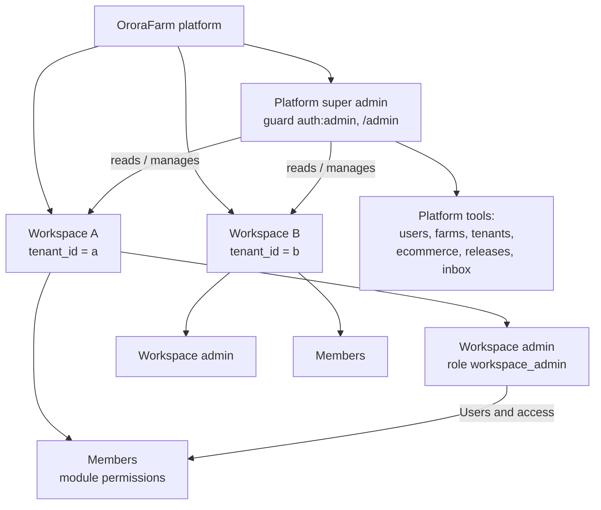
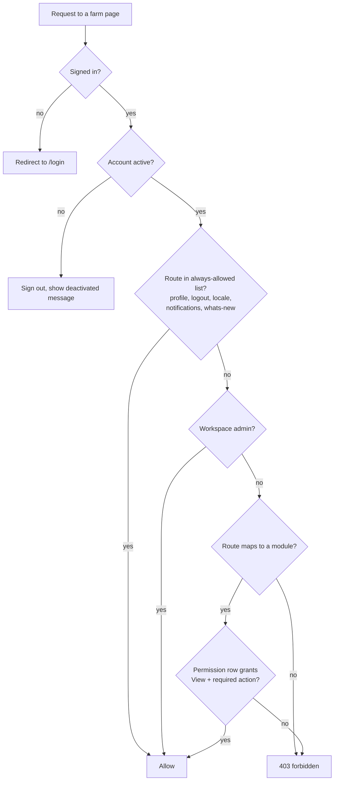
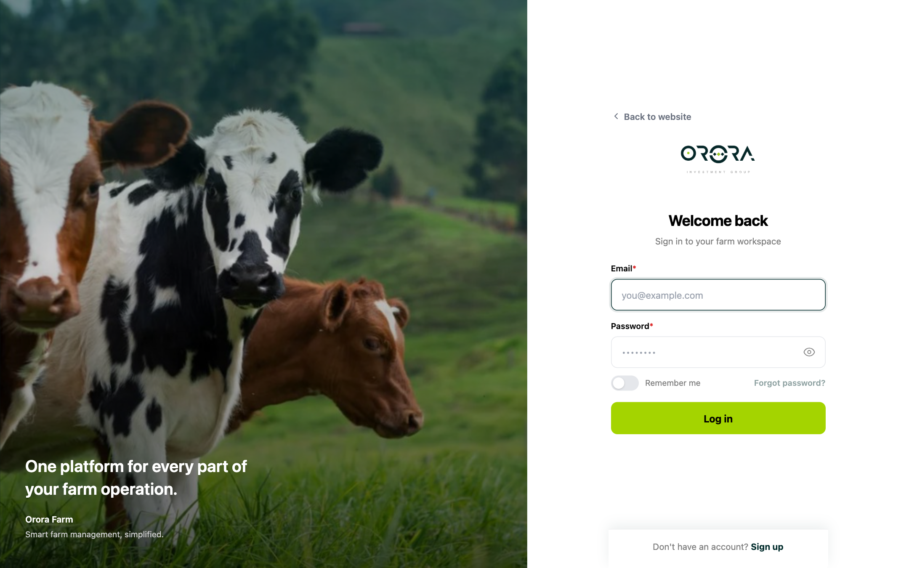

# System administration overview

OroraFarm is a multi-tenant farm-management application. Before you change anything, you need to know which of the two administration levels you are working at, because they are separate systems with separate logins, separate screens and separate powers.

## Two levels of administration

| | Platform administration | Farm workspace administration |
|---|---|---|
| Who | OroraFarm operators (super admins) | The owner / manager of one farm business |
| URL area | `/admin` | `/dashboard`, `/workspace/users`, and every farm module |
| Account table | `admin_users` (central database connection) | `users` (one row per person, tagged with a `tenant_id`) |
| Login guard | `auth:admin` | `auth` (web guard) |
| Role flag | `is_super_admin` on the admin account | `role = workspace_admin` (or `member`) on the user |
| Code | `app/Http/Controllers/Central/*` | `WorkspaceUserController`, `WorkspaceAccessService`, `config/workspace_access.php`, the module controllers |
| Sees | Every workspace (all tenants) | Only its own workspace (its own `tenant_id`) |
| Created by | The `php artisan orora:super-admin` command | Self-registration at `/register`, or a workspace admin adding a user |

Both kinds of account sign in on the **same page**, `/login`. The login request checks the `admin_users` table first; if the e-mail belongs to a platform admin, the platform guard is used and the person is sent to `/admin`. Otherwise the e-mail is looked up in the workspace account directory and the person is sent to their workspace dashboard.

*Figure 1. Platform administration sits above all workspaces; workspace administrators only ever manage their own workspace.*

> **Note:** A platform admin account is **not** a member of any workspace and cannot use the farm modules. Signing in as a platform admin clears the workspace tenant from the session (the `ForgetTenantForCentralAdmin` middleware). A workspace admin can never open `/admin`: every `/admin` route requires the `admin` guard.

## What a workspace is

A **workspace** (a "tenant") is the private data space of one farm business. Every business table carries a `tenant_id` column, and the `BelongsToTenant` model trait adds a global query filter so that each user only sees rows that belong to their own workspace. The workspace is chosen at login from the e-mail address (through the `tenant_accounts` directory table), not from the web address. By default the application runs in **single-database mode** (`TENANCY_SINGLE_DATABASE=true`): all workspaces share one database and are separated only by `tenant_id`.

When a person registers at `/register`, OroraFarm creates a **new workspace** (named "<Name>'s farm", with an id derived from the e-mail), a first user with the role **Workspace admin**, and the directory entry that links the e-mail to that workspace. Registration therefore never "joins" an existing workspace. To give another person access to your workspace, a workspace admin must add them under **Users & access** (see the chapter *Managing users and workspace members*).

## What each administrator can do

### Workspace administrator (workspace_admin)

- Open every module in the workspace, with full view / create / edit / delete rights. Permission rows are ignored for admins.
- Manage the workspace's people under **Workspace > Users & access**: add, edit, set passwords, deactivate, reactivate, and set module permissions for members.
- Register and edit farms, livestock groups, animals or flocks, stock, finance and so on, like any user with full rights.

### Member

- Signs in with their own e-mail and password.
- Sees only the modules in the sidebar for which an admin has switched on **View**.
- Can create, edit, or delete records only where the matching **Create / Edit / Delete** boxes are ticked.
- Can always use their own profile page, notifications, the "What's new" page and the language switcher.

### Platform super admin

- Browse every user, farm and workspace on the platform and view platform-wide statistics and a farm map.
- Delete a user together with their whole workspace (see *Platform administration*).
- Create or delete tenants manually.
- Moderate the public marketplace shop and buyer inquiries.
- Draft and publish release notes ("What's new") to all or selected workspaces.
- Work through the public contact-form inbox.

## Where each task lives

| I want to... | Level | Where |
|---|---|---|
| Give a new employee a login | Workspace admin | **Workspace > Users & access > Add user** |
| Stop a former employee signing in | Workspace admin | **Users & access > Deactivate** |
| Change what a member can open | Workspace admin | **Users & access > Edit > Module access** |
| Register or edit a farm | Anyone with the **Farms** permission | **Farms** |
| See platform totals for all farms | Platform admin | `/admin` dashboard |
| Remove a workspace entirely | Platform admin | `/admin/users/{id}` > **Delete user** |
| Announce a new feature | Platform admin | `/admin/releases` |
| Recover a forgotten password | Workspace admin (for members) / platform operator | See *Common administration problems* |

## The access decision, step by step

Every page inside the farm modules passes through the `module.access` middleware. The decision is made on every request, so a change you make to a user takes effect on that user's next click.

*Figure 2. Access decision for workspace pages. A member needs View on the module plus the specific action the page requires.*

The exact rules, route by route, are in the chapter *Roles and permissions matrix*.

## Known limitations of the administration model

- There is **no audit log** of administrative actions. The application records who created sales, finance postings, customer and employee changes in per-record logs (for example a sale's history), but nothing records "admin X changed user Y's permissions" or "admin X deactivated user Z". There is also no screen to review sign-in history, although each user's last sign-in time is stored (`last_login_at`) and shown to platform admins.
- There is **no two-factor authentication** and no password-strength setting beyond the Laravel default (minimum eight characters).
- There is **no working "Forgot password" flow**. The sign-in page shows a "Forgot password?" link that is disabled ("Coming soon").
- There is **no e-mail verification** for workspace users, and no invitation e-mail: the admin chooses the password and hands it over personally.
- Roles are only **Workspace admin** and **Member**. There is no manager, accountant or read-only role; use the module matrix to approximate one.
- Permissions are **module-wide, not farm-specific**. You cannot restrict a member to one farm out of several.

