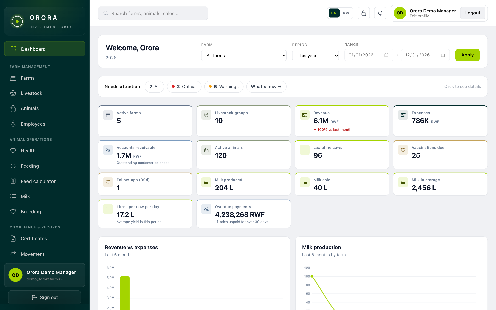

# Platform administration for super admins

This chapter is for the people who run the OroraFarm installation itself. If you only manage one farm business, you will never see these screens and can skip to the next chapter.

Everything here lives under `/admin` and is served by the controllers in `app/Http/Controllers/Central/`. All routes sit behind the `auth:admin` guard.

## Creating the first platform admin

Platform admins are not created through the website. They are created on the server with an Artisan command:

```
php artisan orora:super-admin --name="Jane Operator" --email=jane@example.org --password="a-strong-password"
```

- If you omit an option the command falls back to `SUPER_ADMIN_NAME`, `SUPER_ADMIN_EMAIL`, `SUPER_ADMIN_PASSWORD` in the environment, and then asks you interactively.
- The password must be at least 8 characters.
- If an admin with that e-mail already exists, the command **updates** their name and **resets their password**. This is the only way to reset a platform admin's password.
- Every account created by this command has `is_super_admin = true`.
- `php artisan orora:super-admin-status` lists existing platform admins with their last sign-in time and tells you whether the `admin_users` table is ready.

Sign in at `/login` with that e-mail. You are redirected to `/admin`. Sign out with the logout button in the admin sidebar.

> **Warning:** Do not put the password on a shared command line or in shell history on a multi-user server. Prefer the environment variables or the interactive prompt.



## The platform sidebar

The admin sidebar (from `config/admin.php`) has six entries: **Dashboard**, **Users**, **Farms**, **Ecommerce**, **Releases** and **Contact inbox**. A seventh area, **Tenants**, exists at `/admin/tenants` but is not linked from the sidebar; open it by typing the address.

## Admin dashboard (`/admin`)

The platform dashboard shows aggregate figures across every workspace, filtered by a period and, optionally, one farm.

| Control | Options |
|---|---|
| Period | All time (default), Today (daily), Monthly, Yearly, Custom range (From / To) |
| Farm | All farms, or any single farm on the platform |

Summary tiles (labels as shown): **Accounts pending**, **Farms**, **Livestock groups**, **Animals**, **Birds on hand**, **Cattle farms**, **Poultry farms**, **Milk yield**, **Milk sold**, **Eggs collected**, **Eggs sold**, **Animals sold**, **Flocks**. Charts show **Milk yield**, **Animals sold** and **Animals by group**. Below them are **Recent farms**, **Recent activity** and the **Latest messages** from the contact inbox, plus a farm map.

How the numbers are built (`AdminPlatformStatsService`):

- Farms, livestock groups, animals and flocks are counted by their **creation date** falling inside the chosen period. A farm created last year does not appear in "This month", even if it is active now.
- **Accounts pending** counts workspace accounts (rows in `tenant_accounts`) created in the period whose workspace has no farm yet.
- Milk yield, milk sold, eggs and animals sold come from the production and sales records inside the period.
- Choosing one farm switches every tile to that farm's own figures.

**Farm map.** Each farm becomes a pin. A farm's pin uses its saved latitude/longitude if present; otherwise the pin is placed using its district (and province) as an approximation.

> **Note:** The workspace Farm form does not ask for latitude or longitude, so in practice most pins are placed by district, and several farms in the same district may appear near each other rather than at their true location.

## Users (`/admin/users`)

**Users** lists "everyone with a login on the platform", newest first, 20 per page.

- Search box: matches name, e-mail or workspace id.
- Status filter: **All**, **With farm**, **No farm**.
- Columns: **User**, **Workspace**, **Farms**, **Joined**, **Last sign in** ("Never" if the person has not signed in), **Actions** (**View**).

Open a user to see **Account details**, **Related records** (counts of users, farms, livestock groups, animals, flocks, egg collections, milk sessions, sales, expenses, health records, breeding, feedings, certificates, employees, customers and marketplace listings in that workspace) and the **Farms** they own.

### Deleting a user deletes the whole workspace

The **Delete user** button on a user's page calls `PlatformUserWorkspaceService::purge()`. The confirmation reads: "Delete <name> and all related records (farms, animals, milk, sales, and the rest of this workspace)? This cannot be undone."

What the code actually does:

1. If the user belongs to a workspace (`tenant_id` set), it deletes **every row in every table** that has a `farm_id` belonging to that workspace's farms, then every row in every table with that `tenant_id`, then the tenant record itself. Foreign-key checks are temporarily disabled during the purge.
2. It deletes the sessions of all users in that workspace.
3. If the user has no workspace, only that user (and their sessions) is removed.
4. The whole operation runs in one database transaction. If anything fails, you are told "Could not delete <name>. Some related records could not be removed." and nothing is changed.

This removes **all** users of that workspace, not just the one you opened, along with every farm, animal, sale and finance entry. There is no recycle bin or undo.

> **Warning:** Take a database backup before deleting any user that has farm data. Uploaded files (animal photos, expense attachments) are stored on the public disk; the purge works on database tables and is not documented to clean uploaded files.

## Farms (`/admin/farms`)

A cross-workspace farm directory with filters (period, province, district, farm, type **Cattle** / **Poultry**), summary tiles and a paginated table: **Farm**, **Owner**, **Account** (the workspace's sign-up e-mail), **Location**, **Type**, **Stock** (animals or flocks), **Registered**. **View** opens a farm detail page with the same statistics scoped to that farm, its livestock groups, the owner's membership list and the workspace account. This area is read-only.

## Tenants (`/admin/tenants`)

The tenant list shows **ID**, **Name**, **Domains**, **Created**. **New tenant** (`/admin/tenants/create`) asks for:

| Field | Rules |
|---|---|
| Tenant ID | required, letters, digits, dash and underscore only, unique |
| Display name | required |
| Domain | required only when domain routing is enabled (`TENANCY_DOMAIN_ROUTES=true`); optional and unique otherwise |

The form itself says: "Farmers normally sign up via /register - use this form only for manual provisioning." Creating a tenant here creates only the workspace record. It does **not** create a user, so nobody can sign in to it until a user row and a directory entry are added by other means.

Deleting a tenant (red button, confirmation "Delete this tenant? This cannot be undone.") removes the tenant record. In the default single-database mode the success message still says "and its database were removed", but no separate database exists; the workspace's rows are removed only through the database's `ON DELETE CASCADE` foreign keys on `tenant_id`. Prefer the **Delete user** route described above, which explicitly purges the workspace, and verify on a backup copy before relying on tenant deletion.

## Ecommerce / marketplace (`/admin/ecommerce`)

The public shop (`/shop`) is the marketplace where workspace users list animals for sale and buyers send inquiries. Moderation is restricted to super admins (every action calls `authorizeSuperAdmin`).

- **Marketplace summary** tiles: totals, pending, published, inactive, inquiries, new inquiries.
- **Shop listings** table with filters (search by title, farmer, phone, location; status; species; district).
- Per-listing actions (status change with an optional note): **Approve**, **Reject**, **Publish**, **Unpublish**, **Mark sold**, **Edit**, **View in shop**. The statuses are Draft, Pending review, Approved, Published, Rejected, Sold, Inactive.
- **Create animal listing** lets the platform create a listing on behalf of a farm.
- **Recent buyer inquiries**: update each inquiry's status (new, contacted, closed). The page text says "Contact the buyer and seller to help connect them" - the platform does not message anyone on your behalf.

When a buyer submits an inquiry on a listing, the seller's workspace admins receive an in-app notification (see *Notifications and releases*).

## Releases (`/admin/releases`)

Release notes are the "What's new" announcements. Creating them is described in *Notifications and releases*. The key rules:

- Any platform admin can create and edit **drafts**; drafts are invisible to workspaces and send nothing.
- Only a super admin can **Publish** or **Delete** a release.

## Contact inbox (`/admin/contact-messages`)

Messages submitted on the public contact form appear here, newest first (20 per page) with tiles for total / **New** / **Read** / **Replied**. Use **Update status** to set a message to new, read, replied or archived. Choosing **Replied** stores the time. The inbox is a status tracker only: replying is done outside the application (by e-mail or phone, using the sender's details).

## Known limitations of platform administration

- All platform admins created by the command are super admins. There is no screen to create or remove platform admins and no way to create a non-super admin from the application.
- The platform cannot sign in "as" a workspace user, edit a workspace's data, reset a workspace user's password, or deactivate a single workspace user. Those tasks fall to the workspace's own admin, or, in an emergency, direct database work.
- No platform audit log is kept of who deleted which user, tenant or listing.
- Platform admin password changes can only be made by re-running `orora:super-admin`.
