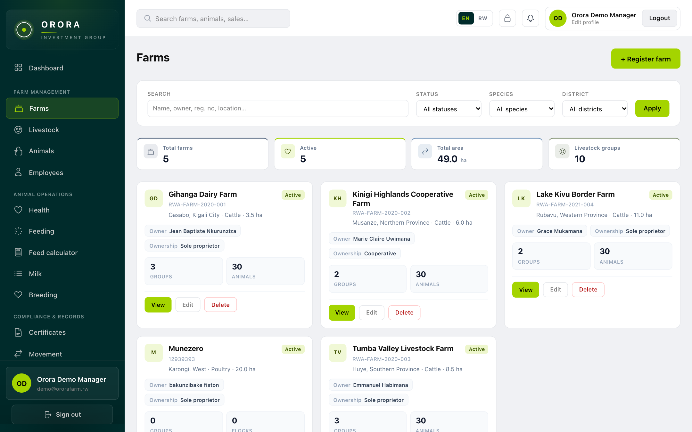

# Workspace settings and farm information

## What "settings" means in OroraFarm

OroraFarm does **not** have a single "Workspace settings" page. The settings a workspace administrator controls are spread over a few places:

| Setting | Where | Who can change it |
|---|---|---|
| Farm identity, location, owner, ownership structure, farm type, status | **Farms** > **Register farm** / edit | Anyone with the **Farms** permission (Create / Edit) |
| Who can sign in and what they can open | **Workspace > Users & access** | Workspace admins only |
| Own name, e-mail, password | **Profile** (`/profile`) | Every user, for their own account |
| Interface language (English or Kinyarwanda) | Language switcher in the header | Every user, for their current browser session |
| Reorder levels, expiry dates, feed types, expense categories, vendors | Each module (see later chapters) | Users with that module's permission |

The workspace's own name (shown for example as "<Name>'s farm") is set automatically when the account is registered. There is no screen to rename the workspace or change its currency, time zone, logo or branding.

> **Note:** The interface language is saved in the browser session (`locale` key). It is not stored on the user account, so a member who signs in from another device starts in the default language.

## The Farms module

The **Farms** page (`/farms`) is the heart of your workspace set-up: every livestock group, animal, flock, feed stock, sale and expense hangs off a farm. Register your farms before anything else.

### The list

Summary tiles: **Total farms**, **Active**, **Total area** (sum of hectares) and **Livestock groups**. Filters: a search box ("Name, owner, reg. no, location..." - matches name, registration number, owner first and last name, phone, district, province, sector and village), **Status**, **Species** and **District**. Use **Clear filters** to reset. Twelve farms are shown per page.

### Registering a farm

1. Open **Farms** in the sidebar and click **Register farm** (or **Register your first farm**).
2. Complete **Farm registration**:
   - **Farm name** (required, up to 255 characters).
   - **Registration number** (required, up to 100 characters; must not already exist, see below).
   - **Registration date** (required).
   - **Farm size (hectares)** (required, zero or more).
   - **Status**: pending, active, inactive or suspended.
   - **Farm type**: Cattle / dairy or Poultry. "One type per farm. Create another farm if you also raise a different species."
3. Complete **Location**: **Country**, then select **Province**, **District**, **Sector**, **Cell** and **Village** in turn. All five must be chosen and they must form a valid combination from the built-in Rwanda administrative list; otherwise you see "The selected Rwanda location is invalid."
4. Complete **Ownership structure**: **Ownership type** is Sole proprietor, Cooperative or Company. For a cooperative or company you must also fill **Organization name** and **Tax ID (TIN)** and add at least one entry under **Organization members** (first name, last name, date of birth, phone, gender).
5. Complete **Business owner** (primary owner or authorized representative): **First name**, **Last name**, **National ID**, **Date of birth** (must be before today), **Gender**, and **Contact information**: **Contact phone**, **Email**, **Emergency contact**. All of these are required.
6. Add optional **Notes** and save. A green message confirms "Farm registered successfully."

### Editing a farm

Open the farm and choose edit; saving shows "Farm updated successfully." Be aware of these behaviours:

- **Farm type is locked** once the farm has any livestock group, animal or flock. Trying to change it fails with "Farm type cannot change after livestock, animals, or flocks have been added." Create a second farm if you also keep another species.
- Switching the ownership type from cooperative/company to sole proprietor clears the organization name, tax id and the members list.
- **Organization members are replaced as a whole** on every save: the existing member rows are deleted and the submitted rows are inserted. Always review the list before saving.
- Changing the location re-writes the stored province, district, sector, cell and village names from the codes you choose.

### Deleting a farm

The farm's delete action removes it without further questions asked by the controller (the browser shows a confirmation). The database relations are set so that the farm's livestock groups, animals, flocks and many dependent records are removed together with it. Treat it as irreversible; see *Recommended data-management practices*. If a farm is simply no longer used, change its **Status** to **inactive** instead.

### Uniqueness of the registration number

The form validates that the registration number is not already used in the `farms` table. That check is **not limited to your workspace**: a number already used by any other workspace on the same installation is rejected. If you see "The registration number has already been taken" for a number you believe is yours, a different workspace (or a farm of yours you forgot) holds it; contact the platform operator.

## The active farm

Most pages can be filtered by farm. OroraFarm remembers the farm you chose in your session (`active_farm_id`):

- If the workspace has exactly one farm, it is selected automatically.
- If there are several, choose one from the **Farm** filter (for example **All farms** on the dashboard); the choice then applies to later pages until you change it.
- The active farm decides which **farm type** profile is used. A cattle farm shows animals, milk and breeding; a poultry farm shows flocks and eggs. Pages for a module the active farm's type does not use return "404 not found" - for example opening **Milk** while a poultry farm is active.

| Module | Cattle / dairy | Poultry |
|---|---|---|
| Dashboard, Farms, Livestock, Employees, Health, Feeding, Feed calculator, Certificates, Movement, Sales, Customers, Expenses, Finance | yes | yes |
| Animals, Milk, Breeding | yes | no |
| Flocks, Eggs | no | yes |
| Sale types | Animal sale, Meat sale, Milk sale | Animal sale, Egg sale, Meat sale |
| Abattoir section in Sales | yes | hidden |

If a user reports "a page is missing", first check which farm is active.

## Your own profile (every user)

**Profile** (`/profile`) lets the signed-in user change:

- **Full name** (required, up to 255 characters).
- **Email address** (required, valid, unique).
- **Change password**: **Current password**, **New password**, **Confirm new password**. The current password is required only when a new one is entered; the new password must be confirmed and meet the default rule (at least eight characters). Leaving the fields blank keeps the old password.

> **Warning:** Changing the e-mail address on the Profile page updates the user record but does **not** update the workspace sign-in directory (`tenant_accounts`) that maps each e-mail to its workspace. After such a change the user may be unable to sign in with the new address because the system cannot find which workspace it belongs to. Workspace admins who need to change someone's e-mail should use **Users & access > Edit**, which updates the directory too. Tell members not to change their e-mail on their own profile. If it has already happened, the platform operator must correct the directory row (see *Common administration problems*).

> **Note:** The profile page mentions a "Profile photo" ("Initials are shown until you upload a photo") but contains no upload control; only initials are shown.

## Known limitations

- No page to rename the workspace, set currency, time zone, units, branding or logo. Currency is chosen per sale or expense (a three-letter code, default RWF).
- No per-user language preference; the language lives in the session.
- Farm map coordinates (latitude / longitude) are not editable in the Farm form.
- No farm-level user assignment: members are not tied to particular farms.
