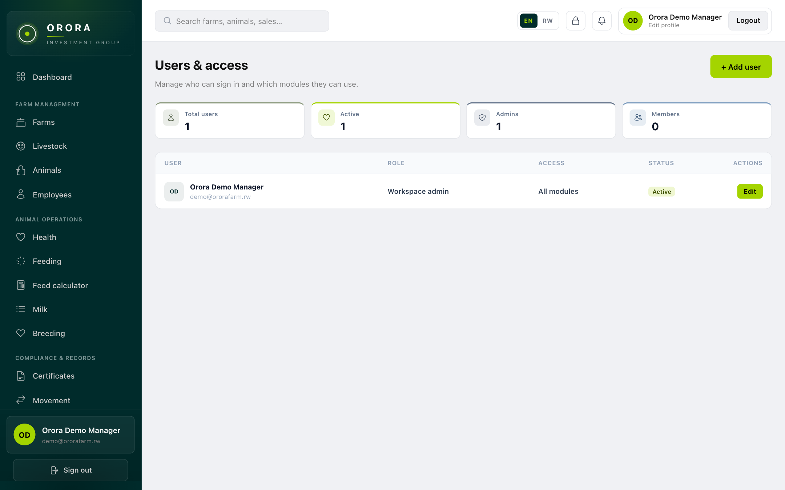
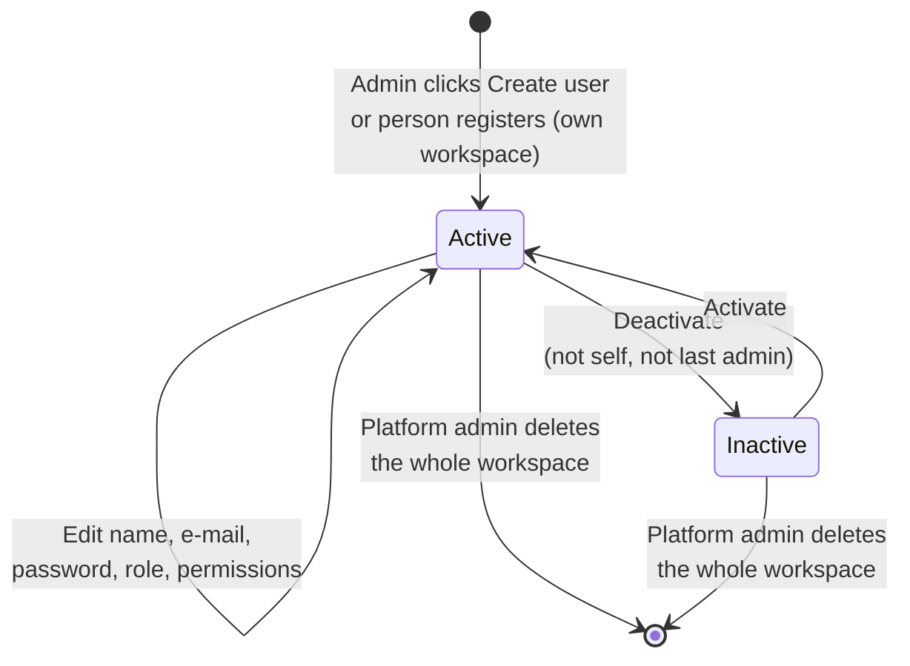

# Managing users and workspace members

Workspace administrators manage the people who can sign in to their workspace from **Workspace > Users & access** (`/workspace/users`). This item appears in the sidebar only for workspace admins; a member who types the address gets "403 - Only workspace admins can manage users."

The logic lives in `WorkspaceUserController`, `WorkspaceUserRequest`, `WorkspaceAccessService` and `config/workspace_access.php`.

## The user list

The page header reads "Users & access - Manage who can sign in and which modules they can use." Four tiles summarise the workspace: **Total users**, **Active**, **Admins** and **Members**.

The table has these columns:

| Column | Meaning |
|---|---|
| **User** | Initials avatar, name and e-mail |
| **Role** | "Workspace admin" or "Member" |
| **Access** | "All modules" for admins; for members "N module(s)" (the number of modules with a permission row) or "No modules" |
| **Status** | **Active** or **Inactive** |
| **Actions** | **Edit**, and **Deactivate** / **Activate** |

Admins are listed first, then everyone alphabetically by name; 20 users per page. On **your own row** there is only **Edit**: you cannot deactivate yourself from the list.

> **Note:** The "Access" count is the number of permission rows, not the number of modules the user can open. A row that grants only View counts as one module.

## Adding a user

1. Sign in as a workspace admin and click **Users & access** under **Workspace**.
2. Click **+ Add user**. The **Add user** page opens with the panel **Account details** ("This person will sign in with the email and password you set.").
3. Fill in:
   - **Name** - required, up to 120 characters.
   - **Email** - required, valid address, up to 190 characters. It is converted to lower case.
   - **Password** and **Confirm password** - both required.
   - **Role** - **Workspace admin** or **Member** (default **Member**). The hint reads "Admins get full access. Members only get modules you select below."
4. If the role is Member, use the **Module access** matrix ("Turn on View first, then Create, Edit, or Delete as needed."). For a new user the **Dashboard / View** box is pre-ticked; everything else is off. See *Roles and permissions matrix*. If the role is Workspace admin, the matrix is hidden because admins always have full access.
5. Click **Create user**. You are returned to the list with "User created successfully."

What the system does when you save:

- Creates the user with `is_active = true`, the chosen role and the workspace's `tenant_id`.
- Stores the password hashed; it can never be displayed again.
- Adds a row to the sign-in directory (`tenant_accounts`) mapping the e-mail to this workspace, so the person is routed to the right workspace at login.
- For a member, writes one permission row per module that has any box ticked.
- Does **not** send an e-mail. Give the person their e-mail and password yourself, in person or through a channel you trust.

### E-mail rules

The e-mail must be unique among this workspace's users and in the platform-wide sign-in directory. In practice **one e-mail address can belong to only one workspace**. If you see "The email has already been taken.", the address is already used here or in another workspace; a person who already owns a workspace of their own cannot also be a member of yours with the same address. Use a different address for that person.

### Password rule

The password must satisfy Laravel's default rule, which in this installation is **at least eight characters** (no application-specific complexity rule is configured), and the two fields must match ("The password field confirmation does not match.").

## Editing a user

1. In the list click **Edit** on the person's row. The page title is **Edit user** with the person's name beneath it ("Update profile, role, and sign-in status.").
2. You can change **Name**, **Email**, **New password** (placeholder "Leave blank to keep current"), **Confirm password**, **Role**, **Status** and the **Module access** matrix.
3. Click **Save changes** ("User updated successfully.").

Behaviour you should know:

- **Password**: if the new-password field is empty, the current password is kept. If filled, it is replaced after the same eight-character rule and confirmation. The user's other signed-in sessions are **not** ended by a password change.
- **E-mail**: changing it also updates the directory entry, so the person keeps signing in to the same workspace. The new address must pass the uniqueness rules above.
- **Role to Member**: the matrix you submit is stored. Make sure View (and any other boxes) are ticked before saving, or the person will have no access to any module and will land on their profile page after signing in.
- **Role to Workspace admin**: all of that person's stored permission rows are deleted (they are no longer needed).
- **Legacy roles**: accounts whose stored role is `owner` or `admin` are treated as workspace admins. When you save such an account it is stored as `workspace_admin`.
- **Your own account**: the role is locked ("You cannot change your own role away from workspace admin.") and the status is locked to Active ("You cannot deactivate your own account.").
- **The last admin**: you cannot demote or deactivate the only active workspace admin: "You cannot remove the last workspace admin." Promote a second admin first.

Permission changes (and role changes) take effect on the person's **next request**; they do not need to sign out and in. Their sidebar will update on the next page load.

## Deactivating and reactivating

**Deactivate** is the way to remove someone's access. There is no way to delete a user inside a workspace.

To deactivate:

1. In the list click **Deactivate** on the person's row and confirm "Deactivate this user? They will not be able to sign in."
2. The status changes to **Inactive** ("User deactivated.").

Rules enforced by the code:

- You cannot deactivate yourself ("You cannot deactivate your own account.").
- You cannot deactivate the last active workspace admin ("You cannot deactivate the last workspace admin.").
- The deactivated person's password and permission rows are **kept**. Reactivating restores exactly the previous access.

What the person experiences:

- On their next request to any farm module page they are signed out and sent to the sign-in page with "Your account has been deactivated. Contact your workspace admin."
- If they try to sign in, the password is checked first and then the attempt is refused with the same message (and counts against the login rate limit).
- Their historical records (sales they created, notes, and so on) remain unchanged.

To reactivate, click **Activate** on the row ("User activated."). There are no extra checks.

> **Note:** The deactivation check runs inside the farm-module middleware. Pages outside that middleware (notifications, "What's new", the marketplace "My listings" pages, location look-ups) require only a signed-in session, so a deactivated person whose session is still open can still reach those pages until their next farm-module request. They cannot see farm data.

### Why there is no "delete user"

The application has no route or button to delete a workspace user. Deactivation preserves the link between the person and the records they created. The only deletion that exists is the platform operator's **Delete user**, which wipes the entire workspace (see *Platform administration*).

## User lifecycle

*Figure 3. A workspace user's life. There is no workspace-level delete.*

## Password handling in detail

| Question | Answer (from the code) |
|---|---|
| How are passwords stored? | Hashed through the user model's `hashed` cast; never readable. |
| Who chooses a new member's first password? | The workspace admin, on **Add user**. |
| Is the user forced to change it on first login? | No. |
| Can a user change their own password? | Yes, on **Profile**: needs **Current password**, then **New password** twice. |
| Can an admin reset a member's password? | Yes: **Edit > New password**. |
| Is there a "forgot password" e-mail? | No. The "Forgot password?" link on the sign-in page is disabled and labelled "Coming soon". |
| Is there password expiry or history? | No. |
| Lock-out after wrong passwords? | After 5 failed attempts for the same e-mail + IP address, further attempts are refused with "Too many login attempts. Please try again in N seconds." (Laravel rate limiter.) |
| Are other sessions ended on password change? | No. |
| Session length | The standard Laravel session lifetime (default 120 minutes of inactivity unless `SESSION_LIFETIME` is changed); "Remember me" keeps the person signed in longer. |

### Recovering a workspace admin who has lost their password

Because there is no self-service reset:

- If another workspace admin exists, that admin sets a new password in **Edit user**.
- If the only admin has lost access, the platform operator must reset it directly in the database (the application provides no tool for workspace users). Plan for this: always keep **at least two** active workspace admins.

## Procedures

### Onboard a new member

1. **Users & access > + Add user**.
2. Enter name, work e-mail and a temporary password; role **Member**.
3. Tick **View** for each module the person needs, then **Create / Edit / Delete** only where their job requires it.
4. **Create user**, hand over the credentials privately, and ask the person to change the password on **Profile** at first sign-in.
5. Ask them to sign in and confirm the sidebar shows exactly what you intended.

### Offboard a leaver

1. **Users & access**, **Deactivate** the person the same day they leave.
2. Review recent work they did (sales, expenses) in the relevant modules and correct anything unusual.
3. Keep the account inactive; do not repurpose the e-mail for another person.

### Change someone's duties

1. **Edit** the person.
2. Adjust the **Module access** ticks and **Save changes**.
3. Ask them to reload the page to see the new sidebar.

### Promote a second admin

1. **Edit** a trusted member and set **Role** to **Workspace admin**; save.
2. The person now has full access to every module and to **Users & access**.

## Known limitations

- No delete, no invitation e-mail, no forced password change, no e-mail verification, no two-factor authentication, no password reset by e-mail.
- No history of who changed whose permissions, and no display of a user's last sign-in inside the workspace (only platform admins see it).
- Each e-mail address can belong to only one workspace on the installation.
- A member cannot be limited to selected farms.
