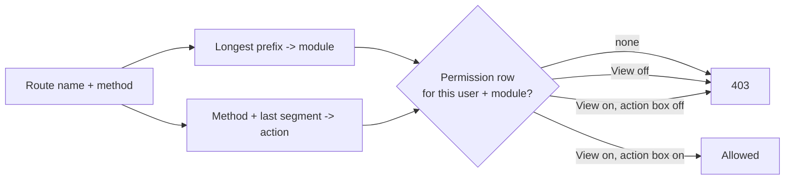
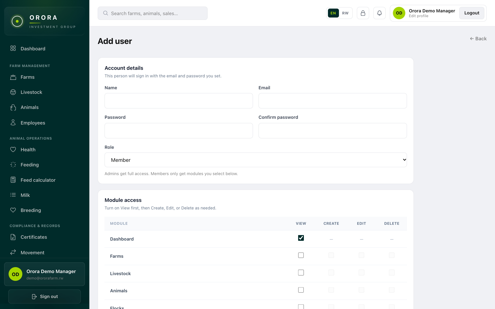

# Roles and module-level permissions matrix

This chapter documents exactly what each permission box does. It was derived from `config/workspace_access.php`, `WorkspaceAccessService`, the `module.access` middleware and the live route list; where the behaviour is surprising, it says so.

## Roles

| Role (as stored) | Label | Rights |
|---|---|---|
| `workspace_admin` (also legacy `owner`, `admin`) | **Workspace admin** | Everything in the workspace, plus **Users & access**. Permission rows are ignored (and deleted on save). |
| `member` | **Member** | Only what the **Module access** matrix grants. |

An account must also be **active**. An inactive account has no access to anything.

## How a permission decision is made

1. The route being requested has a **name** (for example `sales.transactions.store`). The longest matching prefix in `route_modules` selects the **module** (here `sales`). The prefix `feeding.calculator` is more specific than `feeding`, so the calculator is its own module.
2. The route name and HTTP method select the **action**:
   - last name segment `create`, `store`, `import`, `import.store`, `import.confirm`, `import.execute-replace` gives **create**;
   - any other `POST` (except names ending `.index`, `.show`, `.overview`) gives **create**;
   - segment `edit`, `update`, `import.confirm-replace`, or any `PUT` / `PATCH` gives **edit**;
   - `DELETE` (or segment `destroy`) gives **delete**;
   - everything else (`GET`) gives **view**.
3. The user needs the module's **View** box ticked **and** the box for that action. A member with Create but not View is refused: the rule "no View, no anything" is applied in `can()` and also when saving (non-view boxes are discarded if View is off; the page script also unticks and disables them).

*Figure 4. Module and action are both derived from the route.*

## Module-by-module matrix

"Module key" is the key stored in the permission table. The columns show what each box unlocks. Unless noted, **View** opens the list, detail and overview pages; **Create** opens "add" forms and saves new records; **Edit** opens edit forms and saves changes; **Delete** removes records.

| Module (sidebar label) | View | Create | Edit | Delete |
|---|---|---|---|---|
| **Dashboard** (`dashboard`) | The dashboard page only | not offered | not offered | not offered |
| **Farms** (`farms`) | Farm list and detail | Register farm | Edit farm | Delete farm |
| **Livestock** (`livestock`) | Livestock group list and detail | Add group | Edit group | Delete group |
| **Animals** (`animals`) | Animal list, detail, **export**, import preview, import template | Add animal; start import (page + upload), confirm / execute-replace / cancel import | Edit animal; "confirm replace" step of an import | Delete animal |
| **Flocks** (`flocks`) | Flock list and detail | Add flock | Edit flock | Delete flock |
| **Employees** (`employees`) | Overview, directory, detail, export, import template | Add employee; import; add address, document, emergency contact, farm assignment | Edit employee; **payroll** update | Delete employee; remove address, document, emergency contact, farm assignment |
| **Health** (`health`) | Overview, vaccinations, dewormings, treatments, disease, vet visits, mortality, timeline, **medicines (inventory)**, and each record's detail page | Add any health record; add medicine; **record a medicine stock movement** | Edit any health record or medicine | Delete any health record or medicine |
| **Feeding** (`feeding`) | Overview, feed types, **feed inventory**, feeding records, schedules and their detail pages | Add feed type, inventory item, feeding record, schedule; **record a feed stock movement** | Edit those | Delete those |
| **Feed calculator** (`feed-calculator`) | Open the calculator and its animal / group look-ups | **Run the calculation** (it is a POST) | not used | not used |
| **Milk** (`milk`) | Overview, sessions, storage, distribution, detail pages | Add session / storage / distribution; add milk records (single or bulk); **complete** or **cancel** a session | Edit session, storage, distribution; edit a milk record | Delete session, storage, distribution; delete a milk record |
| **Eggs** (`eggs`) | Overview, collections | Add collection | Edit collection | Delete collection |
| **Breeding** (`breeding`) | Overview, breeding records, pregnancy checks, births | Add breeding record, pregnancy check, birth record; **register offspring** | Edit breeding record; edit offspring; edit a birth | Delete breeding record |
| **Certificates** (`certificates`) | List and detail | Add certificate | Edit certificate | Delete certificate |
| **Movement** (`movement`) | Movements list and detail | Record movement | Edit movement | Delete movement |
| **Sales** (`sales`) | Overview, transactions, sale detail, abattoir list and detail | Create a sale; **add line items; record payments; confirm; complete; cancel**; abattoir dispatch and returns | **Edit the sale header only** (draft sales) | Delete a sale (draft or cancelled only) |
| **Customers** (`customers`) | Overview, directory, communications, detail, **export**, import template | Add customer; import; add contact, address, communication | Edit customer; edit contact; **update credit limit** | Delete customer; remove contact or address |
| **Expenses** (`expenses`) | Overview, categories, vendors, expense records | Add category, vendor, expense | Edit those | Delete those |
| **Finance** (`finance`) | Overview, transactions, Profit & loss, Cash flow | not used (read-only module) | not used | not used |

> **Tip:** Notice the unusual rules: *cancelling or completing a sale*, *cancelling or completing a milk session* and *running the feed calculator* all need **Create**, not Edit or Delete, because they are POST requests. Medicine and feed **stock adjustments** also need only **Create**. A member who should be able to record stock but not delete anything needs Create, not Delete.

### Which boxes exist per module

Every module offers all four boxes except **Dashboard**, which offers only **View** (`actions: ['view']`). In the matrix a missing option is shown as a dash.

### What the matrix looks like on screen

On **Add user** and **Edit user**, the **Module access** panel lists each module as a row with four tick boxes, in the order: Dashboard, Farms, Livestock, Animals, Flocks, Employees, Health, Feeding, Feed calculator, Milk, Eggs, Breeding, Certificates, Movement, Sales, Customers, Expenses, Finance. When you untick **View**, the other three boxes for that row are cleared and disabled.

## What is not covered by the matrix

Read this section carefully: some access is **not** governed by the module permissions.

| Area | How access is decided | Consequence |
|---|---|---|
| **Workspace > Users & access** (`workspace.users.*`, URL prefix `/workspace/users`) | Separate `workspace.admin` middleware: admins only. There is no `workspace-users` row in the matrix (the config maps the prefix to key `workspace-users`, but the key is not in the list of grantable modules). | You cannot delegate user management to a member. Only the `workspace_admin` role can use it. |
| **Notifications** (`/notifications`, mark-all-read, open) | Signed-in only; also on the always-allowed list. | Every user, including a member with no module rights, can read their notifications. They are scoped to the signed-in user's own rows. |
| **What's new** (`/whats-new`) | Signed-in only. | Every user can read published release notes visible to their workspace. |
| **Profile, logout, language switch** | Always allowed. | Everyone can edit their own name, e-mail and password. |
| **Location look-ups** (`/api/rwanda/provinces`, districts, sectors, cells, villages) | Signed-in only. | Harmless reference data. |
| **Marketplace shop pages for sellers** (`/shop/create`, `/shop/my-listings`, edit / delete a listing, inquiry status) | Signed-in only; no module permission. Listings are limited to the signed-in user's workspace. | Any signed-in user of a workspace (even a member with no module rights) can create and manage that workspace's shop listings and see its inquiries. |
| **Legacy redirect URLs** `/feedings`, `/feedings/create`, `/sales-legacy` | These redirect routes have **no route name**; the middleware refuses any request whose route has no name. | They return **403 for everyone, including admins**. Use the sidebar links (**Feeding > Records**, **Sales > Transactions**) instead. This was derived from the middleware code and the route list. |
| **Unmapped route names** | If a route inside the module group ever has a name that matches no prefix, only workspace admins may open it. | At the time of writing every named route in the group maps to a module. |

### No second line of defence

All form-request classes (`authorize()`) simply return `true`; the module middleware is the only permission check on farm pages. Also, permissions are **module-wide**: a member with Edit on **Animals** can edit **any** animal in the workspace, not only ones they created, on any farm. There is no record-level ownership check.

### Side effects that cross module boundaries

A few forms create records in another module automatically. The permission needed is the one for the page you are on, not the other module's:

- Recording a feed purchase or a health event can tick **Log expense** and create an **Expense** (and, if you type a new vendor name, an **expense vendor**) even when the user has no **Expenses** permission.
- The **Create sale** form can create a new **Customer** inline.
- Completing a sale posts finance entries (revenue and receivables), visible under **Finance**.
- The **Dashboard** shows revenue, expenses, receivables, recent sales and alerts from many modules to anyone with just **Dashboard > View**.

Take these into account when you decide how much to grant.

## Suggested role templates

These templates are only suggestions built from the actual capabilities; the application stores nothing but the ticks.

| Job | Tick | Do not tick |
|---|---|---|
| Farm hand (daily records) | Dashboard View; Milk View+Create; Eggs View+Create; Feeding View+Create; Health View+Create | Any Delete; Sales; Finance; Customers; Expenses |
| Herd manager | Livestock, Animals, Flocks, Health, Feeding, Milk, Eggs, Breeding, Movement, Certificates: View+Create+Edit | Delete (keep with admins); Finance |
| Sales clerk | Dashboard View; Sales View+Create+Edit; Customers View+Create+Edit (note: Customers **Edit** also allows changing a customer's credit limit) | Sales Delete; Customers Delete; Finance |
| Accountant / auditor | Finance View; Expenses View(+Create+Edit); Sales View | Anything on animals; all Delete |
| Read-only auditor | View on every module | Create, Edit, Delete |
| Second administrator | Role **Workspace admin** | (matrix ignored) |

## Known limitations

- No roles beyond admin and member, and no custom role names.
- No record-level or farm-level scoping.
- **Users & access** cannot be delegated.
- The **Delete** box of a module deletes records that other modules depend on (for example deleting a farm cascades widely); keep **Delete** for administrators.
- The marketplace seller pages and notifications are open to every signed-in user.
