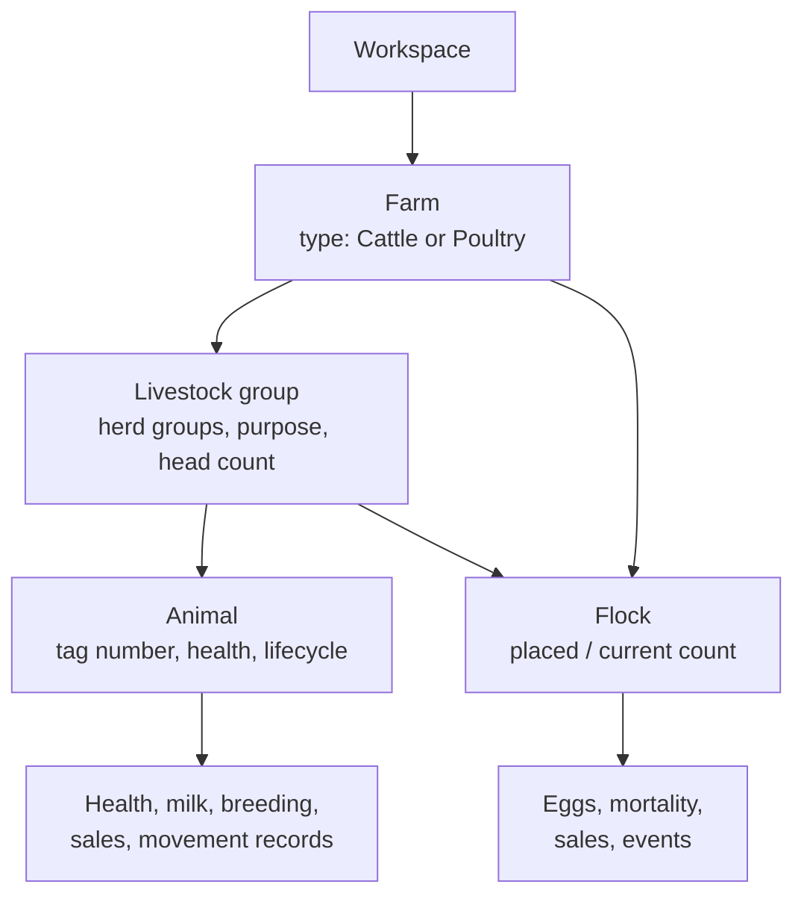

# Managing livestock and poultry operations

This chapter explains how the stock side of the workspace is organised, which rules the application enforces, and what an administrator should watch. Cattle / dairy farms work with **Livestock groups** and **Animals**; poultry farms work with **Livestock groups** and **Flocks**.

## The stock hierarchy

*Figure 5. Everything hangs off a farm. Animals belong to a farm and a livestock group; flocks belong to a poultry farm and, optionally, a group.*

A farm's **type** (Cattle / dairy or Poultry, see *Workspace settings and farm information*) decides which of these tools the workspace shows for that farm, and it is locked once any group, animal or flock exists.

## Livestock groups

Open **Livestock** to see groups (herds) per farm. A group is a classification and a head-count, not a list of individuals.

Creating a group requires (from `LivestockRequest`):

| Field | Rule |
|---|---|
| Farm | required, must exist |
| Herd groups | at least one, chosen from the farm type's list (cattle: Calves Group, Heifer, Cows (lactating), Pregnant Cows, Dry Cows, Bulls, Steer (castrated male), Other; poultry: Day-old chicks, Pullets, Layers, Broilers, Breeders, Cockerels, Other) |
| Livestock types | at least one, from the type's list |
| Production purposes | at least one (cattle: Meat, Dairy, Breeding, Other; poultry: Egg, Meat, Breeding, Other) |
| Farming methods | at least one |
| Feeding methods | at least one |
| "Other" text boxes | required when you choose Other in the matching list |
| Head count | required, whole number, 0 or more |
| Status | `active` or `inactive` |
| Breed, notes | optional |

Important administrative facts:

- **Head count is typed by hand.** It is not recalculated from the animals registered in the group. It is used on the platform dashboard (head count tile) and for reporting, so someone must keep it honest when animals are bought, sold or die.
- The workspace dashboard's **Livestock groups** tile counts groups whose status is **active**.
- Deleting a group deletes the group record only; animals that belonged to it keep existing but lose their group link (the database sets the group reference to empty). Reassign them before deleting.

## Animals (cattle / dairy farms)

An animal is an individual with a tag number. Rules from `AnimalRequest`:

| Field | Rule |
|---|---|
| Farm and livestock group | both required; the group must belong to the chosen farm |
| Tag number | required, up to 100 characters; **unique within the livestock group** (the same tag may exist in a different group) |
| Name | required, up to 255 |
| Gender | male, female or unknown |
| Photo | optional image, up to 2 MB |
| Date of birth | optional, today or earlier |
| Health status | required: Healthy, Pregnant, Sick, Under treatment, Quarantined, Recovering, Deceased |
| Lifecycle status | required: Active, Sold, Deceased, Transferred, Missing, Retired |
| Production status | optional: Lactating, Dry, Growing, Breeding, Fattening, Pregnancy, Not applicable |
| Current condition | optional: Good, Fair, Poor, Critical, Under observation |
| Acquisition type / date, source, mother and father tag, species, breed, weight, notes | optional |

Two statuses matter to administrators:

- **Health status** drives the dashboard alert "Animals need attention" (counts animals that are Sick, Under treatment, Quarantined or Recovering) and the "Animal health" chart.
- **Lifecycle status** decides what an animal can do. Only **Active** animals can be sold ("Animal X is not active and cannot be sold."), appear in new-sale pickers, and be counted in the dashboard's lactating-cow figure. (The dashboard tile labelled "Active animals" actually counts **all** animals of the farm in view, whatever their lifecycle status, so it will include sold and deceased animals until you delete them.) Completing an animal sale sets the animal to **Sold**; recording a mortality sets both health and lifecycle to **Deceased**.

**Lactating animals** are the ones that can be milked. An animal counts as milk-eligible when its production status is **Lactating**, or when it has no production status but belongs to a group that includes the herd group **Cows (lactating)**. Keeping production status current is therefore what keeps **Lactating cows** and milk sessions accurate.

### Bulk import and export

**Animals** offers **export** (CSV of the animals, requires View), a downloadable **import template**, and an import wizard (upload, preview, confirm, with a "replace existing" path and a cancel step). The wizard needs **Create** (and **Edit** for the replace-confirm step). Review the preview carefully; a replace overwrites existing animals' details.

## Flocks (poultry farms)

A flock is a counted group of birds. Rules from `FlockRequest` and `FlockService`:

- Flocks can only be registered on **poultry** farms ("Flocks can only be registered on poultry farms.").
- Required: farm, name, production type, **Placed on** date, **Placed count** (at least 1) and lifecycle status. Optional: livestock group, breed, source (Purchased (hatchery), Own hatch, Transfer, Other), male / female counts, house or pen, expected end date (not before the placement date) and notes.
- A flock code `FLK-YYYYMMDD-nnnn` is generated; current count starts equal to the placed count unless you supply one.
- Creating a flock writes a **Placement** event. Later changes to the count happen through events: **Mortality** (recorded from **Health > Mortality**), **Sale** (when a bird sale is completed), cull, transfer and adjustment. Each event records the balance afterwards. When a flock reaches zero birds its status changes to **Sold**.
- **Flock mortality %** on the dashboard is (placed - current) / placed, summed over the flocks in the view.

> **Warning:** Editing a flock lets you overwrite **Current count** directly, and that edit does **not** write a flock event. Counts changed this way will not match the event history. Prefer recording mortality or sales through their modules so the history stays consistent.

## Mortality

**Health > Mortality** records deaths. Required: the animal or flock (one subject), **Death date**, and for flocks the number of deaths (at least 1). Optional: cause, reporter, vet, disposal method (with a text for "Other"), post-mortem done, notes, and an attachment (PDF, image or Word file up to 5 MB).

Side effects (so you know what a delete or edit changes):

- For an animal: health and lifecycle status become **Deceased**.
- For a flock: the flock count is reduced and a Mortality event is written.
- A matching health record is created. Deleting a mortality record **adds the birds back** to the flock (an adjustment event "Mortality record removed") and removes the health record, but it does not restore an animal's status; reset an animal's lifecycle status by editing the animal.

## Movement and certificates

- **Movement** records transfers, sales, deaths, exports and other moves of an animal or flock between farms (From farm required; To farm optional and must differ; optional quantity and reference). These records are **informational**: saving a movement does **not** change the animal's farm, the flock's count or any stock. Update the animal itself if it truly changed farm.
- **Certificates** (health, vaccination, export, ownership, transport, other) record number, issuing authority, issue date, optional expiry date (not before the issue date) and status (valid, expired, revoked). The dashboard warns "Certificates expiring" for certificates whose expiry is within the next 30 days and not past. A status of "expired" is **not** set automatically; update it yourself.

## Breeding (cattle farms)

**Breeding** has records, pregnancy checks and births:

- A breeding date cannot be in the future. Male and female must be on the same farm, the female must be a female animal, and an internal sire must be male (or an external sire name is entered).
- A pregnancy check is due **35 days** after breeding (config `breeding_pregnancy_check_due_days`) unless an explicit due date is set. Overdue, unchecked pending breedings raise the dashboard alert "Pregnancy checks due".
- Confirmed pregnancies with an expected calving date in the next 14 days raise "Calvings approaching".
- A birth can be recorded only for a pending or confirmed-pregnant breeding; alive offspring cannot exceed total; each breeding can have only one birth, and a breeding record with a birth cannot be edited or deleted. Offspring can then be registered as animals (stillborn ones cannot).

## Daily oversight routine for administrators

1. Open **Dashboard** and read the **Alerts** (see *Dashboards, KPIs and reports*).
2. In **Animals** (or **Flocks**), filter for health status Sick / Under treatment and confirm each has a treatment or disease record.
3. Check that production status is correct for animals expected to milk.
4. Compare the **head count** of each livestock group with the number of active animals; correct differences.
5. Review **Movement** and **Mortality** entries for completeness (reference, cause).

## Known limitations

- Head count and flock counts can be edited by hand without an audit trail.
- Movement records do not move stock.
- Certificate status does not update itself.
- The workspace has no history screen showing who changed an animal's status.
