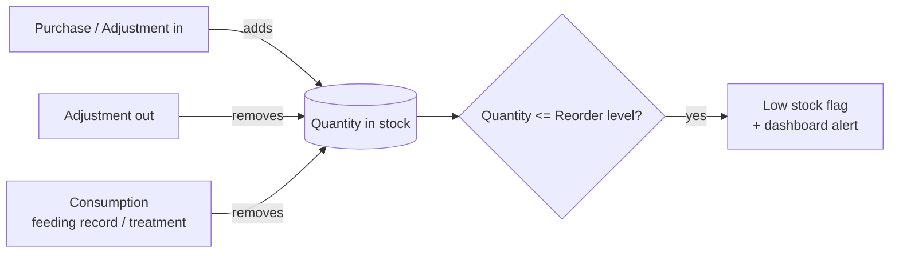

# Inventory and resources

OroraFarm tracks two kinds of consumable stock: **feed** (under **Feeding**) and **medicine** (under **Health**). Both use the same idea: a stock level that changes only through logged **movements**, and a **reorder level** that triggers a "low stock" flag. This chapter explains the rules so administrators can set them up properly and trust the numbers.

> **Note:** Because the two inventories live in different modules, permissions follow the module: feed inventory needs the **Feeding** permission and medicine inventory needs **Health**. Recording a stock movement needs **Create** on that module (see the permissions matrix).

## Stock movements at a glance

*Figure 6. Stock only changes by a movement; each movement stores the balance after it.*

## Feed

### Feed types (**Feeding > Feed types**)

A feed type is a catalogue entry shared across farms.

| Field | Rule |
|---|---|
| Name | required, up to 255 characters |
| Unit | required: kg, g, lb, bale, bag or liter |
| Category | optional from the configured list; choose **Other** and a custom category becomes required |
| Description | optional |
| Active | on/off |

**Inactive feed types** cannot be fed: when a feeding record is saved against an inactive type the stock deduction fails with "This feed type is inactive and cannot be consumed." Mark a feed type inactive instead of deleting it when you stop using it.

### Feed inventory (**Feeding > Inventory**)

An inventory item is "feed type X held on farm Y". Only **one** inventory row can exist for the same farm and feed type ("has already been taken").

Adding an item (**Add inventory**):

1. Choose **Farm** and **Feed type** (the unit is copied from the feed type).
2. Optionally enter **Reorder at** (reorder level, 0 or more). Leave it empty to disable low-stock warnings for this item.
3. Optionally enter an opening **Quantity in stock** (0 up to 100,000,000). If greater than zero it is recorded as an "Adjustment (add)" movement with the note "Opening stock", so the history and the balance agree.
4. Save: "Inventory item created successfully."

When you later **edit** an item you can change the farm, feed type, reorder level and notes, but **not the quantity**. Quantities change only through movements or feeding records.

**Add stock** (button on the row) opens the movement form (`feeding.inventory.movements.store`):

| Movement type | Effect |
|---|---|
| Purchase / stock in | adds the quantity |
| Adjustment (add) | adds |
| Adjustment (remove) | removes |
| Consumption | created automatically by feeding records; not selectable here |

Rules: quantity at least 0.01; the date defaults to now; **a movement that would take the balance below zero is refused** ("Insufficient stock for this movement."). A **Purchase** can also **log an expense** (tick the expense option, amount, vendor); this creates an Expense record in the **Expenses** module automatically.

### Feeding records and stock

Each **Feeding > Records** entry (farm, feed inventory item, target group / animal / flock, quantity at least 0.01, date) **deducts the quantity from the chosen inventory item immediately**. If the stock is too low the record is refused with "Insufficient stock for this movement." and nothing is saved. Editing a feeding record first puts back the old quantity then deducts the new one; deleting a record puts the quantity back. A feeding record that comes from a **schedule** also moves the schedule's next due date forward.

### Feeding schedules

A schedule (**Feeding > Schedules**) fixes a quantity, frequency, start date, optional end date and **next due date**. Status `active` schedules whose next due date is before today are counted as **overdue**:

- Feeding overview tile: **Overdue schedules**.
- Dashboard alert (warning): "Scheduled feedings overdue - N feeding schedule(s) past their due date."

Pause or end schedules you no longer follow so they do not stay overdue forever.

### Low-stock logic for feed

A feed inventory item is **low stock** when it has a reorder level **and** `quantity in stock <= reorder level` (equal counts as low). Items with no reorder level never count. This single rule feeds:

- the **Low stock** badge on **Feeding > Inventory**;
- the **Low stock** tile on the Feeding overview;
- the dashboard alert "Feed inventory low - N item(s) at or below reorder level." (warning);
- the dashboard **Feed stock** panel ("Quantity in stock by feed type"), where low items are listed first;
- the dashboard strip metric **Low stock** next to **Feed types active** (which is the number of inventory items, not of feed types).

> **Tip:** Set a reorder level on every inventory item. An item without one can run to zero with no warning at all.

## Medicine

### Medicines (**Health > Medicines**)

Fields (from `MedicineRequest`):

| Field | Rule |
|---|---|
| Name | required, up to 255 |
| Category | optional list; **Other** requires a custom text |
| Active ingredient, dosage instructions, administration method (list with **Other**), supplier, notes | optional |
| Unit | required: ml, mg, g, tablet, dose, vial, bottle or sachet |
| Quantity in stock | required on creation, 0 or more |
| Reorder level | optional, 0 or more |
| Expiry date | optional |
| Active | on/off |

> **Warning:** Unlike feed inventory, the medicine **edit** form includes **Quantity in stock** and saving it overwrites the quantity **without writing a movement**. The stock history will then no longer explain the balance. Use the stock movement form for every change after the medicine is created, and treat the edit form's quantity field as read-only.

The **Medicines** page shows two alert counts: **Low stock** (reorder level set and quantity <= reorder level) and **Expired** (expiry date before today), and table columns **Medicine**, **Stock**, **Reorder**, **Expiry**, **Status**.

### Movements and treatments

Use **Add stock** / record movement on a medicine's page: types are Purchase / stock in, Adjustment (add), Adjustment (remove), and "Used in treatment" (automatic). As with feed, movements below zero are refused ("Insufficient medicine stock for this movement.").

When a **Treatment** or **Deworming** record names a medicine and a quantity used:

- The system refuses a medicine that is **expired** on the treatment date ("This medicine has expired and cannot be used for treatments.") or **inactive** ("This medicine is inactive and cannot be used for treatments.").
- Otherwise it deducts the quantity as a "Used in treatment" movement.
- Editing or deleting the treatment gives the quantity back.
- Only medicines that are active, in stock (quantity above zero) and not expired are offered in the medicine pick-lists (the medicine already saved on a record stays selectable on that record).

### Deleting medicines

A medicine that is linked to any treatment **cannot be deleted**: "This medicine is linked to treatments and cannot be deleted. Mark it inactive instead." Medicines never used can be removed.

## Other resources

| Resource | Where | Administrator notes |
|---|---|---|
| **Milk storage tanks** | **Milk > Storage** | A tank with milk in it cannot be removed ("Empty the container before removing it."). Milk movements below zero are refused ("Insufficient milk in storage."). |
| **Expense categories** | **Expenses > Categories** | System categories cannot be deleted; a category with expenses cannot be deleted. |
| **Expense vendors** | **Expenses > Vendors** | No guard on deletion. A vendor typed on a purchase form is created automatically if its exact name is new, which can create near-duplicates ("Agro Vet" and "AgroVet"). |
| **Employees** | **Employees** | Staff records, payroll and documents; not login accounts (see below). |

> **Note:** **Employees are not users.** Adding an employee does not give them a login, and adding a user does not create an employee record. Manage both separately.

## Weekly inventory review (administrator)

1. **Feeding > Inventory**: sort by the **Low stock** badge and confirm purchases are planned.
2. **Health > Medicines**: review **Low stock** and **Expired** counts; remove or deactivate expired stock, and record an "Adjustment (remove)" movement with a note to write off what you discard.
3. Compare the physical count of one or two items with **Quantity in stock**; correct any difference with an adjustment movement (never by editing records), so the history explains the change.
4. **Feeding > Schedules**: end or pause overdue schedules that no longer apply.

## Known limitations

- Stock movements are visible on each item's history but there is no workspace-wide stock report or export in the application.
- Feed inventory deletion has no guard in the controller; deleting an item removes its stock row even if it was used in feeding records. Prefer to leave the item with zero stock.
- Reorder levels are plain numbers; there is no automatic purchase order or e-mail/SMS alert. Alerts appear only on the dashboard and overview pages.
- Medicine expiry is checked only when a treatment or deworming is saved; the stock remains on the list until someone acts on the **Expired** count.
