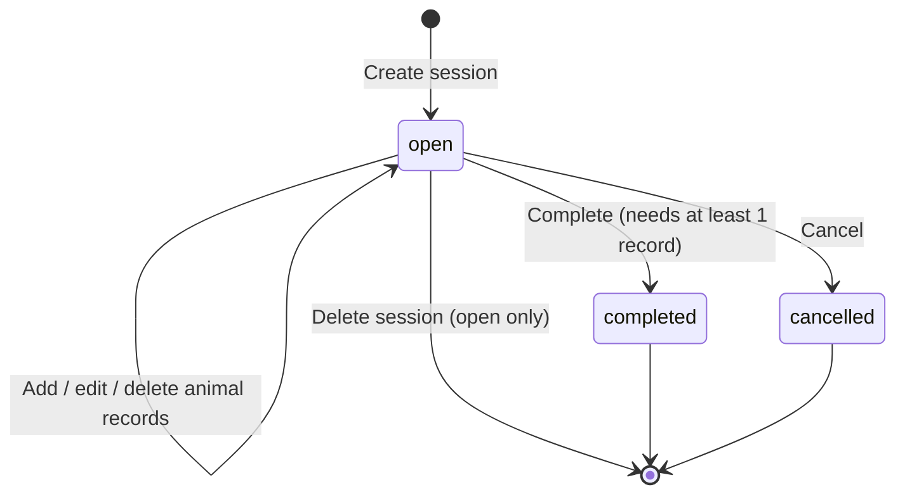
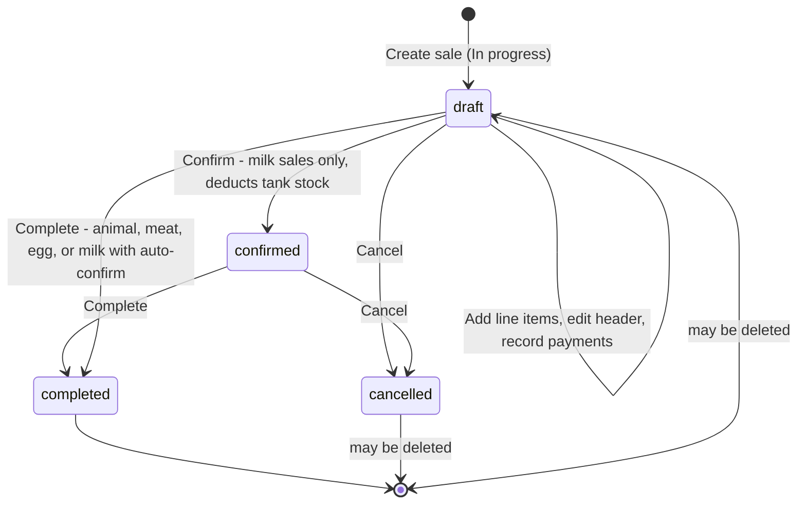

# Monitoring production and sales

This chapter shows administrators what to watch in the production modules (**Milk**, **Eggs**) and in **Sales**, which statuses mean what, and which rules can block or distort records.

## Milk production

Milk is available on cattle / dairy farms (it is hidden on poultry farms). The data model is: **Milk session** (one herd, one date, one shift) containing **milk records** (one per animal), which flow into a **storage tank**, and then leave through **distribution** (non-sale uses) or a **sale**.

### Milk sessions (**Milk > Sessions**)

Creating a session needs: **Farm**, **Livestock group** (herd) belonging to that farm, **Session date** (today or earlier, never in the future), **Shift** (Morning, Afternoon or Evening), **Milked by**, **Milking method**, an optional destination storage tank and notes.

Rules enforced:

- **One session per herd, date and shift.** A second one is refused: "A milk session already exists for this herd, date, and shift."
- A session code `MS-YYYYMMDD-nnnn` is generated.
- Only animals that are **lactating**, that belong to the session's farm and herd, may be added ("Only lactating animals can be milked."; "Animal must belong to the session farm."; "Animal must belong to the session herd."). An animal can have only one record per session.
- A session moves through three statuses:

*Figure 7. Milk session statuses. Once completed or cancelled a session can no longer be edited or deleted.*

- **Complete** totals the litres, number of animals milked and average per animal, and, if a destination tank is set, **adds the litres to that tank**. Completing needs at least one animal record ("Add at least one animal record before completing the session."). Completing is a POST and needs **Create** permission on **Milk**.
- "This session is no longer open for changes." appears if someone edits records of a completed or cancelled session.
- A completed session with a wrong figure cannot be reopened; correct it with an adjustment on the tank and a note.

### Storage and distribution

- **Milk > Storage**: tanks per farm with a current quantity. Quantities change by *intake* (from a completed session), *sale*, *adjustment in/out*, *spoilage / loss*, *distribution* and *distribution reversed*. A movement that would take the tank below zero is refused ("Insufficient milk in storage.").
- **Milk > Distribution**: records where milk went when it was **not** sold: Fed to calf, Household, Neighbor, Relative / visitor, Other. Date and time cannot be in the future ("The date and time cannot be in the future."). **Sold** distributions are not entered here: "Sold milk is managed from the Sales module." They are created automatically when a milk sale is confirmed.

### What to monitor

| Question | Where to look | Notes |
|---|---|---|
| Is everyone recording daily? | **Milk > Sessions**, filter by date | Missing shifts show as gaps; there is no automatic reminder. |
| Is litres-in = litres-out? | **Milk > Storage** | Quantity = intake - sales - distributions - spoilage +/- adjustments. |
| Which animals produce most? | Dashboard **Top animals** ("Highest milk yield this period") | Completed sessions only, top 5. |
| Average yield | Dashboard **Litres per cow per day** | See *Dashboards, KPIs and reports*. |

## Egg production (poultry farms)

**Eggs > Collections** records collections per flock: **Farm** (poultry only), **Flock** (of that farm), **Collected on** date, optional **Shift** (Morning, Afternoon, Evening, All day), **Eggs count** (0 or more), **Cracked count** (cannot exceed the eggs count: "Cracked eggs cannot exceed the total collected."), optional weight, collector and notes. The dashboard shows **Eggs collected** and **Cracked** for the selected period.

There is no egg stock ledger: egg sales do not deduct from a stock figure. The Eggs module has no "one per flock per day" restriction, so duplicate entries are possible; review for duplicates (see *Data-quality monitoring*).

## Sales

The **Sales** module has **Overview**, **Transactions** and, for cattle farms, **Abattoir**. Sale types are **Animal sale**, **Meat sale**, **Milk sale** (cattle) and **Egg sale** (poultry).

### Sale life cycle

*Figure 8. Sale statuses. The screen labels `draft` as "In progress".*

Statuses are Draft ("In progress"), Confirmed, Completed, Cancelled (the configuration also lists Refunded, but no screen or service sets it).

Key rules (from `SaleTransactionService` and the controller):

- **Header editing** is allowed only while the sale is a draft ("Only draft sales can be edited."). **Line items** can be added, edited (**Edit**) or removed (**Remove**) only on draft sales; the sale total is recalculated and the change is written to the sale's activity log.
- **Delete** is allowed only for **draft or cancelled** sales ("Only draft or cancelled sales can be deleted."). A completed sale can never be deleted.
- **Complete** needs at least one line item. Completing an animal sale sets each animal's lifecycle status to **Sold** (only Active animals can be sold); a poultry sale reduces the flock's count; a meat sale marks the abattoir returns as sold. Completing a milk sale that is still a draft confirms it first.
- **Confirm** exists only for milk sales and **deducts the litres from the tank when one is set and has enough milk** (otherwise the deduction is skipped and the sale still completes) and writes a "Sold" milk distribution.
- **Cancel** is refused for completed or already cancelled sales ("This sale cannot be cancelled."). Cancelling a milk sale removes its milk distribution entries.
- A sale number such as `SL-YYYYMMDD-nnnn` (prefixes `MLS-`, `MET-`, `EGS-` for milk, meat and egg sales) is generated.
- An animal cannot be on two in-progress animal sales at the same time, nor twice on the same sale, and must belong to the sale's farm. A flock sale cannot exceed the birds the flock holds.
- The **sale date** may be any date, past or future; there is no cut-off.

### Payments

- **Record payment** accepts an amount of at least 0.01 that **cannot exceed the balance due**, a required payment date, an optional method, reference, receiver and notes. A reference `PAY-...` is generated if you leave it blank.
- Payment status is derived: **unpaid** (nothing paid), **partial**, **paid** (paid >= total). A zero-total sale stays unpaid.
- Payments cannot be recorded on a cancelled sale.
- The dashboard counts **Outstanding payments** (sales unpaid or partially paid and neither draft nor cancelled) and **Overdue payments** (those with a sale date more than 30 days ago).
- **Credit limits** are informational: a customer's credit limit is shown and an alert "Credit limit exceeded" appears when the outstanding balance is above a positive limit, but the sale form does **not** stop a sale to such a customer.

### Finance side effects

Completing a sale automatically posts **revenue** and **accounts receivable** (and tax payable) to the finance ledger; each payment posts cash against receivables; paid expenses post to expense and cash accounts. These postings use the monthly accounting period that contains the sale or expense date, and the posting fails if that period is not open ("Accounting period ... is not open for posting"). Periods are created automatically as open and the application contains **no screen to close a period**, so in normal use backdated sales and expenses post normally.

### Abattoir (cattle farms)

**Sales > Abattoir** records animals dispatched for slaughter and the meat returns, which can then be sold as a **Meat sale**. An animal sent to the abattoir must be Active **and** have health status **Healthy** ("Animal X must be healthy to send to the abattoir."). The Abattoir section is hidden for poultry farms.

## Monitoring checklist for administrators

| Check | How |
|---|---|
| Sales stuck "In progress" | **Sales > Transactions**, filter status; complete or cancel/delete old drafts. Old drafts block their animals from being sold on another sale. |
| Unpaid balances | **Sales > Overview** **Unpaid balance** tile; **Customers** overview **Outstanding**. |
| Credit exposure | Dashboard alert **Credit limit exceeded**; **Customers** overview **Over limit**. |
| Milk sales confirmed but not completed | Confirmed milk sales hold litres already deducted from the tank; complete them or cancel to release the milk record. |
| Revenue vs payments | **Finance > Cash flow** against **Profit & loss** (finance chapter). |

## Known limitations

- Refunded is listed as a sale status but is not reachable in the application.
- Completed sales cannot be reversed or deleted; the only correction path is a new adjusting record or direct database work by the operator.
- Credit limits do not block sales.
- No automatic reminders for missing milk or egg records.
