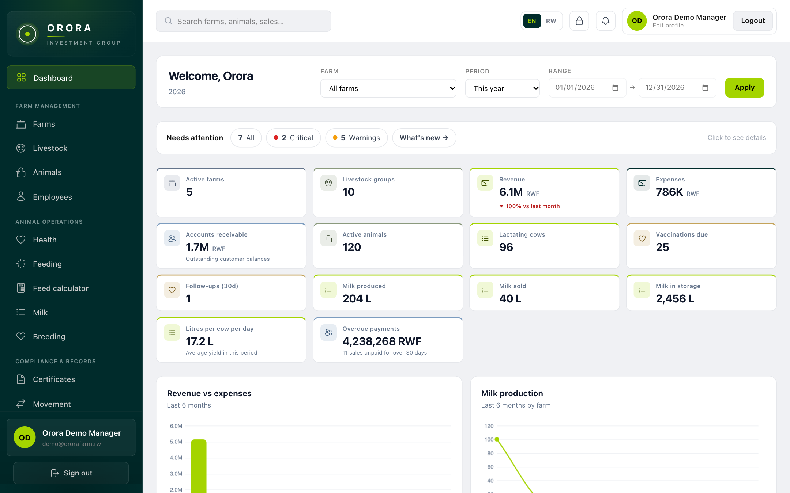

# Dashboards, KPIs and reports

This chapter explains every number an administrator is likely to read on the workspace **Dashboard**, on module **Overview** pages and in **Finance**, and exactly how each is computed. It also notes where two numbers that look alike are built differently, so you do not draw the wrong conclusion.

## Filters

The **Dashboard** (`/dashboard`) has two filters:

| Filter | Options | Default |
|---|---|---|
| Period | All time, Today, This month, Last month, This quarter, This year, Custom range (From / To) | **This year** |
| Farm | All farms, or one farm | The "active farm" remembered from your session |

Most KPIs honour both filters; a few are **snapshots** that ignore the period (called out below). If your workspace has exactly one farm it is pre-selected. "All time" starts at the earliest sale, expense, milk session, finance entry or farm creation date.

Who sees the dashboard: anyone with **Dashboard > View**. Note that it shows money figures to everyone who can open it, regardless of the **Finance**, **Sales** or **Expenses** permission.

## Financial tiles

All four come from the finance ledger (`FinanceReportService`), which is filled automatically when sales are completed and expenses are marked paid. They cover only entries whose **transaction date** is inside the selected period.

| Tile | How it is computed |
|---|---|
| **Revenue** | Sum of **income** ledger lines in the period: for each completed sale, the sale total **minus tax** (the tax portion goes to a tax-payable account, not revenue). Reversals reduce it. |
| **Expenses** | Sum of **expense** ledger lines in the period: every expense with status **paid** is posted on its expense date. Drafts and voided expenses are not counted. |
| **Net profit / Net income** | Revenue - Expenses. |
| **Accounts receivable** | The net debit balance of the receivables account **for postings inside the period**: sales on credit in the period minus payments received in the period. It is *not* the total owed to you at today's date. For that, use the **Unpaid balance** tile on **Sales > Overview** or **Customers > Outstanding**. |

> **Warning:** The dashboard **Revenue vs expenses** bar chart (last six months) is built differently: it sums completed sales' **total amount (including tax)** by sale date, and **paid expenses** by expense date, directly from the sale and expense tables. Over a period with taxed sales, the chart's revenue can be higher than the **Revenue** tile.

## Livestock tiles

| Tile | Cattle / dairy farm | Poultry farm |
|---|---|---|
| **Active animals** / **Birds on hand** | Count of **all** animals in the filter, whatever their lifecycle status (the label says Active, but sold and deceased animals are included until deleted). | Sum of **current count** over flocks. |
| **Active farms** | Farms with status `active` (1 or 0 if one farm is selected). | same |
| **Livestock groups** | Groups with status `active`. | same |
| **Lactating cows** | Animals that are milk-eligible (production status Lactating, or no production status and in a group containing "Cows (lactating)") **and** lifecycle status Active. | 0 / not shown |
| **Animals for sale** / **Open sale listings** | Distinct animals on animal sales that are neither completed nor cancelled (i.e. in progress). | not shown |
| **Flock mortality** | not shown | (placed - current) / placed x 100, to one decimal |
| **Eggs collected** | not shown | Sum of eggs in collections within the period |

## Module strips and KPIs

The dashboard shows a strip per module. The same figures appear as "operation KPIs" on the list pages (computed from 1 January of the current year to today).

| KPI (label) | Definition |
|---|---|
| **Vaccinations due** | Vaccination records with a **next due date** that is on or before **today + 30 days**. This **includes dates already in the past**, and counts every record carrying such a date, even if the animal was later revaccinated. See the data-quality chapter. |
| **Follow-ups (30d)** | Health records whose **next follow-up** date is between today and today + 30 days. |
| **Sick animals** | Distinct **Active** animals with an open disease record (recovery status *recovering* or *chronic*). The hint shows the number of open disease cases. |
| **Low stock** (feeding) | Feed inventory items with a reorder level set and quantity <= reorder level. |
| **Feed types active** (feeding) | Number of feed **inventory items** (not of feed types). |
| **Milk produced today** | Total litres of sessions dated today, **whatever their status** (open sessions are included). |
| **Milk produced** | Total litres of **completed** sessions in the period. |
| **Milk sold** | Litres in milk distributions of category *Sold* in the period. |
| **Milk in storage** | Current litres across all tanks (snapshot, ignores the period). |
| **Litres per cow per day** | Total litres in the period divided by the number of distinct (animal, day) pairs that have a milk record. Sessions of any status are included. |
| **Pregnancy rate** | Among breedings dated in the period whose outcome is known (confirmed pregnant, calved, failed, aborted): those *confirmed pregnant or calved* / all known outcomes, as a whole percent. "0" when nothing is known. |
| **Pregnant cows**, **Calves group** | Animals whose livestock group lists the herd group "Pregnant Cows" / "Calves Group". |
| **Eggs collected**, **Cracked** | Sums over the period (poultry). |
| **Overdue payments** | Money still owed on sales dated **more than 30 days ago**, payment status unpaid or partial, status neither draft nor cancelled. The hint gives how many sales. |

## Alerts

The dashboard collects alerts and orders them by severity. Each shows a "What to do" hint and links to the relevant page. Alerts are recalculated every time the page opens; there is no snooze or acknowledge.

| Alert | Severity | Condition |
|---|---|---|
| **Animals need attention** | Critical | Animals with health status Sick, Under treatment, Quarantined or Recovering. |
| **Credit limit exceeded** | Critical | Customers whose outstanding balance exceeds a credit limit greater than zero (workspace-wide; not filtered by farm). |
| **Feed inventory low** | Warning | Feed items at or below reorder level. |
| **Vaccinations due** | Warning | Vaccination next-due date <= today + 30 days (including past). |
| **Deworming scheduled soon** | Warning | Dewormings with status Scheduled dated today to today + 7 days. |
| **Scheduled feedings overdue** | Warning | Active feeding schedules whose next due date is before today. |
| **Certificates expiring** | Warning | Certificates expiring today to today + 30 days. |
| **Pregnancy checks due** | Warning | Pending breedings with no pregnancy check, past their due date (35 days after breeding by default). |
| **Outstanding payments** | Warning | Sales with payment status unpaid or partial, not draft or cancelled. |
| **Calvings approaching** | Info | Confirmed pregnancies with an expected calving date within 14 days. |

The alert strip at the top shows the total and the counts of Critical, Warning and Info alerts.

## Charts and panels

| Panel | Definition |
|---|---|
| **Revenue vs expenses** | Last six months, see the warning above. |
| **Production trend** (**Milk production** or **Egg collections**) | Last six months; one line per farm (at most five farms); completed milk sessions or egg counts. |
| **Sales by type** | Completed sales in the period summed by type. |
| **Expense breakdown** | Paid expenses in the period grouped by expense group (Feed, Health, Breeding, Farm operations, General / other). |
| **Animal health** | All animals counted by health status. |
| **Feed stock** | Quantity in stock per feed type, summed across farms; low items first. |
| **Top animals** | Top five animals by litres in completed sessions in the period (cattle only). |
| **Recent sales** | Five latest non-cancelled sales in the period. |
| **Recent activity** | Latest sales, expenses and health records (up to 15 items). |

## Module overview pages

Each module's **Overview** page carries its own tiles:

| Module | Tiles (definition) |
|---|---|
| **Feeding** | Overdue schedules; Feed types (active); Inventory items; Low stock; Active schedules; Records this month (by feeding date). |
| **Milk** | Period total litres (completed sessions); sessions; animals milked; best animals and herds over the last 90 days unless a period is chosen. |
| **Eggs** | Collections in the period and egg totals. |
| **Breeding** | Active breedings; Confirmed pregnant; Due this month; Births this month. |
| **Sales** | Period total (completed sales); transaction count; Unpaid balance (all sales unpaid or partial, not cancelled, **total minus payments**); totals per sale type. |
| **Customers** | Total, Active, Outstanding balance, Over limit, Sales this month. |
| **Employees** | Total, Active, On leave, Terminated, Monthly payroll. |
| **Finance** | Revenue, Expenses, Net income, Cash change, Receivable, ledger entry count and recent entries. |

## Finance reports (**Finance** module)

Finance is **read-only** and fed automatically; there are no manual journal entries. Posting rules (`FinancePostingService`):

- **Completed sale**: debit Accounts receivable (gross), credit sales revenue (net, by sale type: milk, animal, meat or egg), credit Tax payable (if any).
- **Sale payment**: debit cash or bank, credit Accounts receivable.
- **Paid expense**: debit the expense account for its category, credit cash or bank by payment method.
- Cancelling or un-paying creates **reversing** entries rather than deleting history.

Pages (**Finance** sidebar):

| Page | What it shows |
|---|---|
| **Overview** | The tiles above plus recent ledger entries. |
| **Transactions** | Paginated ledger with date, code, type, farm and lines. |
| **Profit & loss** (`/finance/reports/profit-loss`) | Income and expense accounts with amounts and net income for the period. |
| **Cash flow** (`/finance/reports/cash-flow`) | Movements through cash and bank accounts and the net cash change. |

Filters: period (from / to), farm and livestock group.

> **Note:** There is no report export (PDF or spreadsheet) for finance or the dashboard. The only exports in the application are animal, customer and employee CSV files. Print or copy the page if you need a hard copy.

## Reading the numbers: a short guide

1. Always check the **period** and **farm** filter first; most "wrong number" reports are a filter issue.
2. If **Revenue** is zero but you have sales, they are probably still **In progress** (not completed) or the sale date is outside the period.
3. If **Expenses** look low, check that expenses have status **paid**.
4. For money owed to you now, use **Unpaid balance** (Sales) or **Outstanding** (Customers), not the dashboard receivable tile.
5. If **Vaccinations due** never reaches zero, old records with past due dates are still counting.

## Known limitations

- No custom reports, saved filters, scheduled reports or exports of dashboards and finance.
- No budget, forecast or year-on-year comparison, though the finance schema contains a budget table; no screen uses it.
- Dashboard alerts cannot be acknowledged or dismissed.
