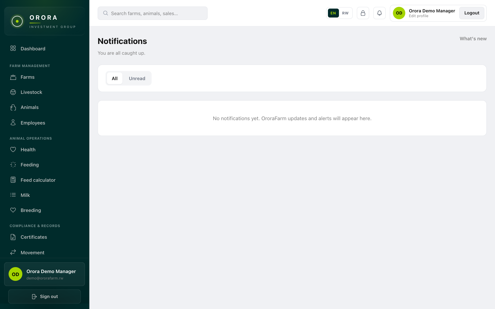
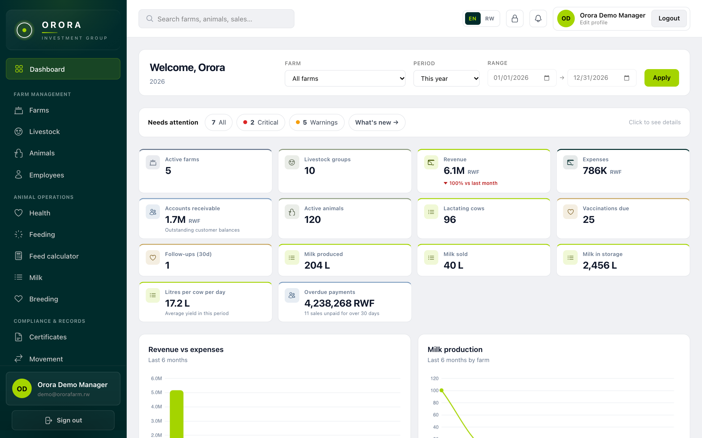
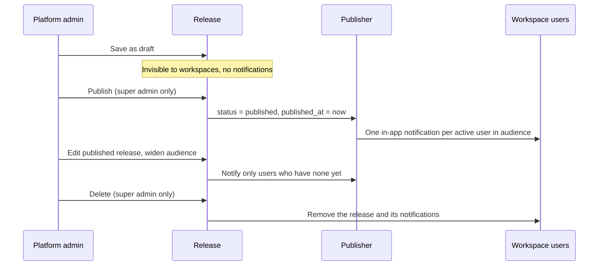

# Notifications management

This chapter describes every kind of notification and reminder OroraFarm really produces, who receives it, and how platform administrators publish "What's new" announcements.

> **Note:** OroraFarm's notifications are **in-app only**. No e-mail, SMS or push message is sent by any notification class (both use the `database` channel). There is also no scheduled job: `routes/console.php` defines no scheduled tasks, so nothing runs overnight to remind anybody of anything.

## The two kinds of in-app notification

| Notification | Created when | Recipients | Where it appears |
|---|---|---|---|
| **Release published** ("What's new") | A super admin publishes a release (or widens a published release's audience) | Active workspace users in the release's audience | Notification bell, **Notifications** page, **What's new** page |
| **New buyer inquiry** (marketplace) | A buyer submits an inquiry on one of the workspace's shop listings | The seller workspace's **workspace admins**; if the workspace has no active admin, every active user of the workspace | Notification bell, **Notifications** page; opens the **My listings** page, section "inquiries" |

Nothing else generates a notification. In particular, **stock, vaccination, payment and breeding reminders are not notifications**; they are **alerts on the Dashboard** that are recalculated each time the page is opened (see *Dashboards, KPIs and reports*). Nobody is told when an alert appears, so an administrator or a designated member must open the dashboard routinely.

## Who receives what: summary

| Event | Admin | Member | Platform admin |
|---|---|---|---|
| Release published | yes (if active and in audience) | yes (if active and in audience) | no (platform admins have no notifications) |
| Buyer inquiry | yes | only when the workspace has no active admin | no (sees all inquiries at `/admin/ecommerce`) |
| Dashboard alerts (low stock, due dates, unpaid sales...) | on the dashboard | on the dashboard, if they have **Dashboard > View** | not applicable |
| Account deactivated | nobody is told; the person sees a message when they try to use the system | | |
| Permissions or role changed | nobody is notified | | |

## Using notifications (every user)

- The **bell** in the header shows the unread count and the latest eight notifications (setting `releases.bell_limit`). Choose **View all notifications** to open the full list.
- **Notifications** (`/notifications`) lists them 20 per page with filters **All** and **Unread**. **Mark all as read** marks every unread notification of that user.
- Clicking a notification marks it read and takes you to its target page if it has an internal one; otherwise back to the list. Only the signed-in user's own notifications can be opened.
- **What's new** (`/whats-new`) lists published releases with a category filter (New feature, Improvement, Bug fix, Important update, Scheduled maintenance). Opening the page marks the release notifications of the listed releases as read.

These pages are always available to a signed-in, active user, whatever the module permissions are.

## Publishing release notes (platform admins)

Open **Releases** in the platform sidebar (`/admin/releases`). The list shows **Release**, **Category**, **Audience**, **Status**, **Release date**, **Notified** (how many users were notified and how many have read it) and **Actions**. You can filter by **All statuses**.

### Create a release

1. Click **New release**.
2. Fill in:
   - **Version or identifier** (required, up to 50 characters).
   - **Title** (required, up to 255).
   - **Description of the changes** (required, up to 5000 characters; line breaks are kept). The hint reads "What changed and how tenants can use it."
   - **Category**: New feature, Improvement, Bug fix, Important update or Scheduled maintenance.
   - **Release date** (required).
   - **Affected module** (optional): "None / whole platform" or one of the workspace modules.
   - **Link to dashboard page** (optional): an internal path that starts with a single `/` (for example `/milk/distribution`). External links are refused: "Use a dashboard path that starts with /, for example /milk/distribution."
   - **Target audience**: **All tenants** or **Selected tenants** (then choose at least one tenant: "Choose at least one tenant, or target all tenants.").
3. Click **Save as draft** ("Drafts are not visible to tenants and send no notifications.") or, if you are a super admin, **Save & publish**.

### Publish, edit and delete

*Figure 9. Release publishing. Notifications are never duplicated: one per release per user.*

- Any platform admin can create and edit drafts; **only a super admin** can **Publish** or **Delete** ("Only super admins can publish releases."). Since every admin created by the command is a super admin, in practice this limits nothing, but the code keeps the distinction (the list says "You can create and edit drafts. A super admin must publish them." to non-super admins).
- **Publish** sets the status to Published, stamps the time and the publisher, and creates one notification for every **active** user (`is_active` true) of every workspace in the audience. A selected audience with no tenants is refused.
- **Editing** a published release does not re-send anything to people who already have the notification. If you add tenants to the audience, only users in the newly added tenants are notified ("Notified N new users.").
- **Delete** removes the release and **all of its notifications** ("Release deleted and its notifications removed.").
- A user added to a workspace **after** the release was published does not get a bell notification, but can still read the release on **What's new**, because that page lists every published release visible to their workspace.
- Deactivated users are skipped; reactivated users are not back-filled.

> **Tip:** Write the description as a note to farmers: what changed, where to find it and what they must do. Use **Affected module** and **Link to dashboard page** so a click lands them on the new feature.

## Reminders and alerts: what to do instead

Because there are no pushed reminders, set up a routine:

| Need | Routine |
|---|---|
| Know when stock is low | Open the **Dashboard** each morning; read **Feed inventory low**; check **Health > Medicines** weekly |
| Vaccination / deworming due | **Vaccinations due** (30-day look-ahead) and **Deworming scheduled soon** (7 days) alerts |
| Unpaid sales | **Outstanding payments**, **Overdue payments** |
| Breeding follow-up | **Pregnancy checks due**, **Calvings approaching** |
| Staff documents | Employee documents have an expiry date, but no alert is generated for them |
| Buyer inquiries | The bell and **Shop > My listings** |

Give a named person responsibility for opening the dashboard, and add a second admin so inquiries and releases are seen even when one admin is away.

## Known limitations

- No e-mail, SMS or push channel; no per-user notification settings; no mute.
- No scheduler, so no automatic daily or weekly digests.
- Alerts cannot be dismissed or assigned to a person.
- Platform admins have no notification centre; new contact messages appear on the admin dashboard and in the **Contact inbox** only.
- Members never get notified of their own permission changes.
