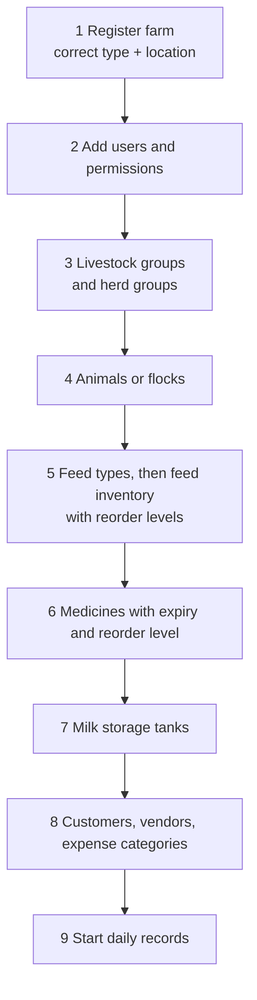

# Recommended data-management practices

OroraFarm has few built-in safety nets: no audit log, no undo, no record locking, no closing of accounting periods and no exports of dashboards or finance. The practices below compensate for those gaps. Each recommendation is tied to a real behaviour described in the earlier chapters.

## 1. Set up in the right order

Registering data in the wrong order causes most later problems. Use this sequence for a new workspace:

*Figure 10. Recommended set-up order for a workspace.*

- **Get the farm type right first.** It cannot change once stock exists.
- **Create livestock groups before animals**, because an animal needs a group.
- **Create feed types before inventory**, and always enter an **opening stock** and a **reorder level** so history and alerts work from day one.
- **Create storage tanks before the first milk session** if sessions will go to a tank.

## 2. Naming and coding conventions

The application cannot enforce them, so agree them in writing:

| Item | Convention |
|---|---|
| Farm names and registration numbers | Official name and number exactly as on the registration document |
| Livestock groups | Farm + purpose + year, for example "Kigali dairy 2026" |
| Animal tag numbers | One scheme across the workspace; tags only need to be unique per group, but keep them unique everywhere to avoid confusion in reports |
| Customers | Legal / trading name; one record per buyer; mark duplicates **inactive** |
| Vendors and feed types | One spelling; reuse existing entries; check the list before typing a new vendor name on a purchase form |
| Expense categories | Prefer the built-in categories; add your own only when none fits |
| Sale and payment references | Use the payment form's **Transaction reference** field for the mobile-money or bank reference |

## 3. Enter data on time

- **Same-day entry** for milk sessions, egg collections, feeding records, sales, payments and expenses. Dates on sales and expenses are unrestricted, so late entry silently moves figures between months (see *Data-quality monitoring*).
- Record **mortality** and **sales** through their modules, not by editing counts; flock counts and statuses then stay consistent with history.
- **Complete or cancel** sales promptly. An in-progress sale reserves its animals and hides revenue.
- **Close the loop** on schedules, disease cases and treatments, otherwise alerts and KPIs stay inflated.

## 4. Prefer status changes to deletion

Several deletions cascade through many tables and cannot be undone (see the data-quality chapter):

| Instead of deleting... | Do this |
|---|---|
| A farm | Set **Status** to inactive |
| An animal | Set **Lifecycle status** to Sold, Deceased, Transferred, Missing or Retired |
| A user | **Deactivate** |
| A customer or vendor | Set status inactive / stop using |
| A medicine or feed type | Mark **inactive** |
| An expense entered wrongly | Change status to **void** (reverses the ledger posting) or correct the amount |
| A flock | Let its count reach 0 through sales or mortality |

Keep the **Delete** permission for workspace admins only, and ask admins to confirm before deleting farms, livestock groups or animals.

## 5. Correct, do not overwrite

- Fix stock with **adjustment movements** and a note ("Physical count 3 Mar: -12 kg"), not with direct edits. Medicine edit forms let you overwrite the quantity; do not use that field after creation.
- Do not edit a flock's **current count** to correct it; record mortality, sale or adjustment.
- When a completed record is wrong and cannot be edited, create the correcting record and describe it in **Notes**.

## 6. Reconcile regularly

| Frequency | Reconcile | Between |
|---|---|---|
| Daily | Litres produced vs litres in tank + distributed + sold | Milk sessions, storage, distribution, sales |
| Weekly | Physical stock vs system stock | Feed and medicine inventory |
| Weekly | Cash and mobile-money received vs recorded payments | Sales payments |
| Monthly | Head counts vs registered animals | Livestock vs Animals |
| Monthly | Unpaid sales vs customer statements | Sales, Customers |
| Monthly | Expenses on paper vs recorded | Expenses (status paid) |
| Quarterly | Users vs staff register | Users & access vs Employees |

## 7. Back up and export

- The application has no backup feature. Ask the platform operator for **regular database backups** and, before any bulk delete, for a restore point. Uploaded files (animal photos, expense and mortality attachments) live in file storage and need backing up too.
- Use the built-in CSV **exports** (animals, customers, employees) monthly and keep the files with the date in the name. They are the only structured exports available.
- Take a **dated screenshot or print** of the Dashboard, **Profit & loss** and **Cash flow** at each month-end; there is no report export, and a later backdated entry will change the live numbers.

## 8. Use imports carefully

- Always start from the **template**; keep the header row.
- Test with a few rows, read the **preview**, and **cancel** when unsure.
- Avoid the "replace" mode unless you intend to overwrite existing animals.
- After importing, compare totals with your source file and export the result.

## 9. Protect personal data

The application stores national IDs, dates of birth, phone numbers, salaries and customer contacts. Keep exposure small:

- Give **Employees** and **Customers** permissions only to people who need them; **Employees > Edit** also controls payroll details.
- Never share a login between people: you lose the little traceability that exists (for example who completed a sale) and cannot deactivate one person without affecting others.
- Remove leavers promptly (see the access chapter).

## 10. Monthly close routine (manual)

Because periods cannot be closed in the system, close them by discipline:

1. Complete or cancel all in-progress sales; record all payments received.
2. Mark all valid expenses **paid** and remove or void drafts.
3. Reconcile stock and tanks; post adjustments.
4. Review **Profit & loss** and **Cash flow** for the month; capture them.
5. Announce internally: "Entries for the closed month are frozen" and review any later entry dated in that month.

## Known limitations behind these recommendations

- No locking of periods, no approvals, no audit trail, no undo.
- No automated backups visible to workspace admins; backups are an operator task.
- No in-app data export except CSV for animals, customers and employees.
