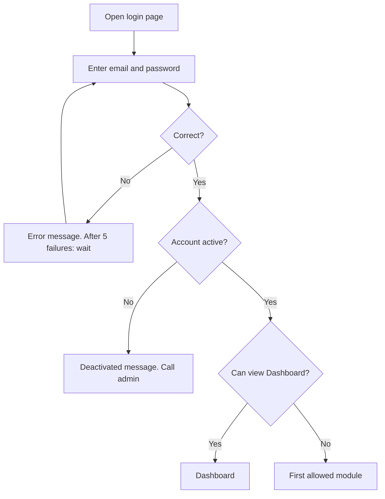
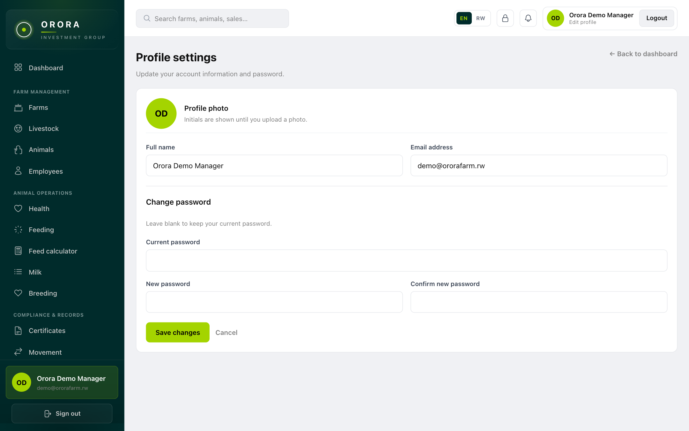

# Access, login and logout

## Who creates your account?

There are two ways an account is made. Know which one applies to you.

| Situation | How you get an account |
|---|---|
| **You are the farm owner** starting OroraFarm for the first time | You register yourself on the **Create account** page. This creates a brand-new private workspace for your farm. You become its **Workspace admin**. |
| **You are staff** at a farm that already uses OroraFarm | Your **workspace admin** creates your account for you in **Users & access** and gives you an email and a password. You do **not** register. |

> **Warning:** Staff must not use the Create account page. If you register there, OroraFarm makes a **new empty workspace** for you. You will not see your farm's records. Ask your admin for your login instead.

## Registering a new workspace (farm owners)

**Purpose:** Create your own private OroraFarm workspace and your first login.

**When to do it:** Only once, when your farm starts using OroraFarm.

**What you need:** Your name, an email address that is not used on OroraFarm yet, and a password.

### Steps

1. Open the OroraFarm address in your browser and go to `/register` (or click **Sign up** at the bottom of the login page).
2. Fill in the form (see the table).
3. Click **Create account**.

### Fields

| Field | What to enter | Required? | Rules |
|---|---|---|---|
| Full name | Your name, for example "Mugisha Eric" | Yes | Up to 255 characters |
| Email | Your email, for example `mugisha@example.rw` | Yes | Must be a valid email. Must **not** already be used by anyone on OroraFarm. Saved in lower case. |
| Password | A password you can remember | Yes | At least 8 characters. Click the eye icon to show what you typed. |
| Confirm password | The same password again | Yes | Must match exactly |

### What happens after you save

- A new private workspace is created, named after you (for example "Mugisha Eric's farm").
- Your user is created with the role **Workspace admin** and is active.
- You are signed in automatically and taken to the **Dashboard**.
- Nobody outside your workspace can see your data.

### Common mistakes

- Using an email that someone already registered. You will see an error under the form. Use another email, or log in if the email is yours.
- A password shorter than 8 characters, or two passwords that do not match.
- Registering as staff of an existing farm (see the warning above).

## Logging in

**Purpose:** Open your farm's records.

**What you need:** The email and password your admin gave you.

### Steps

1. Go to the OroraFarm address. The **Welcome back** page opens ("Sign in to your farm workspace").
2. Type your **Email**.
3. Type your **Password**. Click the eye icon to check it.
4. Tick **Remember me** if you are on your own private device. Do not tick it on a shared computer.
5. Click **Log in**.

### Where you land

OroraFarm takes you to the **Dashboard**. If your admin did not give you Dashboard access, it opens the first module you are allowed to use. If you have no module at all, it opens your **Profile settings** page. See [Permissions](04-permissions.md).

### Messages you may see

| Message | Meaning | What to do |
|---|---|---|
| "These credentials do not match our records." | Wrong email or password | Check spelling and Caps Lock. Try again. |
| "Too many login attempts. Please try again in N seconds." | You failed 5 times | Wait the number of seconds shown, then try again carefully. |
| "Your account has been deactivated. Contact your workspace admin." | Your admin switched your account off | Contact your admin. You cannot log in until they activate you. |

### Forgot your password?

The "Forgot password?" text on the login page is greyed out and says "Coming soon". **There is no self-service password reset.** Ask your workspace admin to set a new password for you in **Users & access**, then change it yourself on your Profile page.

*How login works.*

### If your account is switched off while you are working

If your admin deactivates your account while you are logged in, OroraFarm signs you out on your next click. You go to the login page with the message "Your account has been deactivated. Contact your workspace admin."

## Switching language (English or Kinyarwanda)

At the top right of every page after login you see two small buttons: **EN** and **RW**.

1. Click **RW** to use Kinyarwanda.
2. Click **EN** to go back to English.
3. The page reloads in the chosen language. The active button is highlighted.

> **Note:** The language is remembered only for your current visit. After you log out and log in again, the screens start in English again. Some screens or messages may still show English words, because not every sentence is translated yet.

> **Note:** The login and register pages do not have language buttons. Switch language after you log in.

## Your profile page

**Purpose:** Check or change your own name, email and password.

**Where:** Click your name at the top right of the page ("Edit profile"), or your name at the bottom of the left menu.

### Steps to change your password

1. Open **Profile settings**.
2. In **Current password**, type your present password.
3. In **New password**, type the new one. Type it again in **Confirm new password**.
4. Click **Save changes**.
5. You see "Profile updated successfully."

### Steps to change your name

1. Change **Full name**.
2. Click **Save changes**.

### Fields

| Field | What to enter | Required? | Rules |
|---|---|---|---|
| Full name | Your name | Yes | Up to 255 characters |
| Email address | Your login email | Yes | Valid email, up to 255 characters, not used by another user |
| Current password | Your present password | Only when you set a new password | Must be correct. Wrong password shows "Your current password is incorrect." |
| New password | The new password | No (leave blank to keep the old one) | At least 8 characters |
| Confirm new password | The new password again | Only with a new password | Must match |

### Common mistakes

- Leaving **Current password** empty when you type a new password. The page refuses to save.
- Different "New password" and "Confirm new password".

> **Warning:** **Do not change your email address on this page.** Ask your workspace admin to change it from **Users & access**. OroraFarm keeps a separate list that links each email to its workspace, and the admin screen is the one that updates that list correctly. Changing the email yourself may stop you from logging in next time.

> **Note:** The page says "Initials are shown until you upload a photo", but there is no photo upload box yet. Only your initials are shown.

## Logging out

**Purpose:** Close your session so nobody else uses your account.

**When:** Every time you leave a shared or public computer, and at the end of your shift.

### Steps

Use either button:

- At the top right, click **Logout**.
- At the bottom of the left menu, click **Sign out**.

You return to the login page. Your session and "remember me" are cleared.

> **Tip:** On a phone, tap the menu button (three lines) at the top left to open the left menu, then scroll down to **Sign out**.

## Common problems

| Problem | Likely reason | What to do |
|---|---|---|
| I cannot log in | Wrong password, or account deactivated | Check the message shown. Ask admin to reset your password or activate you. |
| I logged in but see an empty farm | You registered a new workspace instead of using your farm's account | Log out. Ask your admin for your account. |
| The menu has fewer items than my colleague | Admin gave you fewer modules | See [Permissions](04-permissions.md) |
| "Access denied" screen | You clicked something you are not allowed to do | See [Permissions](04-permissions.md) |
