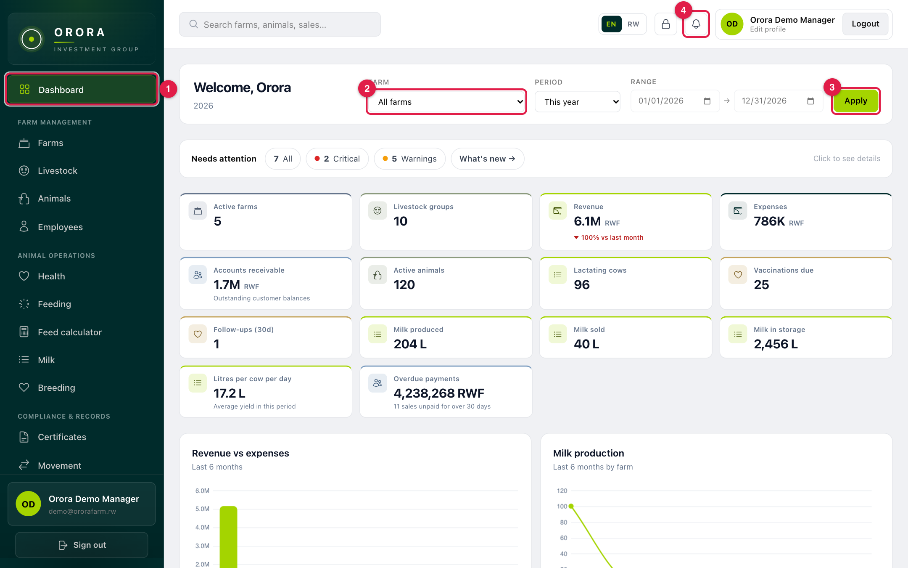
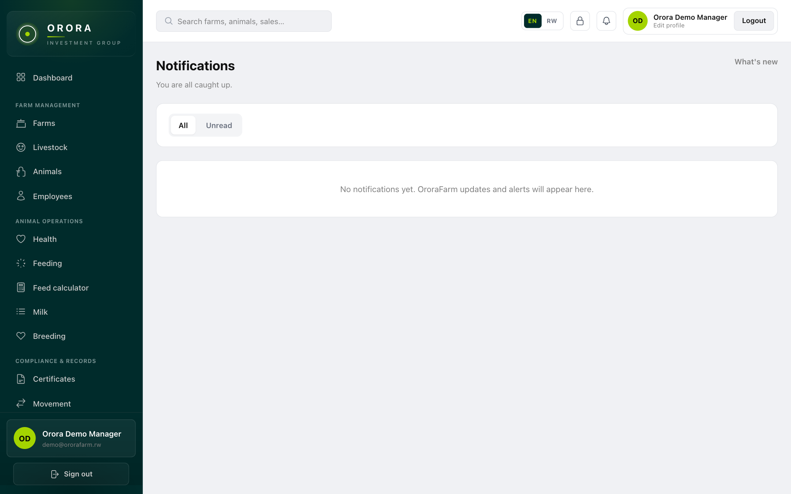
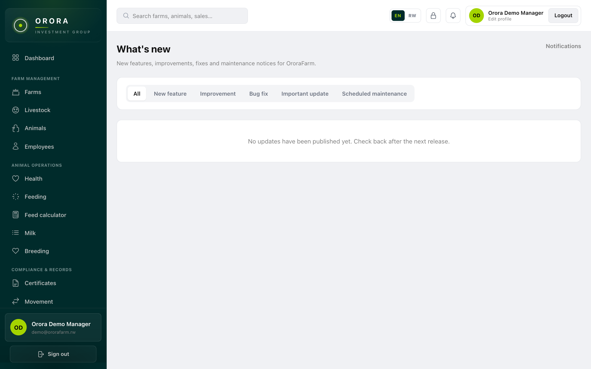

# Dashboard and navigation

## The screen layout

After you log in, every page has the same frame:

| Area | Where | What it does |
|---|---|---|
| **Left menu** (sidebar) | Left side | Lists the modules you may use. Click a name to open it. |
| **Top bar** | Top | **EN / RW** language buttons, the **bell** (notifications), your **name** (opens your profile), and **Logout** |
| **Page area** | Centre | The page you opened: lists, forms, charts |
| **Your name and email** | Bottom of the left menu | Opens your profile. Under it is **Sign out**. |

On a phone or small screen the left menu is hidden. Tap the three-line **menu button** at the top left to open it. Tap the **X** to close it.

## The left menu

The menu is split into groups. You only see the items you are allowed to use and that fit your farm type.

| Group | Items (cattle farm) | Items (poultry farm) |
|---|---|---|
| (no title) | Dashboard | Dashboard |
| Farm management | Farms, Livestock, Animals, Employees | Farms, Livestock, Flocks, Employees |
| Animal operations | Health, Feeding, Feed calculator, Milk, Breeding | Health, Feeding, Feed calculator, Eggs |
| Compliance & records | Certificates, Movement | Certificates, Movement |
| Business & finance | Sales, Customers, Expenses, Finance | Sales, Customers, Expenses, Finance |
| Workspace | Users & access (**admins only**) | Users & access (**admins only**) |

The item you are in is highlighted. An item that is greyed out with the hint "Coming soon" is not ready yet.

Most modules open on an **Overview** page with small tabs near the top. For example, Health has tabs: Overview, Vaccinations, Deworming, Treatments, Medicines, Disease, Vet visits, Mortality, Timeline. Click a tab to move inside the module.

## The Dashboard

**Purpose:** See the state of the farm at a glance: money, animals, production and things that need attention.

**When to use it:** At the start of each day, and before you decide what to do next.

### Choosing what the dashboard shows

At the top of the dashboard is a filter bar:

| Control | Choices | Meaning |
|---|---|---|
| **Farm** | All farms, or one farm name | Show numbers for every farm, or only one farm. Choosing a farm also becomes your "working farm" for the menu (see [Introduction](01-introduction.md)). |
| **Period** | All time, Today, This month, Last month, This quarter, This year, Custom | The time range for money and production numbers. The default is **This year**. |
| **Range** | A "from" date and a "to" date | Used only when Period is **Custom** |
| **Apply** | Button | Click it to refresh the page with your choices |

The greeting "Welcome, [first name]" and the chosen period are shown on the left of the bar.

> **Tip:** Choose **Today** to see only what happened today, for example eggs collected today.

### Alerts: "Needs attention"

Just under the filter bar is the **alert summary**.

- If nothing needs attention you see "No alerts - Nothing needs your attention right now."
- Otherwise you see tabs: **All**, **Critical**, **Warnings**, **Info**, each with a count, and sometimes a **What's new** tab.
- Click a tab to see the list. Click an alert to read the message and "What to do". Click **Open [module]** to go to the right place.
- Click the **X** to close the details.

The colour tells you how urgent it is:

| Level | Meaning |
|---|---|
| **Critical** | Act today. It can harm animals or cost money if left. |
| **Warning** | Act soon, usually within days or weeks. |
| **Info** | Nothing is wrong, but plan ahead. |

The alerts OroraFarm can raise, and exactly when each appears:

| Alert | Level | Appears when | Where to fix it |
|---|---|---|---|
| Animals need attention | Critical | Any animal has health status Sick, Under treatment, Quarantined or Recovering | Health |
| Credit limit exceeded | Critical | A customer with a credit limit owes more than that limit | Customers |
| Feed inventory low | Warning | A feed stock item is at or below its **Reorder level** (only items that have a reorder level set) | Feeding |
| Vaccinations due | Warning | A vaccination has a **Next due date** within the next 30 days (or already passed) | Health |
| Deworming scheduled soon | Warning | A deworming with status **Scheduled** is dated within the next 7 days | Health |
| Scheduled feedings overdue | Warning | An **active** feeding schedule has a "next due" date before today | Feeding |
| Certificates expiring | Warning | A certificate expires within the next 30 days | Certificates |
| Pregnancy checks due | Warning | A breeding is still **Pending**, has no pregnancy check, and 35 days have passed since breeding | Breeding |
| Outstanding payments | Warning | A sale (not draft, not cancelled) is Unpaid or Partially paid | Sales |
| Calvings approaching | Info | A confirmed pregnant cow is expected to calve within 14 days | Breeding |

> **Note:** These alerts are worked out live each time you open the dashboard. They are **not** sent by email, SMS or to the bell. The alert disappears by itself when you fix the cause, for example when you record the vaccination and clear the due date.

### The number cards (KPIs)

Below the alerts are cards with key numbers. Click a card to open the related module. The numbers follow your **Farm** and **Period** choices.

| Card | What it shows | Shown for |
|---|---|---|
| **Active farms** | Number of farms whose status is Active | All |
| **Livestock groups** | Number of **active** livestock groups | All |
| **Revenue** | Total income in the period (from the Finance profit and loss report), with a trend against last month | All |
| **Expenses** | Total expenses in the period (from the Finance profit and loss report), with a trend against last month | All |
| **Accounts receivable** | Money customers still owe you ("Outstanding customer balances") | All |
| **Active animals** | All animals registered | Cattle |
| **Lactating cows** | Active animals that can be milked (production status Lactating, or in a Cows (lactating) group when no status is set) | Cattle |
| **Animals for sale** | Animals on a sale that is not yet completed or cancelled ("Open sale listings") | Cattle |
| **Birds on hand** | Total current birds in all flocks | Poultry |
| **Flock mortality** | Percent of birds lost: (placed - current) divided by placed | Poultry |
| **Eggs collected** | Eggs collected in the period | Poultry |

Then small **module strips** give extra numbers. For example:

| Strip | Numbers |
|---|---|
| Health | Vaccinations due; Follow-ups (30d); Sick animals (with the number of open disease cases) |
| Feeding | Low stock; Feed types active |
| Eggs (poultry) | Eggs collected; Cracked |
| Milk (cattle) | Milk produced today; Milk produced; Milk sold; Milk in storage; Litres per cow per day |
| Breeding (cattle) | Pregnancy rate (pregnant of checked) |
| Herd groups (cattle) | Pregnant cows; Calves group |
| Sales | Overdue payments (amount in RWF and number of sales unpaid for over 30 days) |

### Charts and lists

| Panel | What you see |
|---|---|
| **Revenue vs expenses** | A chart of the last 6 months |
| **Milk production** (cattle) or **Egg collections** (poultry) | The last 6 months, by farm |
| **Recent sales** | The latest sales in the period: sale, customer, amount, status |
| **Alerts** | The same alerts grouped by module, with a filter |
| **Top animals** | The 5 animals with highest milk yield in the period (cattle only; poultry shows "Not available for poultry farms.") |
| **Feed stock** | Quantity in stock for each feed type. A **Low** tag shows when stock is at or under reorder level. Click **Inventory** to open feed stock. |
| **Recent activity** | The latest sales, expenses and health records across the farm |

If a chart has no data it says "No financial data for this range." or "No production data for this range." This is normal for a new farm.

> **Note:** The dashboard is for reading only. You cannot change records from it. Use the module pages for that.

## Notifications (the bell)

The bell icon at the top shows a red number when you have unread notifications.

1. Click the bell. A small panel opens with your latest notifications.
2. Click one to read it. It is marked as read and opens its link if it has one.
3. Click **Mark all as read** to clear the number.
4. Click **View all notifications** to open the full list. Use the **All** / **Unread** filter there.

> **Note:** At this time the bell carries OroraFarm **update notices** (new features, improvements, maintenance news). Farm alerts such as low feed stock are on the dashboard, not in the bell.

## What's new

**Purpose:** See what changed in OroraFarm: new features, improvements, bug fixes, important updates and planned maintenance.

**How to open:** Click **What's new** at the bottom of the bell panel, or the **What's new** tab on the dashboard alert bar.

- Each entry has a coloured tag (New feature, Improvement, Bug fix, Important update, Scheduled maintenance), the module it relates to, and sometimes an **Explore feature** button.
- You can filter by category.
- Opening the page marks the listed updates as read.

## Help

OroraFarm has no separate Help page. For help, use this guide or ask your workspace admin.

## Moving around: quick habits

- To go **back** from a form without saving, click **Cancel** (or the back link at the top). Do not use the browser Back button after saving, or you may send the same form twice.
- Click the **farm name, animal tag or record name** in a list to open its details.
- Your list position (page number) is kept when you use the page links at the bottom of a list.

## Known limitations

- The "Search farms, animals, sales..." box at the top of the page does not work yet. Use the **Search** box on the list pages.
- The padlock button in the top bar does nothing.
- The dashboard cards link to modules. If you click a card for a module you are not allowed to use, you see the "Access denied" screen. See [Permissions](04-permissions.md).
