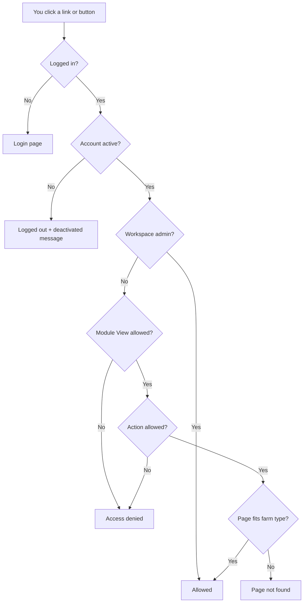
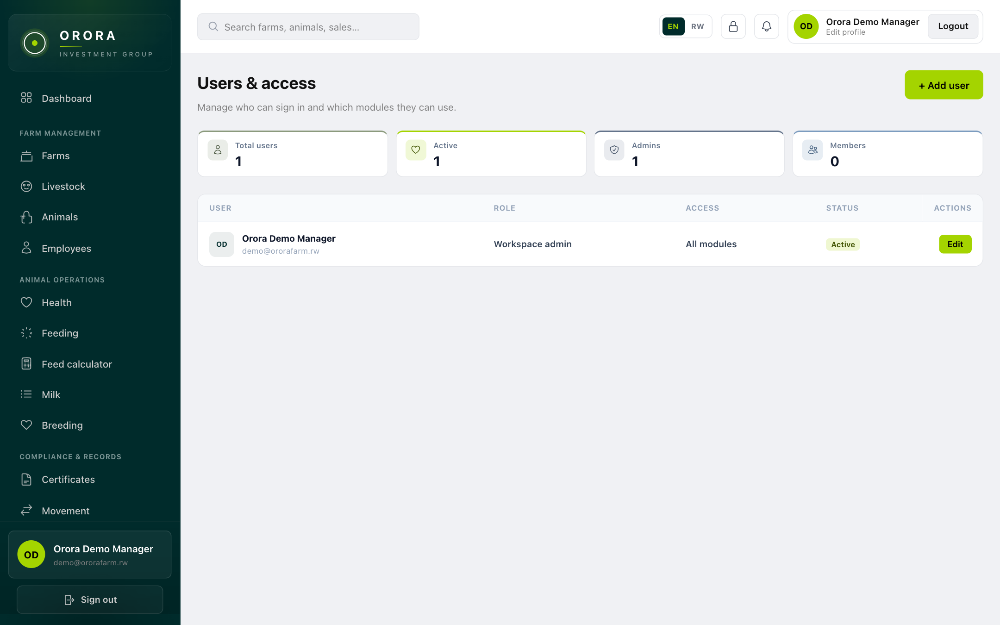
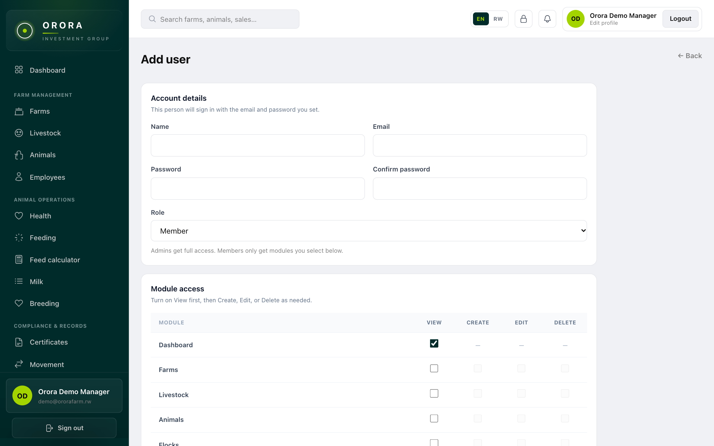

# Permissions

## Why permissions exist

A farm has many people: the owner, the manager, the milker, the vet assistant, the accountant. Not everyone should see or change everything. For example, the milker may only need **Milk**, and the accountant may only need **Expenses** and **Finance**.

OroraFarm lets your **workspace admin** decide, for each person, which modules they may use and what they may do inside each one.

## The two roles

| Role | What the person can do |
|---|---|
| **Workspace admin** | Everything, in every module. Also manages staff in **Users & access**. The person who registered the workspace is an admin. |
| **Member** | Only the modules the admin ticked for them, and only the actions ticked in each module. |

Most data-entry staff are **Members**.

## The four actions

For each module an admin can allow four actions:

| Action | What it lets you do | Examples |
|---|---|---|
| **View** | Open the module and see its lists and details | Open Animals, search, view an animal, export |
| **Create** | Add new records | Register animal, add a vaccination, import a file, record a payment |
| **Edit** | Change existing records | Edit an animal, update a feeding record |
| **Delete** | Remove records | Delete an egg collection, remove a feed type |

Rules:

- **View comes first.** Create, Edit and Delete only work when View is also allowed for that module. If an admin ticks only Create, OroraFarm turns it off.
- The Dashboard module has only **View**.
- Permissions are **per module**, not per farm. A member who may use Animals can see the animals of **all** farms in the workspace.
- The module is the whole menu item. For example, the **Health** permission covers every Health tab: Vaccinations, Deworming, Treatments, Medicines, Disease, Vet visits, Mortality and Timeline. **Sales** covers Transactions and Abattoir. **Breeding** covers breeding records, pregnancy checks and births.
- **Feed calculator**, **Flocks** and **Eggs** are separate modules with their own permissions, and so is **Milk**.

### Modules that can be given to a member

Dashboard (View only), Farms, Livestock, Animals, Flocks, Employees, Health, Feeding, Feed calculator, Milk, Eggs, Breeding, Certificates, Movement, Sales, Customers, Expenses, Finance. Each has View, Create, Edit, Delete (except Dashboard).

> **Note:** **Users & access** is never available to members. Only workspace admins can open it.

### Things everyone can always do

Any active, logged-in user can always open their **Profile settings**, **Notifications**, **What's new**, switch language, and log out. These do not need module permission.

## What you see when you are not allowed

You can notice permissions in four ways.

### 1. The menu is shortened

Modules you have no **View** permission for are **missing from the left menu**. If a colleague sees "Feeding" and you do not, you were not given Feeding.

### 2. "Access denied" screen

If you open a page, or click a button, for something you are not allowed to do, OroraFarm shows a full-page message:

- Title: **Access denied**
- Message: "You do not have permission to access this module."
- Hint: "Ask a workspace admin if you need access to this area."
- Buttons: **Go to home** and **Go back**

> **Warning:** OroraFarm does **not** hide the **Add**, **Edit** or **Delete** buttons when you lack that permission. You may see a button, click it, and then get the Access denied screen. Nothing was saved or deleted. This is normal; it only means your admin did not give you that action.

> **Example:** Claudine is a member with Animals: View and Create only. She can open the animals list and register new animals. She sees the **Edit** and **Delete** buttons, but when she clicks **Delete** she gets "Access denied" and the animal stays.

### 3. "Page not found" for the wrong farm type

If a page does not belong to your farm type (for example **Flocks** on a cattle farm, or **Milk** on a poultry farm), the page says it is not found. This is not a permission problem. It is because of the farm type. See [Introduction](01-introduction.md).

### 4. Your account is deactivated

If your admin switches off your account:

- You cannot log in. The login page shows "Your account has been deactivated. Contact your workspace admin."
- If you were already logged in, your next click logs you out with the same message.

Your records stay. The admin can switch you on again.

### Where you land after login

| Your access | First page |
|---|---|
| You have Dashboard View | Dashboard |
| No Dashboard, but other modules | The first module in the list you may view |
| No modules at all | Profile settings |

## How a click is checked

*The order of checks. The Action is View for opening pages, Create for adding, Edit for saving changes, Delete for removing.*

How OroraFarm decides the action from your click:

| What you do | Action needed |
|---|---|
| Open a list, a record, or an Overview page; download an export | View |
| Open an Add form or the Import page; save a new record; upload an import file; save a payment | Create |
| Open an Edit form; save changes | Edit |
| Press Delete | Delete |

## For workspace admins: managing users

This section is for admins only. Members will not see it.

### Opening the screen

Click **Users & access** (group "Workspace") in the left menu.

The top shows counts: **Total users**, **Active**, **Admins**, **Members**. The table shows each **User**, **Role**, **Access** ("All modules" for admins, "No modules" if none given), **Status** (Active or Inactive) and **Actions** (Edit, Deactivate or Activate).

### Adding a user

**Purpose:** Give a staff member a login.

**When:** When someone joins the farm team.

**What you need:** Their name, a work email, a starting password, and a list of modules they should use.

**Steps**

1. Click **+ Add user**.
2. Fill in **Account details** (see the table).
3. Choose the **Role**. For normal staff choose **Member**.
4. In **Module access**, tick **View** first, then **Create**, **Edit**, **Delete** as needed for each module. (Dashboard View is ticked by default.)
5. Click **Create user**.
6. Give the person their email and password. Ask them to change the password on their Profile page.

| Field | What to enter | Required? | Rules |
|---|---|---|---|
| Name | The person's full name | Yes | Up to 120 characters |
| Email | Their login email | Yes | Valid email, up to 190 characters. Must not be used by anyone else on OroraFarm. Saved in lower case. |
| Password | Starting password | Yes | At least 8 characters |
| Confirm password | Same password | Yes | Must match |
| Role | Workspace admin or Member | Yes | Admins get everything; the Module access table is for Members |
| Module access | Ticks in the table | No | Only used for Members. Create/Edit/Delete need View. |

**What happens after saving:** The user is created **active** in your workspace. You see "User created successfully." They can log in immediately.

### Editing a user

1. In the list, click **Edit** on the user.
2. Change the name, email, role or ticks. Type a **New password** only if you want to change it; leave it blank to keep the current one.
3. Use the **Status** tick "Active (can sign in)" to switch the account on or off.
4. Click **Save changes**. You see "User updated successfully."

This is also how you **reset a forgotten password** for a colleague: type a new password here, save, and tell them.

> **Tip:** When you change someone's email here, the login connection is updated too. This is the correct place to change an email.

### Deactivating and activating

- Click **Deactivate** in the list (confirm the question). The person can no longer log in. Their records stay.
- Click **Activate** to let them back in.

Safety rules OroraFarm enforces:

| Rule | Message |
|---|---|
| You cannot deactivate your own account | "You cannot deactivate your own account." |
| You cannot deactivate the last active workspace admin | "You cannot deactivate the last workspace admin." |
| You cannot remove the last workspace admin (by changing role or status) | "You cannot remove the last workspace admin." |
| You cannot change your own role away from admin | "You cannot change your own role away from workspace admin." |

> **Note:** There is no delete button for users. Deactivate instead. If you change a member to **Workspace admin**, their module ticks are cleared because admins do not need them.

### Good practice for admins

- Give the **least** each person needs. A milker: Milk (View, Create), maybe Animals (View).
- Do not give **Delete** to many people. Deleting a record can also remove linked records, for example deleting a farm deletes everything under it (see [Farms and livestock registration](06-farms-and-livestock-registration.md)).
- Keep at least two admins you trust, so you can never be locked out.
- Deactivate staff who leave the same day.

## Common problems

| Problem | Reason | Fix |
|---|---|---|
| "Access denied" after clicking Add | No Create permission | Ask your admin |
| A module is missing from the menu | No View permission, or the module does not fit the farm type | Ask your admin; check the farm type |
| Page not found | Wrong farm type for that module | Check your farm type |
