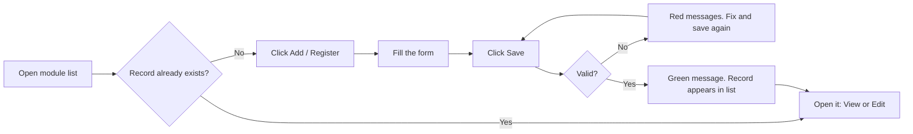
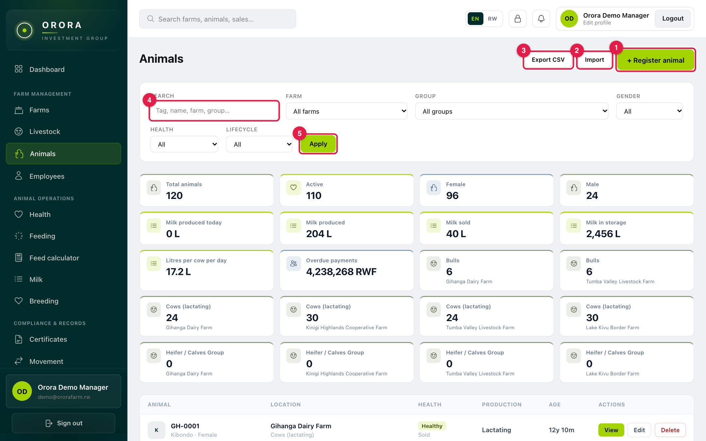
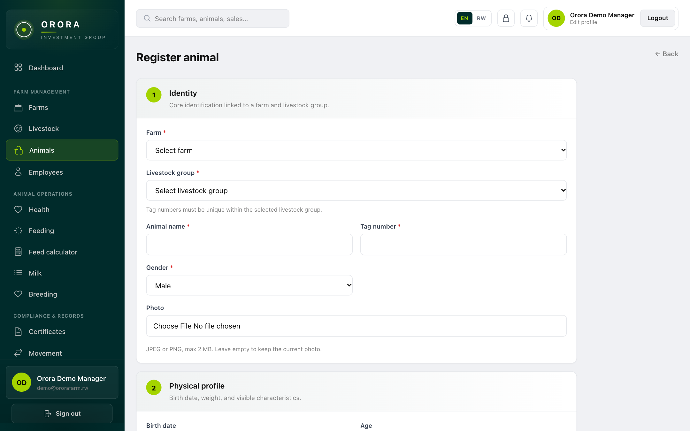
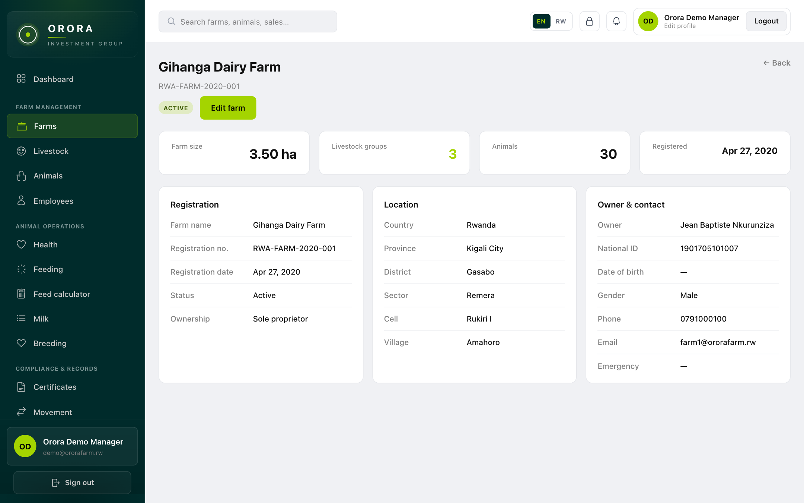

# Creating and updating records

Almost every part of OroraFarm works the same way. Learn the pattern once and you can use any module. This chapter explains lists, search and filters, forms, errors, details, editing, deleting, importing and exporting.

## The life of a record

*Every module follows this pattern.*

## Lists

A **list page** shows records in a table or in cards, newest or most important first. Examples: Farms, Livestock, Animals, Vaccinations, Feeding records.

What you usually find on a list page:

| Part | What it does |
|---|---|
| Page title and the **green add button** at the top right | Opens the form to create a record. Its label tells you what it creates: "+ Register farm", "+ Register animal", "+ Add user" and so on. |
| **Summary numbers** at the top | Totals for the list, such as "Total animals", "Active", "Female", "Male" |
| **Filter bar** (on some lists) | Narrows the list. See below. |
| **Table or cards** | One row per record. The row shows the main facts. |
| **Actions** at the end of each row | **View**, **Edit**, **Delete** |
| **Page numbers** at the bottom | Lists show 12 to 15 records per page. Use the links to go to the next page. |
| A friendly **empty message** | For example "No animals registered yet." with a button to add the first one |

### Search and filters

Only some lists have a search or filter bar. Use what is there:

| List | Search box | Filters |
|---|---|---|
| Farms | Name, owner, registration no., location | Status, Species, District |
| Livestock | Group name, breed, notes, farm | Farm, Status |
| Animals | Tag, name, farm, group | Farm, Group, Gender, Health, Lifecycle |
| Flocks | (none) | Farm, Production type |
| Breeding records | (none) | Farm, Status, "pregnancy check due" |
| Customers and Employees | Search box | Their own filters |
| Expenses and Sales transactions | (none) | Their own filters |
| Most Health, Feeding and Egg lists | (none) | (none: newest first, page by page) |

How to use a filter:

1. Type in the **Search** box or choose from a drop-down.
2. Click **Apply** (some drop-downs apply as soon as you choose).
3. To go back to the full list, click **Clear** or **Clear filters**.

> **Tip:** Search with a short word. Searching "Inyan" finds "Inyange". Search a tag such as "RW-001" to check if an animal already exists.

> **Note:** The box at the very top of the page ("Search farms, animals, sales...") does not work yet. Use the Search box on the list page.

## Before you start: avoid duplicates

A duplicate record gives wrong totals (two cows instead of one, double feed deduction, double expenses). Before you create anything:

1. **Open the list** and search for the record.
2. **Check the spelling and number** (tag, registration number, name).
3. **Click Save only once.** Wait for the green message. Do not press the browser Back button and save again.

What OroraFarm checks for you, and what it does not:

| Record | Duplicate check |
|---|---|
| Farm | **Registration number** must be unique across OroraFarm |
| Animal | **Tag number** must be unique **inside the same livestock group** (the same tag can exist in a different group, so be careful) |
| Feed stock item | Only one stock line per **farm + feed type** |
| User | **Email** must be unique |
| Flock, egg collection, breeding, birth, disease | Codes such as FLK-20261005-0001 are made by OroraFarm. It does **not** stop you adding the same event twice. |
| Feed type, medicine, vendor, vaccination, treatment, feeding record | **No duplicate check.** You are responsible. |

## Creating a record (forms)

1. Click the add button on the list page.
2. The form opens in **sections** with a title and short description, for example "Identity", "Physical profile", "Status".
3. Boxes with a red star (*) are required.
4. Fill in the boxes (see "Kinds of boxes" below).
5. Click the **Save** button at the bottom (its name changes: "Save", "Create user", "Save mortality record"...).
6. Click **Cancel** to leave without saving.

### Kinds of boxes

| Box type | How to use it |
|---|---|
| **Text** | Type. Keep names short and consistent. |
| **Number** | Type digits only. Use a dot for decimals: `12.5`. Do not type thousand separators like `1,200`. Do not type units such as "kg" inside the box; the unit is shown next to or in the label. |
| **Date** | Click the box and pick from the calendar, or type the date as your browser shows it. Dates in lists look like "Oct 5, 2026". |
| **Drop-down (select)** | Click and choose one. Some drop-downs depend on an earlier choice: after you choose a **Farm**, the **Livestock group** and **Animal** lists show only that farm's items. Choose from top to bottom. |
| **Choice with "Other"** | If your answer is not in the list, choose **Other**. A new box appears: type your own answer. It is then required. |
| **Tick boxes** (several allowed) | Used for herd groups, livestock types and similar. Tick all that apply. |
| **Round buttons** (only one) | Used for "Entire livestock group" or "One animal". Choose one. |
| **Text area** | A bigger box for Notes. Optional. |
| **File** | Click and choose a file. Each form states the file types and maximum size (for example "PDF, image, or Word document up to 5 MB"). |
| **Read-only box** | Grey boxes such as **Age** are worked out by OroraFarm. You cannot type there. |

### Money, dates and numbers

- **Currency** is **Rwandan francs (RWF)**. Enter the amount without the letters "RWF" and without commas, for example `45000`.
- **Dates** use the calendar picker. Some dates cannot be in the future (for example "Birth date", "Diagnosis date", "Breeding date"), and some end dates cannot be before the start date. If you break the rule you get a message.
- **Weights** are in **kg**. Medicine and feed use the unit you choose (kg, ml, bag...).
- **Required numbers** such as "Birds placed" must be at least 1; counts can be 0 only where the form says so.

## Errors: what to do when a form will not save

When something is wrong, OroraFarm shows the form again with:

- a **red box at the top** listing every problem, and
- a **red message under** each wrong box.

**All the things you typed are kept.** Fix the boxes named in the messages and click **Save** again.

| Message (example) | What it means | What to do |
|---|---|---|
| "The tag number field is required." | A required box is empty | Fill it |
| "The tag number has already been taken." | The same tag already exists in that group | Search the list; choose a different tag or edit the existing animal |
| "The birth date field must be a date before or equal to today." | A future date | Choose a correct date |
| "The end date field must be a date after or equal to start date." | Dates in the wrong order | Fix the dates |
| "The selected animal does not belong to this farm." | Farm and animal do not match | Choose the farm first, then the animal |
| "Insufficient stock for this movement." | You tried to use more than you have | Check the stock first (see [Feeding](08-feeding-and-feed-inventory.md)) |

If you leave a form open for a very long time, saving may show "Page expired". Reload the page and enter it again.

## Success messages

After a good save you see a **green message** at the top of the next page, such as "Farm registered successfully." or "Treatment saved successfully." If you do not see green, the record was probably **not** saved. Check the list.

## Viewing details

- Click **View** (or the record's name) to open the **details page**. It shows everything saved, in groups. Farms, livestock groups, animals and flocks have full details pages with their own **Edit** button.
- Many other records (for example vaccinations, treatments, disease records, feeding schedules, certificates and movements) open in a simple **read-only "View" page**. It lists every saved field, shows when the record was created and last updated, and has an **Edit** button and a link back to the list. Related records, such as the animal or the farm, are shown as links.

## Editing a record

**Purpose:** Correct a mistake or update a changed fact.

**When:** As soon as you notice a mistake, or when something changes (for example a cow's weight, or a flock's housing).

1. Open the list and find the record.
2. Click **Edit**.
3. Change the boxes. The form is the same as the Add form, with the saved values filled in.
4. Click **Save changes** (or **Save**).
5. You see a green message such as "Animal updated successfully."

Editing has side effects in some modules. For example:

- Editing a **feeding record** puts the old amount back into the feed stock and then takes out the new amount.
- Editing a **treatment** does the same for medicine stock.
- Editing a **mortality** record on a flock fixes the flock's bird count.
- Some records **cannot be edited** once they are linked to a later step (for example a breeding record that already has a birth).

Those details are in the matching chapters.

> **Tip:** If a record is wrong in a way you cannot edit (for example you picked the wrong farm), ask a person with Delete permission to delete it, then enter it again correctly.

## Deleting a record

**Purpose:** Remove a record that was entered by mistake.

1. Click **Delete** in the row (or on the details page).
2. A pop-up asks you to confirm, for example "Delete this farm?" or "Remove this flock? This cannot be undone."
3. Click **OK** to delete or **Cancel** to keep it.
4. You see a green message such as "Animal removed successfully."

> **Warning:** Delete is **permanent**. There is no recycle bin or undo. Deleting a record can also remove other records that depend on it:
>
> - Deleting a **farm** removes the farm's livestock groups, animals, flocks and records linked to them.
> - Deleting an **animal** removes that animal's health, vaccination, treatment, milk and breeding records.
> - Deleting a **livestock group** keeps the animals but shows them as "No group".
> - Deleting a **feeding record**, **treatment**, **deworming**, **vaccination** or **mortality** record also removes the records OroraFarm created from it (the health history entry, the linked expense) and puts stock or bird counts back where the module does that.
>
> If you only want to stop using something, change its **status** instead (for example a feed type or medicine can be made inactive, and a livestock group can be set to inactive).

Some records are protected from deletion and you see a message instead. For example, a medicine used in a treatment cannot be deleted ("This medicine is linked to treatments and cannot be deleted. Mark it inactive instead."), and a breeding record with a birth cannot be deleted.

## Attachments and photos

Some forms let you attach a file (a lab result, a certificate scan, a receipt, an animal photo):

| Form | File types | Maximum size |
|---|---|---|
| Animal photo | Picture (JPEG, PNG) | 2 MB |
| Mortality, treatment, vaccination, deworming, vet visit | PDF, JPG, PNG, DOC, DOCX | 5 MB |
| Disease record | PDF, JPG, PNG | 4 MB |
| Pregnancy check, birth record | PDF, JPG, PNG | 5 MB |
| Linked expense receipt | PDF, JPG, PNG | 5 MB |

If you choose a new file when editing, it replaces the old one. A saved file shows as a **View attachment** link.

## Linked expense: record the cost at the same time

Many health and breeding forms have a last section **Expense (optional)** with a tick box **Log expense for this record**. If you tick it, you can enter the **Amount (RWF)**, vendor, payment method and who paid. OroraFarm then creates an **Expense** in the Expenses module for you, marked as paid, linked to the record. If you later untick it or delete the record, the expense is removed.

> **Tip:** Use this instead of typing the same cost twice in Expenses.

## Import and export

Import (upload a spreadsheet to add many records) and export (download a CSV) exist **only** in these places:

| Module | Export | Import |
|---|---|---|
| **Animals** | **Export CSV** button on the list (it respects the filters you chose) | **Import** button (CSV, text or Excel) |
| Customers | Yes | Yes |
| Employees | Yes | Yes |

No other module has import or export. Animal import is explained fully in [Farms and livestock registration](06-farms-and-livestock-registration.md). The Customers and Employees imports follow the same preview-then-confirm pattern.

The general import pattern:

1. Download the **template** and fill it in. Keep the header row.
2. Upload the file (maximum 5 MB).
3. Read the **preview**. Nothing is saved yet.
4. Fix errors in your file if needed and upload again, or confirm.
5. Read the **summary** of what was created, updated, skipped and failed.

## Habits that keep your data clean

1. **Register in order:** Farm, Livestock group, Animal or Flock, then events.
2. **Same day entry:** Record events the day they happen, with the **real date**.
3. **Consistent names:** "Inyange", not "inyange cow 1".
4. **Use the dropdowns** instead of typing free text where a list exists.
5. **Fill in optional boxes that matter** (for example animal **Weight (kg)**: the feed calculator needs it).
6. **Check the green message** after every save.
7. **Never delete to "fix" a number.** Use Edit or the correct adjustment.
8. **Log out** when finished.

## Common mistakes to avoid

| Mistake | What goes wrong | What to do instead |
|---|---|---|
| Saving twice | Two identical records | Click Save once; check the list |
| Choosing the wrong farm | Animal list in the drop-down is empty or wrong | Choose the farm first |
| Typing `1,200` or `12 kg` in a number box | The box is refused | Type `1200` or `12` |
| Entering a future date for an event that happened | Refused, or the report is wrong | Use the real date |
| Deleting a farm or animal that has history | History is deleted too | Set status to inactive, or ask your manager |
| Ignoring the red messages | Nothing is saved | Read each message and fix the box |
