# Farms and livestock registration

This chapter covers the base records that everything else depends on: **Farms**, **Livestock groups** and **Animals**. It also covers importing and exporting animals, **Certificates**, **Movements**, **Mortality** of animals and **Abattoir dispatch**.

Birds on poultry farms are registered as **Flocks**. See [Flocks, poultry and eggs](07-flocks-poultry-and-eggs.md).

## How the records fit together

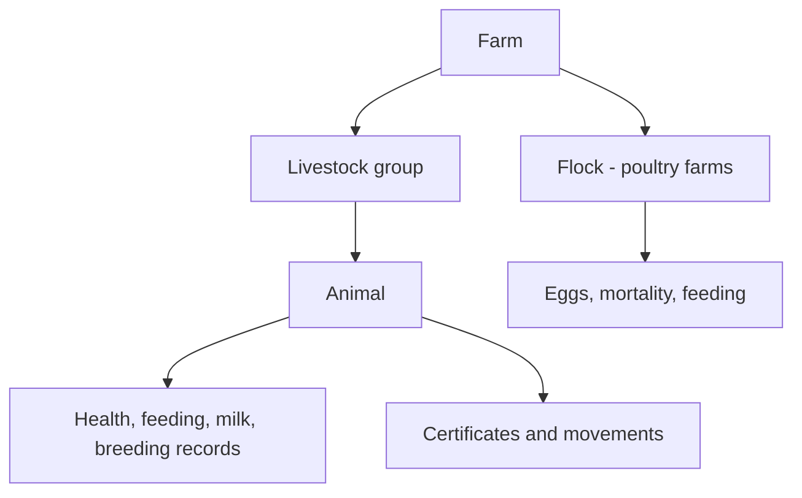

*Always register in this order: Farm, then Livestock group, then Animal (or Flock).*

| Record | What it is | Example |
|---|---|---|
| **Farm** | A place with an owner, a location and a farm type | "Inyange Dairy Farm", Musanze |
| **Livestock group** | A herd or class of animals on a farm | "Cows (lactating)" at Inyange Dairy Farm |
| **Animal** | One animal with its own tag number | Cow "Inyange", tag RW-001, Friesian |

---

## 1. Farms

### 1.1 Register a farm

**Purpose:** Create the farm that will hold your animals or flocks and all their records.

**When to perform:** Once for each farm, before anything else. Also when you open another farm (for example a separate poultry farm).

**Before you start:**

- Open **Farms** and check that this farm is not already listed (search by name or registration number).
- Have ready: the farm's registration number, size in hectares, the owner's names, National ID, date of birth, phone and email, and the location down to the village.

**Steps**

1. In the left menu click **Farms**.
2. Click **+ Register farm**.
3. Fill in **Farm registration** (name, number, date, size, status, farm type).
4. Fill in **Location**. Choose in order: **Province**, then **District**, then **Sector**, then **Cell**, then **Village**. Each list fills after you choose the one before it. **Country** is fixed to Rwanda.
5. Under **Ownership structure** choose the **Ownership type**. If you choose **Cooperative** or **Company**, extra boxes appear: **Organization name**, **Tax ID (TIN)** and a table **Organization members** (click **+ Add member** for each member).
6. Fill in **Business owner** and **Contact information**.
7. Add **Notes** if you wish.
8. Click the save button.

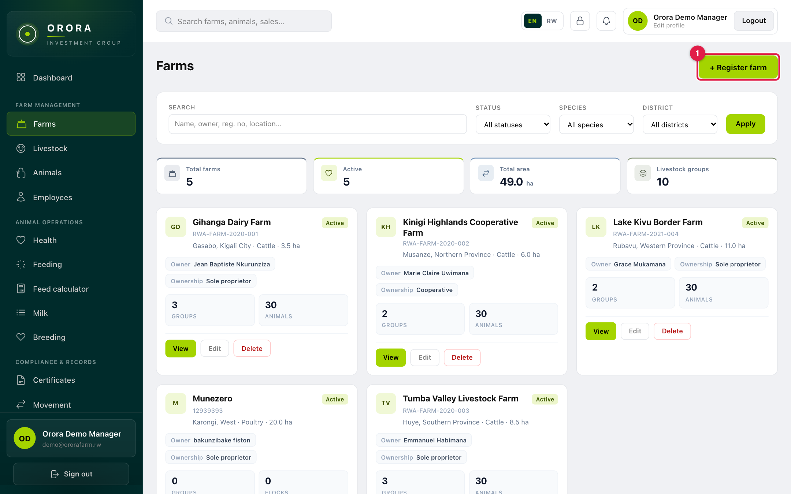

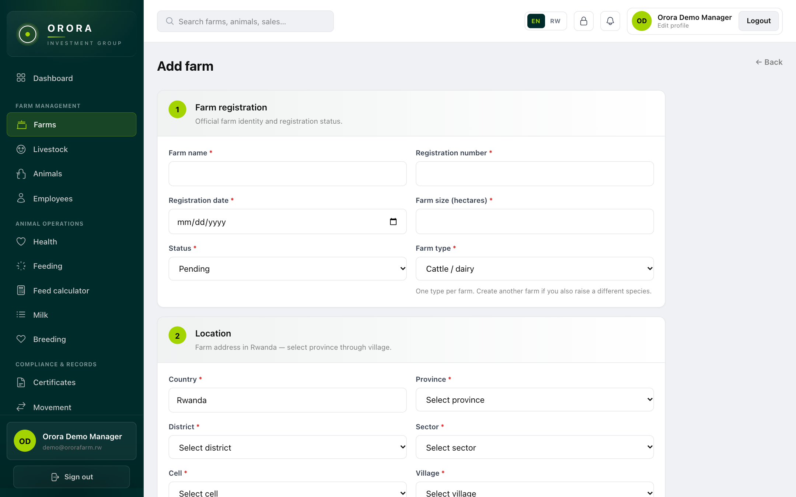

**Fields**

| Field | What to enter | Required? | Rules |
|---|---|---|---|
| Farm name | "Inyange Dairy Farm" | Yes | Up to 255 characters |
| Registration number | Official or your own farm number, e.g. `RW-MUS-0042` | Yes | Up to 100 characters. **Must be unique** across OroraFarm. |
| Registration date | Date the farm was registered | Yes | A date |
| Farm size (hectares) | `2.5` | Yes | Number, 0 or more |
| Status | Pending, Active, Inactive, Suspended | Yes | The form starts on **Pending**. Choose **Active** for a working farm. |
| Farm type | Cattle / dairy or Poultry | Yes | One type per farm. **Locked** after you add a livestock group, animal or flock. |
| Country | Rwanda | Yes | Read-only |
| Province, District, Sector, Cell, Village | Choose from lists | Yes (all five) | The five choices must match each other, otherwise "The selected Rwanda location is invalid." |
| Ownership type | Sole proprietor, Cooperative, Company | Yes | Cooperative or Company need the next three items |
| Organization name | The cooperative or company name | Only for Cooperative / Company | Up to 255 characters |
| Tax ID (TIN) | The TIN | Only for Cooperative / Company | Up to 100 characters |
| Organization members | One row per member: first name, last name, date of birth, phone, gender | Only for Cooperative / Company (at least 1) | Date of birth must be before today. Gender: male, female or other. |
| First name, Last name | The owner or authorised representative | Yes | Up to 255 characters each |
| National ID | Owner's ID number | Yes | Up to 50 characters |
| Date of birth | Owner's date of birth | Yes | Before today |
| Gender | Male, Female, Other | Yes | |
| Contact phone | `0788 123 456` | Yes | Up to 30 characters |
| Email | Owner's email | Yes | Valid email |
| Emergency contact | A phone number | Yes | Up to 30 characters |
| Notes | Anything extra | No | Free text |

**What happens after you save**

- The farm is created and you return to the Farms list with "Farm registered successfully."
- If you chose Cooperative or Company, the members are saved with the farm.
- The farm now appears in the **Farm** drop-downs everywhere (livestock, animals, health, feeding...).
- The dashboard counts it under **Active farms** only if its status is **Active**.

**Common mistakes**

- Leaving the status at **Pending**. The dashboard then shows 0 active farms. Choose **Active**.
- Choosing the wrong **Farm type**. You cannot change it once animals or flocks exist. If you chose wrongly and have not added anything yet, edit the farm.
- Reusing a registration number. You get "The registration number has already been taken."
- Choosing a Village that does not belong to the chosen Cell. Choose the lists in order from the top.

### 1.2 Find, view, edit and delete a farm

- **Find:** Use the **Search** box ("Name, owner, reg. no, location...") and the **Status**, **Species** and **District** filters. The top shows **Total farms**, **Active**, **Total area**, **Livestock groups**.
- **View:** Click **View** on a farm card. The details page shows Farm size, Livestock groups, Animals (or Birds on hand for poultry), Registered date, then **Registration**, **Location**, **Owner & contact**, **Members** and **Notes**.
- **Edit:** Click **Edit** (or **Edit farm**), change what you need, save. "Farm updated successfully." When you save, the member list is rebuilt from what is on the form.
- **Delete:** Click **Delete** and confirm "Delete this farm?".

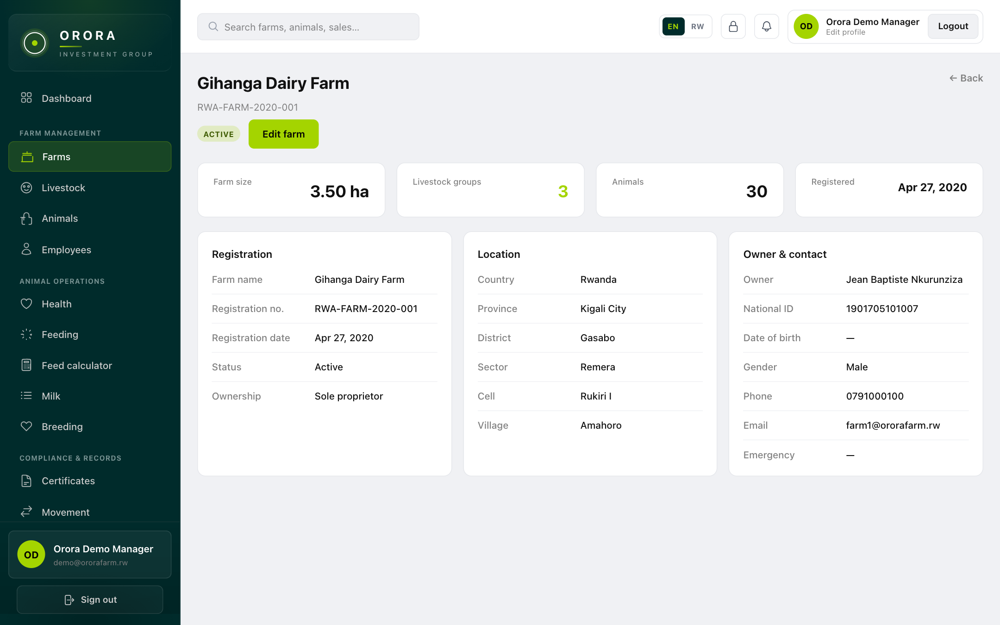

> **Warning:** Deleting a farm is permanent and also deletes the farm's livestock groups, animals, flocks and the records tied to them. Do not delete a farm to "stop using" it. Edit it and set the **Status** to **Inactive**.

---

## 2. Livestock groups

### 2.1 Register a livestock group

**Purpose:** Group animals that are managed together (for example all lactating cows). The group is needed to register animals, and to record feeding, vaccination or treatment for a whole group at once.

**When to perform:** After the farm exists and before you register animals. Create one group for each class of animals you manage as one.

**Before you start:** Open **Livestock** and check the group is not already there for this farm.

**Steps**

1. Click **Livestock** in the left menu.
2. Click **+ Add livestock** (the add button at the top).
3. Choose the **Farm**. The choices below change to fit the farm type.
4. Enter **Breed**, **Head count** and **Status**.
5. Tick everything that applies under **Livestock types**, **Group / herd**, **Production purpose**, **Farming method** and **Feeding method**.
6. If you tick **Other** in any list, type your own text in the box that appears.
7. Click save.

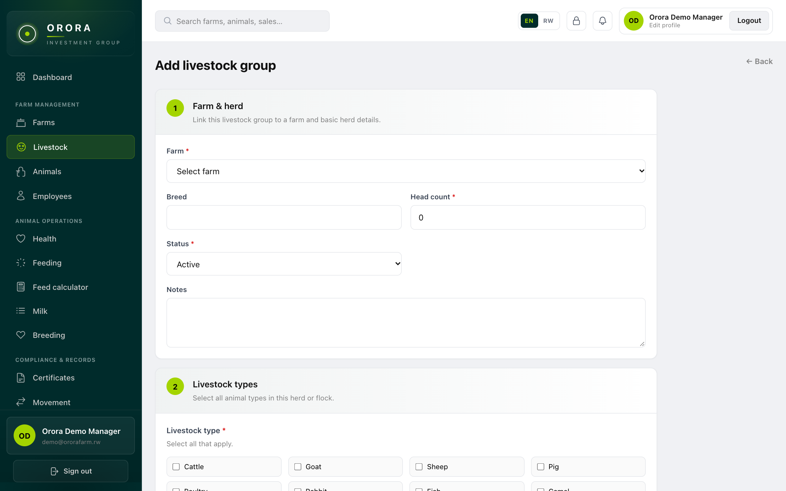

**Fields**

| Field | What to enter | Required? | Rules |
|---|---|---|---|
| Farm | The farm | Yes | Must exist |
| Breed | e.g. "Friesian" | No | Up to 255 characters |
| Head count | How many animals are in the group, e.g. `12` | Yes | Whole number, 0 or more |
| Status | Active or Inactive | Yes | |
| Livestock types | Tick one or more: Cattle, Goat, Sheep, Pig, Poultry, Rabbit, Fish, Camel, Donkey, Horse, Bee Colony, Mixed Livestock, Other (poultry farms: Poultry, Other) | Yes (at least 1) | "Other" needs text |
| Group / herd (cattle) or House / flock group (poultry) | Cattle: Calves Group, Heifer, Cows (lactating), Pregnant Cows, Dry Cows, Bulls, Steer (castrated male), Other. Poultry: Day-old chicks, Pullets, Layers, Broilers, Breeders, Cockerels, Other | Yes (at least 1) | "Other" needs text |
| Production purpose | Cattle: Meat Production, Dairy Production, Breeding, Other. Poultry: Egg Production, Meat Production, Breeding, Other | Yes (at least 1) | "Other" needs text |
| Farming method | e.g. Zero Grazing, Semi-Intensive, Free Range, Deep Litter, Cage System... | Yes (at least 1) | "Other" needs text |
| Feeding method | e.g. Stall Feeding, Zero Grazing (Cut-and-Carry), Hand Feeding... | Yes (at least 1) | "Other" needs text |
| Notes | Extra facts | No | |

**What happens after you save**

- The group is created and its details page opens with "Livestock group created successfully."
- **The group's name is made for you** from the herd groups you ticked. For example, ticking "Cows (lactating)" gives a group named "Cows (lactating)". If you tick two, the name joins them with a comma. You will pick animals by this name later, so tick groups carefully.
- The group appears in the **Livestock group** drop-down when you register animals.

**Common mistakes**

- Expecting **Head count** to change by itself. It does **not** update when you add or remove animals. Update it yourself.
- Creating a new group for every few animals. Keep groups simple: one per class of animals.
- Choosing a farm of the wrong type, so the list of choices looks strange. Choose the right farm first.

### 2.2 Find, view, edit, delete a group

- **Find:** Search (group name, breed, notes, farm) and filter by **Farm** and **Status**.
- **View:** The details page shows Head count, **Animals registered** (how many animal records exist), Farm, Breed, **Herd classification**, **Management** (farming and feeding methods) and Notes.
- **Edit:** **Edit group**, then save. The name is rebuilt from the herd groups you tick.
- **Delete:** Confirm the question. The **animals stay**, but show as "No group". Fix them by editing each animal.

---

## 3. Animals (cattle farms)

### 3.1 Register an animal

**Purpose:** Give each animal its own record so you can track its health, feeding, milk and breeding.

**When to perform:** When an animal is bought, born on the farm, or already on the farm when you start using OroraFarm. (For many animals at once, use the import in section 4.)

**What you need:** The farm and group, a **tag number**, a **name**, gender, and its health and lifecycle status. Birth date and weight are very helpful. The Feed calculator needs the weight.

**Before you start: avoid duplicates**

1. Open **Animals** and search the tag number (for example "RW-001") and the name.
2. Tag numbers must be unique **inside the same livestock group**.

**Steps**

1. Click **Animals** in the left menu.
2. Click **+ Register animal**.
3. **Identity:** choose **Farm**, then **Livestock group**, then type **Animal name**, **Tag number**, choose **Gender**. Optionally add a **Photo**.
4. **Physical profile:** **Birth date** (the **Age** box fills itself), **Weight (kg)**, **Color / markings**, **Species**, **Breed**.
5. **Acquisition and lineage:** **Acquisition type**, **Acquisition date**, **Source**, **Mother tag**, **Father tag**.
6. **Status:** **Health status**, **Production status**, **Lifecycle status**, **Current condition**, **Notes**.
7. Click save.

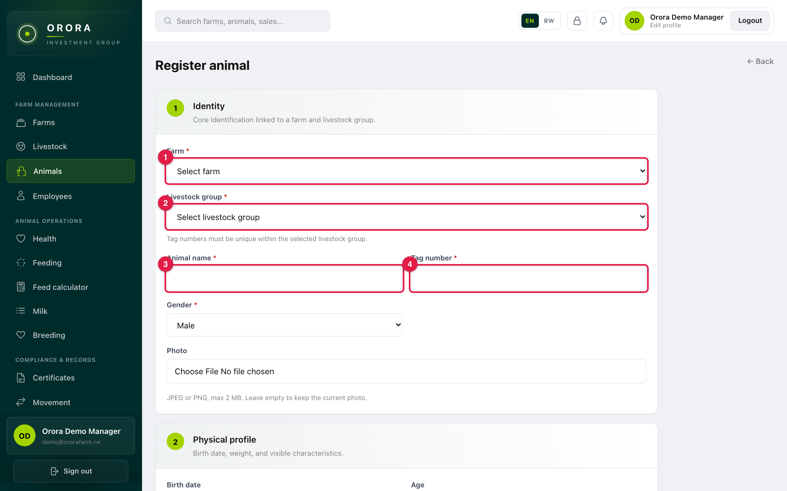

**Fields**

| Field | What to enter | Required? | Rules |
|---|---|---|---|
| Farm | The farm | Yes | |
| Livestock group | The group the animal belongs to | Yes | Must belong to the chosen farm |
| Animal name | "Inyange" | Yes | Up to 255 characters |
| Tag number | "RW-001" (the ear tag) | Yes | Up to 100 characters. Unique within the group. |
| Gender | Male, Female, Unknown | Yes | |
| Photo | A picture of the animal | No | JPEG or PNG, up to 2 MB |
| Birth date | Date of birth | No | Not in the future |
| Age | Shown by OroraFarm | (read-only) | Worked out from birth date |
| Weight (kg) | `420` | No | Number, 0 or more |
| Color / markings | "Black and white patches" | No | Up to 255 characters |
| Species | Cattle, Goat, Sheep, ... | No | Choose from list, or "Not set" |
| Breed | "Friesian" | No | Up to 255 characters |
| Acquisition type | Purchased, Born on farm, Gift, Transfer, Loan, Auction, Other | No | |
| Acquisition date | When it joined the farm | No | A date |
| Source | Seller, farm or origin | No | Up to 255 characters |
| Mother tag | The dam's tag | No | Up to 100 characters. Just text; not linked to the mother's record. |
| Father tag | The sire's tag | No | Up to 100 characters |
| Health status | Healthy, Pregnant, Sick, Under treatment, Quarantined, Recovering, Deceased | Yes | |
| Production status | Lactating, Dry, Growing, Breeding, Fattening, Pregnancy, Not applicable | No | |
| Lifecycle status | Active, Sold, Deceased, Transferred, Missing, Retired | Yes | |
| Current condition | Good, Fair, Poor, Critical, Under observation | No | |
| Notes | Anything else | No | |

> **Example:** Inyange, Friesian cow, tag RW-001, group "Cows (lactating)", born 10 May 2022, 420 kg, acquisition "Born on farm", health "Healthy", production "Lactating", lifecycle "Active", condition "Good".

**What happens after you save**

- The animal is created and its details page opens with "Animal registered successfully."
- The photo, if any, is stored.
- The animal now appears in drop-downs in Health, Feeding, Milk, Breeding, Certificates and Movement.
- It is counted in **Active animals** on the dashboard.
- **Lactating** cows (production status Lactating) appear as milking candidates in the Milk module. If you leave production status empty, cows in a "Cows (lactating)" group are treated as milking cows.
- Other modules change this animal's status for you later. See the table below.

**Statuses changed automatically by other modules**

| When you do this | The animal's status changes to |
|---|---|
| Save a **Disease record** for the animal | Health status becomes Sick, Recovering, Healthy, Quarantined or Deceased, depending on the recovery status and the Quarantine tick |
| Save a **Mortality** record for the animal | Health status **Deceased** and lifecycle **Deceased** |
| Confirm pregnancy in a **Pregnancy check** | Health **Pregnant**, production **Pregnancy** |
| Record a pregnancy check result "Not pregnant" | Back to **Healthy**, production cleared (only if it was Pregnant) |
| Record a **Birth** | Mother: health Healthy (or Sick if weak/critical), production **Lactating** (cattle), or Deceased if the mother died |
| Send the animal to the **abattoir** | Lifecycle **Transferred** |

**Common mistakes**

- Same tag in the same group, for example two "RW-001". Use a clear tag scheme.
- Leaving **Weight (kg)** empty. The Feed calculator then warns you.
- Setting lifecycle status to Sold by hand when the animal was sold through the Sales module. Use the Sales module so money is recorded too.
- Forgetting that a farm must have at least one livestock group before you can register an animal.

### 3.2 Find, view, edit and delete an animal

- **Find:** Search (tag, name, farm, group) and filter by **Farm**, **Group**, **Gender**, **Health**, **Lifecycle**. The list shows Animal, Location, Health, Production and Age.
- **View:** The details page shows Tag number, Name, Gender, Farm, Livestock group, Age, Weight, Production, Condition, **Physical profile**, **Acquisition & lineage**, **Quick links** (View farm, View livestock group) and Notes.
- **Edit:** **Edit animal**. Choosing a new photo replaces the old one. Leave the photo box empty to keep it.
- **Delete:** Confirm "Delete this animal?".

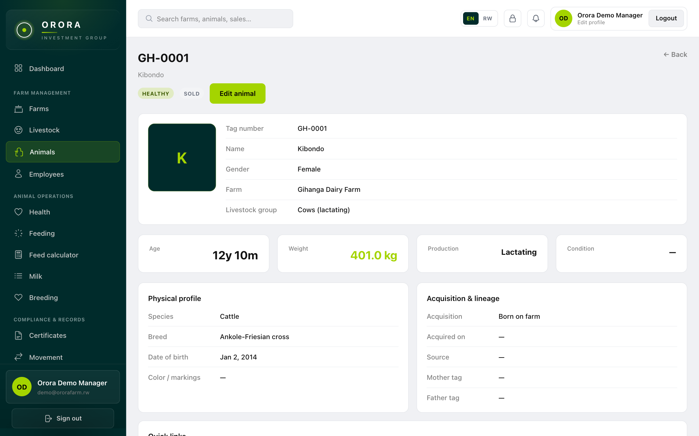

> **Warning:** Deleting an animal also deletes that animal's health records, vaccinations, treatments, milk records and breeding records. If the animal died or was sold, do **not** delete it. Record the death in **Health, Mortality**, or record a sale in **Sales**, so the history is kept.

---

## 4. Import and export animals

### 4.1 Export animals

**Purpose:** Download your animal register as a spreadsheet file (CSV).

1. Open **Animals**. Choose any filters you want (Farm, Group, Gender, Health, Lifecycle).
2. Click **Export CSV**.
3. A file called `animals-YYYY-MM-DD-HHMMSS.csv` downloads. Open it in Excel or Google Sheets.

The export contains only the animals that match your filters (not the search box). Columns: farm_name, livestock_name, tag_number, name, gender, health_status, lifecycle_status, date_of_birth, weight_kg, color_markings, species, breed, acquisition_type, acquisition_date, source, mother_tag, father_tag, production_status, current_condition, notes.

### 4.2 Import animals

**Purpose:** Register many animals at once, for example when you move from a paper register.

**When to perform:** When you start using OroraFarm with many animals already on the farm, or after a bulk purchase.

**What you need:**

- The **farm must already exist**, spelled exactly as in OroraFarm.
- A spreadsheet in CSV, TXT or Excel (.xlsx) format, **up to 5 MB and 2,000 rows**.

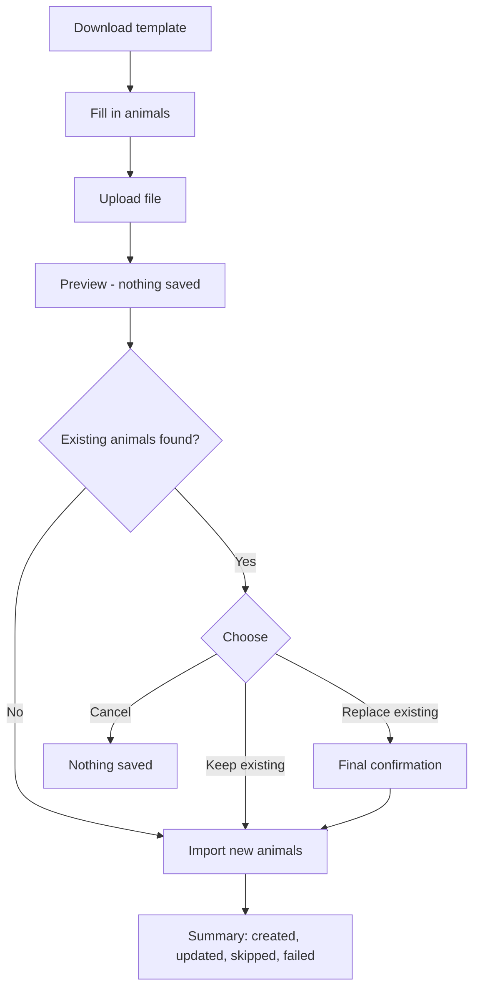

*The import always shows a preview before saving anything.*

**Steps**

1. Open **Animals**, click **Import**.
2. Click **Download template** (or **Download CSV template**). Open it. Row 2 is an example.
3. Fill one row per animal. Keep the header row. Delete the example row.
4. Back on the import page, click **Choose file** under **Import file** and select your file.
5. Click **Upload & preview**.
6. Read the **Preview summary**: **Rows in file**, **New animals**, **Existing animals**, and any **Invalid rows** with the reason.
7. Decide:
   - If there are no existing animals, click **Import N new animals**.
   - If some animals already exist (same tag in the same group), choose **Keep existing** (leave them as they are and only add new ones), **Replace existing** (update them with the file values), or **Cancel import**.
   - If you choose **Replace existing**, a **Final confirmation** page asks you to click **Confirm replace**.
8. Read the result: **Created**, **Updated**, **Skipped**, **Failed** and the lists **Rows adjusted** and **Import errors**.

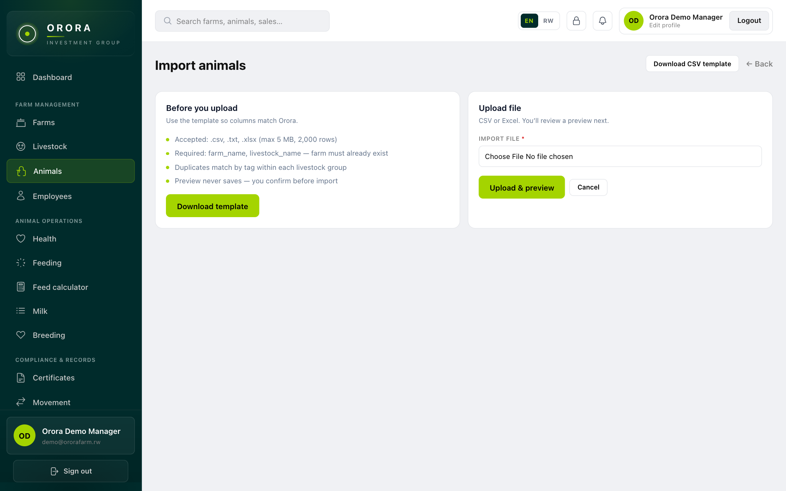

**Columns in the file**

| Column | Required? | What to put |
|---|---|---|
| farm_name | **Yes** | The exact farm name. The farm must exist. |
| livestock_name | **Yes** | The livestock group name, e.g. `Cows (lactating)`. If it does not exist on that farm, OroraFarm **creates it** for you. |
| tag_number | No | The tag. If blank, OroraFarm assigns one like `INY-0001` (first three letters of the farm name plus a number). |
| name | No | If blank, the tag number is used as the name. |
| gender | No | male/female/unknown (also m, f, u). Blank or unknown values become unknown. |
| health_status | No | Healthy, Pregnant, Sick, ... Unknown values become Healthy. |
| lifecycle_status | No | Active, Sold, ... Blank becomes Active. |
| date_of_birth, acquisition_date | No | Dates. `2022-05-10` is safest. Day/month/year is read first. A future birth date is cleared. |
| weight_kg | No | A number. Text is cleared. |
| color_markings, species, breed, source, mother_tag, father_tag, notes | No | Free text |
| acquisition_type | No | Purchased, Born on farm, Gift, Transfer, Loan, Auction, Other |
| production_status, current_condition | No | As in the animal form |

Other header names also work, such as "Farm", "Group", "Tag", "Sex", "DOB", "Weight". Use the template to be safe.

**What happens after you import**

- New animals are created (with the farm and group found by name).
- Missing livestock groups are created automatically, named after your text, marked "Created automatically during animal import." Check these groups afterwards and complete their details (types, purposes, methods).
- Rows with small problems are saved with a fix and listed under **Rows adjusted** (for example "Gender was blank, so unknown was used.").
- Rows with bad data (missing farm, unknown farm, duplicate tag inside the file) are **not saved** and listed under **Import errors** with the row number.
- With **Replace existing**, matching animals get the new values.
- Your upload is discarded when the import finishes.

**Common mistakes**

- A farm name spelled differently from OroraFarm ("Inyange Farm" vs "Inyange Dairy Farm"). The row fails.
- The same tag twice in the same group in the file.
- Using Excel formats that change tags, e.g. `001` becoming `1`. Format the tag column as Text.
- Importing the same file twice with **Replace existing** by mistake, overwriting edits made in OroraFarm.
- Leaving the preview open for a long time. If you see "Your import preview expired. Upload the file again.", upload again.

---

## 5. Certificates

### 5.1 Add a certificate

**Purpose:** Keep a record of official papers: health, vaccination, export, ownership, transport.

**When to perform:** When a certificate is issued or renewed.

**Steps**

1. Click **Certificates** in the left menu.
2. Click **Add certificate**.
3. Choose the **Farm**. Optionally choose an **Animal** (cattle farms) or a **Flock** (poultry) the certificate is for. Choose one at most.
4. Choose the **Certificate type**, enter the number and authority, the dates and the **Status**.
5. Click save.

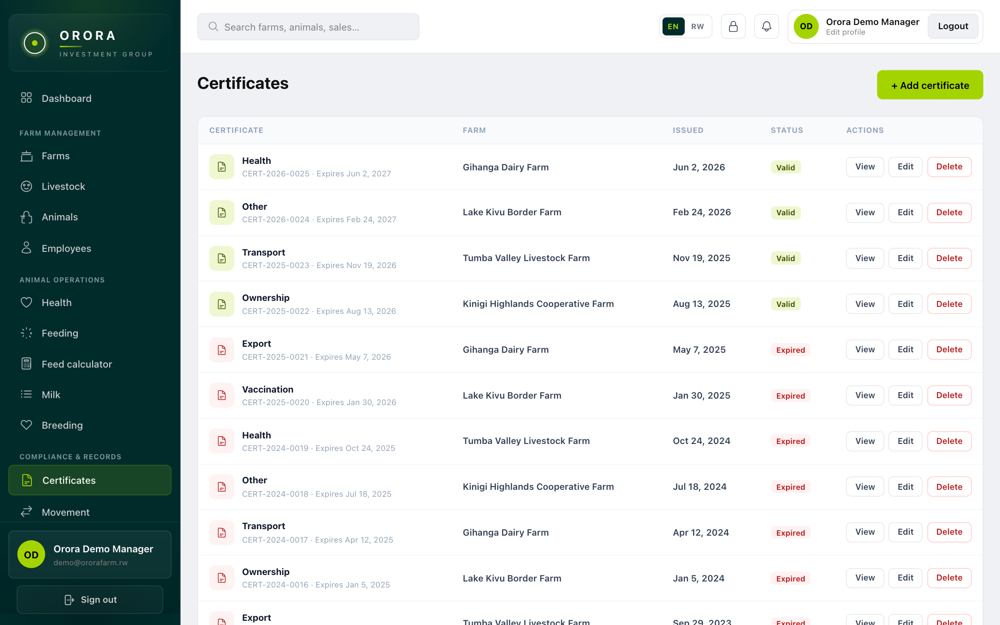

| Field | What to enter | Required? | Rules |
|---|---|---|---|
| Farm | The farm | Yes | |
| Animal / Flock | The animal or flock covered | No | Choose **one or the other**, not both |
| Certificate type | health, vaccination, export, ownership, transport, other | Yes | |
| Certificate number | The number on the paper | No | Up to 255 characters |
| Issuing authority | e.g. "RAB" or "District vet office" | No | Up to 255 characters |
| Issued on | Date issued | Yes | A date |
| Expires on | Date it ends | No | Not before Issued on |
| Status | valid, expired, revoked | Yes | You choose it. It does **not** change by itself when the date passes. |
| Notes | Extra facts | No | |

**What happens after you save:** The certificate appears in the list ("Certificate created successfully."). If it **expires within 30 days**, the dashboard shows a **Certificates expiring** warning.

**Common mistakes**

- Forgetting to change the **Status** to expired when the date has passed.
- Choosing an animal and a flock together.

> **Note:** Certificates are records only. OroraFarm does not block a sale or movement if a certificate is missing or expired.

---

## 6. Movements

### 6.1 Record a movement

**Purpose:** Keep a log of animals or birds moving between farms or leaving the farm (transfer, sale, death, export, other).

**When to perform:** On the day the animals or birds move.

**Steps**

1. Click **Movement** in the left menu.
2. Click **+ Record movement**.
3. Choose the **Animal** (cattle farm) or the **Flock** (poultry farm), enter **Quantity** (heads moved; use 1 for a single animal), the **Movement type**, **From farm**, optional **To farm**, **Moved on**, optional **Reference** (for example a permit number) and **Notes**.
4. Click save.

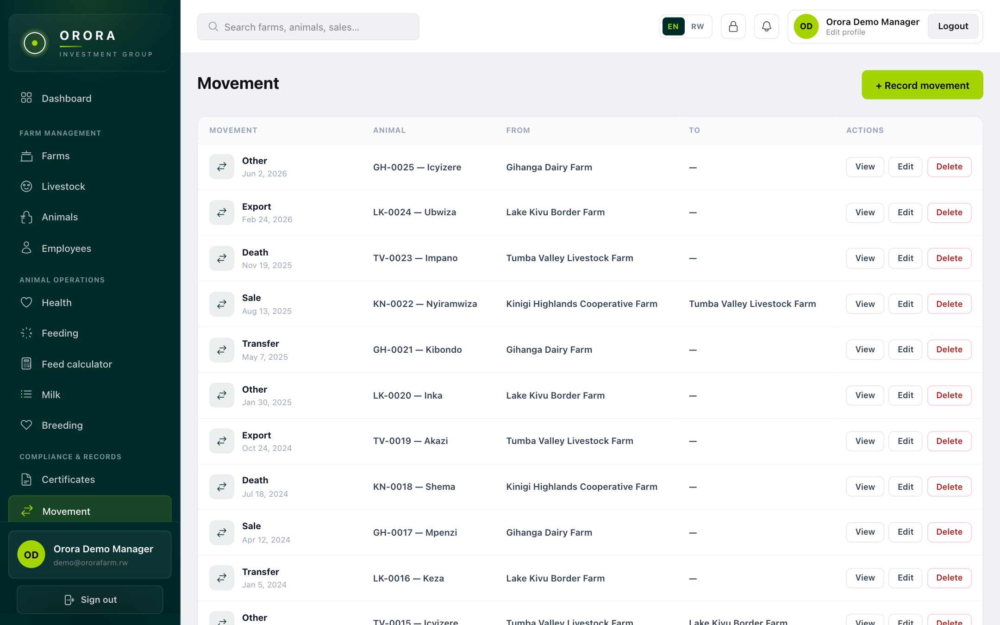

| Field | What to enter | Required? | Rules |
|---|---|---|---|
| Animal / Flock | What moved | Yes, one of them | Choose **either** an animal **or** a flock |
| Quantity | Number of heads or birds | No | Whole number, at least 1 |
| Movement type | transfer, sale, death, export, other | Yes | |
| From farm | Where it left | Yes | |
| To farm (optional) | Where it went | No | Must be a **different** farm from "From farm" |
| Moved on | Date | Yes | |
| Reference | Permit or document number | No | Up to 255 characters |
| Notes | Extra facts | No | |

**What happens after you save:** The movement is added to the log ("Movement recorded successfully."). **That is all.** It does **not** move the animal to the other farm, change a flock's bird count, or mark an animal sold or dead.

> **Warning:** To really sell an animal, use **Sales**. To record a death, use **Health, Mortality**. Movement is only the paper log.

---

## 7. Mortality of an animal

**Purpose:** Record the death of an animal, with cause and how the body was disposed of.

**When to perform:** On the day of death.

**Steps**

1. Click **Health**, then the **Mortality** tab.
2. Click **+ Add mortality record**.
3. Choose the **Farm**, then the **Animal**.
4. Enter the **Death date** and other details.
5. Click **Save mortality record**.

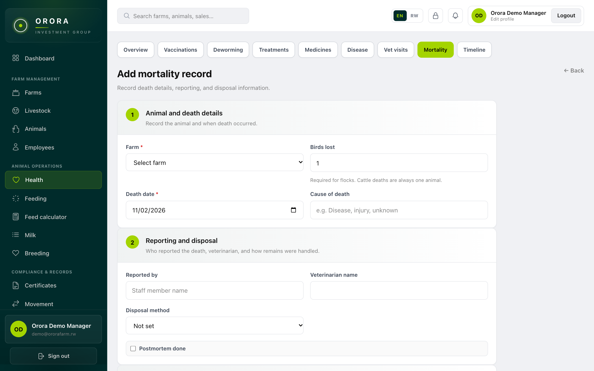

| Field | What to enter | Required? | Rules |
|---|---|---|---|
| Farm | The farm | Yes | |
| Animal | The animal that died | Yes (or a Flock, see chapter 7) | Choose an animal **or** a flock |
| Birds lost | Only for flocks | For flocks only | For an animal it is always 1 |
| Death date | Date of death | Yes | A date |
| Cause of death | e.g. "East Coast fever" | No | Up to 255 characters |
| Reported by | Who reported it | No | Up to 255 characters |
| Veterinarian name | The vet | No | Up to 255 characters |
| Disposal method | Burial, Rendering, Incineration, Composting, Other | No | "Other" needs text |
| Postmortem done | Tick if yes | No | |
| Notes | Extra facts | No | |
| Attachment | Report or photo | No | PDF, JPG, PNG, DOC, DOCX up to 5 MB |

**What happens after you save**

- The animal's health status and lifecycle status both become **Deceased**.
- A **Mortality** entry is added to the health history (timeline) of the animal.
- The animal is no longer "Active". It stays in the register for history.

**Common mistakes**

- Deleting the animal instead of recording its death. This erases its history.
- Recording the same death twice. Check the Mortality list first.

---

## 8. Abattoir dispatch (cattle farms only)

**Purpose:** Record animals sent to an abattoir (slaughterhouse), then record the meat cuts returned.

**When to perform:** On the day the animals leave for the abattoir, and again for each return of meat.

**Where:** **Sales**, then the **Abattoir** tab. This is available only on cattle farms; poultry workspaces do not see it. You need access to the **Sales** module.

### 8.1 Dispatch animals

**Steps**

1. Open **Sales**, then **Abattoir**.
2. Click **+ New dispatch**.
3. Choose the **Farm** and **Dispatch date**.
4. Enter the **Abattoir name** and optional location, contact person, transport, vehicle plate, driver and expected return date.
5. Tick the animals to send. Enter each animal's live weight if you know it (it starts from the animal's saved weight).
6. Click save.

| Field | What to enter | Required? | Rules |
|---|---|---|---|
| Farm | The farm | Yes | |
| Dispatch date | Date animals leave | Yes | |
| Abattoir name | e.g. "Nyabugogo Abattoir" | Yes | Up to 255 characters |
| Location, Contact person | Details | No | Up to 255 characters |
| Transport | Transport method | No | Up to 50 characters |
| Vehicle plate, Driver | Details | No | Plate up to 50, driver up to 255 characters |
| Expected return | Date | No | |
| Notes | Extra facts | No | |
| Animals | Tick at least one animal | Yes | Each must be **Active** and **Healthy** |
| Live weight | kg per animal | No | |

**What happens after you save**

- A dispatch with a code such as `ABT-20261005-0001` is created with status "dispatched".
- Each chosen animal's lifecycle becomes **Transferred**.
- You land on the dispatch details page: "Animals dispatched to abattoir."

> **Warning (known problem):** Only **Active** and **Healthy** animals may be sent. If you tick an animal that is not, OroraFarm cannot show a friendly message; the page may show a server error and **nothing is saved**. Before you dispatch, check each animal's **Health status** is Healthy and **Lifecycle** is Active in the Animals list.

### 8.2 Record a return of meat

1. Open the dispatch (click **View**).
2. In the return section choose the **Animal**, **Return date**, **Cut type** (whole carcass, hindquarter, forequarter, ribs, offal, mixed), **Cut weight (kg)**, and optionally **Carcass weight (kg)**, **Dressing percentage** (0 to 100), **Grade** and **Notes**.
3. Click save. You see "Abattoir return recorded."

The dispatch status becomes "returned" after any return is saved. Selling the meat is done in **Sales** as a meat sale (see the Sales chapter).

---

## Known limitations

- **Head count** on a livestock group is typed by hand; it does not follow the animals.
- **Movement** is a log only; it does not move animals or change counts.
- **Certificate status** is not automatic and certificates are not checked during sales or movements.
- **Mother tag** and **Father tag** are plain text, not links to other animals.
- The **Abattoir** dispatch can fail with a server error when an animal is not Active and Healthy (see warning above).
- Deleting records is permanent, and deleting a farm or an animal also removes records tied to it.
