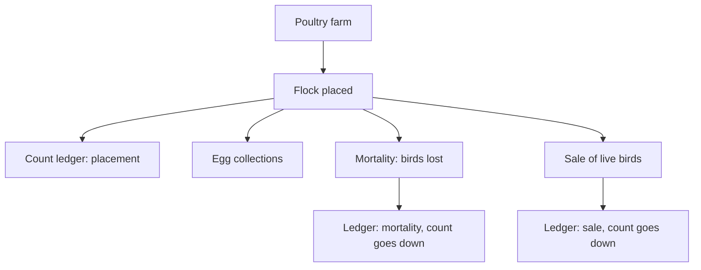
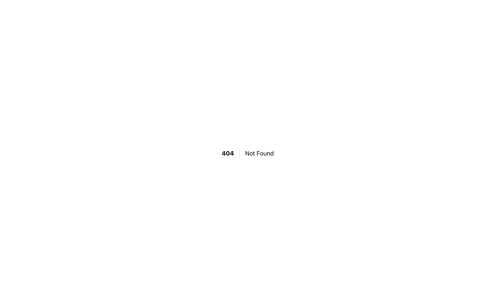

# Flocks, poultry and eggs

On a poultry farm you do not register each bird. You register a **flock**: a batch of birds that arrived together and are managed together, for example "Layers House 1, 500 birds placed on 3 March".

OroraFarm then keeps a **count ledger** for the flock: birds placed, birds lost, birds sold. It also records **egg collections** for the flock.

> **Note:** Flocks and Eggs appear in the menu only for **poultry farms**. See [Introduction](01-introduction.md) for how the menu follows the farm type. If your workspace has both cattle and poultry farms, choose the poultry farm in the **Farm** filter on the Dashboard and click **Apply** first.

## How poultry differs from cattle

| Topic | Cattle farm | Poultry farm |
|---|---|---|
| What you register | Individual **animals** with tags | **Flocks** with bird counts |
| Production record | **Milk** sessions | **Egg collections** |
| Death record | One animal (count is always 1) | Number of **Birds lost** from the flock |
| Health forms (vaccination, deworming, treatment, disease, vet visit) | Choose "Entire livestock group" or "One animal" | Choose a **Flock** |
| Feeding records and schedules | For a group or an animal | For a **Flock** (or none) |
| Breeding module | Yes | Not available |
| Abattoir dispatch | Yes | Not available |
| Sale types | Animal, meat, milk | Animal (live birds), egg, meat |
| Dashboard cards | Active animals, Lactating cows, Animals for sale | Birds on hand, Flock mortality, Eggs collected |
| Feed calculator | Weight-based | Fixed grams per bird per day by age and type |

*What touches a flock's bird count.*

---

## 1. Flocks

### 1.1 Place a flock

**Purpose:** Register a new batch of birds so you can count them, feed them, treat them and record their eggs.

**When to perform:** On the day the birds arrive, hatch or are moved into a house.

**What you need:** A poultry farm (Farm type = Poultry) already registered. The flock name, production type, placement date and the number of birds placed.

**Before you start: avoid duplicates**

1. Open **Flocks** and check the flock is not already listed.
2. Name flocks so they cannot be mixed up, for example "Layers House 1 - Mar 2026".

**Steps**

1. Click **Flocks** in the left menu.
2. Click **+ Place flock**.
3. **Farm & identity:** choose the **Farm** (only poultry farms are listed), optionally a **House / group**, then type the **Flock name**, choose **Production type**, and optionally **Breed** and **Source**.
4. **Placement:** enter **Placement date**, **Birds placed**, and optionally **Males** and **Females**.
5. **Housing & status:** optionally **House / pen** and **Expected harvest / end of lay**, then choose **Status**.
6. Add **Notes** if you wish.
7. Click save.

**Fields**

| Field | What to enter | Required? | Rules |
|---|---|---|---|
| Farm | A poultry farm | Yes | A cattle farm is refused: "Flocks can only be registered on poultry farms." |
| House / group | A livestock group used as housing | No | Must belong to the chosen farm. Create it first in **Livestock** if you want one. |
| Flock name | "Layers House 1" | Yes | Up to 255 characters |
| Production type | Layers, Broilers, Pullets, Breeders, Cockerels, Mixed | Yes | |
| Breed | e.g. "Isa Brown", "Cobb 500" | No | Up to 255 characters |
| Source | Purchased (hatchery), Own hatch, Transfer, Other | No | |
| Placement date | Day the birds arrived | Yes | A date |
| Birds placed | `500` | Yes | Whole number, at least 1 |
| Current count | (edit form only) corrected number of birds now | No | Whole number, 0 or more. See below. |
| Males | Number of males | No | Whole number, 0 or more |
| Females | Number of females | No | Whole number, 0 or more |
| House / pen | "House 1" | No | Up to 255 characters |
| Expected harvest / end of lay | Planned date | No | Not before the Placement date |
| Status | Active, Sold, Deceased, Transferred, Missing, Retired | Yes | Use **Active** for birds you still keep |
| Notes | Extra facts | No | |

**What happens after you save**

- The flock is created with a **flock code** such as `FLK-20260303-0001`.
- **Current count** starts equal to **Birds placed**.
- A first line is written in the flock's **Count ledger**: "Placement", +500, balance 500.
- You see "Flock placed successfully." and the flock's details page opens.
- The flock appears in the Flock drop-downs in Eggs, Health, Feeding, Certificates and Movement.
- The dashboard card **Birds on hand** now includes these birds.

**Common mistakes**

- Choosing a cattle farm. The farm list shows only poultry farms; if yours is missing, check its **Farm type**.
- Entering the wrong **Birds placed**. This number is also used to work out mortality percent.
- Registering one flock for birds of different ages. Place each batch separately.
- Putting a **Status** of Sold for a flock you still have.

### 1.2 View a flock

Click **View** on a flock. The page shows **Birds on hand**, **Placed**, **Mortality** (percent), **Type**, the **Placement** details (Farm, House / group, Breed, Source, Placed on, Expected end, House / pen, Males, Females) and the **Count ledger**.

The **Count ledger** lists every change in the number of birds: Date, Event, Qty, Balance. Events can be **Placement**, **Mortality**, **Sale** and **Adjustment** (a +/- fix). It is the history of the flock's count.

> **Note:** The **Mortality** percent is (birds placed - birds now) divided by birds placed. It counts **all** birds that left the flock, including birds you **sold**, not only deaths. Do not worry if it looks high after a sale.

For layers, pullets and breeders there is a **Log eggs** button that opens the egg form with the farm and flock already chosen.

### 1.3 Edit a flock

**Purpose:** Correct details or fix the bird count.

1. Open **Flocks**, click **Edit** on the flock (or **Edit flock** on its details page).
2. Change what is wrong.
3. Click save. "Flock updated successfully."

About **Current count**: this box is for **corrections only**. The form says "Use this for corrections. Mortality and sales update the count automatically." Do **not** type deaths or sales here. Record them in **Mortality** and **Sales** so the ledger and reports stay right.

> **Warning:** Changing **Current count** on the edit form changes the number but does **not** add a line to the Count ledger. The ledger will then not add up to the new number. Use it only to fix a real counting mistake.

### 1.4 Find and delete a flock

- **Find:** Use the **Farm** and **Production type** filters. The top shows total flocks, active flocks, birds on hand and birds placed.
- **Delete:** Click **Delete** and confirm "Remove this flock? This cannot be undone." Deleting removes the flock and its ledger, egg collections and linked records. If the flock is finished, set its **Status** to Sold or Retired instead.

---

## 2. Mortality (bird deaths)

**Purpose:** Record birds that died, so the flock count and mortality percent stay true.

**When to perform:** Every day you find dead birds, or at least at the end of each week. Daily is best.

**Steps**

1. Click **Health** in the left menu, then the **Mortality** tab.
2. Click **+ Add mortality record**.
3. Choose the **Farm**, then choose the **Flock** (do not choose an animal).
4. Enter **Birds lost** (how many died) and the **Death date**.
5. Fill in cause and other details if you know them.
6. Click **Save mortality record**.

| Field | What to enter | Required? | Rules |
|---|---|---|---|
| Farm | The poultry farm | Yes | |
| Flock | The flock the birds came from | Yes (for birds) | Choose **either** a flock **or** an animal, never both |
| Birds lost | Number of dead birds, e.g. `12` | **Yes for a flock** | Whole number, at least 1 |
| Death date | The day found dead | Yes | A date |
| Cause of death | e.g. "Newcastle disease", "Heat stress" | No | Up to 255 characters |
| Reported by | The person who found them | No | |
| Veterinarian name | The vet | No | |
| Disposal method | Burial, Rendering, Incineration, Composting, Other | No | "Other" needs text |
| Postmortem done | Tick if done | No | |
| Notes | Extra facts | No | |
| Attachment | Vet report or photo | No | PDF, JPG, PNG, DOC, DOCX up to 5 MB |

**What happens after you save**

- The flock's **current count** goes down by the number of **Birds lost** (it never goes below 0).
- A **Mortality** line (negative quantity) is added to the flock's **Count ledger**.
- A **Mortality** entry is added to the health history, with notes such as "Deaths: 12", reporter, disposal and postmortem.
- If the count reaches 0 and the flock was Active, its status automatically becomes **Sold**.
- You see "Mortality record saved successfully."

**If you edit or delete the record**

- **Edit** the number of birds lost: the flock count is corrected by the difference. If you change the flock, the birds go back to the old flock and are taken from the new one.
- **Delete** the record: the birds are **added back** to the flock (an **Adjustment** line is written in the ledger) and the health history entry is removed.

**Common mistakes**

- Recording deaths by editing **Current count** on the flock instead. Use Mortality.
- Typing the total of the week as one record dated one day. Use the real date for each loss, or at least the real week.
- Forgetting **Birds lost** (required for flocks).
- Recording the same deaths twice. Check the Mortality list first.

> **Example:** On 14 October, 12 layers from "Layers House 1" were found dead from heat. Record: Farm "Kigali Poultry Farm", Flock "Layers House 1", Birds lost 12, Death date 14 Oct, Cause "Heat stress". The flock goes from 480 to 468.

---

## 3. Egg collection

### 3.1 Record an egg collection

**Purpose:** Record the eggs collected from a flock, and how many were cracked, so you know how many are good to sell and what your lay rate is.

**When to perform:** After each collection round (for example morning and afternoon), or once at the end of the day.

**What you need:** The flock, the date, the number of eggs counted, and the number cracked.

**Before you start: avoid duplicates**

1. Open **Eggs**, then check **Recent collections** for the same flock, date and shift.
2. If you collect in rounds, use the **Shift** box so each round is its own record and you do not enter the day twice.
3. Remember: the database allows **only one record for the same flock, date and shift** (Morning, Afternoon, Evening or All day).

> **Warning (known problem):** If you save a second record for the same flock, date and a chosen shift, OroraFarm does not show a friendly message. The page shows a server error and nothing is saved. If you get an error, open **Eggs, Collections**, find the existing record and **Edit** it instead. (When **Shift** is left blank, this protection does not apply, so duplicates can be created by mistake. Check the list first.)

**Steps**

1. Click **Eggs** in the left menu.
2. Click **+ Record collection**. (You can also click **Log eggs** on a layer flock's page.)
3. Choose the **Farm**, then the **Flock**.
4. Enter the **Date**, optional **Shift**, **Eggs collected**, **Cracked**, optional **Weight (kg)** and **Collected by**.
5. Click save.

**Fields**

| Field | What to enter | Required? | Rules |
|---|---|---|---|
| Farm | The poultry farm | Yes | Poultry farms only: "Egg collections can only be recorded on poultry farms." |
| Flock | The flock the eggs came from | Yes | Must belong to the chosen farm |
| Date | Collection date | Yes | A date |
| Shift | Morning, Afternoon, Evening, All day | No | Blank is shown as "All day" |
| Eggs collected | Total eggs, e.g. `430` | Yes | Whole number, 0 or more |
| Cracked | Broken or cracked eggs, e.g. `6` | No | Whole number, 0 or more. **Cannot be more than Eggs collected.** Blank counts as 0. |
| Weight (kg) | Total weight of the eggs | No | Number, 0 or more |
| Collected by | The person who collected | No | Up to 255 characters |
| Notes | Extra facts | No | |

**What happens after you save**

- The collection is saved with a code such as `EGG-20261014-0001`.
- You see "Egg collection saved." and the **Collections** list opens.
- The **Eggs** overview numbers update: eggs (last 30 days), saleable eggs, lay rate.
- The dashboard card **Eggs collected** and the egg chart update.

**Common mistakes**

- Counting cracked eggs twice: put the **total** (good + cracked) in **Eggs collected**, and only the broken ones in **Cracked**.
- Choosing the wrong flock or farm.
- Entering a whole week in one record. Enter each day.
- Putting a **Cracked** number larger than the total. You get "Cracked eggs cannot exceed the total collected."

### 3.2 The Eggs overview

Click **Eggs** to see the **Overview**. Choose a **Farm** (or "All poultry farms") at the top.

| Number | Meaning |
|---|---|
| **Eggs (30 days)** | All eggs collected in the last 30 days |
| **Cracked** | Cracked eggs in the last 30 days |
| **Saleable** | Eggs minus cracked eggs |
| **Lay rate** | (eggs divided by 30 days divided by birds on hand) x 100. Birds on hand counts **active** flocks only. |
| **Birds on hand** | Total current birds in active flocks |
| **Recent collections** | The latest 10 collections |

### 3.3 Edit or delete an egg collection

- **Edit:** Open **Eggs**, **Collections**, click **Edit**. Change and save: "Egg collection updated."
- **Delete:** Click **Delete**. "Egg collection removed."

Egg collections do **not** change the bird count and do **not** create egg stock.

> **Note:** There is no "egg stock" screen. When you sell eggs in **Sales** (an Egg sale), OroraFarm records the sale and money, but it does not reduce any egg stock because none is kept.

---

## 4. Other poultry records

These work as in the other chapters, but choose a **Flock** instead of a livestock group or animal:

| Task | Where | Poultry difference | Chapter |
|---|---|---|---|
| Vaccination, deworming, treatment, disease, vet visit | Health | The target is a flock. The "group / animal" choice is not shown for poultry farms. | [9](09-health-treatments-and-breeding.md) |
| Feeding record and schedule | Feeding | Choose a flock, or leave the target empty to record for the farm | [8](08-feeding-and-feed-inventory.md) |
| Feed calculator | Feeding calculator | Uses fixed grams per bird per day | [8](08-feeding-and-feed-inventory.md) |
| Selling live birds | Sales | Item type "flock birds". You cannot sell more birds than the flock holds. When the sale is **completed**, the flock count goes down and a Sale line is added to the ledger. | Sales chapter |
| Certificates and Movement | Certificates, Movement | Choose a flock instead of an animal | [6](06-farms-and-livestock-registration.md) |

## Daily poultry routine (suggestion)

1. Morning: record the **egg collection** for each layer flock.
2. When you find dead birds: record **Mortality** with the number.
3. When feed is given: record **Feeding** for the flock.
4. When birds are vaccinated or treated: record it in **Health**.
5. At the end of the week: check **Eggs** overview and the dashboard.

## Known limitations

- The **Mortality** percent includes birds sold.
- **Current count** edits do not appear in the Count ledger.
- Saving a second egg collection for the same flock, date and shift causes a server error instead of a clear message. With no shift chosen, duplicates are silently allowed.
- There is no egg stock; egg sales do not reduce anything.
- When a flock's count reaches 0 by deaths, its status turns to **Sold**, even though no sale happened. Edit the status to Deceased or Retired if that is more accurate.
- The Breeding module is not available for poultry.
