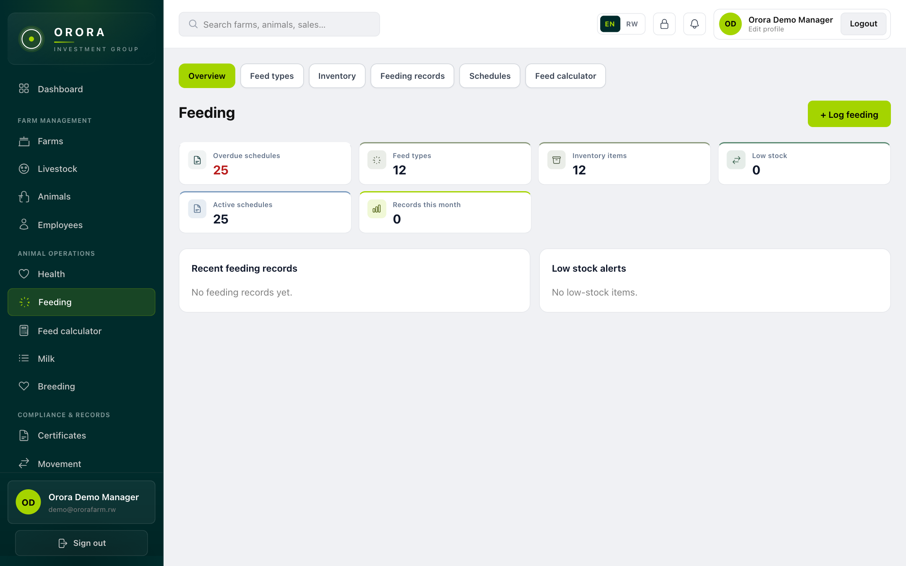
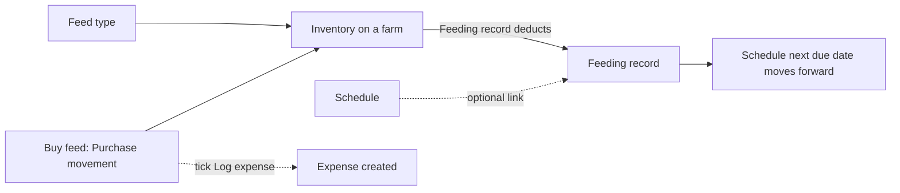
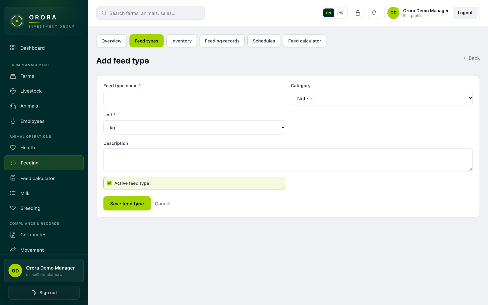
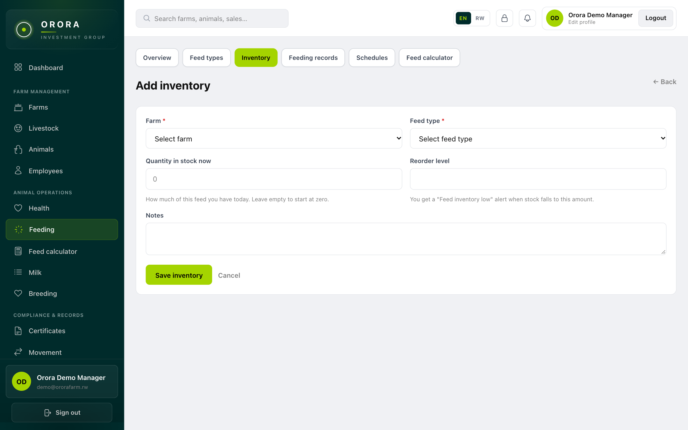
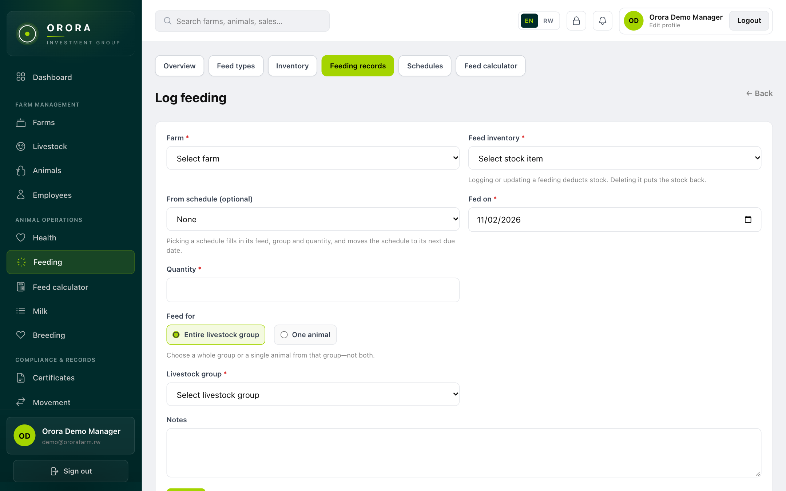
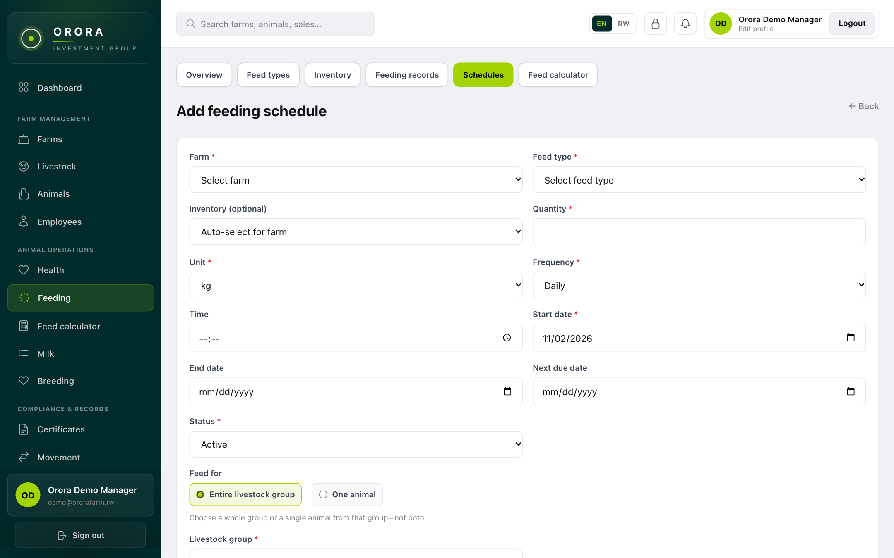
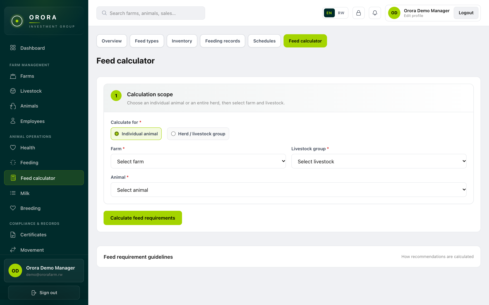

# Feeding and feed inventory

The **Feeding** module keeps track of what you feed, how much feed you have, and what you plan to feed. It has five parts. Use the tabs at the top of the Feeding module to move between them.

| Tab | What it is for |
|---|---|
| **Overview** | Summary numbers and recent records |
| **Feed types** | The list of feeds you use (for example "Napier grass", "Dairy meal") |
| **Inventory** | How much of each feed you have in stock on each farm, and stock in/out |
| **Feeding records** | What was actually fed, and to whom |
| **Schedules** | A plan: what to feed, how much, how often |
| **Feed calculator** | A suggestion of how much feed an animal or group needs (also a separate menu item) |

## How the feed flows

*Set up the feed type first, then the inventory line, then record purchases and feedings.*

The order of work is always:

1. Create the **Feed type** (once).
2. Create the **Inventory** line for that feed on the farm (once per farm and feed type).
3. Add stock when you buy or receive feed (**Purchase / stock in**).
4. Record each **Feeding** (stock goes down by itself).
5. Optionally create **Schedules** to remind you.

---

## 1. Feed types

### 1.1 Add a feed type

**Purpose:** Name each feed you use and give it a unit of measure.

**When to perform:** The first time you start using a new feed (for example when you buy a new brand of dairy meal).

**Before you start:** Open **Feeding, Feed types** and check the feed is not already there. OroraFarm does **not** check for duplicate names, so look first.

**Steps**

1. Click **Feeding**, then the **Feed types** tab.
2. Click **+ Add feed type**.
3. Fill in the form.
4. Click save.

| Field | What to enter | Required? | Rules |
|---|---|---|---|
| Feed type name | "Dairy meal 16%" | Yes | Up to 255 characters |
| Unit | kg, g, lb, bale, bag, liter | Yes | Pick how you count this feed. All stock of this feed uses this unit. |
| Category | Forage, Concentrate, Supplement, Mineral, Other | No | "Other" needs a custom category text |
| Description | Extra facts | No | |
| Active feed type | Tick if the feed is in use (ticked by default) | No | Inactive feeds cannot be fed |

**What happens after you save:** The feed type is added ("Feed type saved successfully."). It now shows in the list with the number of inventory lines and the total in stock. It can be used when you create inventory.

**Common mistakes**

- Adding "Dairy meal" again when "Dairy Meal 16%" already exists.
- Choosing the wrong **Unit**. Pick one that matches how you buy (for example **bag** if you buy 50 kg bags and count bags).
- Unticking **Active feed type** by mistake. An inactive feed cannot be selected for feeding records and cannot be consumed.

### 1.2 Edit or delete a feed type

- **Edit:** change and save ("Feed type updated successfully.").
- **Delete:** confirm the question.

> **Warning:** Deleting a feed type also deletes its **inventory lines and their stock history**, and any **schedules** that use it. Past feeding records stay but lose the link to the feed. If you just stop using a feed, untick **Active feed type** instead.

---

## 2. Feed inventory (stock)

An **inventory line** is the stock of one feed type on one farm, for example "Dairy meal at Inyange Dairy Farm: 300 kg".

### 2.1 Add an inventory line

**Purpose:** Start tracking stock of a feed on a farm.

**When to perform:** Once per farm and feed type, before you record feedings of that feed.

**Before you start: avoid duplicates:** OroraFarm allows only **one inventory line per farm and feed type**. If it already exists you get an error. Open the list and use the existing line.

**What you need:** The feed type must already exist and be active. Know how much of it you have right now.

**Steps**

1. Click **Feeding**, then **Inventory**.
2. Click **+ Add inventory**.
3. Choose the **Farm** and **Feed type**.
4. Enter **Quantity in stock now** (what you have counted today).
5. Optionally enter a **Reorder level** and **Notes**.
6. Click save.

| Field | What to enter | Required? | Rules |
|---|---|---|---|
| Farm | The farm that holds the feed | Yes | |
| Feed type | An active feed type | Yes | Only one line per farm and feed type: otherwise "has already been taken" |
| Quantity in stock now | Your counted stock, e.g. `300` | No | Number, 0 to 100,000,000. Shown on the **add** form only. |
| Reorder level | The amount at which you want a warning, e.g. `50` | No | Number, 0 or more |
| Notes | Extra facts | No | |

**What happens after you save**

- The inventory line is created. Its unit is taken from the feed type.
- If you entered a quantity above 0, OroraFarm writes an **"Opening stock"** movement (type "Adjustment (add)") so the history agrees with the balance.
- "Inventory item created successfully."
- If stock is at or below the **Reorder level**, the line shows **Low stock** and the dashboard shows a **Feed inventory low** warning.

**Common mistakes**

- Leaving the **Reorder level** empty. The low-stock warning only works for lines that have a reorder level.
- Typing the quantity in the wrong unit (for example 50 bags as `2500`).

### 2.2 Add or remove stock (movements)

**Purpose:** Change the stock when feed arrives, is corrected, or is lost.

**When to perform:** Every time you buy or receive feed, and whenever a stock count shows a difference.

You **cannot** edit the quantity directly on an existing line. You must record a movement so there is a history.

**Steps**

1. Click **Feeding**, then **Inventory**.
2. Click **Edit** on the line (the page also shows **Stock**, **Current stock**, **Reorder level**, **Status** and recent movements).
3. In **Add or remove stock** choose the **Movement type**, enter **Quantity** and **Date**, and **Notes**.
4. If you bought feed and want to record the cost, tick **Log expense for this record** and fill in the amount (RWF), vendor and payment details.
5. Click the save button for the movement.

| Field | What to enter | Required? | Rules |
|---|---|---|---|
| Movement type | **Purchase / stock in**, **Adjustment (add)**, **Adjustment (remove)** | Yes | "Consumption" is created only by feeding records, not by hand |
| Quantity | Amount in the line's unit | Yes | Number, at least 0.01 |
| Date | When it happened | No | Defaults to now |
| Notes | e.g. "Bought from Kigali Feeds, invoice 123" | No | |
| Log expense for this record | Tick to create an Expense | No | Only for **Purchase / stock in**. Needs **Amount (RWF)**. Vendor, payment method, paid by and notes are optional. |

**What happens after you save**

- The stock goes **up** (purchase, adjustment add) or **down** (adjustment remove). It can never go below 0: "Insufficient stock for this movement."
- A row is added to the movement history with the balance after.
- For a **Purchase** with **Log expense** ticked, an **Expense** is created (category "feed purchase", status paid, vendor created if new). See the Expenses chapter.
- "Stock movement recorded successfully."

**Common mistakes**

- Using **Adjustment (add)** for a purchase. Use **Purchase / stock in** so the cost can be recorded.
- Using **Adjustment (remove)** for feed you fed to animals. Record a **Feeding record** instead so there is a record of who ate it.
- Ticking **Log expense** without an amount.

### 2.3 Edit or delete an inventory line

- **Edit** the **Reorder level** and **Notes** on the line page and save ("Inventory updated successfully."). Do **not** change the farm or feed type of a line that already has history.
- **Delete** removes the line and its stock history ("Inventory item removed successfully."). Past feeding records stay but lose the link to this line.

---

## 3. Feeding records

### 3.1 Record a feeding

**Purpose:** Record that feed was given, so the stock goes down and you know what each group, animal or flock was fed.

**When to perform:** Every time feed is given (or once a day for the daily total).

**What you need:** The farm, the feed (an inventory line with enough stock), the date, the quantity, and who it was for.

**Before you start: avoid duplicates:** Open **Feeding records** and check today's entries. Saving the same feeding twice takes the stock out twice.

**Steps**

1. Click **Feeding**, then **Feeding records**.
2. Click **+ Log feeding**.
3. Choose the **Farm**.
4. Choose the **Feed inventory** (the feed on that farm).
5. Optional: choose **From schedule (optional)** if this feeding follows a plan.
6. Enter **Fed on** (date) and **Quantity**.
7. Under **Feed for** choose:
   - Cattle farm: **Entire livestock group** (then choose the **Livestock group**) or **One animal** (then choose the **Animal**).
   - Poultry farm: choose the **Flock**. You may also leave it empty to record feed for the whole farm.
8. Add **Notes** and click save.

| Field | What to enter | Required? | Rules |
|---|---|---|---|
| Farm | The farm | Yes | |
| Feed inventory | The stock line to take from | Yes | Must be on the chosen farm and an **active** feed type |
| From schedule (optional) | An active schedule on the same farm | No | Moves the schedule forward (see below) |
| Fed on | Date fed | Yes | A date |
| Quantity | Amount fed in the line's unit, e.g. `25` | Yes | Number, at least 0.01 |
| Feed for | Entire livestock group, or One animal (cattle) | Yes on cattle farms | |
| Livestock group | The group fed | Yes if "Entire livestock group" | Must belong to the farm |
| Animal | The animal fed | Yes if "One animal" | Must belong to the group and the farm |
| Flock | The flock fed (poultry) | No | Poultry farms only. A flock cannot be mixed with a group or animal. |
| Notes | e.g. "Morning feeding" | No | |

> **Example:** On 14 Oct, the herdsman fed 25 kg of Dairy meal to the group "Cows (lactating)" at Inyange Dairy Farm. Stock was 300 kg and is now 275 kg.

**What happens after you save**

- The feeding record is created. Its unit is taken from the inventory line.
- The stock **goes down** by the quantity. A **Consumption** movement is written in the stock history, linked to this feeding.
- If you linked a **schedule**, its **Next due date** moves to the first occurrence after the feeding date (daily +1 day, weekly +1 week, biweekly +2 weeks, monthly +1 month). If the new date is after the schedule's **End date**, the schedule becomes **Completed**.
- The **Feeding overview**, the dashboard **Feed stock** panel and the low-stock warning update.
- "Feeding record created successfully."

**If the stock is too low**

If you try to feed more than you have, nothing is saved and the page shows: "Insufficient stock for this movement." Fix the quantity, or first add stock (a purchase or correction).

**If the feed type is inactive**

You get: "This feed type is inactive and cannot be consumed."

**Common mistakes**

- Forgetting to add the purchase first. Then feeding fails with "Insufficient stock".
- Entering the quantity in the wrong unit.
- Choosing the wrong inventory farm. Choose the **Farm** first; the feed list follows it.
- Recording one feeding per animal for a whole group. Record it for the group.

### 3.2 Edit or delete a feeding

- **Edit:** OroraFarm first **puts the old quantity back** into stock, then **takes out the new quantity**. If the new amount is more than you have, it refuses and nothing changes. "Feeding record updated successfully."
- **Delete:** the quantity is **put back into stock** and the consumption line is removed. "Feeding record removed successfully."

This keeps stock correct. Never fix a wrong feeding by adjusting the stock; fix the feeding record.

---

## 4. Feeding schedules

### 4.1 Add a schedule

**Purpose:** Plan recurring feedings so the dashboard can warn you when one is overdue.

**When to perform:** When you set a routine (for example 20 kg of silage every day at 06:00 for the heifers).

**Steps**

1. Click **Feeding**, then **Schedules**.
2. Click **+ Add schedule**.
3. Choose the **Farm**, **Feed type**, optionally the **Inventory**.
4. Enter **Quantity**, **Unit**, **Frequency**, optional **Time**, **Start date**, optional **End date** and **Next due date**, and **Status**.
5. Choose **Feed for** (group, animal, or flock on poultry farms) and **Notes**.
6. Click save.

| Field | What to enter | Required? | Rules |
|---|---|---|---|
| Farm | The farm | Yes | |
| Feed type | The feed | Yes | |
| Inventory (optional) | A stock line of that feed on that farm | No | If you leave it empty, OroraFarm creates a stock line of 0 for this feed and farm (if none exists) |
| Quantity | Amount per feeding | Yes | At least 0.01 |
| Unit | kg, g, lb, bale, bag, liter | Yes | |
| Frequency | Daily, Weekly, Biweekly, Monthly | Yes | |
| Time | e.g. `06:00` | No | 24-hour hours:minutes |
| Start date | First day | Yes | A date |
| End date | Last day | No | Not before Start date |
| Next due date | When it is next due | No | Not before Start date. **Empty means the Start date.** |
| Status | Active, Paused, Completed | Yes | Only **Active** schedules give overdue warnings |
| Feed for | Livestock group / One animal (cattle); Flock (poultry) | Yes on cattle farms | |
| Notes | Extra facts | No | |

**What happens after you save**

- The schedule is saved ("Feeding schedule saved successfully.").
- **It does not take feed out of stock and does not create feeding records.** It is a plan only.
- Each time you log a feeding **From schedule**, the next due date moves forward.
- If an **active** schedule's next due date is before today, the dashboard shows **Scheduled feedings overdue**, and the schedule list shows it as overdue.

**Common mistakes**

- Expecting the schedule to feed automatically. You must still **Log feeding**.
- Not choosing the schedule in the feeding form, so the next due date never moves and it stays overdue.
- Leaving the schedule **Active** after the plan ended. Set it to **Completed** or **Paused**.

### 4.2 Edit or delete a schedule

Edit and save ("Feeding schedule updated successfully."), or delete after confirming. Past feeding records stay.

---

## 5. Feed calculator

**Purpose:** Get a suggested **daily** amount of feed for one animal or a whole group, split into roughage, concentrate and supplement.

**When to use it:** When planning daily rations, or buying feed.

**What it needs:** For cattle, the animal's **Weight (kg)** and **Production status**, and its birth date, filled in on its animal record. For poultry, the flock's production type and age.

**Steps**

1. Click **Feed calculator** in the menu (or the **Feed calculator** tab in Feeding).
2. Under **Calculate for** choose **Individual animal** or **Herd / livestock group**.
3. Choose the **Farm**, then the **Livestock group**, then (for individual) the **Animal**.
4. Click **Calculate feed requirements**.
5. Read the result: **Total daily feed** in kg per day, the split into **Roughage**, **Concentrate** and **Supplement**, a bar chart, an explanation of the rule used, and warnings. For a group you also see the **Total animals**, **Average per animal** and a table for each animal.

| Field | What to choose | Required? | Rules |
|---|---|---|---|
| Calculate for | Individual animal or Herd / livestock group | Yes | |
| Farm | An **active** farm | Yes | Only farms with status Active are listed |
| Livestock group | An **active** group on that farm | Yes | |
| Animal | An **active** animal in that group | Yes for individual | Not allowed for a herd |

How the answer is worked out (for your understanding):

- **Cattle and goats:** daily dry matter is a percent of body weight, which depends on the production status and age. For example a **lactating** cow gets 3.5% (low yield under 10 L/day), 4% (medium, 10 to 20 L/day) or 4.5% (high, over 20 L/day) of her weight. The yield comes from the average of her last 5 milking records; with no milk records the medium level is used. A **dry** cow gets 2%, a **pregnant** cow or breeding bull 2.5%. A growing calf under 6 months gets 3.5%.
- **Poultry:** a fixed amount per bird per day: chick 30 g, grower 80 g (4 to 8 weeks) or 120 g (older), laying hen 120 g, broiler 150 g, breeder 130 g.
- The total is then split, for example 45% roughage, 50% concentrate, 5% supplement for a medium-yield lactating cow.

> **Example:** Inyange, a lactating Friesian cow of 420 kg giving about 15 L/day, gets 4% of 420 kg = 16.8 kg per day. Split: 7.56 kg roughage, 8.4 kg concentrate, 0.84 kg supplement.

**What happens after you calculate:** The result is **only shown on the screen**. Nothing is saved, no feeding record is made and no stock is changed. Use the answer when you fill in a **Feeding record** or a **Schedule**.

**Common mistakes**

- Weight missing on the animal. You get the warning "Body weight is missing - enter weight on the animal profile for an accurate recommendation."
- Production status empty or wrong. The rule used may not fit.
- Treating the answer as exact. It is a guide; follow your vet or nutritionist for the final ration.
- Getting "No feeding rule matches this animal profile." This happens for animal types without rules (only cattle, goat, pig and poultry have rules).

---

## 6. Feeding overview

The **Overview** tab shows: **Overdue schedules**, **Feed types**, **Inventory items**, **Low stock**, **Active schedules**, **Records this month**, a list of **Recent feeding records** and **Low stock alerts**. Use it each morning to see what needs feed.

## Daily feeding routine (suggestion)

1. Check **Feeding, Overview** for overdue schedules and low stock.
2. Feed the animals.
3. Record each feeding in **Feeding records** (choose the schedule if there is one).
4. When feed arrives, record a **Purchase / stock in** and tick **Log expense**.
5. Once a month, count the stores and fix any difference with an **Adjustment**.

## Known limitations

- A schedule never creates feeding records or deducts stock by itself.
- Feed type names are not checked for duplicates.
- Deleting a feed type deletes its stock lines, stock history and schedules.
- The calculator does not save anything and does not know about the feeds you actually have in stock.
- Feed amounts in a feeding record use the unit of the stock line; OroraFarm does not convert between units.
