# Health, treatments and breeding

This chapter covers two modules:

- **Health:** vaccinations, deworming, treatments, medicines (stock), disease records, vet visits, general health records, mortality and the health timeline.
- **Breeding** (cattle farms only): breeding records, pregnancy checks, births and registering the calves.

Good health and breeding records protect your herd and your money. They also feed the dashboard alerts, so the farm manager is warned in time.

---

# Part A: Health

## The Health tabs

Click **Health** in the menu. The tabs are:

| Tab | What it holds |
|---|---|
| **Overview** | Counts, medicine alerts, charts and recent activity |
| **Vaccinations** | Vaccines given or planned |
| **Deworming** | Deworming given or planned |
| **Treatments** | Medicine given to a sick animal or flock (reduces medicine stock) |
| **Medicines** | The medicine store: stock, expiry, reorder level |
| **Disease** | Diagnosed diseases, severity and quarantine |
| **Vet visits** | Visits and treatments by a vet |
| **Mortality** | Deaths (see [chapter 6](06-farms-and-livestock-registration.md) for animals and [chapter 7](07-flocks-poultry-and-eggs.md) for birds) |
| **Timeline** | One list of all health history, newest first |

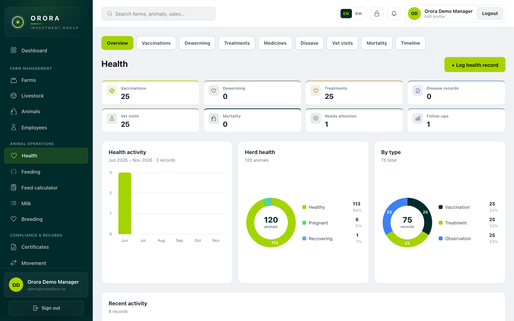

The overview shows: **Vaccinations**, **Deworming**, **Treatments**, **Disease records**, **Vet visits**, **Mortality**, **Needs attention**, **Follow-ups**, and the medicine alerts **Low stock medicines** and **Expired medicines**.

## Who or what is the record for? (the "target")

Every health form asks first for the **Farm**, then who it is about.

| Farm type | Choose |
|---|---|
| Cattle farm | **Entire livestock group** (then choose the **Livestock group**) or **One animal** (then choose the **Animal** from that group). Not both. |
| Poultry farm | A **Flock**. The group/animal choice is not shown. |

Choose from top to bottom: Farm, then group, then animal. The lists follow your choice.

## What every health record also creates for you

Most Health forms automatically add a line to the **health history (Timeline)** of the animal or flock. You do not enter this twice.

| You save a... | A Timeline entry of type | Animal status changed? |
|---|---|---|
| Vaccination | Vaccination | No |
| Deworming | Deworming | No |
| Treatment | Treatment | No |
| Disease record | Illness | **Yes** if the target is **One animal** |
| Vet visit | Vet visit | No |
| Mortality | Mortality | **Yes** (animal becomes Deceased) |
| General health record | the type you choose | **Yes** (the animal's health status is set to the status you choose) |

When you **edit** the record, its Timeline entry is updated. When you **delete** the record, its Timeline entry is deleted too.

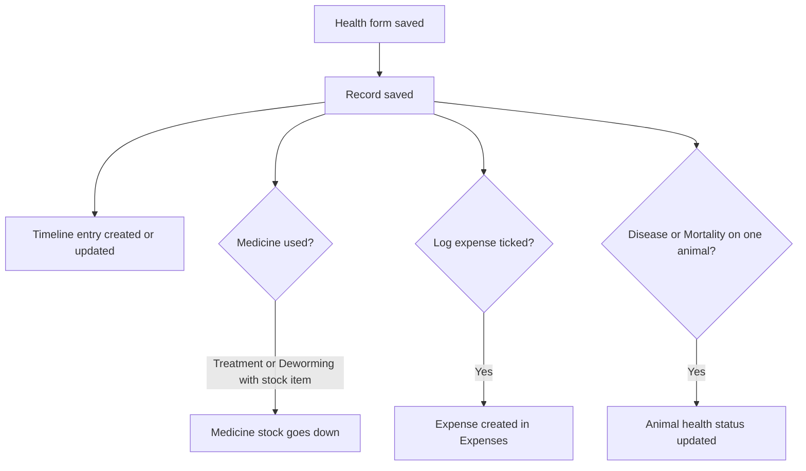

*What a Health save can trigger. Vaccinations and vet visits do not reduce medicine stock.*

## Linked expense and attachments (all Health forms)

At the bottom of the Vaccination, Deworming, Disease and Vet visit forms is **Expense (optional)**. Tick **Log expense for this record** to create an Expense of **Amount (RWF)** in the Expenses module. You can also set vendor, payment method, paid by and notes. The Treatment form has no expense section.

Attachments (lab results, vet reports) are optional. Sizes and types are in [chapter 5](05-creating-updating-records-and-forms.md).

---

## 1. Vaccinations

### 1.1 Add a vaccination

**Purpose:** Record vaccines given (or planned), so you know when the next dose is due.

**When to perform:** On the day the vaccine is given. You can also add a **Scheduled** one in advance.

**What you need:** Vaccine name, date, who is vaccinated, batch number if you have it.

**Before you start:** Open **Health, Vaccinations** and check this vaccination (same animal or group, same date) is not already there.

**Steps**

1. Click **Health**, then **Vaccinations**.
2. Click **+ Add vaccination**.
3. Choose the **Farm**, then the target (group or animal; flock on poultry farms).
4. Fill in **Vaccine name**, **Vaccination date**, **Status**, and the other boxes you know.
5. Set **Next due date** if a booster is needed.
6. Tick **Log expense** if you want to record the cost.
7. Click save.

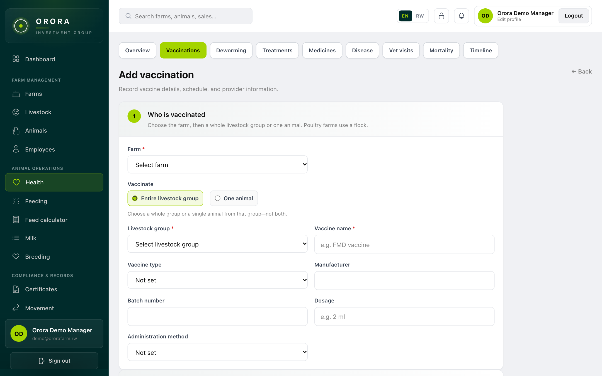

| Field | What to enter | Required? | Rules |
|---|---|---|---|
| Farm | The farm | Yes | |
| Vaccinate | Entire livestock group or One animal (cattle) | Yes (cattle) | |
| Livestock group / Animal / Flock | The target | Yes (the one that applies) | Must belong to the farm |
| Vaccine name | e.g. "FMD vaccine" | Yes | Up to 255 characters |
| Vaccine type | Live attenuated, Inactivated, Subunit, Toxoid, mRNA, Vector, Other | No | "Other" needs text |
| Manufacturer | e.g. "MSD" | No | Up to 255 characters |
| Batch number | From the bottle | No | Up to 100 characters |
| Dosage | e.g. "2 ml" | No | Up to 100 characters |
| Administration method | Injection, Subcutaneous, Intramuscular, Intranasal, Oral, Pour-on, Other | No | "Other" needs text |
| Vaccination date | Date given or planned | Yes | A date |
| Next due date | Date of the next dose | No | Not before Vaccination date |
| Status | Scheduled, Completed, Overdue, Cancelled | Yes | You choose it |
| Veterinarian name, Veterinary clinic, Administered by | Names | No | Up to 255 characters |
| Side effects, Reaction notes, Notes | Free text | No | |
| Attachment | Certificate or receipt | No | PDF, JPG, PNG, DOC, DOCX, up to 5 MB |
| Expense | Optional, see above | No | Amount needed if ticked |

**What happens after you save**

- The vaccination is saved: "Vaccination saved successfully."
- A **Vaccination** entry is added to the Timeline, with the **Next due date** as the follow-up date. If the status is **Completed**, the history shows "Healthy".
- If you ticked **Log expense**, an Expense is created.
- If **Next due date** is within 30 days (or already passed), the dashboard shows **Vaccinations due**.

**Common mistakes**

- Leaving **Status** on "Scheduled" after the vaccine was given. Change it to **Completed**.
- Not setting **Next due date** for boosters, so there is no reminder.
- Recording one vaccination per animal when the whole group was vaccinated. Record it for the **group**.
- Expecting the medicine stock to go down. **Vaccinations do not use the Medicines stock.**

> **Example:** On 5 Oct 2026, the whole group "Cows (lactating)" at Inyange Dairy Farm was given FMD vaccine, batch FM-2201, 2 ml, intramuscular, by Dr. Uwase, status Completed, next due 5 Apr 2027.

### 1.2 Edit or delete

Click **Edit**, change, save ("Vaccination updated successfully."). **Delete** removes the vaccination, its Timeline entry and its linked expense.

---

## 2. Deworming

### 2.1 Add a deworming

**Purpose:** Record deworming (drenching) so worm control is on time.

**When to perform:** On the day the product is given, or to plan it ahead.

**Steps**

1. Click **Health**, then **Deworming**.
2. Click **+ Add deworming**.
3. Choose **Farm** and target.
4. Enter **Product name**, **Deworming date**, **Status** and other details.
5. If the product is in your Medicines store and you want stock to go down, choose it under **Medicine inventory item** and enter **Quantity used**.
6. Click save.

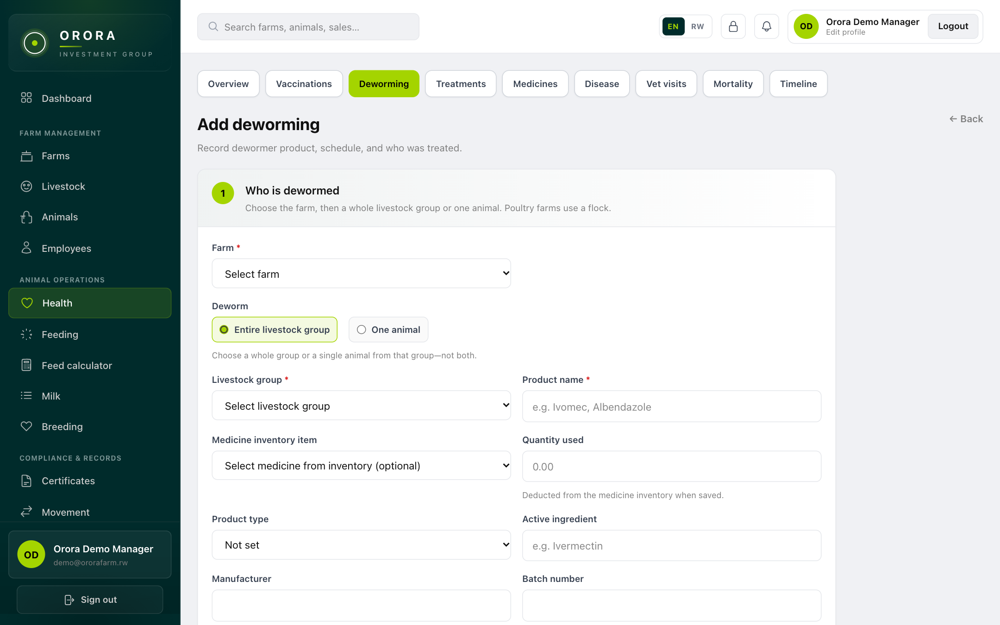

| Field | What to enter | Required? | Rules |
|---|---|---|---|
| Farm and target | As in vaccinations | Yes | |
| Product name | e.g. "Albendazole" | Yes | Up to 255 characters |
| Medicine inventory item | A medicine from your store | No | The list shows active medicines. On saving, an expired or inactive medicine, or not enough stock, is refused. |
| Quantity used | Amount taken from stock, e.g. `20` | No (needed to deduct stock) | At least 0.01 |
| Product type | Endoparasiticide, Ectoparasiticide, Endectocide, Oral drench, Injectable, Pour-on, Bolus, Other | No | "Other" needs text |
| Active ingredient, Manufacturer, Batch number, Dosage | Details | No | Text |
| Administration method | As in vaccinations | No | |
| Deworming date | The date | Yes | A date |
| Next due date | Next deworming | No | Not before Deworming date |
| Status | Scheduled, Completed, Overdue, Cancelled | Yes | |
| Veterinarian name, Administered by | Names | No | |
| Notes, Attachment, Expense | As elsewhere | No | |

**What happens after you save**

- The deworming is saved ("Deworming saved successfully.") and a **Deworming** Timeline entry is made.
- If you chose a **Medicine inventory item** and a **Quantity used**, the medicine stock **goes down** by that quantity and a "Used in treatment" movement is recorded. If the stock is too low, the medicine is expired or inactive, nothing is saved and an error is shown under **Quantity used**.
- A **Scheduled** deworming within the next 7 days shows on the dashboard as **Deworming scheduled soon**.
- Edit puts the old quantity back and takes out the new one. Delete puts the quantity back.

**Common mistakes**

- Choosing a medicine but leaving **Quantity used** empty. Then no stock is taken.
- Leaving a past deworming as "Scheduled".

---

## 3. Treatments

### 3.1 Add a treatment

**Purpose:** Record medicine given to a sick animal, group or flock. The medicine is taken out of stock.

**When to perform:** When treatment starts, and update it as it continues or finishes.

**What you need:** Disease or problem, the medicine, the quantity used, the start date.

**Before you start:** Make sure the medicine exists in **Health, Medicines** with enough stock. If it does not, you can register it on the spot (see below).

**Steps**

1. Click **Health**, then **Treatments**.
2. Click **+ Add treatment**.
3. Choose **Farm** and target.
4. Enter **Disease name**.
5. Under medicine choose **Use existing medicine** and pick it, or **Register new medicine** and enter its name, unit and opening stock.
6. Enter **Quantity used**, **Dosage**, treatment method, **Start date** and **Status**.
7. Click save.

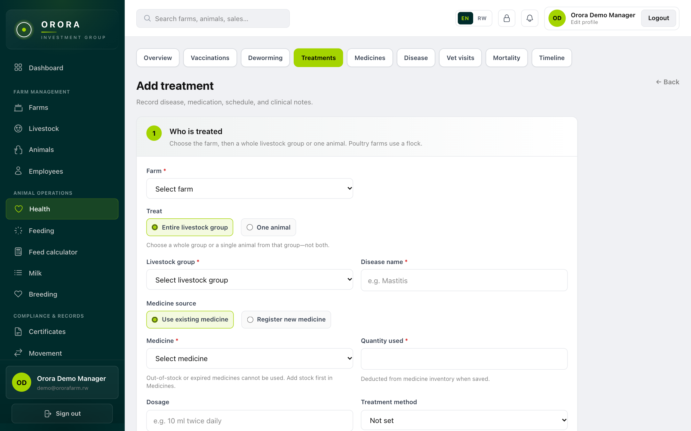

| Field | What to enter | Required? | Rules |
|---|---|---|---|
| Farm and target | As before | Yes | |
| Disease name | e.g. "Mastitis" | Yes | Up to 255 characters |
| Medicine (Use existing medicine) | Pick from the store | Yes | Must be **active**, with stock above 0, and not expired on the start date |
| New medicine name (Register new medicine) | e.g. "Oxytetracycline 20%" | Yes in this mode | Up to 255 characters |
| Unit | ml, mg, g, tablet, dose, vial, bottle, sachet | Yes in this mode | |
| Opening stock | How much you have | Yes in this mode | At least 0.01 |
| Quantity used | Amount given | Yes | At least 0.01. **Cannot be more than the stock** (or the opening stock for a new medicine). |
| Dosage | e.g. "10 ml per day" | No | Up to 100 characters |
| Treatment method | Oral, Injection, Topical, Intravenous, Intramuscular, Subcutaneous, Supportive care, Other | No | "Other" needs text |
| Start date | First day | Yes | A date |
| End date | Last day | No | Not before Start date |
| Follow-up date | Next check | No | Not before Start date |
| Status | Ongoing, Completed, Discontinued, Cancelled | Yes | |
| Veterinarian name | The vet | No | |
| Symptoms, Diagnosis, Notes | Free text | No | |
| Attachment | Prescription or result | No | PDF, JPG, PNG, DOC, DOCX up to 5 MB |

**What happens after you save**

- The treatment is saved ("Treatment saved successfully.") and it records **who** entered it.
- If you used **Register new medicine**, the medicine is created in the Medicines store with your opening stock.
- The **Quantity used** is taken **out of the medicine stock** and a "Used in treatment" movement is written, linked to this treatment.
- A **Treatment** Timeline entry is made (health shown as "Under treatment" for Ongoing and "Recovering" for Completed), with the follow-up date.
- If stock is too low: "Insufficient medicine stock for this treatment." If expired: "This medicine has expired and cannot be used for treatments."

**Edit and delete:** Editing puts the old quantity back and takes out the new quantity. Deleting puts the quantity back, removes the Timeline entry and the movement.

**Common mistakes**

- Registering the same medicine again as "new" when it is already in the store. This makes a second stock line. Use **Use existing medicine**.
- Forgetting that a treatment **does not change the animal's health status**. To show the animal as Sick or Under treatment on the dashboard, also add a **Disease record** for that animal, or edit the animal's **Health status**.
- Leaving a finished treatment as "Ongoing".

---

## 4. Disease records

### 4.1 Add a disease record

**Purpose:** Record a diagnosed disease with its severity, whether it spreads, and whether the animal must be isolated.

**When to perform:** When a disease is diagnosed or strongly suspected. Update it as the animal recovers.

**Steps**

1. Click **Health**, then **Disease**.
2. Click **+ Add disease record**.
3. Choose **Farm** and target (for a group or animal; flock on poultry farms).
4. Enter **Disease name** and **Diagnosis date**.
5. Choose **Severity**, **Recovery status**, **Contagious status**, and tick **Yes, quarantine is required** if needed.
6. Fill in symptoms, vet name and notes. Optionally log an expense and attach a file.
7. Click save.

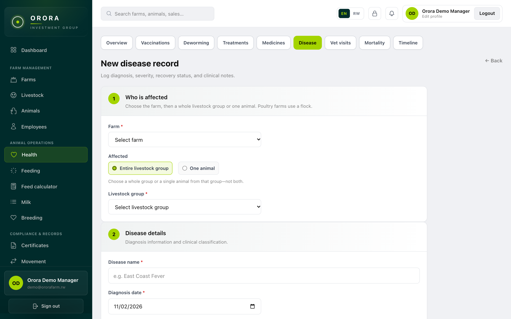

| Field | What to enter | Required? | Rules |
|---|---|---|---|
| Farm and target | As before. For a livestock group choose the group; for a single animal choose the animal. | Yes | |
| Disease name | e.g. "East Coast Fever" | Yes | Up to 255 characters |
| Diagnosis date | The date diagnosed | Yes | **Not in the future** |
| Severity | Low, Medium, High, Critical | Yes | Starts on Medium |
| Recovery status | Recovering, Recovered, Chronic, Dead | Yes | Starts on Recovering |
| Contagious status | Unknown, Contagious, Non contagious | Yes | Starts on Unknown |
| Quarantine | Yes, quarantine is required | No | |
| Symptoms, Notes | Free text | No | |
| Veterinarian name | The vet | No | |
| Attachment | Lab or vet report | No | PDF, JPG, PNG up to 4 MB |
| Expense | Optional | No | |

**What happens after you save**

- The disease record is saved with a code such as `DIS-20261005-0001`: "Disease record saved successfully."
- An **Illness** Timeline entry is made.
- If the target is **One animal**, the animal's **Health status** is set from the record:

| Disease record | Animal's health status becomes |
|---|---|
| Quarantine ticked | **Quarantined** |
| Recovery: Recovered | **Healthy** |
| Recovery: Recovering | **Recovering** |
| Recovery: Chronic | **Sick** |
| Recovery: Dead | **Deceased** |

- If the target is a **livestock group** or a **flock**, no animal status changes.
- The dashboard counts animals that are Sick, Under treatment, Quarantined or Recovering under **Animals need attention** (critical alert).

**Common mistakes**

- Forgetting to update **Recovery status** to Recovered when the animal is well. It stays on the "needs attention" list.
- Choosing "Dead" instead of recording the death in **Mortality**. A disease record does **not** set the lifecycle to Deceased, and it does not reduce a flock's count. Use Mortality.
- Recording the disease for the group when only one animal is sick (so its status does not change).

---

## 5. Vet visits

### 5.1 Add a vet visit

**Purpose:** Record a visit and treatment given by a vet.

**When to perform:** After the vet visit.

**Steps**

1. Click **Health**, then **Vet visits**.
2. Click **+ Add vet visit**.
3. Choose **Farm** and target.
4. Enter **Disease name**, **Medicine name** and **Start date**.
5. Fill in the rest, then save.

| Field | What to enter | Required? | Rules |
|---|---|---|---|
| Farm and target | As before | Yes | |
| Disease name | The problem | Yes | Up to 255 characters |
| Medicine name | What the vet used (just text) | Yes | Up to 255 characters |
| Dosage | e.g. "5 ml" | No | |
| Treatment method | As in treatments | No | "Other" needs text |
| Start date | Visit date | Yes | |
| End date, Follow-up date | Dates | No | Not before Start date |
| Status | Ongoing, Completed, Discontinued, Cancelled | Yes | |
| Veterinarian name | The vet | No | |
| Symptoms, Diagnosis, Notes | Free text | No | |
| Attachment | Vet report | No | PDF, JPG, PNG, DOC, DOCX up to 5 MB |
| Expense | Vet fee, optional | No | |

**What happens after you save:** "Vet visit saved successfully.", a **Vet visit** Timeline entry, and an optional Expense. **The Medicine name is only text: it does not reduce your Medicines stock.** If the vet used your own stock, record a **Treatment** instead.

---

## 6. Medicines (stock)

The **Medicines** tab is your medicine store.

### 6.1 Add a medicine

**Purpose:** Keep track of the medicine you hold, its expiry date and when to reorder.

**When to perform:** When you buy a new medicine.

**Before you start:** Search the list. Medicine names are not checked for duplicates.

**Steps**

1. Click **Health**, then **Medicines**.
2. Click **+ Add medicine**.
3. Fill in the form and save.

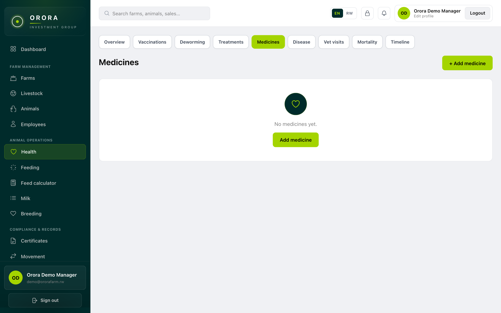

| Field | What to enter | Required? | Rules |
|---|---|---|---|
| Medicine name | e.g. "Penicillin" | Yes | Up to 255 characters |
| Category | Antibiotic, Antiparasitic, Anti-inflammatory, Vaccine, Vitamin, Mineral, Disinfectant, Other | No | "Other" needs text |
| Active ingredient | e.g. "Procaine penicillin" | No | |
| Dosage instructions | Label directions | No | |
| Administration method | As in vaccinations | No | |
| Unit | ml, mg, g, tablet, dose, vial, bottle, sachet | Yes | |
| Quantity in stock | What you have now | Yes | Number, 0 or more |
| Reorder level | Warn me at or below this | No | Number, 0 or more |
| Expiry date | Date on the box | No | A date |
| Supplier | Where you bought it | No | |
| Notes | Extra facts | No | |
| Active | Tick if in use | No | An inactive medicine cannot be used in treatments |

**What happens after you save:** "Medicine saved successfully." The medicine appears in the list and in treatment and deworming drop-downs (if active). The list header shows alerts: **Low stock** (stock at or below the reorder level) and **Expired** (expiry date in the past). The Health overview shows **Low stock medicines** and **Expired medicines**.

### 6.2 Add or remove medicine stock

1. Open **Health, Medicines**, then click the medicine (**View**).
2. In the stock form choose **Movement type**: **Purchase / stock in**, **Adjustment (add)** or **Adjustment (remove)**.
3. Enter **Quantity**, optional date and notes, and save ("Stock movement recorded successfully.").

"Used in treatment" movements are made by Treatment and Deworming records only. You cannot make a stock go below 0: "Insufficient medicine stock for this movement."

The medicine page also lists its recent stock movements and the treatments that used it.

> **Note:** When you first create a medicine, its starting quantity is saved directly and is **not** shown as a movement in the history.

### 6.3 Edit or delete

- **Edit** changes the medicine details. Tick or untick **Active**.
- **Delete** is refused if the medicine was ever used in a treatment: "This medicine is linked to treatments and cannot be deleted. Mark it inactive instead."

---

## 7. General health record and timeline

**Purpose:** Record any health event that does not fit another tab (an injury, quarantine, a check-up), or change an animal's health status with a note.

**Steps**

1. Click **Health**, then **+ Log health record** (also on the **Timeline** tab: **Log a record**).
2. Choose the **Farm**, then the **Animal** (or **Flock**).
3. Choose the **Record type**, **Recorded on** and **Health status**.
4. Fill in the other boxes and click **Save record** ("Health record logged successfully.").

| Field | What to enter | Required? | Rules |
|---|---|---|---|
| Farm | The farm | Yes | |
| Animal or Flock | Who it is about | Yes, one of them | Not both. Must belong to the farm. |
| Record type | Vaccination, Treatment, Vet visit, Illness, Injury, Deworming, Quarantine, Mortality, Other | Yes | |
| Recorded on | Date | Yes | |
| Health status | Healthy, Pregnant, Sick, Under treatment, Quarantined, Recovering, Deceased | Yes | **Sets the animal's health status** |
| Summary / diagnosis | Short heading | No | Up to 255 characters |
| Treatment, Medication, Veterinarian | Text | No | |
| Next follow-up | Date | No | Not before Recorded on |
| Notes | Free text | No | |

**What happens after you save:** The record appears in the Timeline. If it is about an **animal**, the animal's **Health status** becomes the status you chose. If the type is Mortality or the status is Deceased, the animal's lifecycle also becomes **Deceased**.

> **Tip:** This is the quickest way to mark an animal "Sick" so it appears in **Animals need attention**.

The **Timeline** tab lists every health entry, newest first, 20 per page.

**Common mistakes**

- Using this form for vaccines or treatments you can enter on their own tab. Use the proper tab: it keeps stock and expenses right.
- Choosing "Deceased" for an animal that is not dead.

---

## Medicine stock: a simple rule

| Action | Reduces medicine stock? |
|---|---|
| Treatment with a medicine | **Yes** |
| Deworming with medicine item and quantity | **Yes** |
| Vaccination | No |
| Vet visit | No |
| Disease record | No |
| Stock movement "Adjustment (remove)" | Yes |

---

# Part B: Breeding (cattle farms)

The Breeding module follows a cow from mating to calf. It is available only on **cattle farms**. Poultry farms do not have it.

## The breeding cycle

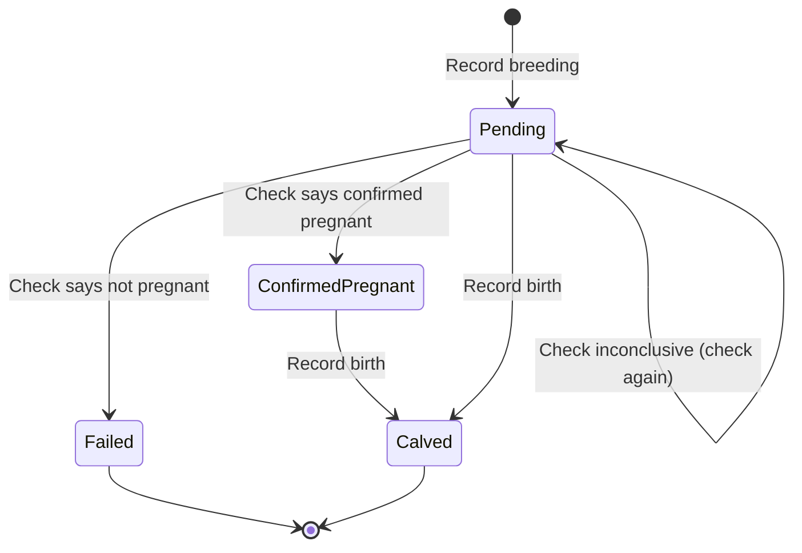

*The status of a breeding record. "Aborted" exists as a status name but there is no screen to set it.*

| Step | Where | Result |
|---|---|---|
| 1. Record breeding | Breeding, Breeding records | Status **Pending**, expected calving date, pregnancy check reminder |
| 2. Pregnancy check | Breeding, Pregnancy checks | **Confirmed pregnant**, **Failed** (not pregnant), or still Pending |
| 3. Birth | Breeding, Birth records | Status **Calved**, offspring rows created |
| 4. Register calves | Birth record page | New animals created |

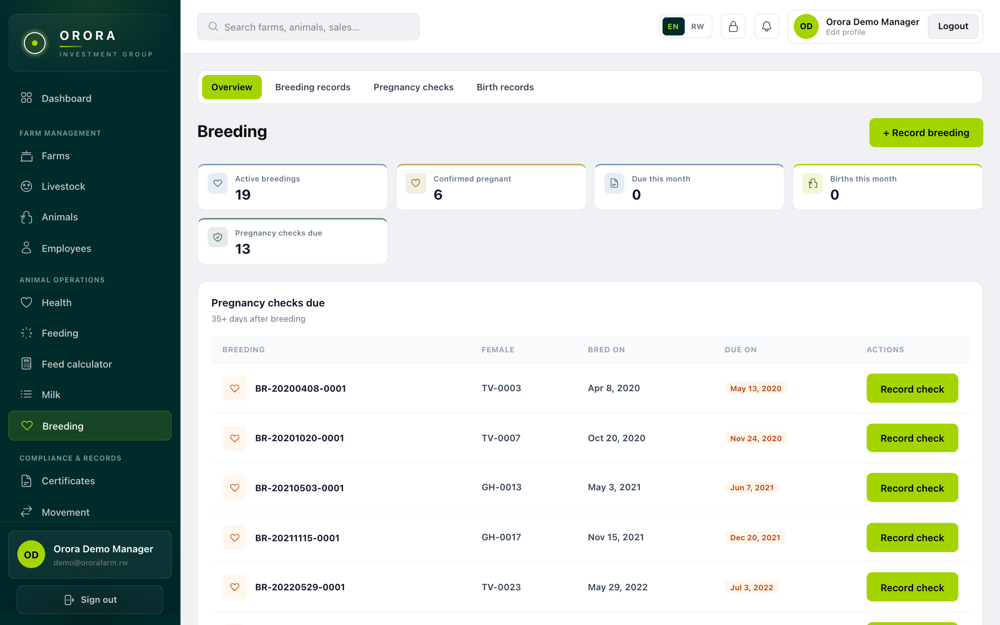

The **Overview** tab shows **Active breedings**, **Confirmed pregnant**, **Due this month**, **Births this month**, **Pregnancy checks due**, the list of checks due (with a button to record the check), **Upcoming calvings** and **Recent breedings**.

---

## 8. Record a breeding

**Purpose:** Record a mating or insemination, so OroraFarm can work out the calving date and remind you to check pregnancy.

**When to perform:** On the day of mating or artificial insemination (AI).

**What you need:** The cow (female) and the bull (male) or the semen details, the date, the method.

**Before you start: avoid duplicates:** Open **Breeding records** and filter by farm to check the cow was not already recorded for this heat. OroraFarm does not block a second record.

**Steps**

1. Click **Breeding**, then **Breeding records**.
2. Click **+ Record breeding**.
3. Choose the **Farm**, then **Animal type** and the **Female** (only females of that farm are listed).
4. Enter **Breeding date** and **Breeding type**.
5. Choose the sire: **Internal sire** (a male on the farm), **or** type the **External sire name** (for example a bull's name or AI bull code).
6. Optionally fill in heat detection, technician, semen details and gestation days.
7. Click save.

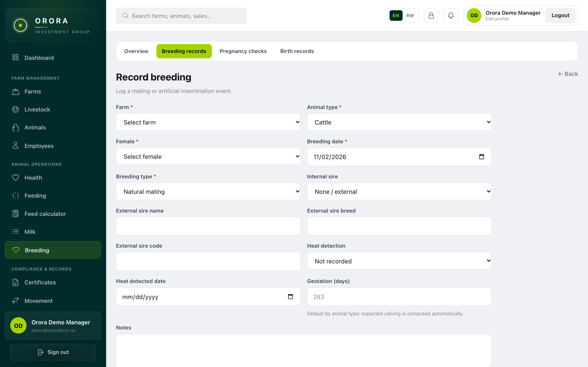

| Field | What to enter | Required? | Rules |
|---|---|---|---|
| Farm | The farm | Yes | |
| Animal type | Cattle, Goat, Pig, Poultry | Yes | Sets the default gestation days |
| Female | The cow | Yes | Must be a **female** animal on this farm |
| Breeding date | Date of mating or AI | Yes | **Not in the future** |
| Breeding type | Natural mating, Artificial insemination (AI) | Yes | |
| Internal sire | A **male** animal on the same farm | One of sire boxes needed | Must be male and on the same farm |
| External sire name | Name of an outside bull | One of sire boxes needed | Needed if no Internal sire: "Select an internal sire or enter an external sire name." |
| External sire breed, External sire code | Details | No | |
| Heat detection | Visual, Tail paint, Heat detector, Hormone / progesterone test | No | |
| Heat detected date | Date heat seen | No | Not in the future |
| Gestation (days) | Leave empty for the default | No | 1 to 400. Defaults: cattle 283, goat 150, pig 114, poultry 21. |
| Technician (AI) | Who did the AI | No | |
| Semen batch, Semen straw code, Semen source | AI details | No | |
| Notes | Extra facts | No | |
| Expense | e.g. AI fee | No | Amount needed if ticked |

> **Example:** Inyange (RW-001) was inseminated on 1 Sep 2026 with semen from bull "Max" (code HF-5521) by technician Kamali. Gestation left empty so the default 283 days is used.

**What happens after you save**

- The breeding record is saved with a code like `BR-20260901-0001`, status **Pending**.
- **Expected calving date** = breeding date + gestation days. For Inyange: 1 Sep 2026 + 283 days.
- A **pregnancy check due date** is set to 35 days after breeding.
- An **activity log** line "Breeding event recorded..." is written.
- The success message tells you the check date: "Breeding recorded. You will be reminded to perform a pregnancy check on [date] (35 days after breeding)."
- The record page opens, where you can add checks and the birth.
- Once 35 days have passed with no pregnancy check, the dashboard and the Breeding overview show **Pregnancy checks due**.

**Common mistakes**

- Choosing a male as the **Female**, or a female as the **Internal sire**.
- Choosing animals from a different farm.
- Entering neither an internal sire nor an external sire name.
- Typing a future date.

### Edit or delete a breeding record

- **Edit** changes the details and recalculates the calving date and the check date. **You cannot edit a breeding record that already has a birth recorded.**
- **Delete** removes it (and its linked expense). **You cannot delete one that has a birth.**
- To find records, use the **Farm** and **Status** filters on the list, or the **pregnancy check due** link from the Overview.

---

## 9. Pregnancy checks

**Purpose:** Record the result of checking whether the cow is pregnant.

**When to perform:** About 35 days after breeding, and again if the result is inconclusive.

**Steps**

1. Click **Breeding**, then **Pregnancy checks**, then **+ Add check**. (Or open the breeding record and click **+ Add pregnancy check**, or use the button on the Overview list.)
2. Choose the **Breeding record**. The cow is filled in for you.
3. Enter **Check date**, **Method**, **Result**, **Checked by**.
4. Save.

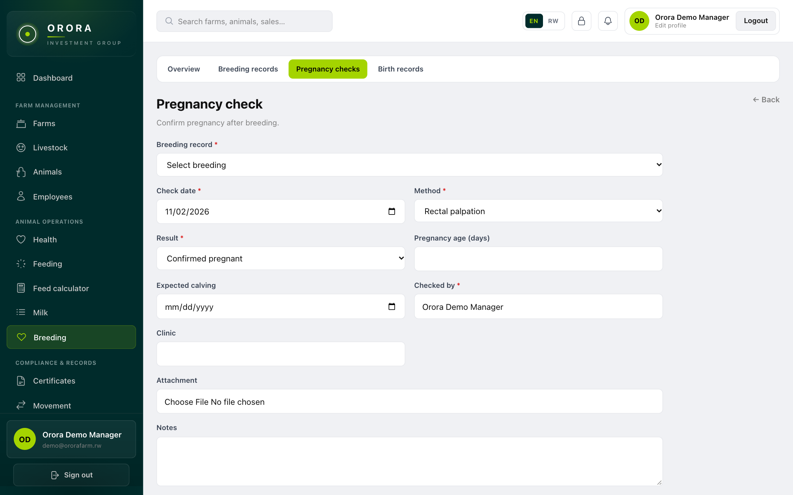

| Field | What to enter | Required? | Rules |
|---|---|---|---|
| Breeding record | The breeding being checked | Yes | Only breedings that are Pending or Confirmed pregnant and have no birth |
| Check date | Date of the check | Yes | Not in the future, and not before the breeding date |
| Method | Rectal palpation, Ultrasound, Blood test, Visual observation | Yes | |
| Result | Confirmed pregnant, Not pregnant, Inconclusive | Yes | |
| Pregnancy age (days) | How far along | No | 0 or more |
| Expected calving | A new expected date if the vet says so | No | A date |
| Checked by | Name of the person or vet | Yes | Up to 255 characters |
| Clinic | The clinic | No | |
| Next check date | Date to check again | **Yes if Inconclusive** | Must be after the Check date |
| Attachment | Scan or report | No | PDF, JPG, PNG up to 5 MB |
| Notes | Extra facts | No | |
| Expense | Optional | No | |

**What happens after you save**

| Result | What changes |
|---|---|
| **Confirmed pregnant** | Breeding status becomes **Confirmed pregnant**. The expected calving date is replaced by the one you entered (if any). The cow's **Health status** becomes **Pregnant** and **Production status** becomes **Pregnancy**. |
| **Not pregnant** | Breeding status becomes **Failed**. If the cow's health status was Pregnant, it returns to **Healthy** and her production status is cleared. |
| **Inconclusive** | Nothing else changes; the breeding stays **Pending**. Check again on the date you gave. |

- A check code such as `PC-20261005-0001` is created and a line is added to the breeding **activity log**.
- "Pregnancy check recorded."
- The **Pregnancy checks due** alert for this breeding disappears once any check exists.
- A confirmed pregnant cow expected to calve within 14 days shows the dashboard info alert **Calvings approaching**.

**Common mistakes**

- Choosing an inconclusive result without a **Next check date**.
- Entering a check date earlier than the breeding date.
- Looking for pregnancy checks to edit or delete. Pregnancy checks **cannot be edited or deleted** after saving, so check the values before you save.

---

## 10. Birth records and offspring

### 10.1 Record a birth

**Purpose:** Record the calving: how many calves, alive or dead, how the birth went, and how the mother is.

**When to perform:** On the day of birth.

**Steps**

1. Click **Breeding**, then **Birth records**, then **+ Record birth**. (Or open the breeding record and click **Record birth**.)
2. Choose the **Breeding record**. The mother is filled in.
3. Enter **Birth date**, **Birth type**, **Total offspring**, **Alive**, **Stillborn**, **Difficulty**, **Mother after birth**.
4. Save.

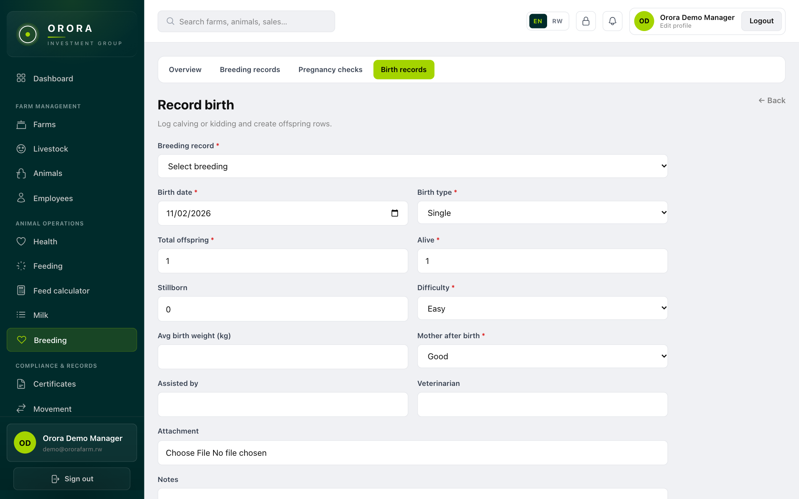

| Field | What to enter | Required? | Rules |
|---|---|---|---|
| Breeding record | The breeding that ended in this birth | Yes | Must be Pending or Confirmed pregnant, with no birth already recorded |
| Birth date | Date of birth | Yes | Not in the future |
| Birth type | Single, Twins, Triplets, Multiple | Yes | |
| Total offspring | Total number of calves | Yes | At least 1 |
| Alive | Calves born alive | Yes | 0 or more. **Cannot be more than Total offspring.** |
| Stillborn | Calves born dead | No | 0 or more. Blank counts as 0. |
| Difficulty | Easy, Assisted, Difficult, Caesarean | Yes | |
| Avg birth weight (kg) | Average calf weight | No | 0 or more |
| Mother after birth | Good, Weak, Critical, Died | Yes | |
| Assisted by, Veterinarian | Names | No | |
| Attachment | Report or photo | No | PDF, JPG, PNG up to 5 MB |
| Notes | Extra facts | No | |
| Expense | e.g. vet fee | No | |

**What happens after you save**

- A birth record is saved with a code like `BIR-20260612-0001`: "Birth recorded. Register offspring below."
- The breeding status becomes **Calved**.
- The **mother** is updated:
  - Health status **Healthy** (or **Sick** if she is Weak or Critical).
  - For cattle and goats, her production status becomes **Lactating** (so she can be milked).
  - If you chose **Died**, she becomes **Deceased** (health and lifecycle) and production is cleared.
- One **offspring row** is created for each calf **born alive** (not for stillborn), with gender "unknown" and health "healthy", waiting to be completed.
- A "Calved" line is added to the breeding activity log.
- The birth page opens so you can register the calves.

**Common mistakes**

- Wrong **Alive** and **Total** numbers (alive more than total is refused). Make sure Total = Alive + Stillborn; OroraFarm does not check that for you.
- Recording a birth for a breeding that already has one.
- Choosing "Died" for the mother by mistake: this marks her Deceased.
- Note: a birth record **cannot be deleted**, and its breeding record becomes locked. Check carefully before saving.

### 10.2 Complete and register each calf

On the birth page you see one block for each live calf.

**Step A: save the calf's details**

1. Set **Gender**, **Birth weight (kg)**, **Health at birth** (Healthy, Weak, Sick, Stillborn), **Color / markings** and **Notes**.
2. Click **Save details**. "Offspring updated."

**Step B: register it as an animal**

1. Enter a **Tag number** (unique in the mother's livestock group), the **Name**, and optionally the **Breed** (the mother's breed is used if empty).
2. Click **Register as animal**. "Offspring registered as a new animal."

| Field | What to enter | Required? | Rules |
|---|---|---|---|
| Gender | Male, Female, Unknown | Yes (Step A) | |
| Birth weight (kg) | Calf's weight | No | 0 or more |
| Health at birth | Healthy, Weak, Sick, Stillborn | Yes (Step A) | |
| Color / markings | Description | No | |
| Tag number | The new ear tag, e.g. "RW-014" | Yes (Step B) | Up to 100 characters. Must be unique within the mother's livestock group. |
| Name | The calf's name | Yes (Step B) | Up to 255 characters |
| Breed | Breed | No | Defaults to the mother's breed |

**What happens after you register**

- A new **Animal** is created in the **same farm and livestock group as the mother**, with: birth date = the birth date, weight = birth weight, acquisition type "Born on farm", **mother tag** = the mother's tag, **father tag** = the sire's tag (if the sire is on the farm), lifecycle **Active**, species and breed from the breeding record or mother.
- The calf's health status is mapped: Healthy to Healthy, Weak to Recovering, Sick to Sick.
- The offspring row is marked **registered** and linked to the new animal. A line is added to the breeding activity log.
- You can then use the calf everywhere (feeding, health, and so on).

**Common mistakes**

- Registering before setting the **Gender** in Step A. Save the details first, so the calf is registered with the right gender.
- Registering a calf whose Health at birth is **Stillborn**: "Stillborn offspring cannot be registered as live animals."
- Reusing an existing tag in the group.
- Trying to change a calf's details after registration: "Registered offspring cannot be edited here." Edit the animal in **Animals** instead.

### 10.3 Find births

The **Birth records** tab lists all births. Click a birth to open its page. Click the code to view details.

---

## 11. Breeding reminders

OroraFarm reminds you in three places, with no extra work:

| Reminder | When it appears | Where |
|---|---|---|
| **Pregnancy checks due** | A breeding is Pending, has **no** pregnancy check, and its check due date (breeding + 35 days) has arrived | Dashboard warning, Breeding overview list, the breeding record page |
| **Calvings approaching** | A Confirmed pregnant cow's expected calving date is within 14 days | Dashboard info alert, "Upcoming calvings" on the Breeding overview |
| Days until check | Shown on the breeding record page while a check is pending | Breeding record page |

> **Note:** These are shown on screen when you open the pages. They are not sent by SMS or email.

## Daily and weekly routines (suggestion)

**Health**

1. Look at the dashboard for **Animals need attention**, **Vaccinations due** and **Deworming scheduled soon**.
2. Record each treatment, vaccination or deworming the same day.
3. Once a week, check **Health, Medicines** for low stock and expired items.

**Breeding**

1. Record each mating or AI the same day.
2. Open **Breeding, Overview** each week and do the checks listed as **due**.
3. After each birth, record it the same day and register the calves within a few days.

## Known limitations

- A **treatment** does not change the animal's health status; a **disease record on one animal** or a **general health record** does.
- **Vaccinations**, **vet visits** and **disease records** do not use the Medicines stock.
- The starting quantity of a new medicine does not appear as a stock movement.
- A **Pregnancy check** cannot be edited or deleted. A **Birth record** cannot be deleted.
- A breeding record with a birth cannot be edited or deleted.
- The breeding status **Aborted** exists in the system but there is no screen to set it.
- Total offspring is not checked against Alive plus Stillborn.
- "Overdue" is a status you choose; OroraFarm does not change a Scheduled vaccination or deworming to Overdue by itself.
- The Breeding module is not available on poultry farms.
