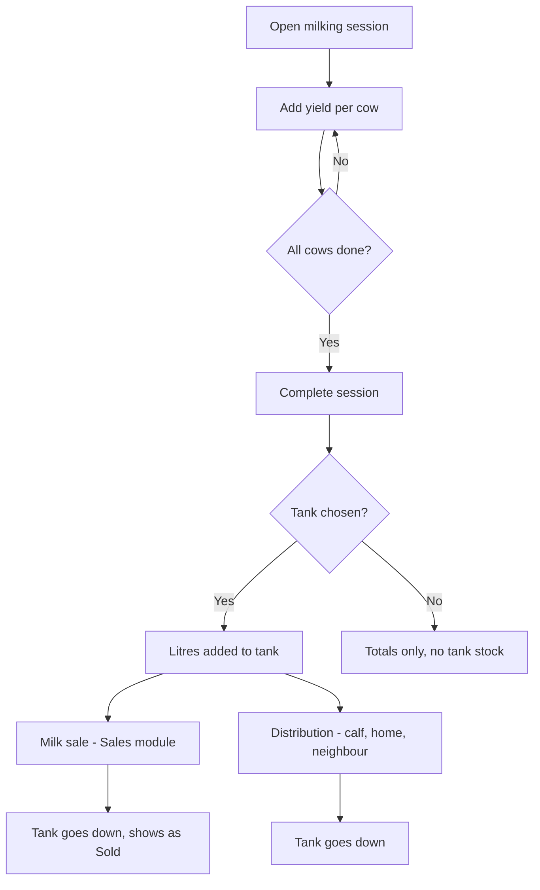
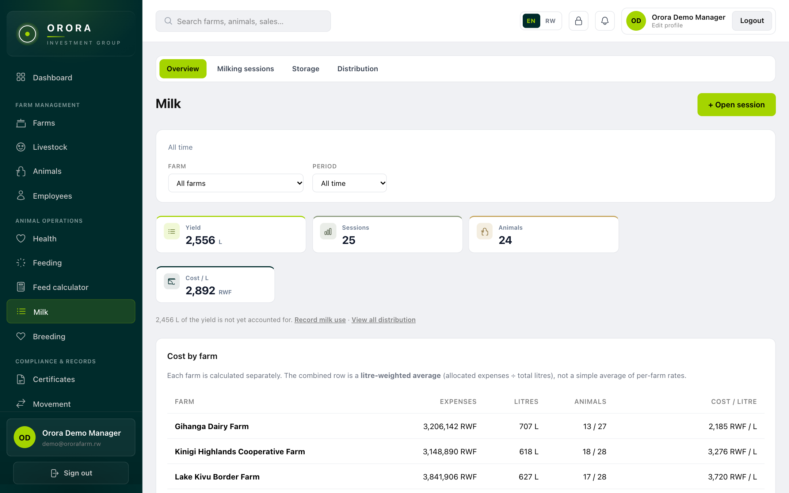
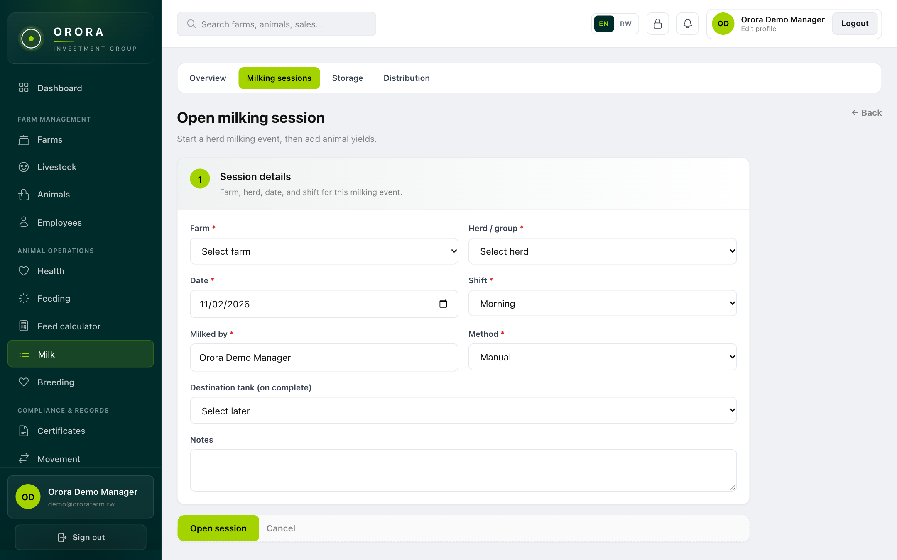
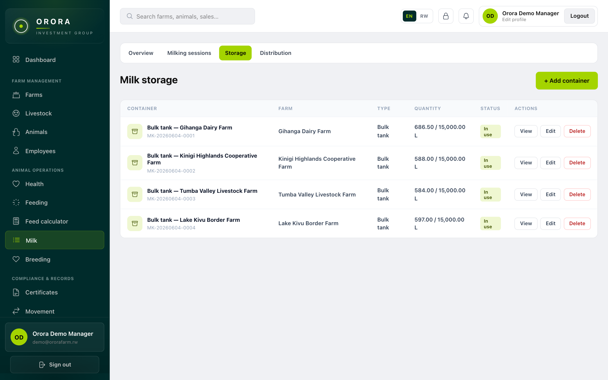
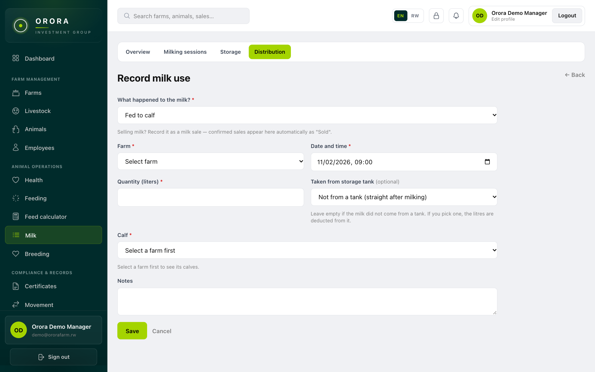

# Milk production, storage and distribution

This chapter shows you how to record milk from the cow to the final use. You will learn how to:

- open a milking session and record how much each cow gave;
- complete the session and put the milk into a storage tank;
- record milk that is not sold (calves, family, neighbours);
- read the Milk overview.

Selling milk to a customer is done in the **Sales** module. See the chapter *Sales and customers*.

> **Note:** The Milk module is only shown for farms whose animal type gives milk (for example dairy cattle or goats). If you do not see **Milk** in the menu, ask your workspace admin. If you open a milk page you are not allowed to see, you will get a "page not found" (404) screen.

## How milk moves through OroraFarm

Think of it as a simple path. Milk is first **recorded** per cow. Then it is **stored** in a tank. After that it leaves the tank because it is **sold** or **used** in some other way.



*Figure: the life of milk in OroraFarm.*

The Milk module has four pages. Use the tabs at the top:

| Tab | What it is for |
|---|---|
| Overview | Totals, charts, top cows, cost per litre |
| Milking sessions | One session = one milking time for one herd |
| Storage | Your tanks, cans and buckets, and how much milk is in each |
| Distribution | Where milk went when it was not sold |



## Words you need to know

| Word | Meaning |
|---|---|
| Session | One milking time (morning, afternoon or evening) for one herd on one date |
| Record / yield | The litres from one cow in one session |
| Herd / group | A livestock group, for example "Cows (lactating)" |
| Tank / container | Where milk is kept: bulk tank, chiller, can, bucket or other |
| Distribution | A non-sale use of milk |

## Before you start

You need three things in place:

1. A **farm** and a **livestock group (herd)** exist.
2. The cows are in that herd and are **lactating**. A cow can be milked only if its production status is **Lactating**, or if it has no production status and its herd is a lactating herd group ("Cows (lactating)"). Other animals are not offered in the list.
3. At least one **storage container** exists if you want the milk to go into a tank.

> **Tip:** If a cow does not appear in the list, open the animal and check that it belongs to the same farm and herd as the session and that its production status is **Lactating**.

---

## 1. Milking sessions

### Purpose
A session groups all the cows milked at one time. OroraFarm adds up the litres for you.

### When to perform
Right after each milking: morning, afternoon or evening. Do not wait several days. Memory fades and numbers become wrong.

### Required information
- The farm and the herd.
- The date and the shift.
- The name of the person who milked.
- How the cows were milked.
- The litres from each cow.

### Step by step: open a session

1. Click **Milk** in the menu, then the **Milking sessions** tab.
2. Click **Open session**.
3. Fill in the form (see the table below).
4. Click **Save session**.
5. You land on the session page. The message says: *Milking session opened. Add animal yields below.*



### Field table: milking session

| Field | What to enter | Required? | Rules |
|---|---|---|---|
| Farm | The farm where milking happened | Yes | Must be an existing farm |
| Herd / group | The livestock group you milked | Yes | Must belong to the chosen farm |
| Date | The day of milking | Yes | A date. It cannot be after today |
| Shift | Morning, Afternoon or Evening | Yes | One of the three |
| Milked by | Name of the milker, for example "Mukamana Jeanne" | Yes | Up to 255 letters |
| Method | Manual, Machine or Semi-automated | Yes | One of the three |
| Destination tank (on complete) | The tank to receive the milk | No | You can choose it now or later ("Select later") |
| Notes | Anything special | No | Free text |

### Duplicate protection
You cannot open two sessions for the **same herd, same date and same shift**. If you try, you see:

> A milk session already exists for this herd, date, and shift.

Open the existing session instead (find it in the Milking sessions list) and add the missing cows there.

### Session code
Every session gets a code like `MS-20261102-0001` (MS, the date, a running number). Every cow record gets a code like `MR-20261102-0001`. You do not type these.

---

## 2. Recording yields per cow

While the session is **Open** you can add records. You have two ways.

### Way A: the table of cows (best for many cows)

1. On the session page find the list of lactating cows in the herd.
2. Type the litres next to each cow. Leave the cows that were not milked empty.
3. Click **Save all yields**.

### Way B: paste tag and litres

1. In the box **Or paste tag + liters**, type one cow per line:

```
COW-001, 14.5
COW-002, 13.2
COW-003 11.0
```

2. Lines that start with `#` are ignored. You can separate with a comma, semicolon, tab or a space.
3. Click **Save all yields**.

The tag must be exactly the animal tag number (capital or small letters do not matter). A tag that is not found is silently ignored, so check the message after saving: it tells you how many yields were saved and how many were skipped.

### Way C: one cow at a time

1. In the section to add an animal, choose the **Animal**.
2. Enter **Yield (liters)**.
3. Fill in optional details.
4. Click **Add yield**. The message says: *Animal yield recorded.*

### Field table: one cow record

| Field | What to enter | Required? | Rules |
|---|---|---|---|
| Animal | The cow | Yes | Must be on the same farm and herd as the session, and lactating |
| Yield (liters) | Litres from this cow, for example 12.5 | Yes | A number, at least 0.01 |
| Milking duration (minutes) | How long milking took | No | Whole number, at least 1 |
| Lactation stage | Early, Mid, Late or Dry | No | One of the four |
| Lactation number | Which lactation (1, 2, 3 ...) | No | Whole number, at least 1 |
| Udder condition | Normal, Inflamed or Mastitis suspected | No | One of the three |
| Abnormal milk | Tick if the milk looked wrong | No | Tick box |
| Abnormal notes | Describe what was wrong | Yes, if "Abnormal milk" is ticked | Free text |
| Notes | Anything else | No | Free text |

In the table (Way A) only the litres are entered. Each litre value must be at least 0.01.

### Rules that protect your data
- One cow can have **only one record per session**. If you try again you see: *This animal already has a record in this session.* In the bulk save, that cow is skipped and listed as "already recorded".
- A cow from another farm or another herd is refused: *Animal must belong to the session farm.* or *Animal must belong to the session herd.*
- A cow that is not lactating is refused: *Only lactating animals can be milked.*
- If you save with an empty table and no pasted lines, you see: *Enter at least one yield in the table or paste lines.*

### What happens after saving
- The session totals are recalculated at once: **Total litres**, **Animals milked** and **Average per animal**.
- The overview cost-per-litre figure is refreshed.
- No tank stock changes yet. Stock changes only when you complete the session.

### Fixing a record
There is no "edit" button on a single cow record. To fix a wrong number: click **Remove** on that row, then add the cow again with the right litres. This works only while the session is **Open**. See the chapter *Correcting mistakes*.

---

## 3. Completing a session

### Purpose
Completing says: "Milking is finished and the numbers are final." It also moves the milk into a tank.

### Step by step

1. Check the cow records carefully. After you complete, you **cannot change them**.
2. At the bottom of the session page, choose the **Destination tank**. Choose "Skip storage (totals only)" if the milk does not go into a tank.
3. Click **Complete session**.
4. The message says: *Session completed and milk stored.*

### Rules
- Only an **Open** session can be completed: *Only open sessions can be completed.*
- You need at least one cow record: *Add at least one animal record before completing the session.*
- The tank must belong to the **same farm** as the session: *Storage tank must belong to the same farm as the session.*

### What happens after saving
- The session status becomes **Completed**. The time and your name are saved.
- If you chose a tank, the total litres are added to that tank as an **Intake (milking)** movement. The tank quantity and status update.
- If you skipped the tank, no stock is added. The litres still count in the Overview totals, but you cannot later sell or distribute that milk "from a tank".

> **Warning:** OroraFarm does not stop you when the milk is more than the tank capacity. The tank simply shows as **full**. Check the real tank yourself.

### Cancelling or deleting a session
- **Cancel session** changes an open session to **Cancelled**. It stays in the list and no milk is stored.
- Deleting a session is possible only while it is **Open**. Its cow records are deleted too.
- A **Completed** or **Cancelled** session cannot be deleted or edited.

### Common mistakes
- Completing before all cows are entered. You cannot add them afterwards. Use a new session and note it in the Notes field.
- Choosing the wrong tank. The stock cannot be moved back from the screen.
- Entering a date in the wrong month. The date cannot be in the future, but a wrong past date is accepted.

---

## 4. Storage tanks

### Purpose
Each tank has a quantity of milk. This tells you how much milk you can still sell or use.

### Step by step: add a container

1. Open **Milk**, then **Storage**.
2. Click **Add container**.
3. Fill in the form and click **Save**. The message says: *Storage container added.*



### Field table: storage container

| Field | What to enter | Required? | Rules |
|---|---|---|---|
| Farm | The farm that owns the tank | Yes | Existing farm |
| Container name | For example "Chiller 1" | Yes | Up to 255 letters |
| Type | Bulk tank, Chiller, Can, Bucket or Other | Yes | One of the five |
| Capacity (liters) | The size of the tank | Yes | A number, at least 1 |
| Temperature (°C) | Current temperature | No | A number |
| Location | For example "Dairy room" | No | Up to 255 letters |
| Status | Available, In use, Full or Maintenance | No | One of the four |
| Notes | Anything else | No | Free text |

A new container starts with 0 litres. The **Current quantity** is shown but you do not type it. It changes only when milk comes in or goes out.

### Status of a tank
OroraFarm sets the status for you:

| Quantity | Status |
|---|---|
| 0 litres | Available |
| More than 0 but below capacity | In use |
| Equal to or above capacity | Full |

If you set the status to **Maintenance**, OroraFarm leaves it alone until you change it.

### Movements
Open a tank (edit page) to see its last 20 movements. The types are:

| Movement | When it happens | Effect |
|---|---|---|
| Intake (milking) | You complete a session into this tank | Adds milk |
| Sale | A milk sale is completed | Takes milk out |
| Distribution (non-sale use) | You record a distribution from this tank | Takes milk out |
| Distribution reversed | You edit or delete a distribution | Puts milk back |

A tank can never go below zero. You would see: *Insufficient milk in storage.*

### Removing a container
Click delete on the container. If it still has milk you see: *Empty the container before removing it.* Its movement history is deleted with it.

> **Known limitation:** The system knows movement types "Adjustment in", "Adjustment out" and "Spoilage / loss", but there is **no screen** to record them. If milk is spilled or spoiled, use a **Distribution** with the use "Other use" and describe it (for example "Spoiled, power cut"). This takes the litres out of the tank.

---

## 5. Milk distribution (non-sale use)

### Purpose
To explain where milk went when it was not sold. This helps you find missing milk.

### When to perform
Each time milk is given to calves, used at home, or given away.

### Categories

| What happened to the milk? | Recipient type you can choose |
|---|---|
| Fed to calf | Calf |
| Household consumption | Household |
| Given to neighbor | Neighbor |
| Given to relative or visitor | Relative or Visitor |
| Other use | Other, Farm worker, Neighbor, Relative, Visitor or Household |

**Sold** milk is not entered here. When you complete a milk sale, a "Sold" line appears here by itself.

### Step by step

1. Open **Milk**, then **Distribution**.
2. Click **Record milk use**.
3. Choose **What happened to the milk?**. The form changes to match.
4. Fill in the other fields.
5. Click **Save**. The message says: *Milk distribution recorded.*



### Field table

| Field | What to enter | Required? | Rules |
|---|---|---|---|
| What happened to the milk? | The category | Yes | One of the five manual categories |
| Describe the use | For example "Made into yoghurt" | Yes, for Other use | Up to 255 letters |
| Farm | The farm | Yes | The farm must keep milk |
| Date and time | When it happened | Yes | Not in the future (5 minutes of tolerance) |
| Quantity (liters) | Litres used | Yes | More than 0 and up to 100,000 |
| Taken from storage tank | The tank the milk came from | No | Must be a tank of the same farm. Leave empty for milk used straight after milking |
| Calf | The calf that was fed | Yes, for Fed to calf | Must be an active calf on the farm (under 12 months, or in the "Calves Group") |
| Recipient type | Type of person | Yes | Must match the category |
| Recipient name | Name of the person | Yes, for Neighbor and Relative or visitor | Up to 255 letters. Not used for calves |
| Phone number | Their phone | No | 7 to 20 characters: digits, spaces, brackets, dashes, optional + |
| Notes | Extra information | No | Up to 2000 letters |

### Real messages you may see
- *Select the calf that was fed.*
- *Describe what the milk was used for.*
- *Enter the name of the person who received the milk.*
- *Only 40.00 L is available in this storage tank.* (when you ask for more than the tank holds)
- *The date and time cannot be in the future.*

### What happens after saving
- A distribution code like `MD-20261102-0001` is created.
- If you chose a tank, the litres are taken out of the tank (movement "Distribution").
- The Milk overview distribution cards are updated.

### Editing or deleting
- Editing the **quantity** or the **tank** first puts the old litres back in the tank, then takes the new litres out. If the new amount is more than the tank holds, you get an error and nothing changes.
- Deleting puts the litres back into the tank.
- A **Sold** line cannot be edited or deleted here. You are sent to the Sales module: *Sold milk is managed from the Sales module.*

### Common mistakes
- Forgetting to choose the tank. The litres are recorded but the tank stays high.
- Recording the same use twice. Check the list for the same date and quantity first.
- Using "Other use" without a clear description.

---

## 6. Reading the Milk overview

Open **Milk** and use the filters **Farm** and **Period** (All time, Today, This month, This year).

| Number | Meaning |
|---|---|
| Yield | Total litres from **completed** sessions in the period |
| Sessions | Number of completed sessions in the period |
| Animals | How many different cows were milked in the period |
| Average per session | Yield divided by sessions |
| By shift | Litres per shift. With "All time" it shows **today only** |
| Top producers | The 6 cows with the most litres |
| Recent sessions | The last 8 sessions (any status) |
| Yield per animal / herd | Litres per cow and per herd (top 10 each) for the chosen period. "All time" uses all completed sessions |

Open and cancelled sessions are **not** counted. Complete your sessions so the figures are right.

### Distribution cards
They show litres by use in the chosen period, plus:

- **Given away**: neighbour plus relative or visitor.
- A sentence under the cards says how many litres are **not yet accounted for**. This is Yield minus all distributions (including Sold).
- If more was distributed than produced, the message asks you to check older stored milk or your records.

### Cost per litre
The cost per litre card shows what a litre of milk cost you, in **RWF**. The full method is explained in the chapter *Reports and analytics*.

## Known limitations

- No screen to edit a single cow record (remove and add again).
- No screens for spoilage or manual stock adjustment.
- Completing a session does not check the tank capacity.
- A completed session cannot be re-opened.
- The older "milk sales" module is not used. Milk sales are made in **Sales**, and the old web address `/milk/sales` sends you there.
