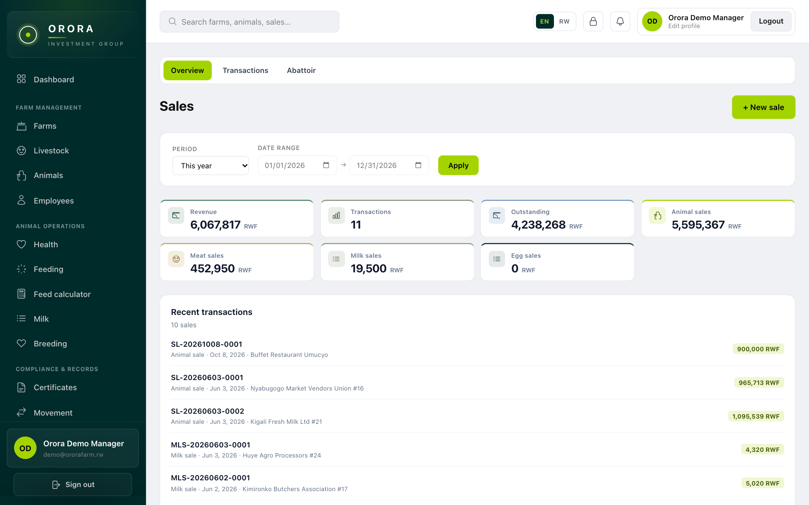
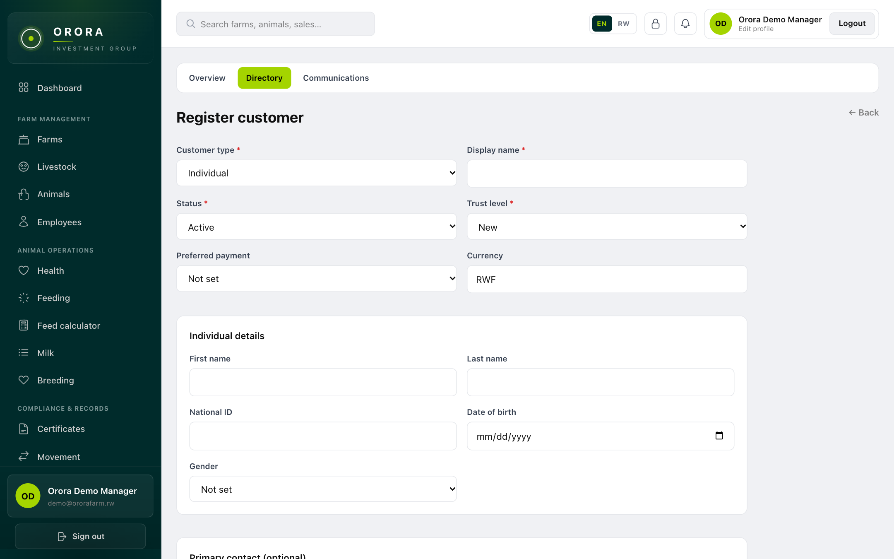
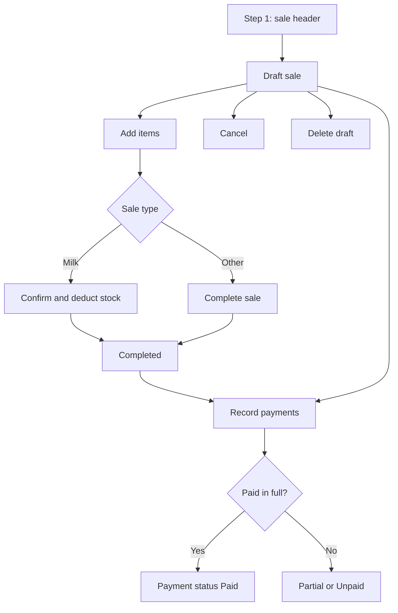
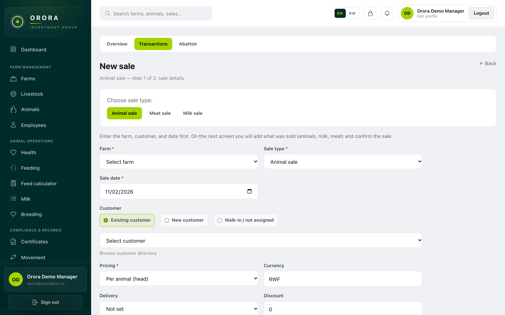

# Sales and customers

This chapter explains how to record what you sell, who bought it, and how much they have paid. All money in OroraFarm is in **Rwandan francs (RWF)**. The Currency field on a sale starts as RWF.

You will learn how to:

- register customers and keep their contacts, addresses and credit settings;
- create a sale, add items, complete it and record payments;
- sell milk from a storage tank;
- use the abattoir (meat) flow;
- import and export customers with a CSV file.

## The two modules

| Module | Tabs | Use it to |
|---|---|---|
| **Sales** | Overview, Transactions, and Abattoir (when your farm type has it) | Make and follow sales |
| **Customers** | Overview, Directory, Communications | Keep buyer information |

---

## 1. Customers

### Purpose
A customer record keeps the buyer's name, phone, address, trust level and how much they owe you.

### When to perform
Register a buyer the first time they buy, or before. A customer is **not** required for a sale (you can choose "Walk-in / not assigned"), but a record lets you track what they owe.

### Step by step: add a customer

1. Open **Customers**, then **Directory**.
2. First **search** the name (box above the list) to check the person is not already there. This avoids duplicates.
3. Click **Add a customer**.
4. Fill in the form and click **Add customer**.
5. The message says: *Customer registered successfully.*

### Field table: customer

| Field | What to enter | Required? | Rules |
|---|---|---|---|
| Customer type | Individual, Company, Cooperative, Abattoir or Exporter | Yes | One of the five |
| Display name | The name you will see in lists, e.g. "Uwimana Jean" or "Kigali Dairy Coop" | Yes | Up to 255 letters |
| Status | Active, Inactive or Blacklisted | Yes | One of the three |
| Trust level | New, Regular, Trusted or VIP | Yes | One of the four |
| Preferred payment method | Cash, Mobile money, Bank transfer, Cheque or Other | No | One of the list |
| Currency | Three letters, RWF | Yes | Up to 3 letters |
| Notes | Anything useful | No | Free text |
| Contact name / role / phone / email | The main contact person | No | Email must be a valid email. Phone up to 50 characters |
| First name, Last name | For individuals | No | Up to 100 letters each |
| National ID | For individuals | No | Up to 50 characters |
| Date of birth, Gender | For individuals | No | Valid date. Gender: Male, Female or Other |
| Organization name, Registration number, Tax ID, License number and expiry, Website, Industry, Number of employees, Established date | For companies and other non-individuals | No | Dates must be valid. Employees must be 0 or more |

If you enter any contact detail, a **primary contact** is created. If you leave the contact name empty, the display name is used.

### What happens after saving
- A customer code like `CUS-0001` is created.
- A credit record is created with **credit limit 0** and **outstanding balance 0**.
- An entry is written in the customer's **Audit trail**.

> **Warning:** OroraFarm does **not** check if a customer with the same name or phone already exists. Only the customer code must be unique. Always search first.

### The customer page
Click **View** on a customer. The page has these panels: **Profile**, **Contacts**, **Addresses**, **Credit settings**, **Communications**, **Purchase history**, **Purchases by type** and **Audit trail**.

#### Add a contact
Use **Add contact**. Only **Contact name** is required. Other fields: role (max 100), phone (max 50), email, "primary" tick box and notes. If you tick primary, other contacts stop being primary. Contacts can be removed with **Remove**. There is no edit button: remove and add again.

#### Add an address
Use **Add address**.

| Field | What to enter | Required? | Rules |
|---|---|---|---|
| Address type | Billing, Delivery, Physical or Other | Yes | One of the four |
| Label | Short name, e.g. "Home" | No | Up to 100 |
| Country, Province, District, Sector, Cell, Village | Rwanda location parts | No | Up to 100 each |
| Street address | Free text | No | Free text |
| GPS latitude / longitude | Map point | No | Latitude -90 to 90, longitude -180 to 180 |
| Default address | Tick if this is the main address | No | Ticking removes "default" from the others |

Addresses can be added and deleted. There is no edit button: delete and add again.

#### Credit settings
Use **Update credit**.

| Field | What to enter | Required? | Rules |
|---|---|---|---|
| Credit limit | The most you allow the customer to owe, in RWF | Yes | A number, 0 or more |
| Payment terms | e.g. "Pay in 14 days" | No | Up to 100 characters |
| Last reviewed | Date | No | A valid date |
| Notes | Free text | No | Free text |

The **Outstanding balance** is **calculated by the system**. It is the total of unpaid amounts of the customer's sales that are not draft and not cancelled. You cannot type it.

> **Known limitation:** The credit limit is **not enforced**. OroraFarm does not stop a sale to a customer who is over the limit. It only **warns**: the Customers overview shows "Over limit", and the dashboard shows the alert "Credit limit exceeded". A limit of 0 means "no limit set" and never triggers the warning.

#### Log a communication
Use **Log communication** on the customer page. You can also see all of them in **Customers > Communications**, filtered by type or by follow-up.

| Field | What to enter | Required? | Rules |
|---|---|---|---|
| Type | Phone call, Email, Visit, Meeting, WhatsApp or Note | Yes | One of the six |
| Direction | Inbound or Outbound | No | One of the two |
| Subject | Short title | No | Up to 255 |
| Summary | What was said | Yes | Free text |
| Date | Date of contact | Yes | A valid date |
| Contact person | Who you spoke to | No | Up to 255 |
| Follow-up required | Tick if you must call back | No | Tick box |
| Follow-up date / notes | When and what | No | Valid date |

Communications **cannot be edited or deleted** after saving. Write carefully.

### Editing a customer
Click **Edit** on the customer page. The same form opens. Changing the name, status, trust level or type is written to the audit trail. Setting the status to **Blacklisted** is logged with the note "Customer blacklisted."

### Deleting a customer
A customer who has **any sale** cannot be deleted. You see: *Customer has sales history and cannot be deleted.* Set the status to **Inactive** instead. A customer without sales is removed, together with its contacts, addresses and credit record.

### Import customers from a CSV file
Use this when you have many customers in a spreadsheet.

1. Open **Customers > Directory**, click **Import**.
2. Download the **template** and fill it in. Save as **CSV**.
3. Choose the file and upload. The file must be a CSV, **up to 2 MB** and **up to 2000 rows**.
4. Read the result. A row that fails is listed with its row number. Rows that are fine are **already saved**. Fix the failed rows in the file and upload **only those rows** again, otherwise you will create duplicates.

Rules per row are the same as the form: `customer_type`, `display_name`, `status`, `trust_level` and `currency` are required. `customer_code` is optional but must not already exist. Messages you may see:

- *Please choose a CSV file to import.*
- *The import file must be a CSV.*
- *The CSV file may not be greater than 2 MB.*
- *The CSV file is missing a header row.*
- *The CSV file exceeds the maximum of 2000 data rows.*

### Export customers
Click **Export CSV** to download a CSV of the customers. The filters you used on the Directory page (type, status, search) are applied to the export.

---

## 2. Sales

### The three statuses of a sale

A sale has a **sale status** and a **payment status**.

| Sale status | Meaning |
|---|---|
| Draft | Being prepared. You can still change the header and add items |
| Completed | Finished. Stock and animals are updated and money is posted to Finance |
| Cancelled | Stopped. Nothing was sold |

A milk sale uses the same statuses. The button for milk says **Confirm & deduct stock** but it also marks the sale **Completed** in one step.

| Payment status | Meaning |
|---|---|
| Unpaid | Nothing paid yet |
| Partial | Some money paid, a balance remains |
| Paid | Paid in full |

OroraFarm calculates the payment status from the total and the payments. You do not set it.

*Figure: the life of a sale.*

### Step 1: create the sale header

1. Open **Sales > Transactions** and click **New sale**. Choose the sale type (Animal sale, Meat sale, Milk sale or Egg sale). Which types you see depends on your farm's animal type.
2. Fill in the header. The page says *step 1 of 2: sale details*.
3. Save. You go to the sale page. The message says: *Add line items below, then confirm the sale.*

| Field | What to enter | Required? | Rules |
|---|---|---|---|
| Farm | The selling farm | Yes | Existing farm |
| Sale type | Animal, Meat, Milk or Egg sale | Yes | Allowed for your farm type |
| Sale date | Date of the sale | Yes | A valid date |
| Customer | **Existing customer** (pick from list), **New customer** (type name, optional phone and email) or **Walk-in / not assigned** | Yes (one of the three) | A new customer needs a name (max 255). Phone max 50. Email must be valid |
| Pricing | Per animal (head), Per kg (live weight), Per liter, Per egg, Per tray or Per dozen | Yes | One of the six |
| Currency | RWF | Yes | Up to 3 letters |
| Delivery | Pickup, Delivery or Abattoir transfer | No | One of the three |
| Discount | Amount taken off, in RWF | No | 0 or more |
| Tax | Amount added, in RWF | No | 0 or more |
| Notes | Free text | No | Free text |

If you choose **New customer**, OroraFarm creates a customer record (status Active, trust level New) at the same time and says *Customer registered...*. Search first so you do not create a duplicate.

A sale gets a number: `MLS-20261102-0001` for milk, `MET-` for meat, `EGS-` for eggs, `SL-` for animals, followed by the date and a running number.

### Step 2: add items (draft only)

Items can be added **only while the sale is a Draft**. The form shows fields for the sale type.

| Field | What to enter | Required? | Rules |
|---|---|---|---|
| Description | What you sold, e.g. "Fresh milk, morning" | Yes | Up to 255 |
| Quantity | How many (litres, kg, eggs, head, birds) | Yes | A number, at least 0.001 |
| Unit | Unit word, e.g. L, kg, head | Yes | Up to 20 |
| Unit price / Price / liter / Price / kg | Price in RWF | Yes for milk, meat, eggs and birds | Must be more than 0 |
| Animal (animal sale) | The animal sold | Yes for animal items | Same farm, **Active** status, not already on this or another draft animal sale |
| Flock and Birds (live birds) | Flock and number of birds | Yes for bird items | Number must be 1 or more and not more than the flock holds |
| From tank (milk) | The tank the milk comes from | Needed to complete a milk sale | A tank of the same farm |
| Live weight (kg), Price / kg | For per-kg pricing | Live weight needed when pricing is per kg | Number, 0 or more |

How the line total is worked out:

- Pricing **per kg**: weight multiplied by price per kg.
- All other pricing: quantity multiplied by unit price.

The sale **total** is: sum of line totals, minus Discount, plus Tax (never below 0). It is recalculated each time you add an item.

> **Warning:** There is **no button to remove or edit a line item**. If an item is wrong while the sale is still Draft, use **Delete draft** and make the sale again.

Item type must match the sale type, otherwise you see: *Item type does not match this sale.*

### Step 3: complete the sale

Check the items and the total. Then:

- For milk, click **Confirm & deduct stock**.
- For all other sales, click **Complete sale**.

You are asked to confirm.

#### What happens when you complete

| Sale type | Effect |
|---|---|
| Milk sale | Litres of every line are taken out of the chosen tank (movement "Sale"). A "Sold" line appears under Milk > Distribution. A line without a tank stops the sale: *Sale item must specify a storage tank.* Not enough milk stops it: *Insufficient milk in storage.* |
| Animal sale | Each sold animal's status becomes **Sold**. Each animal must still be Active: *Animal COW-014 is not active and cannot be sold.* |
| Animal sale with birds | The number of birds is taken off the flock |
| Meat sale | The meat cuts are marked sold; linked animals become **Sold** |
| Egg sale | Only the sale is recorded. **Egg stock is not reduced** |

For **every** completed sale:

- The status becomes **Completed**.
- A **Finance** entry is created (see the chapter *Expenses and finance*): income recognised, with the money you are owed shown as "Accounts receivable".
- The customer's **outstanding balance** is recalculated.

If something fails, the whole completion is cancelled. Nothing is half-done, and you see the message in red above the form.

You cannot complete a sale with no items: *Cannot complete a sale without items.*

### Recording payments

1. On the sale page find **Record payment**.
2. Enter the amount. The field starts with the balance due.
3. Click **Record payment**. The message says: *Payment recorded.*

| Field | What to enter | Required? | Rules |
|---|---|---|---|
| Amount | Money received, RWF | Yes | At least 0.01 and **not more than the balance due** |
| Method | Cash, Mobile money, Bank transfer, Cheque or Other | No | One of the list |
| Paid on | Date money was received | Yes | A valid date |
| Reference | Mobile money code, bank slip number | No | Up to 100 |
| Received by | Staff name | No | Up to 255 |
| Notes | Free text | No | Free text |

Real messages: *Payment cannot exceed the balance due (150,000 RWF).* and *This sale has no balance due.* You cannot record payments on a cancelled sale.

After saving:

- The payment status changes (Unpaid, Partial or Paid).
- If the sale is **Completed**, a Finance entry "Payment received" is created. If the sale is still a Draft, the Finance entry is made later, when you complete the sale.
- The customer's outstanding balance goes down.

> **Warning:** A payment **cannot be edited or deleted**. Check the amount, date and method before you click.

> **Example:** On 2 November a hotel in Rubavu buys 200 L of milk at 450 RWF per litre. Total 90,000 RWF. They pay 50,000 RWF by Mobile money. Payment status is Partial. Balance due is 40,000 RWF. The hotel's outstanding balance grows by 40,000 RWF until they pay.

### Cancelling and deleting

- **Cancel sale**: allowed for Draft sales. A Completed sale cannot be cancelled: *This sale cannot be cancelled.*
- **Delete draft**: allowed only for Draft or Cancelled sales: *Only draft or cancelled sales can be deleted.* The items and any payments on it are deleted too.
- You can change the header (**Save header**) only while Draft: *Only draft sales can be edited.*

See *Correcting mistakes* for what to do with a completed sale that is wrong.

### The Sales overview

Choose a period. The cards are:

| Card | How it is calculated |
|---|---|
| Revenue | Sum of the total of **Completed** sales in the period |
| Transactions | Number of sales in the period in any status |
| Outstanding | Money still owed on all Unpaid or Partial sales (not cancelled), whatever the date |
| Animal / Meat / Milk / Egg sales | Revenue of completed sales by type |

---

## 3. Abattoir (meat) flow

This flow is available only for farm types that sell meat.

1. Open **Sales > Abattoir** and create a **dispatch**: the farm, the date, the abattoir name, and the animals sent. Optional: location, contact person, transport, vehicle plate, driver, expected return date, notes, and live weight per animal.
2. Every animal must be Active **and Healthy**. Otherwise: *Animal COW-014 must be healthy to send to the abattoir.*
3. After saving, the animals' status becomes **Transferred** and the dispatch is "dispatched".
4. When meat comes back, open the dispatch and add a **return** line: animal, return date, cut type, cut weight (kg, more than 0), and optional carcass weight, dressing percentage (0 to 100) and grade (up to 10 characters). The dispatch becomes "returned".
5. Sell the cuts with a **Meat sale**.

> **Known limitation:** There is no screen to cancel or edit a dispatch or a return once saved.

---

## Common mistakes to avoid

- Creating a second customer for the same person. Search first.
- Completing a milk sale from the wrong tank.
- Recording a payment against the wrong sale. It cannot be removed.
- Selling an animal that is already sold. The system refuses, but check the Animals list first.
- Forgetting to record payments. The customer will look as if they still owe you, and the dashboard shows "Outstanding payments".
- Leaving the sale in Draft. A Draft is **not** counted in revenue and not in Finance.
