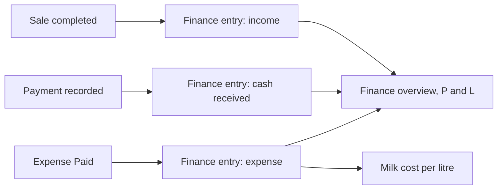
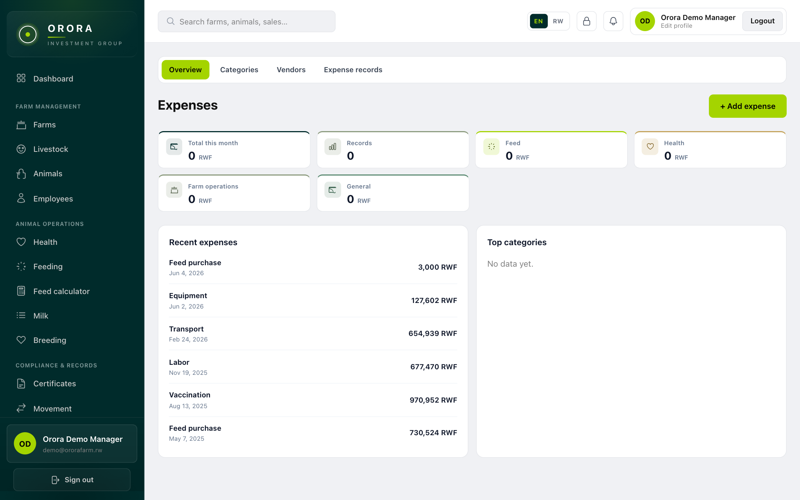
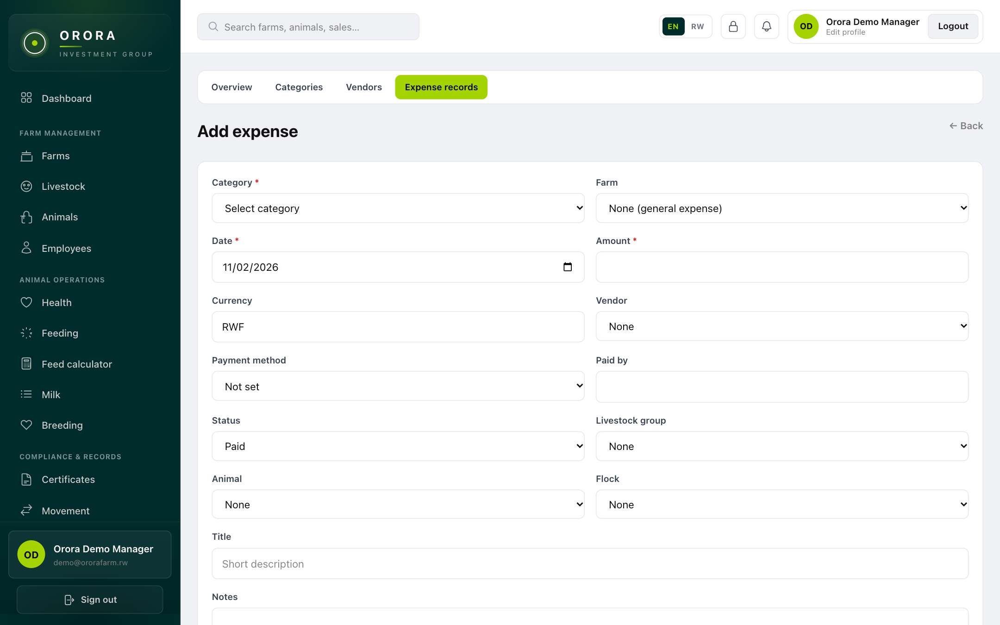
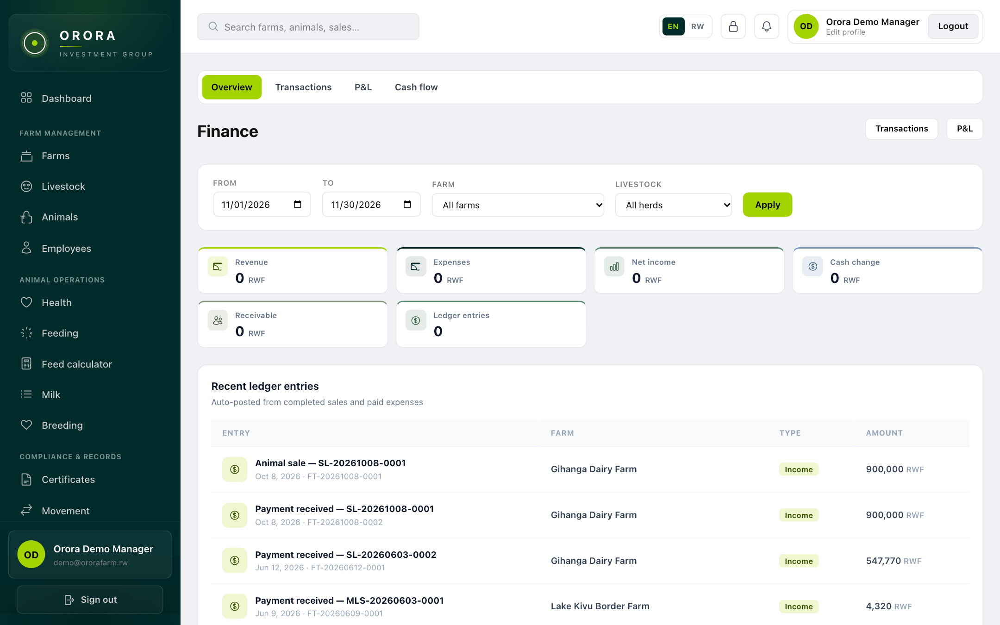

# Expenses and finance

This chapter covers the money you spend (Expenses) and the money summary OroraFarm builds from your sales and expenses (Finance). Staff pay (employees and payroll) is in the next chapter.

Money is in **Rwandan francs (RWF)**.

## How it all fits together

You do **not** type finance entries by hand. OroraFarm creates them for you when you:

- complete a sale;
- record a payment on a completed sale;
- save an expense with the status **Paid**.

*Figure: where Finance numbers come from.*

If your numbers look wrong in Finance, the cause is almost always a sale not completed, a payment not recorded, or an expense left as Draft.

---

## 1. Expenses

The **Expenses** module has four tabs: **Overview**, **Categories**, **Vendors** and **Expense records**.

### Two ways an expense is created

1. **By hand** in **Expense records**, for example electricity or fencing wire.
2. **By another module.** In Feeding (feed purchase), Health (vaccination, deworming, treatment, vet visit, disease record) and Breeding (breeding, pregnancy check, birth) the form has an option to **log an expense**. The expense is then created and kept in step with that record.

Expenses made by another module show their **Source** in the list. They are **locked** here: if you click edit you see *This expense is linked to another module. Edit it from the source record.* To delete one you delete the source record. If you try here: *Delete the source record instead, or unlink first.*

### Add an expense by hand

#### Purpose
Keep a record of every cost so you know the real cost of milk, meat and animals.

#### When to perform
The same day you pay. Keep the receipt.

#### Step by step

1. Open **Expenses**, then **Expense records**.
2. Click **Add expense**.
3. Choose the **Category** first. The Farm field depends on it.
4. Fill in the other fields.
5. Click save. The message says: *Expense recorded successfully.*

#### Field table: expense

| Field | What to enter | Required? | Rules |
|---|---|---|---|
| Category | The type of cost, e.g. "Feed purchase" | Yes | Existing category |
| Farm | The farm that paid | Yes, except for General categories | Existing farm. For "General / other" categories, "None (general expense)" is allowed |
| Date | Date of the expense | Yes | A valid date |
| Amount | Cost in RWF, e.g. 85000 | Yes | A number, at least 0.01 |
| Currency | RWF | Yes | Up to 3 letters |
| Vendor | Who you paid | No | An existing vendor |
| Payment method | Cash, Mobile money, Bank transfer, Cheque or Other | No | One of the list |
| Paid by | Staff name who paid | No | Up to 255 |
| Status | Paid, Draft or Void | Yes | One of the three. Starts as **Paid** |
| Livestock group | The herd the cost belongs to | No | Must belong to the chosen farm |
| Animal | One animal the cost belongs to | No | Must belong to the chosen farm. Cannot be used together with Flock |
| Flock | One flock the cost belongs to | No | Must belong to the chosen farm. Cannot be used together with Animal |
| Title | Short description | No | Up to 255 |
| Notes | Free text | No | Free text |
| Receipt / attachment | A photo or file of the receipt | No | PDF, JPG, PNG, DOC or DOCX, **up to 5 MB** |

#### The three statuses

| Status | Meaning | In Finance? | In cost per litre? |
|---|---|---|---|
| Paid | You paid the money | Yes | Yes |
| Draft | Planned or not yet paid | No | No |
| Void | Cancelled | No (reversed if it was Paid) | No |

#### What happens after saving a Paid expense
- A **Finance** entry of type expense is created. The account is chosen from the category (for example Feed purchase goes to the feed cost account, Vaccination to the health cost account, Labor to wages).
- The money is shown as paid out of the **Cash** account.
- The Milk **cost per litre** figures are refreshed.
- If you later change a Paid expense to **Void** or **Draft**, the Finance entry is reversed.

> **Known limitation (please read):** Do **not** change the **amount** of a Paid expense, and do not set a Void expense back to Paid. The system reverses the old Finance entry but, because the original entry still exists, it does **not** create a new one. The expense then shows in the Expenses list but is missing from Finance. The safe way: delete the expense and enter it again with the right amount.

> **Known limitation:** If you change only the **date**, **farm** or **category** of a Paid expense, the Finance entry is **not** moved. It stays on the old date and account. To fix such a mistake, delete the expense and enter it again.

> **Known limitation:** Finance has separate Cash and Bank accounts, but because of how payment method names are stored, **every** payment (including Bank transfer and Mobile money) is posted to the **Cash** account.

> **Example:** On 1 November you buy 10 bags of maize bran for 85,000 RWF from "Kigali Agro Supplies" and pay by Mobile money. Category: Feed purchase. Farm: Orora Demo Farm. Vendor: Kigali Agro Supplies. Status: Paid. Attach a photo of the receipt.

#### Common mistakes
- Choosing "General" category for a farm cost. The cost then does not show under the farm's group.
- Leaving the status on Draft. Draft costs are **not** counted in the Overview, in Finance or in cost per litre.
- Entering the same receipt twice. Search the list first.
- Typing the amount with spaces or commas. Type only digits, for example `85000`.

### Delete an expense
Click delete on the row (by-hand expenses only). A **Paid** expense is reversed in Finance first, then deleted. The attached receipt file is removed. See *Correcting mistakes*.

### Categories

Categories sort your costs into groups: **Feed expenses**, **Health expenses**, **Breeding expenses**, **Farm operations** and **General / other**. About 16 **system categories** are already there (Feed purchase, Feed transport, Feed storage, Vaccination, Medicine / treatment, Vet visit, Lab / diagnostics, Labor, Utilities, Equipment, Maintenance, Fencing / structures, Office / admin, Transport, Insurance / licenses, Other).

Click **Add category** to add your own.

| Field | What to enter | Required? | Rules |
|---|---|---|---|
| Group | One of the five groups | Yes | One of the five |
| Name | e.g. "Mobile data" | Yes | Up to 255 |
| Description | Short note | No | Free text |
| Active | Tick to use it | No | Tick box |

Deleting:
- System categories cannot be deleted: *System categories cannot be deleted.*
- A category that has expenses cannot be deleted: *Category has expenses and cannot be deleted.*

> **Note:** Your own categories (no system code) are posted to the general "other" cost account in Finance.

### Vendors

A vendor is a shop or person you pay. Click **Add vendor**.

| Field | What to enter | Required? | Rules |
|---|---|---|---|
| Name | e.g. "Kigali Agro Supplies" | Yes | Up to 255 |
| Contact person | Name | No | Up to 255 |
| Phone | Number | No | Up to 50 |
| Email | Email | No | Valid email |
| Notes | Free text | No | Free text |
| Active | Tick to use it | No | Tick box |

Deleting a vendor is allowed at any time. The expenses stay, but their vendor becomes empty. No duplicate check exists, so look in the list before adding.

> **Note:** When a Health, Feeding or Breeding form creates an expense and you type a vendor name that does not exist, a new vendor is created for you. Spelling the name differently creates a second vendor.

### The Expenses overview

The cards are for **this calendar month** and count **Paid** expenses only:

| Card | Meaning |
|---|---|
| Total this month | Sum of Paid expenses this month |
| Records | Number of expense records this month, in **any** status |
| Feed, Health, Farm operations, General | Paid total per group this month |

It also lists the top categories (six biggest) and the last ten expenses.

---

## 2. Finance

**Finance** is **read-only**. It has four tabs: **Overview**, **Transactions**, **P&L** and **Cash flow**. Nobody types into it. You can read it only if you have Finance permission.

### Filters
Every Finance page can be filtered by **From** and **To** date, **Farm** and **Livestock group**. The default is the **current month**.

### Overview cards

| Card | How it is calculated |
|---|---|
| Revenue | Income recorded in the period: completed sales, minus any reversals |
| Expenses | Expenses recorded in the period: Paid expenses, minus any reversals |
| Net income | Revenue minus Expenses |
| Cash change | Cash and bank money received minus money paid out in the period |
| Receivable | Money customers still owe from sales **dated in this period** (sales recognised minus payments received in the same period) |
| Ledger entries | Number of Finance entries in the period |

> **Note:** Revenue is counted when a sale is **completed**, even if the customer has not paid. Cash change counts only money that really moved. So Revenue and Cash change are often different. That is normal.

> **Note:** Receivable on this page covers only the chosen dates. For the full amount each customer owes, use **Customers**.

### Transactions
A list of all entries with the entry code (like `FT-20261102-0001`), date, farm, type, source and amount. Types are:

| Posting kind | Created when |
|---|---|
| Recognition | A sale is completed, or an expense is Paid |
| Collection | A payment is recorded on a completed sale |
| Reversal | An expense is voided, deleted or its amount changes |

Entries are **never edited or deleted**. A mistake is corrected by a **reversal** (an opposite entry), so the history stays honest.

### P&L (profit and loss)
- **Income** lists income by account, for example Milk sales, Animal sales, Meat sales, Egg sales.
- **Expenses** lists costs by account, for example Feed, Health, Labor.
- **Total income**, **Total expenses**, **Net income** (income minus expenses).

### Cash flow
A list of every cash or bank movement with date, entry code, description and amount (money in is positive, money out is negative). **Net cash change** is the total.

### Accounting periods
Every entry belongs to a monthly period that OroraFarm creates by itself. If a period were closed, posting into it would be refused with *Accounting period ... is not open for posting.* There is no screen to close a period, so you should not meet this message in daily work. If you do, tell your workspace admin.

## Known limitations

- Finance cannot be changed by hand and has no export (no PDF or Excel). Use the screens and your own notes.
- Bank and Mobile money payments are all posted to the Cash account.
- Changing the amount, date, farm or category of a Paid expense does not give you a correct Finance entry (see above). Delete and re-enter instead.
- Cancelling a **completed** sale is not allowed from the screen, so a completed sale cannot be reversed.
