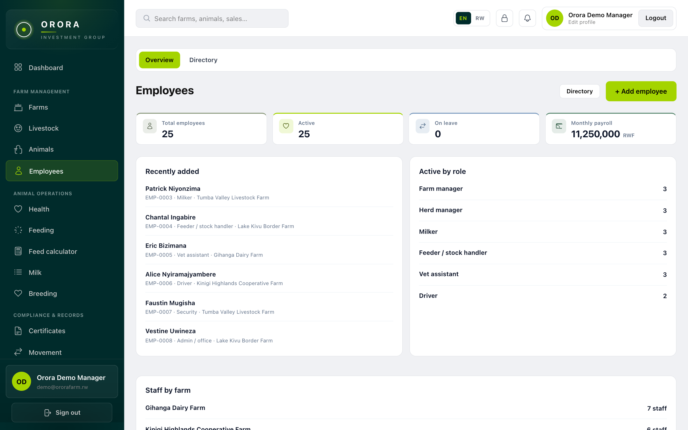
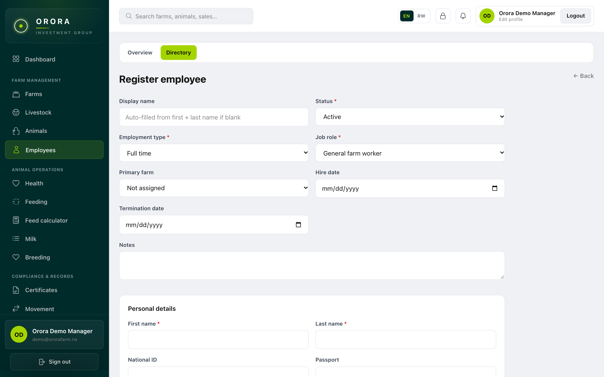

# Employees

The **Employees** module keeps a record for each person who works on your farm. It stores personal details, job role, farm assignments, emergency contacts, document notes and the pay agreement.

> **Important:** Employees are **records**, not system users. An employee does not get a login from this module. Logins for staff are made by the workspace admin under **Workspace users** (see the chapter on permissions).

> **Important:** The module stores the **pay agreement** (salary, how often, how paid). It does **not** run payroll. It does not calculate monthly pay, make payslips, record salary payments or send money to Expenses or Finance. If you pay wages, record them yourself in **Expenses** with the category **Labor**.

The module has three tabs: **Overview**, **Directory** and the employee pages.

## Who can do what
Access follows the permissions the admin gave you for **Employees**: view, create, edit and delete. See the chapter *Permissions*.

---

## 1. Add an employee

### Purpose
Create one complete record for a new staff member.

### When to perform
On the day the person is hired, or when you start using OroraFarm.

### Required information
First name, last name, status, employment type and job role. Everything else can be added later.

### Step by step

1. Open **Employees**, then **Directory**.
2. Use the search box to check that the person is not already listed.
3. Click **Add an employee**.
4. Fill in the sections: **Personal details**, **Emergency contact (optional)** and **Payroll (optional)**.
5. Click save. The message says: *Employee registered successfully.*

### Field table: employee

| Field | What to enter | Required? | Rules |
|---|---|---|---|
| Display name | The name to show in lists | No | Up to 255. If empty it becomes "First name Last name" |
| Status | Active, Inactive, On leave or Terminated | Yes | One of the four |
| Employment type | Full time, Part time, Seasonal, Contractor or Intern | Yes | One of the five |
| Job role | Farm manager, Herd manager, Milker, Feeder / stock handler, Vet assistant, Driver, Security, Admin / office, General farm worker or Other | Yes | One of the list |
| Primary farm | Where the person mainly works | No | An existing farm |
| Hire date | First working day | No | A valid date |
| Termination date | Last working day | No | A valid date, **not before the hire date** |
| Notes | Free text | No | Free text |
| First name | e.g. "Jeanne" | Yes | Up to 100 |
| Last name | e.g. "Mukamana" | Yes | Up to 100 |
| National ID | The ID number | No | Up to 50 |
| Passport | Passport number | No | Up to 50 |
| Date of birth | Birth date | No | A valid date |
| Gender | Male, Female or Other | No | One of the three |
| Marital status | Single, Married, Divorced, Widowed or Other | No | One of the five |
| Nationality | e.g. "Rwandan" | No | Up to 100 |
| Phone | Mobile number | No | Up to 50 |
| Email | Email address | No | Must be a valid email |
| Education | Level of school | No | Up to 100 |
| Skills & certifications | e.g. "AI technician certificate" | No | Free text |
| Emergency contact: name, relationship, phone, email | Who to call in an emergency | No | Email valid. Created only if a name or a phone is given |
| Contract type | Permanent, Fixed term or Casual / daily | No | One of the three. Starts as Permanent |
| Base salary | Pay amount in RWF | No | A number, 0 or more |
| Currency | RWF | No | Up to 3 letters |
| Pay frequency | Monthly, Weekly, Bi-weekly or Daily | No | One of the four. Starts as Monthly |
| Payment method | e.g. "Mobile money" | No | Up to 50 |

### What happens after saving

- An employee code like `EMP-0001` is created.
- A **profile** and a **payroll** record are created (payroll uses defaults if you left it empty: RWF, monthly, permanent).
- If you chose a **Primary farm**, the person is also **assigned** to that farm as the main assignment, with the job role and hire date.
- If you gave an emergency contact, it is saved as the primary one.
- An entry is written to the employee's **Audit trail**.

### Common mistakes
- Adding the same person twice. There is **no duplicate check** (not even for National ID). Search first.
- Choosing "Terminated" but leaving the termination date empty.
- Typing the salary with a comma. Use digits only: `60000`.

---

## 2. The employee page

Open an employee with **View**. You see these panels:

| Panel | What it holds | Actions |
|---|---|---|
| Profile | Main details | **Edit** |
| Farm assignments | Farms where the person works | **Add assignment**, remove |
| Emergency contacts | People to call | **Add contact**, remove |
| Addresses | Where the person lives | **Add address**, remove |
| Documents | Notes about papers (ID, contract...) | **Record document**, remove |
| Payroll & contract | The pay agreement | **Update payroll** |
| Audit trail | Who changed what and when | Read only |

Each of the lists can be **added to** and **removed from**. There is no edit button on a single contact, address, document or assignment: remove it and add it again.

### Farm assignments

An assignment says that the employee works on a farm, for a period.

| Field | What to enter | Required? | Rules |
|---|---|---|---|
| Farm | The farm | Yes | An existing farm. The employee cannot be assigned twice to the same farm: *Employee is already assigned to that farm.* |
| Role | The job on that farm | No | One of the job roles |
| Primary | Tick if this is the main farm | No | Ticking removes "primary" from the other assignments |
| Assigned from | Start date | No | A valid date |
| Assigned until | End date | No | A valid date, not before "assigned from" |
| Notes | Free text | No | Free text |

> **Note:** The **Primary farm** field in the profile and the **primary assignment** are not linked after the first save. If you change one, check the other.

### Emergency contacts

| Field | What to enter | Required? | Rules |
|---|---|---|---|
| Contact name | e.g. "Nyiransabimana Alice" | Yes | Up to 255 |
| Relationship | e.g. "Wife" | No | Up to 100 |
| Phone | Number | No | Up to 50 |
| Email | Email | No | Valid email |
| Primary | Tick for the main contact | No | Ticking removes "primary" from the others |
| Notes | Short note | No | Up to 255 |

### Addresses

| Field | What to enter | Required? | Rules |
|---|---|---|---|
| Address type | Physical, Mailing or Other | Yes | One of the three |
| Label | e.g. "Home" | No | Up to 100 |
| Country, Province, District, Sector, Cell, Village | Parts of the address | No | Up to 100 each |
| Street address | Free text | No | Free text |
| Default | Tick for the main address | No | Ticking removes "default" from the others |

### Documents

> **Note:** This section is a **register of documents**, not a file store. You write down that a document exists and when it expires. You **cannot upload** the file here. Keep the paper or scan in a safe place and write where in the Notes.

| Field | What to enter | Required? | Rules |
|---|---|---|---|
| Document type | National ID, Employment contract, Training certificate, Medical clearance, License / permit or Other | Yes | One of the six |
| Document name | e.g. "Milking training certificate 2026" | Yes | Up to 255 |
| Issued date | Date issued | No | A valid date |
| Expiry date | When it ends | No | A valid date, not before the issued date |
| Notes | e.g. "Paper copy in office cabinet" | No | Free text |

The system does **not** send reminders for expiring employee documents.

### Payroll and contract (pay agreement)

Click **Update payroll**.

| Field | What to enter | Required? | Rules |
|---|---|---|---|
| Contract type | Permanent, Fixed term or Casual / daily | Yes | One of the three |
| Contract start | Start date | No | A valid date |
| Contract end | End date | No | A valid date, not before the start |
| Base salary | The agreed pay, in RWF | No | 0 or more |
| Currency | RWF | Yes | Up to 3 letters |
| Pay frequency | Monthly, Weekly, Bi-weekly or Daily | Yes | One of the four |
| Payment method | e.g. "Mobile money" | No | Up to 50 |
| Bank name, Bank account | For bank payment | No | Up to 100 |
| Mobile money number | e.g. MTN or Airtel number | No | Up to 50 |
| Notes | Free text | No | Free text |

Changes to base salary, pay frequency and contract type are saved in the **Audit trail** with the old and new values.

> **Warning:** Salary, bank and mobile money numbers are private. Give Employees access only to people who need it.

---

## 3. Edit an employee

1. Open the employee and click **Edit**.
2. Change the details and save. The message says: *Employee updated successfully.*

Changes to the name, status, job role or employment type are written in the Audit trail. Payroll and contract are changed from the **Update payroll** panel, not from the edit page.

---

## 4. Delete an employee

Click delete and confirm. The employee is **hidden** from the lists (the record is kept in the database, not erased) and the message says: *Employee removed successfully.* There are no checks, so be sure. If the person only left the farm, set the status to **Terminated** and fill the termination date instead. This keeps the history.

---

## 5. The Employees overview

| Card | How it is calculated |
|---|---|
| Total | All employees |
| Active | Employees with status Active |
| On leave | Employees with status On leave |
| Terminated | Employees with status Terminated |
| Monthly payroll | Sum of **base salary** of **Active** employees whose pay frequency is **Monthly**. Weekly, bi-weekly and daily salaries are **not** included |

It also shows the latest 8 employees, the main job roles among active staff (top 6), and the number of active employees per farm (top 6). An employee who is assigned to two farms is counted in both farms.

> **Example:** Three active milkers are paid 50,000 RWF monthly, and one driver is paid 3,000 RWF daily. Monthly payroll shows 150,000 RWF. The driver is not included.

---

## 6. Import and export

### Export
Click **Export CSV** on the Directory page. The filters you used (search, status, role, farm) apply.

### Import

1. Click **Import**, then download the **template**.
2. Fill in one row per person. Save as CSV.
3. Upload it. The file must be a CSV, **up to 2 MB** and **up to 2000 rows**.
4. Read the result. A row that fails is listed with its row number. Rows that were fine are **already saved**. Upload only the corrected rows again. Uploading the whole file again creates duplicates.

Rules per row are the same as the form. `first_name`, `last_name`, `status`, `employment_type` and `job_role` are required. `primary_farm_name` must be the exact name of an existing farm, or empty.

## Known limitations

- No payroll run, payslips or salary payment records.
- Documents cannot be uploaded.
- No duplicate check for employees.
- No reminder for expiring documents or contracts.
- Contacts, addresses, documents and assignments cannot be edited, only removed and re-added.
