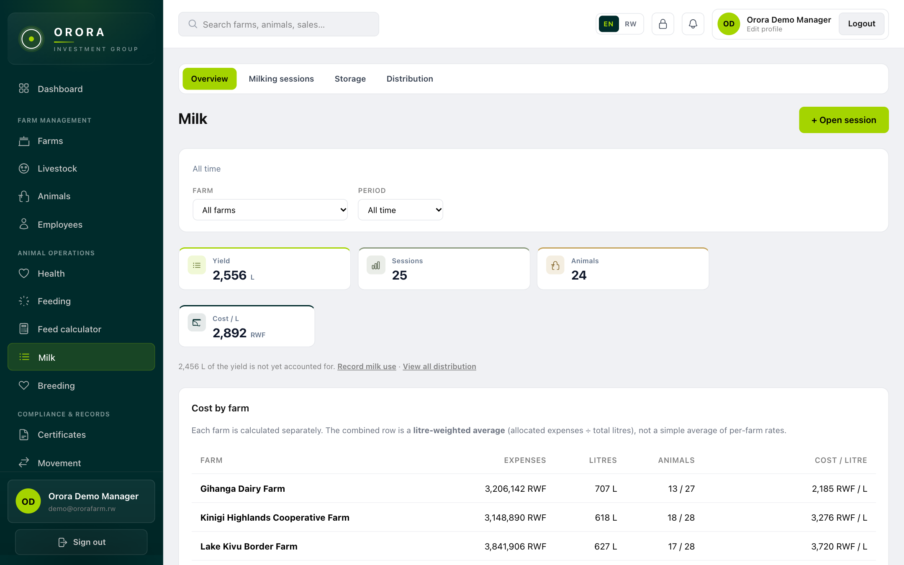

# Reports and analytics

OroraFarm shows its reports as **overview pages** inside each module, and as lists you can filter. This chapter lists every report that exists, and explains **how each number is worked out**, so you can trust it and explain it.

> **Note:** OroraFarm has **no PDF or Excel report download** for farm users. The only downloads are **CSV files** for Animals, Customers and Employees (lists, not reports) and the public **Animal trace** PDF. If you need a report on paper, use your browser's Print function on the overview page.

## The golden rule

A report is only as good as the data behind it. Before you read any number, check:

1. Milk sessions are **Completed** (open sessions are not counted in most milk figures).
2. Sales are **Completed** (drafts are not counted in revenue).
3. Expenses are **Paid** (drafts and void are not counted).
4. Payments are recorded.

## List of reports

| Report | Where | What it tells you |
|---|---|---|
| Dashboard | Dashboard | Summary of the whole farm, alerts, charts |
| Milk overview | Milk > Overview | Litres, sessions, top cows, shifts, distribution, cost per litre |
| Health overview | Health > Overview | Counts of health events, animals needing attention, charts |
| Sales overview | Sales > Overview | Revenue, outstanding money, by sale type |
| Customers overview | Customers > Overview | Customers, balances owed, best customers |
| Expenses overview | Expenses > Overview | This month's costs by group and category |
| Employees overview | Employees > Overview | Staff counts and monthly payroll |
| Finance overview, P&L, Cash flow | Finance | Income, costs, profit, cash movement |
| Eggs, Feeding and Breeding overviews | Each module's Overview | Module counts for the current period (see those chapters) |

---

## 1. Milk overview

How to use it: open **Milk**, choose a **Farm** (or all farms) and a **Period**: **All time**, **Today**, **This month** (calendar month) or **This year** (calendar year).

| Number | Exactly how it is worked out |
|---|---|
| Yield | Sum of "total litres" of **Completed** sessions in the period |
| Sessions | Count of **Completed** sessions in the period |
| Animals | Number of different cows with a record in a completed session in the period |
| Average per session | Yield divided by Sessions (0 if no sessions) |
| Today total | Completed sessions dated today (all farms or the chosen farm). Not affected by the period |
| By shift | Litres by Morning, Afternoon, Evening. With "All time" selected it shows **today only**. With other periods it shows the period |
| Top producers | Six cows with the highest total litres in the period (completed sessions) |
| Yield per animal / per herd | Total litres per cow and per herd group, biggest first (top 10). For "All time" uses all completed sessions |
| Recent sessions | Last 8 sessions, any status |

### Distribution cards (where the milk went)

Uses the Distribution records dated in the period (and the chosen farm).

| Number | How it is worked out |
|---|---|
| Sold, Fed to calves, Household, Other use | Total litres recorded in that category |
| Given away | Given to neighbor plus Given to relative or visitor |
| Distributed (total) | Sum of all categories, including Sold |
| Share | Distributed divided by Yield, as a percent |
| Not yet accounted for | Yield minus Distributed |

Read "Not yet accounted for" like this:

- **A positive number** means some milk has no recorded use. Record the missing uses (**Record milk use**) or check for missing sales. Milk still in a tank is also "not accounted" until it leaves the tank.
- **A negative number** means more milk was used than was produced in this period. Often it is milk stored from an earlier period, or a wrong entry.

> **Example:** This month, Yield = 3,200 L. Sold = 2,400 L (from sales), Fed to calves = 300 L, Household = 100 L, Given away = 50 L. Distributed = 2,850 L. Share = 89%. Not yet accounted for = 350 L. Look in the tank: if 350 L is still there, the books are fine.

### Cost per litre

This tells you what one litre of milk cost to produce, in **RWF**. It uses your **Paid** expenses.

How it is worked out, for one farm and a date range:

1. **Total expense** = sum of **Paid** expenses of that farm dated in the range (all categories).
2. **Total animals** = active animals on the farm. **Producing animals** = active animals whose production status is **Lactating**.
3. **Producing ratio** = Producing animals divided by Total animals.
4. **Allocated expense** = Total expense multiplied by the Producing ratio. (The idea: only the part of the cost that belongs to cows that give milk is charged to the milk.)
5. **Total litres** = litres from completed sessions in the range.
6. **Cost per litre** = Allocated expense divided by Total litres.

If there are **no litres** or **no lactating animals**, OroraFarm shows "no data" with the reason: *No milk recorded in this period* or *No lactating animals found*.

For **all farms**, it is the weighted average: the sum of the allocated expenses of all active farms divided by the sum of all their litres. A "Cost by farm" panel shows each farm.

The cards you see:

| Card | Meaning |
|---|---|
| Cost / L | Cost per litre for the period |
| Compare with the previous period | Only for Today, This month and This year. Compares with yesterday, last month or last year. Shows the difference in RWF per litre |
| Cost trend | A chart of the cost per litre for the **last 6 months** |
| Expenses | A pie chart of Paid expenses by group (Feed, Health, Farm operations, General...) |
| Breakdown | Expenses, Producing, Allocated, Litres |

For **All time** the range runs from the first completed session to today.

> **Example:** In October the farm has 20 active animals, 8 are Lactating (ratio 40%). Paid expenses were 1,000,000 RWF. Allocated = 400,000 RWF. The 8 cows gave 2,000 L. Cost per litre = 200 RWF. If the shop price is 450 RWF per litre, the margin is about 250 RWF per litre.

> **Warning:** The cost is only right if **all** your expenses are entered as **Paid**, and the animals' production status is correct (a cow that is dry but still marked Lactating makes the cost look better than it is). The figure is stored for a few minutes, so it can take a short time to change after you add an expense.

---

## 2. Health overview

Open **Health**. The numbers are totals for the whole workspace (not filtered by farm).

| Number | How it is worked out |
|---|---|
| Vaccinations, Dewormings, Treatments, Disease records, Vet visits, Mortality | Count of all records of that kind, any date |
| Healthy | Animals whose health status is **Healthy** |
| Needs attention | Animals with status **Sick**, **Under treatment**, **Quarantined** or **Recovering** |
| Follow-ups | Health records whose "next follow-up" date is between today and the next 30 days |
| Medicines low stock | Medicines with a reorder level where the quantity on hand is at or below that level |
| Medicines expired | Medicines with an expiry date before today |

Charts:

| Chart | Meaning |
|---|---|
| Records by month | Number of health records per month for the **last 6 months** |
| Animals by status | Number of animals in each health status. Statuses that are not known are grouped as "Other / unset" |
| Records by type | The 8 most common record types |

A list shows the 8 latest health records.

---

## 3. Sales overview

Pick a period (the same period selector as the Dashboard).

| Number | How it is worked out |
|---|---|
| Revenue | Sum of the total of **Completed** sales in the period |
| Transactions | Count of sales in the period in any status (including Draft and Cancelled) |
| Outstanding | For **all dates**: total of unpaid parts (sale total minus payments) of sales whose payment status is Unpaid or Partial and that are not Cancelled. Draft sales are included here |
| Animal / Meat / Milk / Egg sales | Revenue of completed sales of that type |

A list shows the 10 latest sales.

## 4. Customers overview

| Number | How it is worked out |
|---|---|
| Total | All customers |
| Active | Customers with status Active |
| Outstanding | Sum of the customers' outstanding balances. Each balance is the unpaid part of sales that are not Draft and not Cancelled |
| Over limit | Customers whose balance is above their credit limit. Customers with a limit of 0 are not counted |
| Sales this month | Total of sales dated this calendar month that are not Draft and not Cancelled |

Also: the 8 newest customers, and the 6 customers with the highest lifetime sales (sales that are not Draft and not Cancelled).

## 5. Expenses overview

All figures are for the **current calendar month**.

| Number | How it is worked out |
|---|---|
| Total this month | Paid expenses this month |
| Feed, Health, Farm operations, General | Paid expenses this month in that group |
| Records | Number of expense records this month, any status |
| Top categories | Six categories with the highest Paid total this month |

> **Note:** The Breeding group is not shown as its own card. Breeding expenses count in "Total this month" only.

## 6. Employees overview

See the chapter *Employees*. Monthly payroll is the sum of base salary of Active employees paid **monthly** only.

## 7. Finance reports

See the chapter *Expenses and finance*. In short:

- **Revenue** = income of completed sales (counted when completed, even if unpaid).
- **Expenses** = Paid expenses.
- **Net income** = Revenue minus Expenses.
- **Cash change** = money received minus money paid out.
- **Receivable** = money still owed from sales dated in the chosen dates.

Use the **From** and **To** dates. The default is the current month. A farm or herd filter is available.

---

## 8. The Dashboard

The Dashboard is explained in the chapter *Dashboard*. Some of its numbers are worked out slightly differently from the module pages, so they can differ a little:

| Dashboard number | Difference to know |
|---|---|
| Milk produced | Completed sessions in the period |
| Milk produced today | Counts **all** sessions dated today, including open ones. The Milk overview counts completed sessions only |
| Milk sold | Litres of "Sold" distributions in the period |
| Milk in storage | Current litres in all tanks (not limited by date) |
| Litres per cow per day | Litres divided by "cow-days" (a cow milked on a day counts once). Counts all sessions in the period, including open ones |
| Overdue payments | Unpaid or partly paid sales (not Draft, not Cancelled) older than **30 days**: the money still owed and the number of sales |
| Revenue, Expenses, Net profit, Receivable | From Finance for the chosen period |

Dashboard alerts (**Credit limit exceeded**, **Outstanding payments**, **Vaccinations due**, etc.) are explained in the chapter *Notifications and what's new*.

---

## 9. Exports

| Export | Where | Content |
|---|---|---|
| Animals CSV | Animals list, **Export** | Animals |
| Customers CSV | Customers > Directory, **Export CSV** | Customers. Respects your search, type and status filters |
| Employees CSV | Employees > Directory, **Export CSV** | Employees. Respects your filters |
| Animal trace PDF | Public trace page (`/trace`), for animals | A document about one animal's history, for buyers |

CSV files open in Excel or Google Sheets. If Excel shows letters wrongly, import the file as UTF-8 text.

## 10. Reading numbers safely: a checklist

Before you share or act on a report:

- [ ] Is the **farm** filter and **period** the one you want?
- [ ] Are all milk sessions of the period **Completed**?
- [ ] Are all sales **Completed** and payments recorded?
- [ ] Are all expenses **Paid** (not Draft)?
- [ ] Do the Milk "not accounted" litres match what is in your tanks?
- [ ] Are production statuses of the animals correct?

## Known limitations

- No PDF or Excel export of any overview or Finance report.
- Overviews cannot be saved or scheduled.
- Health overview counts are not filtered by farm or date range.
