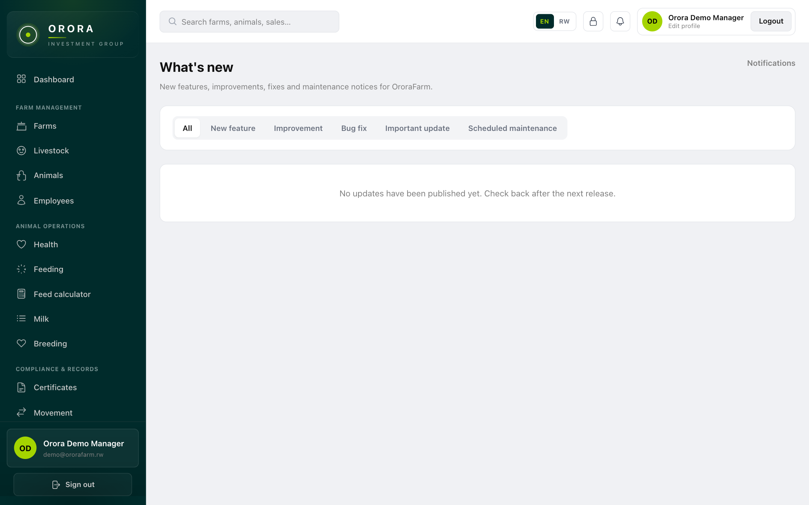

# Notifications, alerts and What's new

OroraFarm tells you about important things in three places:

| Place | What it shows | Where to find it |
|---|---|---|
| **Notification bell** | Messages sent to you personally | Top bar of every page |
| **Dashboard alerts** | Things that need action on your farm today | Dashboard |
| **What's new** | News about new features and fixes from OroraFarm | Bell menu or its own page |

> **Note:** All three work **inside the app**. OroraFarm does **not** send email, SMS or WhatsApp messages for them. You must sign in to see them.

---

## 1. Notifications (the bell)

### What triggers a notification

Only two kinds of notification exist today:

| Kind | Who gets it | When |
|---|---|---|
| **Release notice** (category such as New feature, Improvement, Bug fix, Important update, Scheduled maintenance) | Active users of the workspaces the OroraFarm team chose | When the OroraFarm team publishes a new release note |
| **New buyer inquiry** | The workspace admins (or all active users if the workspace has no admin) | When a buyer sends an inquiry on one of your Marketplace listings |

Each person gets **one** notice per release, even if the release is published or widened more than once.

> **Note:** Farm events (a new sale, a new milk session, a completed vaccination) do **not** create notifications. For reminders about farm work, use the **Dashboard alerts** below.

### The bell

1. Look at the top bar. The bell shows a number when you have **unread** notifications.
2. Click the bell. A small panel opens with your **latest 8** notifications. Unread ones are marked.
3. Each one shows a **title**, a short message, a **category label** and when it arrived.
4. Click a notification. OroraFarm marks it as **read** and takes you to the place it talks about (for a release notice, the What's new page; for a buyer inquiry, your listings page).
5. Click **Mark all as read** to clear the number.
6. Click **View all notifications** to open the full list.

If there is nothing new you see: *You're all caught up.*

### The Notifications page

Open it from **View all notifications**.

| Control | What it does |
|---|---|
| **All** tab | Shows all your notifications, 20 per page |
| **Unread** tab | Shows only unread ones. Empty message: *No unread notifications.* |
| **Mark all as read** | Marks every unread notification as read |
| **What's new** button | Opens the What's new page |

The page tells you how many are unread, for example *3 unread notifications*. If the list is empty: *No notifications yet. OroraFarm updates and alerts will appear here.*

### Rules to know

- You can only see and open **your own** notifications.
- A notification link only goes to a page **inside OroraFarm**.
- You cannot delete a notification. Mark it read and ignore it.
- Everyone can open Notifications and What's new. No special permission is needed.

---

## 2. Dashboard alerts (farm reminders)

The Dashboard shows an **alert strip** with the number of alerts, split into **critical**, **warning** and **info**. These are worked out **fresh** each time you open the Dashboard. They disappear by themselves when the problem is fixed. They are not stored and cannot be "marked read".

| Alert | Level | Shown when | Where it takes you |
|---|---|---|---|
| Animals need attention | Critical | Some animals have a health status that needs care | Health overview |
| Credit limit exceeded | Critical | A customer with a credit limit above 0 owes more than the limit | Customers directory |
| Feed inventory low | Warning | Feed items at or below their reorder level | Feeding overview |
| Vaccinations due | Warning | Vaccinations with a "next due" date within the next 30 days (or already past) | Vaccinations |
| Deworming scheduled soon | Warning | Scheduled dewormings in the next 7 days | Dewormings |
| Scheduled feedings overdue | Warning | Active feeding schedules with a due date before today | Feeding schedules |
| Certificates expiring | Warning | Certificates that expire within 30 days | Certificates |
| Pregnancy checks due | Warning | Pending breedings with no pregnancy check, when the check date has come (35 days after breeding by default) | Breeding overview |
| Outstanding payments | Warning | Sales (not Draft, not Cancelled) that are Unpaid or Partial | Sales overview |
| Calvings approaching | Info | Confirmed pregnancies with an expected calving date in the next 14 days | Breeding overview |

How to act:

1. Open the Dashboard first thing in the morning.
2. Click an alert to open the right page.
3. Do the work and record it (for example record the vaccination). The alert goes away when the data is updated.

> **Tip:** An alert for "Vaccinations due" or "Pregnancy checks due" that never goes away often means a **record was done but not entered**. Enter it to clear the alert.

### Reminders in Breeding

The breeding screens also mark a breeding record as due for a pregnancy check once the due date has come. You can see the same count on the Breeding overview (**Pregnancy checks due**). See the Breeding chapter.

---

## 3. What's new

### Purpose
To tell you about new features, improvements, fixes and planned maintenance, so you are not surprised.

### How to open it

- Click **What's new** in the bell panel, or
- Click **What's new** on the Notifications page, or
- Open the notification of a release.

### What you see

A list of release notes, newest first, 15 per page. Each note has:

- a **category** label: *New feature*, *Improvement*, *Bug fix*, *Important update* or *Scheduled maintenance*;
- the related **module** name;
- a **title** and a description;
- an **Explore feature** button that opens the related part of OroraFarm.

Use the tabs (**All** and one tab per category) to filter. If nothing matches: *No updates in this category yet.* If nothing was ever published: *No updates have been published yet. Check back after the next release.*

### Who sees which release

A release can be for **all workspaces** or for **selected workspaces** only. You see only the releases meant for your workspace.

### Marking as read

Opening the What's new page counts as reading the release notices shown on that page. Their bell notices become **read** automatically. (Notices for releases on a later page stay unread until you view that page.)

### Important: scheduled maintenance

Read **Scheduled maintenance** notes carefully. They tell you when OroraFarm may be unavailable. Plan your data entry so you do not lose work. Save before the maintenance time.

---

## Common mistakes to avoid

- Waiting for an email. None is sent. Look at the bell and the Dashboard.
- Ignoring "Pregnancy checks due" or "Vaccinations due". They appear because the dates are near or already past.
- Thinking "Mark all as read" removes dashboard alerts. It does not. It only clears bell notices.

## Known limitations

- Only release notices and marketplace inquiries create notifications.
- No email, SMS or push messages.
- Notifications cannot be deleted.
- Dashboard alerts cannot be snoozed or dismissed.
