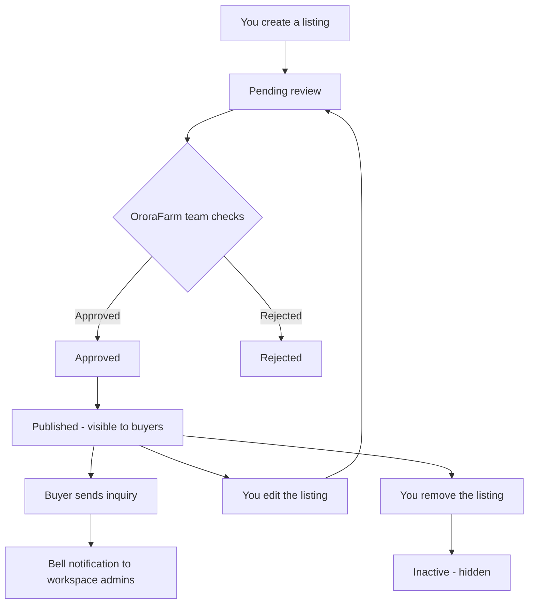

# Marketplace

The OroraFarm **Marketplace** is the **public website** where buyers look for animals, meat, milk and feed. A farm user can use it to **advertise** items for sale and to **receive buyer inquiries**.

## Scope of this chapter

The Marketplace is **not** a module in your farm menu. It does not appear in the sidebar. You reach it through the public web address of OroraFarm (the home page of the site), where you use the **Shop** pages after signing in.

This chapter covers only what a **signed-in farm user** can do:

1. Create a listing for something you want to sell.
2. See and edit your own listings.
3. Follow buyer inquiries.
4. Look up the history of an animal with **Trace**.

The review of listings and the running of the site are done by the OroraFarm team (platform admins). That is outside this guide.

> **Note:** Pages such as **About**, **Contact** and the public **Shop** list are open to everyone, with no sign-in. The old "Learning" pages now send visitors back to the home page.

> **Important:** The Marketplace does **not** record sales or take payment. When a buyer agrees, make the real sale in **Sales > Transactions** as usual. See the chapter *Sales and customers*.

## How a listing moves

*Figure: the life of a Marketplace listing.*

A listing is shown to buyers only when its status is **Published**. Statuses you may see in **My listings**: Draft, Pending review, Approved, Published, Rejected, Sold, Inactive.

---

## 1. Create a listing

### Purpose
To advertise animals, meat, milk or feed to buyers outside your farm.

### When to perform
When you really have the item for sale and you have its price and photos.

### Step by step

1. Sign in to OroraFarm.
2. Open the **Shop** page of the public site and choose to **add a listing** (the page address ends with `/shop/create`).
3. Choose the **Category**: Live Animals, Meat Products, Milk & Dairy or Feed & Supplies.
4. Fill in the form (table below).
5. Add up to 5 photos.
6. Submit. The message says: *Your animal listing has been submitted for review.*

### Field table: listing

| Field | What to enter | Required? | Rules |
|---|---|---|---|
| Farm | The farm that owns the item | No | Must be a farm in **your** workspace: *Select a farm in your workspace.* |
| Link an existing animal | An animal from your records | No | Must be in your workspace and on the chosen farm. Only for **Live Animals** listings: *Link an animal only to a live animal listing.* |
| Category | What you sell | Yes | Existing category. It sets the listing type |
| Title | A clear name, e.g. "Friesian heifer, 18 months" | Yes | Up to 255 characters |
| Description | Details for the buyer | Yes | Up to 2000 characters |
| Species | e.g. Cattle | No | Up to 80 |
| Sex | e.g. Female | No | Up to 40 |
| Breed | e.g. Friesian | No | Up to 120 |
| Age | e.g. "18 months" | No | Up to 60 |
| Weight (kg) | Weight | No | A number, 0 or more |
| Quantity | How many (or how much) | Yes | A number, at least 0.001 |
| Unit | head, kg, litre, bag or ton | Yes | One of the list |
| Price (RWF) | The asking price in Rwandan francs | Yes | A number, 0 or more |
| Price type | Fixed, Negotiable, Per kg or Per litre | Yes | One of the list |
| Seller name | Your name or farm name | Yes | Up to 120 |
| Phone | A number buyers can call | Yes | Up to 40 |
| Email | An email | No | Valid email |
| Seller type | Individual Farmer, Cooperative, Company or Abattoir | Yes | One of the list |
| District | Where the item is | Yes | Up to 120 |
| Sector | Sector | No | Up to 120 |
| Photos | Pictures of the item | No | Up to **5** images, JPG or PNG, each **up to 4 MB**. If you link an animal that has a photo, its photo is used when you add none |

> **Warning:** Your **phone number and name are shown publicly** to buyers. Do not enter private numbers you do not want to share.

### What happens after saving
- The listing is saved with the status **Pending review**.
- It is **not** visible to buyers yet.
- It appears in **My listings** with its status.
- The OroraFarm team reviews it. When approved and published it is visible in the Shop.

### Common mistakes
- A price of 0 or a wrong unit (for example price per head but unit "kg").
- Photos that are too large (more than 4 MB) or not JPG or PNG.
- Linking an animal from another farm.
- Listing an animal that is already sold. Check **Animals** first.

---

## 2. My listings

Open **My listings** (address ends with `/shop/my-listings`). You see a table with **Listing**, **Farm**, **Price**, **Submitted**, **Inquiries** and **Status**, and the number of new inquiries for each listing.

### Edit a listing
1. Click edit on the listing.
2. Change what you need. Use the "keep images" choices to keep or remove existing photos.
3. Save. The message says: *Your listing has been resubmitted for review.*

> **Warning:** After **any** edit your listing goes back to **Pending review** and loses its "verified" mark. It may disappear from the public Shop until the team approves it again. Edit only when needed.

### Remove a listing
Click remove. The listing becomes **Inactive** (hidden from buyers). The message says: *Listing removed.* You do not permanently delete it. You can only manage listings that belong to **your** workspace; any other will show "access denied" (403).

---

## 3. Buyer inquiries

### How an inquiry arrives
A buyer opens your published listing and sends an inquiry. They must give:

| Field | Required? | Rules |
|---|---|---|
| Name | Yes | Up to 120 |
| Phone | Yes | Up to 40 |
| Email | No | Valid email |
| Location | No | Up to 120 |
| Message | Yes | Up to 1000 |

When it arrives:
- Your workspace admins get a bell notification: **New buyer inquiry: (listing title)**. If the workspace has no admin, all active users get it.
- The inquiry is added under **Buyer inquiries** on the **My listings** page (newest and "new" ones first, up to 50 shown).

### Follow up
1. Call or message the buyer on the phone they gave.
2. On **My listings**, change the inquiry status:

| Status | Meaning |
|---|---|
| New | Not yet answered |
| Contacted | You spoke to the buyer |
| Closed | Finished (sold or no deal) |

3. If a deal is made, record the **real sale** in Sales.

---

## 4. Trace (animal history lookup)

**Trace** is a public page (address ends with `/trace`). A buyer types an animal's **tag number** (required, up to 100 characters) to see its recorded history. If one animal matches, its page opens. If several match, a list is shown. If none match, a "not found" page is shown. The page can also be downloaded as a **PDF**.

This is why accurate data in the **Animals**, **Health** and **Breeding** modules matters: buyers may see it. The page is limited to 30 requests per minute for each visitor.

## Known limitations

- The Marketplace has no link in the farm sidebar. Use the public site addresses.
- There is no payment or order process. It is an advertisement and inquiry tool only.
- You cannot permanently delete a listing, only make it inactive.
- Any edit sends the listing back to review.
- Sold items are not marked "Sold" automatically when you record a sale in Sales.
