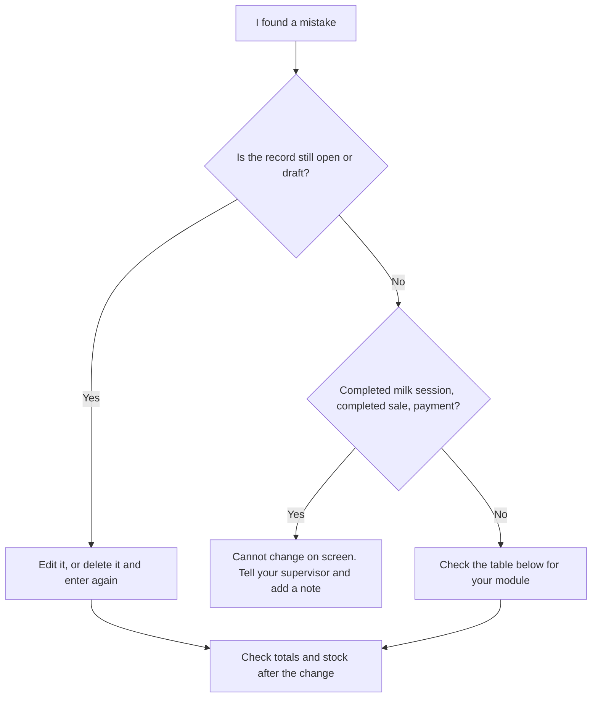

# Correcting mistakes

Everyone makes mistakes when entering data. This chapter tells you, for each part of OroraFarm, **what you can change, what you can delete, and what happens to stock, money and other records when you do**.

## Three golden rules

1. **Check before you save.** Some records cannot be corrected afterwards.
2. **Never delete to "tidy up".** Deleting can remove linked records. Prefer changing the **status** (Inactive, Terminated, Cancelled) when it fits.
3. **Tell your supervisor** before you delete anything that has money or stock attached.

## Who is allowed to correct

Your workspace admin gives each user rights per module: **view**, **create**, **edit** and **delete**.

| You click | Right needed |
|---|---|
| Edit, Save changes on an existing record | Edit |
| Delete, Remove | Delete |
| Add, Save on a new record | Create |
| Buttons that send a form such as Complete, Cancel, Confirm, Record payment | Create |

If you do not have the right you see the **Access denied** page: *You do not have permission to access this module.* Ask your admin or supervisor to make the correction.

## Quick decision chart

*Figure: how to decide.*

---

## Milk

| Record | Edit? | Delete? | What happens to stock |
|---|---|---|---|
| Milking session (Open) | Yes: farm, herd, date, shift, milker, method, tank, notes | Yes. Its cow records are deleted too | Nothing, because nothing was stored yet |
| Cow record in an Open session | **No edit.** Click **Remove**, add again | Yes (**Remove**) | None. Session totals are recalculated at once |
| Session (Completed) | **No** | **No** | Milk is already in the tank |
| Session (Cancelled) | **No** | **No** | None |
| Storage container | Yes (name, type, capacity, status ...). You cannot type a new quantity | Only when it holds **0 litres**: *Empty the container before removing it.* Its movement history is deleted with it | Quantity changes only through milk movements |
| Distribution (non-sale) | Yes | Yes | **Reversible.** Editing the quantity or tank first puts the old litres back, then takes out the new litres. Deleting puts the litres back |
| Distribution "Sold" | No. You are sent to Sales | No | Managed from the sale |

**If you completed a session by mistake or with wrong numbers:**
The session cannot be re-opened and the litres cannot be taken back out of the tank from the session page. Options:

1. Tell your supervisor. Write the mistake in the Notes field of the next session or the tank.
2. To take wrongly stored litres **out of a tank**, record a **Distribution** with "Other use", describe it clearly (for example "Correction: session MS-20261102-0001 entered twice"), and choose the tank. This lowers the tank to the right level but **adds the litres to the "distributed" total** of the overview. Explain it in the note.

> **Warning:** Deleting an **animal**, a **herd (livestock group)** or a **farm** deletes its milk records and sessions at the database level. The session totals of other cows are **not** recalculated and can become wrong. Do not delete an animal that has milk history. Change its status instead (for example Sold, Deceased, Inactive).

## Sales

| Record | Edit? | Delete? | Effects |
|---|---|---|---|
| Sale header (Draft) | Yes (**Save header**) | **Delete draft** | None yet: no stock moved, no Finance entry |
| Sale line item (Draft) | Yes (**Edit** on the line) | Yes (**Remove** on the line) | Total and balance update; nothing else moved yet |
| Sale (Completed) | **No** | **No** | Stock, animals and Finance are already updated |
| Sale (Cancelled) | No | Yes (**Delete**) | Nothing sold |
| Payment | **No** | **No** | Stays on the sale |

What each action does:

- **Cancel sale** is allowed for sales that are **not Completed** (in practice Draft). A completed sale **cannot be cancelled**: *This sale cannot be cancelled.*
- **Delete draft** is allowed only for Draft and Cancelled sales. The items **and any payments** recorded on that draft are deleted with it.
- For a **milk sale**, the milk leaves the tank (if a tank is chosen and has enough milk) only when you press **Complete sale**, and the sale becomes Completed at once. So a milk sale that is still Draft has not touched the tank.

**If a completed sale is wrong** (wrong price, wrong customer, wrong animal):
OroraFarm has no screen to reverse it. Do this:

1. Tell your supervisor or workspace admin.
2. Write the problem in your paper record or in the notes of the next related record.
3. Never "fix" it by selling the same item twice. An animal sold once has status **Sold** and cannot be sold again.

**If a payment was recorded wrongly** (wrong amount or wrong sale): it cannot be removed. Tell your supervisor. Do not add a negative payment: it is refused (the amount must be at least 0.01).

**Customer money:** The customer's **outstanding balance** is recalculated by the system each time you complete a sale or record a payment. You cannot type over it.

## Customers

| Record | Edit? | Delete? | Notes |
|---|---|---|---|
| Customer | Yes | Only if it has **no sales**: *Customer has sales history and cannot be deleted.* | Use status **Inactive** or **Blacklisted** instead |
| Contact | Remove and add again | Yes (**Remove**) | |
| Address | Delete and add again | Yes | |
| Credit settings | Yes (**Update credit**) | | Changes are logged |
| Communication | **No** | **No** | Add a new communication note that corrects the old one |

Duplicate customers: there is no merge tool. Keep one record. Make the duplicate **Inactive** and write "Duplicate of CUS-0007" in its Notes. It cannot be deleted if it already has sales.

## Expenses

| Record | Edit? | Delete? | Effects on Finance |
|---|---|---|---|
| Expense made by hand | Yes | Yes | See below |
| Expense linked to another module (Feeding, Health, Breeding) | **No.** Edit the source record | **No.** Delete the source record | Follows the source |
| Category | Yes | Not if it is a system category or has expenses | |
| Vendor | Yes | Yes. Expenses remain, vendor becomes empty | |

- **Delete a Paid expense:** a reversing entry is made in Finance, the receipt file is removed, and the expense is deleted. The cost disappears from the Expenses overview and from cost per litre.
- **Void:** Set the status to **Void** to cancel an expense but keep the line. The Finance entry is reversed.
- **Do not change the amount** of a Paid expense, and do not change a Void expense back to Paid. The Finance entry will not be correct (see the chapter *Expenses and finance*). **Delete and enter again.**
- Changing only the date, farm or category of a Paid expense does not move the Finance entry. **Delete and enter again.**

## Finance

Finance entries are **never** edited or deleted by hand. A mistake is corrected only by the source record (sale, payment, expense). Reversals are automatic where the system allows them.

## Employees

| Record | Edit? | Delete? | Notes |
|---|---|---|---|
| Employee | Yes (**Edit**) | Yes: the record is hidden, not erased | Prefer status **Terminated** with a termination date |
| Payroll (pay agreement) | Yes (**Update payroll**) | | Changes are logged |
| Assignment, emergency contact, address, document | Remove and add again | Yes | |

Deleting an employee does not touch Expenses or Finance, because the module does not post payments.

## Other modules (short guide)

These are covered in their own chapters. In short:

| Module | Delete effect |
|---|---|
| Feeding record | Deleting returns the feed to the inventory stock. Editing first puts the old quantity back, then deducts the new one |
| Feed inventory item | Deleted with no check |
| Treatment | Deleting returns the medicine to stock, removes the linked expense and the linked health record |
| Vaccination | Removes the linked expense and the linked health record (and the attached file) |
| Medicine | Cannot be deleted if used in a treatment: *This medicine is linked to treatments and cannot be deleted. Mark it inactive instead.* |
| Mortality | Deleting adds the dead birds back to the flock count |
| Breeding record | Cannot be deleted if it has a birth: *Cannot delete a breeding record that has a birth.* The linked expense is removed |
| Animal, Flock, Livestock group, Farm | Deleted with **no** safety check. Linked records may be deleted by the database (for example milk records, sessions, sales of that farm). Think very carefully |
| Egg collection, Movement, Certificate | Simply removed |

> **Warning:** Deleting a **Farm** deletes everything tied to it at the database level, including its milk sessions, tanks and sales. Expenses are kept but lose their farm. Never delete a farm that has history. Change its status to inactive instead.

## When you must not "fix" it yourself

Ask your supervisor first if the mistake is in:

- a **completed milk session** or a **completed sale**;
- any **payment**;
- a **Paid expense** with a changed amount;
- a farm, herd or animal with history.

## What to write down

When you correct something that cannot be undone on screen, keep a short note: **date, record code (for example MS-20261102-0001), what was wrong, what was done, your name**. Put it in the record's Notes field when you can.

## Preventing mistakes

- Read the confirmation window before you click OK.
- Search the list for duplicates before adding.
- Enter data the same day.
- Check the totals shown after saving (the session total, the sale balance).
- Use the **Audit trail** panels (Customers and Employees) and the sale's history to see who changed what.
