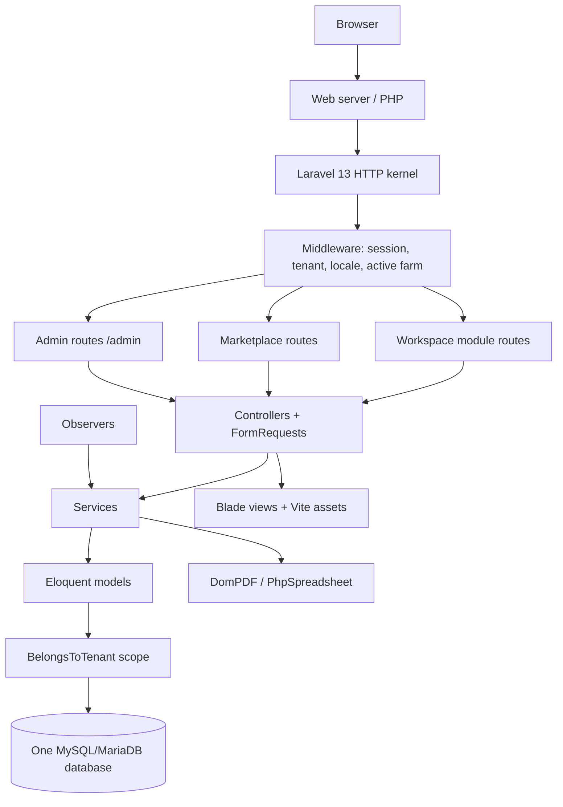

# System overview

## Purpose

OroraFarm (repository name `Orora`) is a multi-tenant web application for managing farms in Rwanda. A **workspace** (tenant) owner registers, creates one or more farms, and records livestock, health, feeding, milk, eggs, breeding, sales, customers, expenses, finance and employees. A separate **platform administration area** (`/admin`) lets the platform operator see all workspaces, manage a public marketplace/learning hub, publish release notes and read contact messages. A public **marketplace** (`/`, `/shop`, `/trace`, `/about`, `/contact`) is served by the same application.

The UI is available in English and Kinyarwanda (`lang/en.json`, `lang/rw.json`).

## Functionality (derived from code)

Workspace modules (keys from `config/workspace_access.php`; navigation in `config/modules.php` and `config/species.php`):

| Module | What it does | Main controllers / services |
|---|---|---|
| Dashboard | KPI cards and charts across modules | `DashboardController`, `DashboardAnalyticsService` |
| Farms | Farm registration with Rwanda administrative location (province to village), GPS coordinates, status | `FarmController`, `RwandaLocationService`, `RwandaLocationController` (`/api/rwanda/*`) |
| Livestock | Herd/batch groups per farm | `LivestockController` |
| Animals | Individual animal register, CSV import (preview, confirm, replace) and export | `AnimalController`, `AnimalImportExportController`, `Import/AnimalCsvImporter`, `Export/AnimalCsvExporter` |
| Flocks and Eggs | Poultry flocks, flock event ledger, daily egg collections | `FlockController`, `EggCollectionController`, `FlockService`, `EggCollectionService` |
| Health | Health records, vaccinations, treatments, dewormings, vet visits, mortality, disease records, medicine stock | `HealthController`, `*Controller`, `MedicineInventoryService`, `HealthOverviewAnalyticsService` |
| Feeding | Feeding records, feed types, inventory, schedules, feed calculator | `FeedingController`, `FeedInventoryController`, `FeedCalculatorController`, `FeedInventoryService`, `Feeding/*` |
| Milk | Milking sessions and per-animal records, storage tanks, distribution (sold/calf/household...), cost per litre | `MilkSessionController`, `MilkStorageController`, `MilkDistributionController`, `MilkSessionService`, `MilkStorageService`, `Milk/*` |
| Breeding | Breeding records, pregnancy checks, births, offspring registration, reminders | `BreedingModuleController`, `BreedingService`, `BreedingReminderService` |
| Certificates, Movement | Animal certificates and movement records | `CertificateController`, `MovementController` |
| Sales | Unified sales (animal, meat, milk, egg), line items, payments, documents, abattoir dispatch/returns | `SaleTransactionController`, `SaleTransactionService`, `AbattoirDispatchController` |
| Customers | Customer master with profile, credit, addresses, contacts, communications, documents; CSV import/export | `CustomerController`, `CustomerService` |
| Expenses | Expense categories, vendors, expense records | `ExpenseController`, `ExpenseService` |
| Finance | Double-entry ledger auto-posted from paid expenses and sales/payments, periods, reports | `FinanceModuleController`, `Finance/*` |
| Employees | Employee master with profile, payroll/contract data, addresses, documents, farm assignments; CSV import/export | `EmployeeController`, `EmployeeService` |
| Workspace users | Workspace admin manages users, roles (`workspace_admin`, `member`) and per-module permissions | `WorkspaceUserController`, `WorkspaceAccessService` |
| Notifications / What's new | In-app bell and release-notes page | `NotificationController`, `WhatsNewController` |
| Profile / locale | Profile edit; session language switch (`/locale/{locale}`) | `ProfileController`, `LocaleController` |

Platform (central) functions under `/admin` (guard `admin`): dashboard and statistics, accounts directory and purge, farm directory/map, tenants list/create/delete, e-commerce (marketplace listing moderation, inquiries), platform releases (draft, publish, notify), contact messages.

Public functions: marketplace shop (browse, create own listings when logged in, inquiries), learning hub routes (currently redirects), about, contact form (throttled), animal trace lookup with PDF output.

> **Note:** Species awareness: `config/species.php` defines two profiles, `cattle` (default) and `poultry`. The cattle profile enables Animals, Milk and Breeding (sale types: animal, meat, milk); the poultry profile enables Flocks and Eggs instead (sale types: animal, egg, meat) and hides the abattoir sales section. `EnsureSpeciesModule` returns 404 for modules the active profile does not allow.

## Technology stack

| Layer | Technology | Version (source) |
|---|---|---|
| Language | PHP | `^8.3` (composer.json); local CLI is 8.4.7 |
| Framework | Laravel | `^13.8` constraint, 13.11.2 installed (composer.lock) |
| Multi-tenancy | stancl/tenancy | `^3.10`, 3.10.0 installed; used in row-level mode (see chapter 3) |
| PDF | barryvdh/laravel-dompdf | `^3.1`, 3.1.2 |
| Spreadsheet import | phpoffice/phpspreadsheet | `^5.0`, 5.10.0 |
| REPL | laravel/tinker | `^3.0` |
| Dev/test | phpunit `^12.5.12`, laravel/pint, laravel/pail, laravel/pao, mockery, fakerphp, collision | composer.json `require-dev` |
| Database | MySQL/MariaDB (`DB_CONNECTION=mysql`, DB `orora`); local server is MariaDB 10.4.28. SQLite in-memory for PHPUnit (`phpunit.xml`) | `.env`, `phpunit.xml` |
| Frontend build | Vite | `^8.0.0`, 8.0.14 installed |
| Vite plugin | laravel-vite-plugin | `^3.1`, 3.1.0 (also configures Bunny font "Instrument Sans") |
| CSS | Tailwind CSS via `@tailwindcss/vite` | `^4.0.0`, 4.3.0 |
| Charts | Chart.js | `^4.4.1`, 4.4.1 |
| Templating | Blade (server-rendered), vanilla ES modules | `resources/views`, `resources/js` |
| Sessions / cache / queue | `database` drivers | `.env`: `SESSION_DRIVER`, `CACHE_STORE`, `QUEUE_CONNECTION` = database |
| Mail | `MAIL_MAILER=log` in the development `.env` | `.env` |
| Files | `FILESYSTEM_DISK=local` | `.env` |

There is no SPA framework and no REST API for third parties; the only JSON endpoints are `/api/rwanda/*` (location lookups) used by forms.

## Components

| Component | Location | Role |
|---|---|---|
| Public marketplace | `routes/marketplace.php`, `app/Http/Controllers/Marketplace`, `resources/views/marketplace` | Landing, shop, trace, about, contact |
| Workspace app | `routes/modules.php`, `app/Http/Controllers/*`, `resources/views/modules`, `records`, `dashboard` | Farm management modules |
| Platform admin | `routes/web.php` (`/admin`), `app/Http/Controllers/Central`, `resources/views/central` | Operator console |
| Tenancy layer | `app/Services/TenantContext.php`, `app/Models/Concerns/BelongsToTenant.php`, `InitializeDefaultTenant`, `TenantAccountService` | Resolves and enforces the current tenant |
| Domain services | `app/Services` | Business rules, stock ledgers, finance posting |
| Observers | `app/Observers` | Finance posting and milk-cost cache invalidation |
| Console commands | `app/Console/Commands` | `orora:install`, `orora:migrate`, `orora:seed-demo`, `orora:super-admin`, `orora:super-admin-status`, `orora:learning-cleanup`, `finance:backfill`, `rwanda:download-locations` |
| Queue worker | `php artisan queue:listen` (composer `dev` script) | Database queue; no queued job classes found in `app/` (no `ShouldQueue` implementations) |

## Architecture diagram

*Figure: Logical architecture; all tenants share one database and are separated by `tenant_id`.*

## Runtime modes

| Mode | Switch | Behaviour |
|---|---|---|
| Single database (default, production target) | `TENANCY_SINGLE_DATABASE=true` | Row-level tenancy; stancl bootstrappers are disabled (`TenancyMode::bootstrappers()` returns `[]`). Works on cPanel shared hosting. |
| Database per tenant (legacy) | `TENANCY_SINGLE_DATABASE=false` | Enables stancl Database/Cache/Filesystem/Queue bootstrappers and create/migrate/delete database jobs. Needs `CREATE DATABASE` rights (cPanel UAPI manager is provided in `app/Tenancy`). |
| Domain routing | `TENANCY_DOMAIN_ROUTES=true` | Scopes web routes to `CENTRAL_DOMAINS` and loads `routes/tenant.php`; default false (any host serves the app). |

> **Warning:** Only the single-database mode is exercised by the migrations and application logic described in these chapters. The database-per-tenant path is retained from the package skeleton and is not verified here.
