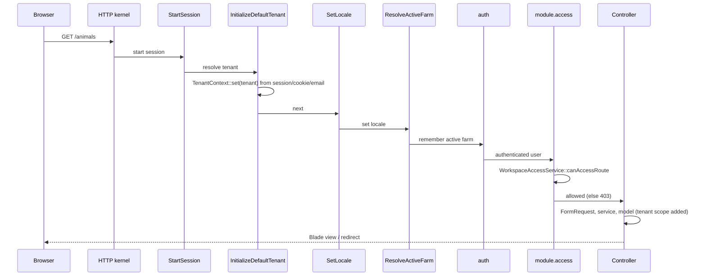
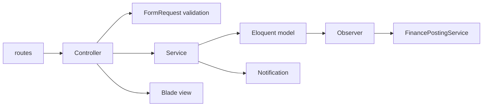

# Technical architecture

## Laravel application structure

| Path | Content |
|---|---|
| `bootstrap/app.php` | Application builder: routing, global middleware, aliases, redirect rules |
| `bootstrap/providers.php` | Registered providers (see below) |
| `routes/web.php` | Login/register, `/admin` platform routes; requires `routes/marketplace.php` and (inside the `auth` group) `routes/modules.php` |
| `routes/modules.php` | All workspace module routes |
| `routes/marketplace.php` | Public marketplace routes |
| `routes/tenant.php` | Only loaded when `TENANCY_DOMAIN_ROUTES=true` |
| `routes/console.php` | Console routes; the health check URL is `/up`, configured in `bootstrap/app.php` |
| `app/Http/Controllers` | Controllers (`Central/`, `Marketplace/`, `Auth/`, `Api/` sub-folders; `Concerns/` holds section-view traits) |
| `app/Http/Requests` | FormRequest validation classes |
| `app/Services` | Domain services |
| `app/Models` | Eloquent models (`Central/` for central-connection models, `Concerns/` for traits) |
| `app/Observers` | Model observers |
| `app/Notifications` | `ReleasePublished`, `MarketplaceInquiryReceived` (both database channel only) |
| `app/Support` | Helpers: `TenancyMode`, `CentralDomains`, `AppUrl`, `TenantStorageUrl`, `SuperAdminSetup`, `TenancyCpanel`, `TenancyDatabaseNaming` |
| `app/Tenancy` | Custom stancl database managers (cPanel UAPI, shared-hosting blocker) |
| `app/Auth/TenantAwareUserProvider.php` | `tenant_eloquent` user provider |
| `config/` | App config plus domain config: `modules.php` (enums, navigation), `workspace_access.php`, `species.php`, `finance.php`, `marketplace.php`, `localization.php`, `record_views.php`, `releases.php`, `dashboard.php`, `feed_calculator.php`, `rwanda_map.php`, `demo.php`, `branding.php`, `admin.php` |
| `database/migrations`, `database/migrations/tenant` | Schema (see chapter 4) |
| `tests/Feature`, `tests/Unit` | PHPUnit tests (SQLite in memory); `tests/TenantTestCase.php` base class |

## Bootstrap (`bootstrap/app.php`)

- Routing: `web` (routes/web.php), `commands`, health endpoint `/up`.
- Web middleware group **appended** (in order): `InitializeDefaultTenant`, `SetLocale`, `ResolveActiveFarm`.
- Aliases: `module.access` -> `EnsureModuleAccess`; `workspace.admin` -> `EnsureWorkspaceAdmin`.
- `appendToPriorityList(StartSession::class, InitializeDefaultTenant::class)` makes sure the tenant is resolved after the session starts.
- Guests are redirected to `/login`; authenticated users hitting guest routes go to `/admin` (admin guard) or the first module they may access (`WorkspaceAccessService::homeRouteFor`).
- `withExceptions` is empty (default handler).

### Service providers

| Provider | Responsibility |
|---|---|
| `AppServiceProvider` | In single-DB mode loads `database/migrations/tenant`; registers `tenant_eloquent` auth provider; Authenticate/RedirectIfAuthenticated redirects; sets stancl `TenantAssetsController` middleware; view composers for navigation (`layouts.dashboard`) and the notification bell; `/tenancy/assets/{path?}` route; repairs invalid console request URI |
| `FinanceServiceProvider` | Registers `SaleTransactionObserver`, `ExpenseObserver`, `SalePaymentObserver` |
| `MilkServiceProvider` | Registers `MilkRecordObserver` |
| `TenancyServiceProvider` | stancl event wiring; in single-DB mode create/migrate/delete-database pipelines and bootstrap listeners are empty; maps `routes/tenant.php` only when domain routes are enabled |

### Middleware

| Middleware | Where applied | Purpose |
|---|---|---|
| `InitializeDefaultTenant` | web group (global) and again on the main route group | Skips `/admin*`; resolves tenant from session `tenant_id` / cookie `orora_tenant_id`, then from `auth_email` / cookie `orora_auth_email` via `tenant_accounts`; forces re-login if an authenticated session cannot be tied to a tenant |
| `SetLocale` | web group | Reads `session('locale')`, validates against `config('localization.supported')` (`en`, `rw`), sets app and Carbon locale |
| `ResolveActiveFarm` | web group | For authenticated non-admin requests stores the active farm (`?farm_id=` or the only farm) in the session via `ActiveFarmContext` |
| `auth` / `auth:admin` | route groups | Session guards `web` (provider `tenant_eloquent`) and `admin` (eloquent `AdminUser`) |
| `ForgetTenantForCentralAdmin` | `/admin` authenticated group | Calls `TenantContext::forget()` so admin requests run without a tenant |
| `module.access` | most module routes | `EnsureModuleAccess`: requires active user; maps route name to module/action via `WorkspaceAccessService`; 403 otherwise |
| `workspace.admin` | `/workspace/users` | Only workspace admins |
| `EnsureSpeciesModule` | milk, breeding, poultry, abattoir routes | 404 when the active species profile does not allow the module |
| `InitializeTenancyForAssets` | stancl assets route | Initialises tenant for `/tenancy/assets` |
| `throttle:30,1` | contact form and trace routes | Rate limit |

Login additionally rate-limits to 5 attempts per key (`LoginRequest::ensureIsNotRateLimited`).

## Request lifecycle

*Figure: Request lifecycle for a workspace route.*

Key points:

1. The tenant is held in a **static** (`TenantContext::$tenantId`) for the PHP process lifetime; it is not stored in the container.
2. If the session shows a logged-in web user (`login_web_*` key or `remember_web_*` cookie) but no tenant can be resolved, the user is redirected to `/login` with "Your session expired" and stale auth state is cleared.
3. `TenantAwareUserProvider::retrieveById` returns `null` while no tenant is active, so a session cannot authenticate without a tenant.
4. `/admin/*` skips tenant resolution entirely; admin controllers that need cross-tenant data call `withoutGlobalScope('tenant')` explicitly.

## Backend layering

*Figure: Controller to service to model layering.*

- **Controllers** are thin; many are module "overview" controllers that compose view data through traits in `Controllers/Concerns` (for example `MilkSectionViews`).
- **FormRequests** carry validation. Allowed values come from `config/modules.php` via `Rule::in(...)` (see chapter 6).
- **Services** hold transactional business rules (`DB::transaction` appears in 19 controller/service classes (49 call sites)), numbering (`generateCode`, `generateSaleNumber`), stock ledgers and finance posting.
- **Models** use the `BelongsToTenant` scope (through `TenantModel`), casts, relations and a few helpers.
- **Observers**: `SaleTransactionObserver` (post/reverse sale revenue on `sale_status` change), `SalePaymentObserver` (post payment on create), `ExpenseObserver` (post/reverse on status/amount change, invalidate milk-cost cache), `MilkRecordObserver` (invalidate milk-cost cache).
- **Notifications**: `ReleasePublished` and `MarketplaceInquiryReceived` use the `database` channel; stored in `notifications` and read by the bell (`resources/js/notification-bell.js`). No queued notifications and no e-mail channel exist in code.
- **PDF**: `barryvdh/laravel-dompdf` generates only the animal trace PDF (`marketplace.trace.pdf` view, `AnimalTraceService`).
- **Spreadsheets**: `phpoffice/phpspreadsheet` is used to parse animal import files (`ParsesAnimalImportFile`); exports are plain CSV (`Services/Export/*CsvExporter`).

> **Known limitations:** `MilkSaleService` and models `Sale`, `MilkSale*` are legacy and unreachable from routes (tables do not exist). See chapter 4.

## Frontend architecture

- **Server-rendered Blade** under `resources/views`: `layouts/` (dashboard layout, sidebar partials, notification bell), `modules/`, `records/`, `dashboard/`, `central/` (admin), `marketplace/`, `auth/`, `profile/`, `workspace/`, `notifications/`, `whats-new/`, `errors/`, `partials/`.
- **Vite 8 + laravel-vite-plugin** build entries (`vite.config.js`): `resources/css/app.css` plus marketplace page CSS (`marketplace-landing|shop|learning|about|contact|trace`) and page-specific modules `resources/js/app.js`, `farm-form`, `livestock-form`, `animal-form`, `health-form`, `feed-calculator-form`, `feeding-record-form`, `health-overview-charts`, `landing-page`, `marketplace-*`, `select-other-form`, `milk-distribution-form`, `notification-bell`. Views load only the entries they need.
- **Tailwind CSS 4** through `@tailwindcss/vite`; `app.css` imports Tailwind and declares `@source` globs for Blade and JS plus a `@theme` block.
- **Chart.js 4.4.1** is imported only in `health-overview-charts.js` (`chart.js/auto`).
- No JS framework; scripts are vanilla ES modules enhancing forms (dependent selects, "Other" fields, calculators).
- Fonts: Bunny "Instrument Sans" 400/500/600 via the Vite plugin.
- `public/build/` (with `manifest.json`) must be produced by `npm run build` and deployed; without it pages fail with "Vite manifest not found" (auth pages fall back to basic styles, per `MULTITENANCY.md`).

## Localization

- `config/localization.php`: supported `en` (English) and `rw` (Kinyarwanda); default from `APP_LOCALE`.
- Translations: `lang/en.json` (about 1,500 keys) and `lang/rw.json` use the English text as key (`__('...')`); `lang/{en,rw}/auth|pagination|passwords|validation.php` for framework messages.
- Switching: `GET /locale/{locale}` (`LocaleController`) stores the locale in the session; `SetLocale` applies it. The choice is per session, not stored on the user record.
- Untranslated keys fall back to the English key text.

## Development and test tooling

- `composer dev` runs `artisan serve`, `queue:listen`, `pail` and `npm run dev` concurrently.
- `composer test` clears config and runs `artisan test`; PHPUnit uses SQLite `:memory:`. Feature tests: 17 files; unit tests include `BelongsToTenantTest`.
- Code style: Laravel Pint.
