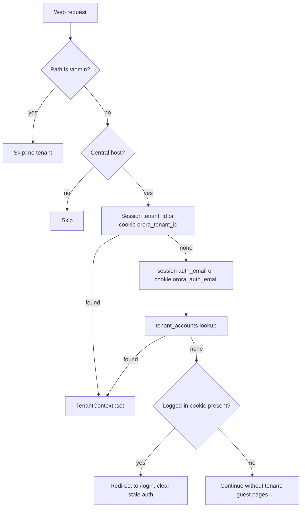

# Multi-tenancy and workspaces

## Model in one paragraph

OroraFarm runs **one database** for all customers. A **tenant** (a row in `tenants`, string id such as `demo`) is a customer **workspace**. Every farm-related table carries `tenant_id`; an Eloquent global scope appends `WHERE <table>.tenant_id = <current tenant>` to every query, and a `creating` hook fills `tenant_id` on insert. The package `stancl/tenancy` 3.10 is installed, but in the default `TENANCY_SINGLE_DATABASE=true` mode **none of its bootstrappers run**; the current tenant is held in the app's own `TenantContext` class.

> **Note:** `MULTITENANCY.md` in the repository root summarises the same design (written for cPanel shared hosting, where `CREATE DATABASE` is not allowed).

## Configuration (`config/tenancy.php`, `.env`)

| Setting | Default / value | Meaning |
|---|---|---|
| `TENANCY_SINGLE_DATABASE` | `true` | Row-level tenancy; also read by `TenancyMode::usesSingleDatabase()`, which empties the bootstrapper list and event pipelines |
| `TENANCY_DOMAIN_ROUTES` | `false` | When false the app answers on any host and tenant comes from session/cookie; when true, `CENTRAL_DOMAINS` restrict routes and `routes/tenant.php` is loaded |
| `DEFAULT_TENANT_ID` | `demo` | Fallback tenant used at login when the e-mail has no `tenant_accounts` row |
| `tenant_model` | `App\Models\Tenant` | Plain Eloquent model (`id` string, fillable `id`, `name`), **not** stancl's `BaseTenant` |
| `id_generator` | `UUIDGenerator` | Not used: ids are generated by `TenantAccountService::generateTenantId` (slug of the e-mail local part, suffix `-1`, `-2`... on collision) |
| `database.central_connection` | `central` | Connection name for central models (`TenantAccount`, `AdminUser`, `CentralModel` subclasses) |
| `bootstrappers` | `[]` in single-DB mode; Database, Cache, Filesystem, Queue otherwise | |

Connections in `config/database.php`: the default `mysql` and a second `central` connection. Both read the same `DB_*` variables (`DB_DATABASE=orora`), so they point to the same database; `central` exists so central models keep working when stancl switches the default connection in database-per-tenant mode.

## Components

| Component | File | Role |
|---|---|---|
| `TenantContext` | `app/Services/TenantContext.php` | Static holder of the active tenant id: `id()`, `isActive()`, `tenant()`, `set()`, `forget()`, `run($tenant, $callback)` (restores the previous id afterwards) |
| `BelongsToTenant` | `app/Models/Concerns/BelongsToTenant.php` | Global scope `tenant` + `creating` hook (details below) |
| `TenantModel` | `app/Models/TenantModel.php` | Abstract base using `BelongsToTenant`; almost all farm models extend it |
| `BelongsToTenantWithSystemCatalog` | `app/Models/Concerns/` | Variant for `ExpenseCategory` and `FinanceAccount`: scope is `tenant_id = X OR is_system = true`, so seeded system rows are shared |
| `InitializeDefaultTenant` | `app/Http/Middleware/` | Resolves the tenant on each web request |
| `TenantAccountService` | `app/Services/TenantAccountService.php` | Email to tenant lookup, registration, cookies, tenant initialisation |
| `TenantAwareUserProvider` | `app/Auth/` | Auth provider `tenant_eloquent`; refuses `retrieveById`/`retrieveByToken` when no tenant is active |
| `ForgetTenantForCentralAdmin` | `app/Http/Middleware/` | Clears the tenant for `/admin` routes |
| `CentralDomains`, `TenancyMode`, `AppUrl` | `app/Support/` | Mode and host helpers |
| `PlatformUserWorkspaceService` | `app/Services/` | Platform-admin purge of a whole workspace |

### The scope

```php
static::addGlobalScope('tenant', function (Builder $builder): void {
    if (! $tenantId = TenantContext::id()) { return; }          // no tenant: NO filter
    if (! Schema::hasColumn($model->getTable(), 'tenant_id')) { return; }
    $builder->where($model->getTable().'.tenant_id', $tenantId);
});
static::creating(function (Model $model): void {
    // fills tenant_id from TenantContext if empty and the column exists
});
```

Consequences:

- Scope name is `tenant`; central code removes it with `withoutGlobalScope('tenant')`.
- When **no tenant is active** (console commands, queue workers, tinker, `/admin`) the scope does nothing and queries are unfiltered.
- The scope filters only the model's own table. Joined tables are not filtered (the joins in dashboards are made through foreign keys from an already scoped base model).
- `Schema::hasColumn(...)` is executed whenever the scope is applied and when a model is created; it is not cached by the application.
- Rows with `tenant_id IS NULL` are never returned while a tenant is active (the column is nullable on 69 of the 76 tables that have it).

## Tenant resolution flow



*Figure: Tenant initialisation in `InitializeDefaultTenant`.*

With `TENANCY_DOMAIN_ROUTES=false`, `CentralDomains::isCentralHost()` always returns true, so every host is treated as central.

### Login

`LoginRequest::authenticate()`:

1. Rate limit: 5 attempts per throttle key.
2. If the e-mail exists in `admin_users`, attempt the `admin` guard (central connection); success returns `admin` and the session loses `tenant_id`/`auth_email`.
3. Otherwise `TenantAccountService::initializeForEmail()`: lookup `tenant_accounts.email` -> `tenant_id` -> `TenantContext::set`. If there is no row, **fall back to `DEFAULT_TENANT_ID` (`demo`)**.
4. `Auth::guard('web')->attempt(...)` through `TenantAwareUserProvider`; the user query is tenant-scoped, so only that tenant's user with that e-mail can match. Inactive users (`is_active = false`) are rejected.
5. On success `tenant_id` and `auth_email` are saved to the session and as 1-year cookies (`orora_tenant_id`, `orora_auth_email`, 525,600 minutes).

### Registration

`TenantAccountService::registerAccount(name, email, password)`: checks that `users.tenant_id` exists, ends any tenancy, creates `tenants` (`id` = slug of e-mail local part, `name` = "<name>'s farm"), sets the context, creates the `users` row with `role = workspace_admin`, `is_active = true`, then creates `tenant_accounts (tenant_id, email)`. These steps are **not wrapped in a DB transaction**.

## Workspaces, users and roles

- A workspace = a tenant. `users.tenant_id` links a user; `User::farms()` is `hasMany(Farm, 'tenant_id', 'tenant_id')`, so "the user's farms" means all farms of the tenant.
- Roles (`config/workspace_access.php`): `workspace_admin` and `member`. `users.role`, `users.is_active`, `users.last_login_at` hold role, status and last login.
- Members get rows in `workspace_module_permissions` (`user_id`, `module_key`, view/create/edit/delete flags via `WorkspaceModulePermission`); workspace admins have implicit access to everything, including `workspace-users` and `profile`. Details: `WorkspaceAccessService::can()`.
- Modules (keys): dashboard, farms, livestock, animals, flocks, employees, health, feeding, feed-calculator, milk, eggs, breeding, certificates, movement, sales, customers, expenses, finance.
- Workspace admins manage users at `/workspace/users` (`workspace.admin` middleware). `WorkspaceUserRequest` scopes the e-mail uniqueness check by tenant and also against `tenant_accounts.email`.
- Farms inside a workspace: the **active farm** is session state (`ActiveFarmContext`), selected with `?farm_id=`; it narrows views but is not a security boundary; the tenant scope is.

## Central (platform) side

| Item | Detail |
|---|---|
| Guard | `admin` (session driver, provider `admin_users`, eloquent `AdminUser`, connection `central`) |
| Routes | `/admin/*` with `auth:admin` + `ForgetTenantForCentralAdmin` |
| Login | Same `/login` form; admin e-mails are matched first |
| Creation | `php artisan orora:super-admin`; status `orora:super-admin-status` |
| Cross-tenant access | Controllers/services call `withoutGlobalScope('tenant')` on `Farm`, `User` etc. (accounts, farm directory, map, stats, e-commerce moderation, release recipients) |
| Tenant admin pages | `TenantController` (`/admin/tenants`: index, create, store, destroy). `store` creates a `tenants` row plus an optional `domains` row; `destroy` deletes the tenant (DB cascades remove child rows). The success message still says "Database: tenant:<id>" (text inherited from database-per-tenant mode) although no database is created. |
| Workspace purge | `PlatformUserWorkspaceService::purge()` inside a transaction with FK checks disabled: deletes sessions, rows of every table that has `farm_id` for the tenant's farms, rows of every table that has `tenant_id`, then the tenant |

Central models (`App\Models\Central\*`, `connection = central`, **no tenant scope**): `AdminUser`, `ContactMessage`, `LearningCategory`, `LearningPost`, `MarketplaceCategory`, `MarketplaceInquiry`, `MarketplaceListing`, `MarketplaceListingStatusChange`, `PlatformRelease`. `TenantAccount` also uses `central`.

`MarketplaceListing` has `tenant_id`/`farm_id`/`animal_id` columns, but filtering to the owner is done by code in `MarketplaceListingService` (using `withoutGlobalScope('tenant')` when it reads farm/animal models), not by a global scope.

## Which models are tenant-scoped (verified by reading `app/Models`)

**Scoped through `TenantModel` / `BelongsToTenant` (69 classes extend `TenantModel`, plus `User` using the trait directly):**

AbattoirDispatch, AbattoirDispatchAnimal, AbattoirReturn, Animal, BirthRecord, BreedingLog, BreedingRecord, Certificate, Customer, CustomerAddress, CustomerCommunication, CustomerContact, CustomerCredit, CustomerDocument, CustomerLog, CustomerProfile, Deworming, DiseaseRecord, EggCollection, Employee, EmployeeAddress, EmployeeDocument, EmployeeEmergencyContact, EmployeeFarmAssignment, EmployeeLog, EmployeePayroll, EmployeeProfile, Expense, ExpenseVendor, Farm, FarmMember, FeedInventory, FeedInventoryMovement, FeedSupplier, FeedType, Feeding, FeedingSchedule, FinancePeriod, FinanceTransaction, FinanceTransactionLine, FinanceTransactionLog, Flock, FlockEvent, HealthRecord, Livestock, Medicine, MedicineMovement, MilkDistribution, MilkRecord, MilkSale\*, MilkSession, MilkStorage, MilkStorageMovement, Mortality, Movement, Offspring, PregnancyCheck, Sale, SaleDocument, SaleItem, SaleLog, SalePayment, SaleTransaction, Treatment, Vaccination, VetVisit, and `User`.

(`MilkSale`, `MilkSaleItem`, `MilkSaleLog`, `MilkSalePayment` and `Sale` extend `TenantModel` but have no tables.)

**Scoped with shared system rows (`BelongsToTenantWithSystemCatalog`):** `ExpenseCategory`, `FinanceAccount`.

**Not scoped:**

| Model / table | Why / risk |
|---|---|
| `Tenant` (`tenants`) | The tenant catalogue itself |
| `TenantAccount` (`tenant_accounts`, central) | Email to tenant map; global unique e-mail |
| `WorkspaceModulePermission` | No `tenant_id`; reached only via `User::modulePermissions()` (the user itself is scoped) |
| 9 `Central\*` models | Platform data, by design |
| Tables without models: `finance_balance_snapshots`, `finance_budgets`, `finance_budget_items`, `finance_tax_rates`, `finance_tax_entries` | Have `tenant_id` but no model and no code uses them |
| `notifications`, `sessions`, `jobs`, `cache`... | Framework tables; notifications are per `notifiable` (user id) |

Tenant-bearing tables with no scoped model: `domains` and `platform_release_tenant` (package/central tables) and the five unused finance tables listed above; every other `tenant_id` table has a scoped model.

## Known leakage risks and observations

1. **Fail-open scope.** With no `TenantContext` the scope adds no filter. Queue workers, scheduled commands and tinker see all tenants. Any code path that runs a tenant model query before `InitializeDefaultTenant` resolves the tenant, or after `TenantContext::forget()`, is unfiltered. `/admin` relies on this deliberately.
2. **Unscoped raw query (confirmed).** `FinanceReportService::transactionCount()` uses `DB::table('finance_transactions')` with date, farm and livestock filters but **no `tenant_id` condition**; when no farm/livestock filter is selected it counts transactions of **all tenants**. Only an integer is exposed (finance overview `transaction_count`).
3. **Unscoped validation rules.** About 40 FormRequests use `exists:table,id` / `Rule::exists(...)` (89 `exists:`/`unique:` occurrences under `app/Http`). Laravel's presence verifier queries the table directly, so these rules do **not** apply the tenant scope. A forged id from another tenant passes that rule; later code usually loads the record through a scoped query (which then returns nothing), but each controller/service must be checked individually. Some requests additionally verify farm ownership (see `FarmRelationValidationTest`, which tests farm consistency, not tenant consistency).
4. **Other raw table access.** `MilkOverviewAnalyticsService` reads `animals` and `livestock` with `DB::table(...)->whereIn('id', $ids)` for ids obtained from scoped queries (low risk). `PlatformUserWorkspaceService` uses `DB::table` by design for purge (admin only).
5. **Joins.** Dashboard queries join `expense_categories`, `milk_sessions`, `animals`, `customer_credit`, `employee_payroll`, `employee_farm_assignments` from a scoped base model; only the base table is filtered, safe as long as joins follow tenant-consistent foreign keys.
6. **Nullable `tenant_id`.** 69 of the 76 tables with the column allow NULL; NOT NULL only on `flocks`, `flock_events`, `egg_collections`, `marketplace_listings`, `tenant_accounts`, `domains`, `platform_release_tenant`. A row created while no tenant is active (for example by a console import) is saved with NULL and becomes invisible to every tenant.
7. **Global unique keys.** Business codes are unique per tenant (for example `unique(tenant_id, sale_number)`), but `milk_distributions.distribution_code` is globally unique and `domains.domain`, `tenant_accounts.email`, `marketplace_listings.listing_code` are global. Two workspaces generating the same distribution code would collide.
8. **E-mail uniqueness model.** `users` is unique on `(tenant_id, email)` but `tenant_accounts.email` is globally unique, and login resolves the tenant from the e-mail. In practice an e-mail belongs to exactly one workspace.
9. **Default tenant fallback.** A login with an unknown e-mail is attempted against the `demo` tenant (`DEFAULT_TENANT_ID`); keep that tenant free of unintended users in production.
10. **Static context.** `TenantContext` is a static property; long-running workers (Octane, `queue:work`) would keep a value between jobs unless `forget()` is called. The app currently has no queued jobs.
11. **Registration atomicity.** `registerAccount` is not transactional; a failure after `tenants` creation leaves an orphan tenant.
12. **Cookie-based tenant hint.** The tenant id is accepted from `orora_tenant_id` cookie and session. Authentication still requires a valid user in that tenant (`TenantAwareUserProvider` + scoped lookup), so a forged cookie alone cannot log in, but it chooses which tenant scope a guest request runs under.
13. **Test coverage.** `tests/Unit/BelongsToTenantTest.php` covers the trait (with and without `tenant_id`); there is no automated test that enumerates all models.

## Database-per-tenant mode (legacy)

`TenancyServiceProvider` wires stancl `CreateDatabase`/`MigrateDatabase`/`DeleteDatabase` pipelines and `BootstrapTenancy` only when `TENANCY_SINGLE_DATABASE=false`. `app/Tenancy/CpanelMysqlDatabaseManager` creates databases through cPanel UAPI (`TENANCY_CPANEL_HOST`, `TENANCY_CPANEL_USERNAME`, `TENANCY_CPANEL_API_TOKEN`); `SharedHostingBlockedDatabaseManager` blocks `CREATE DATABASE` where it is not permitted. Tenant migrations are then expected in `database/migrations/tenant`. This mode is not covered by the chapters of this manual.
