# ERD and relationships

Diagrams below are generated from the **live foreign keys** (`information_schema`), grouped by domain. `tenant_id -> tenants.id` exists on 76 tables (see the schema chapter) and is drawn only in the tenancy diagram to keep the others readable. Relationship labels are the FK column. Cardinality: `||--o{` required parent, `|o--o{` nullable parent (`ON DELETE SET NULL`), `||--o|` one-to-one (unique FK).

> **Note:** Cardinality is derived from nullability and unique indexes, not from Eloquent. Most `tenant_id` columns are nullable even though the application always fills them.

## Tenancy, users and access

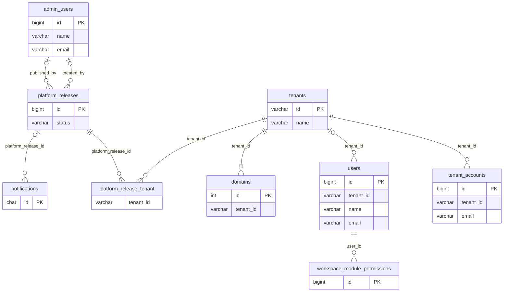

*Figure: Tenancy, users and access entities and foreign keys (live schema).*

> **Note:** The `admin_users` table is central-only; `notifications` is polymorphic (`notifiable_type`/`notifiable_id`) and has a real FK only to `platform_releases`.

## Farms, livestock groups and animals

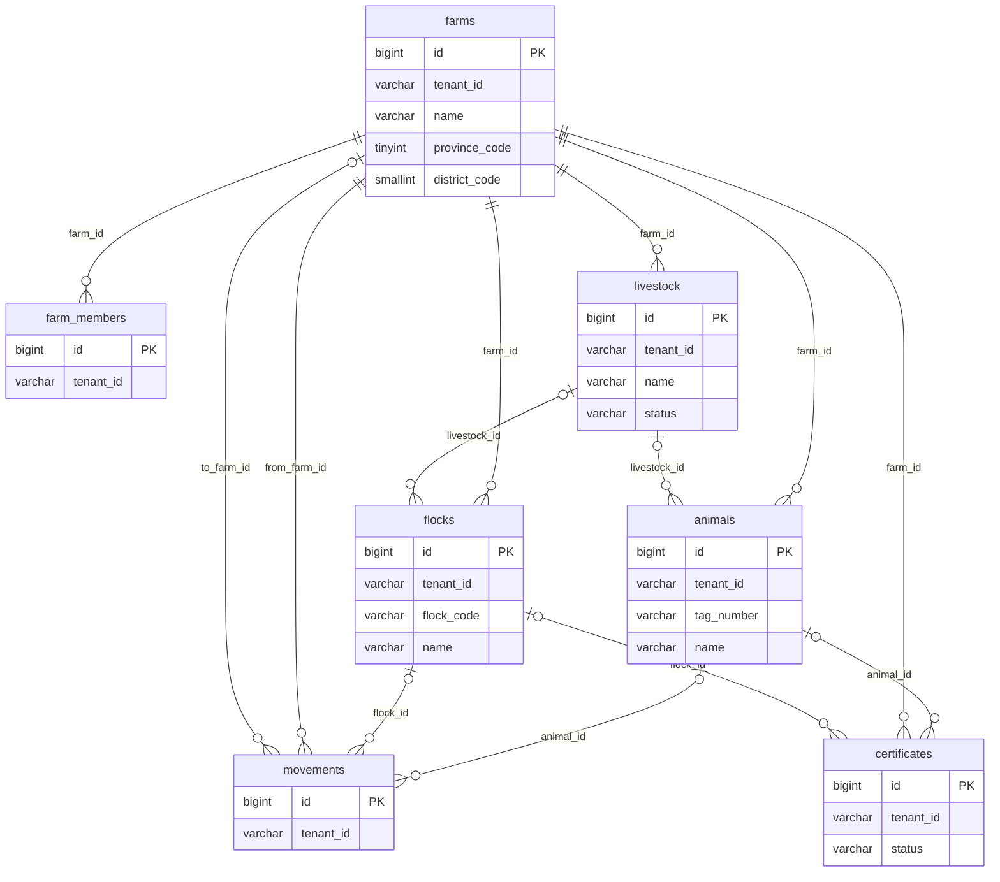

*Figure: Farms, livestock groups and animals entities and foreign keys (live schema).*

## Poultry flocks and eggs

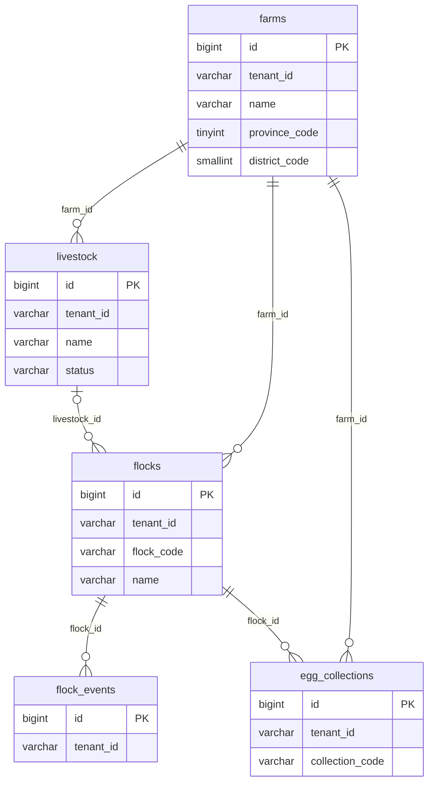

*Figure: Poultry flocks and eggs entities and foreign keys (live schema).*

## Health and medicines

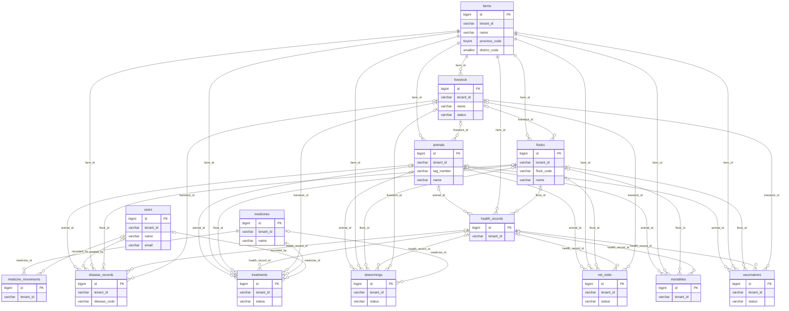

*Figure: Health and medicines entities and foreign keys (live schema).*

## Feeding

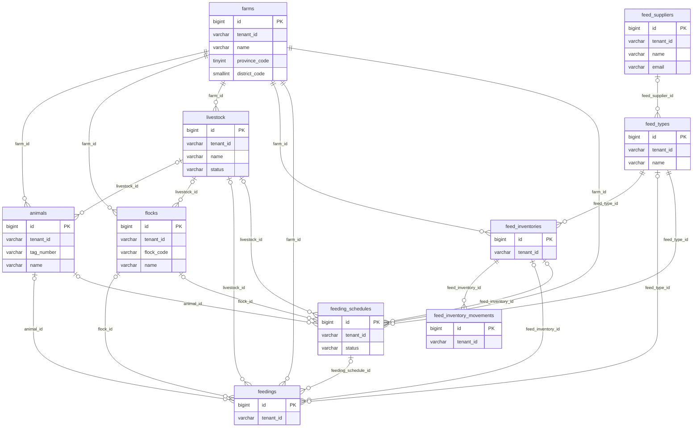

*Figure: Feeding entities and foreign keys (live schema).*

## Milk

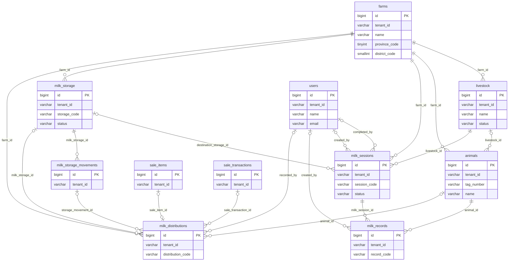

*Figure: Milk entities and foreign keys (live schema).*

## Breeding

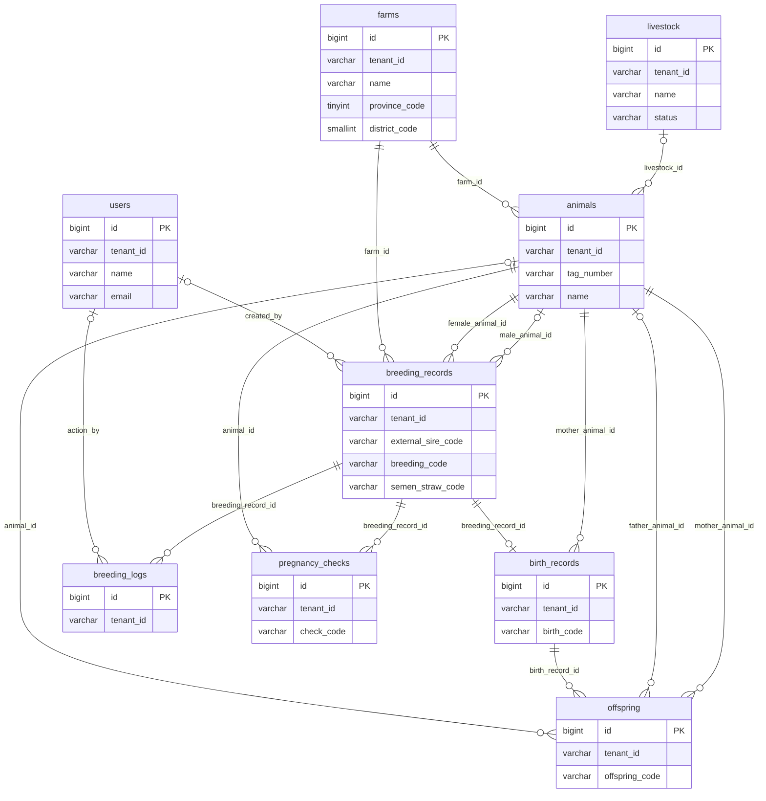

*Figure: Breeding entities and foreign keys (live schema).*

## Sales, customers and abattoir

```mermaid
erDiagram
    abattoir_dispatch_animals {
        bigint id PK
        varchar tenant_id
    }
    abattoir_dispatches {
        bigint id PK
        varchar tenant_id
        varchar dispatch_code
    }
    abattoir_returns {
        bigint id PK
        varchar tenant_id
    }
    animals {
        bigint id PK
        varchar tenant_id
        varchar tag_number
        varchar name
    }
    customer_addresses {
        bigint id PK
        varchar tenant_id
    }
    customer_contacts {
        bigint id PK
        varchar tenant_id
        varchar email
    }
    customer_credit {
        bigint id PK
        varchar tenant_id
    }
    customer_profiles {
        bigint id PK
        varchar tenant_id
    }
    customers {
        bigint id PK
        varchar tenant_id
        varchar customer_code
        varchar status
    }
    farms {
        bigint id PK
        varchar tenant_id
        varchar name
        tinyint province_code
        smallint district_code
    }
    flocks {
        bigint id PK
        varchar tenant_id
        varchar flock_code
        varchar name
    }
    livestock {
        bigint id PK
        varchar tenant_id
        varchar name
        varchar status
    }
    milk_storage {
        bigint id PK
        varchar tenant_id
        varchar storage_code
        varchar status
    }
    sale_documents {
        bigint id PK
        varchar tenant_id
    }
    sale_items {
        bigint id PK
        varchar tenant_id
    }
    sale_logs {
        bigint id PK
        varchar tenant_id
    }
    sale_payments {
        bigint id PK
        varchar tenant_id
    }
    sale_transactions {
        bigint id PK
        varchar tenant_id
    }
    users {
        bigint id PK
        varchar tenant_id
        varchar name
        varchar email
    }
    users |o--o{ customers : "created_by"
    customers ||--o| customer_profiles : "customer_id"
    customers ||--o| customer_credit : "customer_id"
    customers ||--o{ customer_addresses : "customer_id"
    customers ||--o{ customer_contacts : "customer_id"
    abattoir_dispatches |o--o{ sale_transactions : "abattoir_dispatch_id"
    users |o--o{ sale_transactions : "created_by"
    customers |o--o{ sale_transactions : "customer_id"
    farms ||--o{ sale_transactions : "farm_id"
    abattoir_returns |o--o{ sale_items : "abattoir_return_id"
    animals |o--o{ sale_items : "animal_id"
    customers |o--o{ sale_items : "customer_id"
    flocks |o--o{ sale_items : "flock_id"
    livestock |o--o{ sale_items : "livestock_id"
    milk_storage |o--o{ sale_items : "milk_storage_id"
    sale_transactions ||--o{ sale_items : "sale_transaction_id"
    customers |o--o{ sale_payments : "customer_id"
    sale_transactions ||--o{ sale_payments : "sale_transaction_id"
    sale_transactions ||--o{ sale_documents : "sale_transaction_id"
    users |o--o{ sale_logs : "action_by"
    sale_transactions ||--o{ sale_logs : "sale_transaction_id"
    users |o--o{ abattoir_dispatches : "created_by"
    farms ||--o{ abattoir_dispatches : "farm_id"
    abattoir_dispatches ||--o{ abattoir_dispatch_animals : "abattoir_dispatch_id"
    animals ||--o{ abattoir_dispatch_animals : "animal_id"
    abattoir_dispatches ||--o{ abattoir_returns : "abattoir_dispatch_id"
    animals ||--o{ abattoir_returns : "animal_id"
    farms ||--o{ animals : "farm_id"
    livestock |o--o{ animals : "livestock_id"
```

*Figure: Sales, customers and abattoir entities and foreign keys (live schema).*

## Expenses and finance

```mermaid
erDiagram
    animals {
        bigint id PK
        varchar tenant_id
        varchar tag_number
        varchar name
    }
    expense_categories {
        bigint id PK
        varchar tenant_id
        varchar name
    }
    expense_vendors {
        bigint id PK
        varchar tenant_id
        varchar name
        varchar email
    }
    expenses {
        bigint id PK
        varchar tenant_id
        varchar status
    }
    farms {
        bigint id PK
        varchar tenant_id
        varchar name
        tinyint province_code
        smallint district_code
    }
    finance_accounts {
        bigint id PK
        varchar tenant_id
        varchar account_code
        varchar expense_category_code
    }
    finance_balance_snapshots {
        bigint id PK
        varchar tenant_id
    }
    finance_budget_items {
        bigint id PK
        varchar tenant_id
    }
    finance_budgets {
        bigint id PK
        varchar tenant_id
        varchar budget_code
        varchar status
    }
    finance_periods {
        bigint id PK
        varchar tenant_id
        varchar status
    }
    finance_tax_entries {
        bigint id PK
        varchar tenant_id
    }
    finance_tax_rates {
        bigint id PK
        varchar tenant_id
        varchar tax_code
    }
    finance_transaction_lines {
        bigint id PK
        varchar tenant_id
    }
    finance_transaction_logs {
        bigint id PK
        varchar tenant_id
    }
    finance_transactions {
        bigint id PK
        varchar tenant_id
        varchar transaction_code
    }
    flocks {
        bigint id PK
        varchar tenant_id
        varchar flock_code
        varchar name
    }
    livestock {
        bigint id PK
        varchar tenant_id
        varchar name
        varchar status
    }
    users {
        bigint id PK
        varchar tenant_id
        varchar name
        varchar email
    }
    animals |o--o{ expenses : "animal_id"
    expense_categories ||--o{ expenses : "expense_category_id"
    expense_vendors |o--o{ expenses : "expense_vendor_id"
    farms |o--o{ expenses : "farm_id"
    flocks |o--o{ expenses : "flock_id"
    livestock |o--o{ expenses : "livestock_id"
    finance_accounts |o--o{ finance_accounts : "parent_account_id"
    users |o--o{ finance_periods : "closed_by"
    users |o--o{ finance_transactions : "created_by"
    farms |o--o{ finance_transactions : "farm_id"
    finance_periods ||--o{ finance_transactions : "finance_period_id"
    livestock |o--o{ finance_transactions : "livestock_id"
    finance_transactions |o--o{ finance_transactions : "reversed_transaction_id"
    finance_accounts ||--o{ finance_transaction_lines : "finance_account_id"
    finance_transactions ||--o{ finance_transaction_lines : "finance_transaction_id"
    users |o--o{ finance_transaction_logs : "action_by"
    finance_transactions ||--o{ finance_transaction_logs : "finance_transaction_id"
    users |o--o{ finance_budgets : "created_by"
    farms |o--o{ finance_budgets : "farm_id"
    finance_accounts ||--o{ finance_budget_items : "finance_account_id"
    finance_budgets ||--o{ finance_budget_items : "finance_budget_id"
    livestock |o--o{ finance_budget_items : "livestock_id"
    farms |o--o{ finance_balance_snapshots : "farm_id"
    finance_accounts ||--o{ finance_balance_snapshots : "finance_account_id"
    finance_periods ||--o{ finance_balance_snapshots : "finance_period_id"
    finance_tax_rates ||--o{ finance_tax_entries : "finance_tax_rate_id"
    finance_transactions ||--o{ finance_tax_entries : "finance_transaction_id"
```

*Figure: Expenses and finance entities and foreign keys (live schema).*

> **Note:** `finance_transactions` links back to its source (sale, expense, payment) through the polymorphic-style columns `source_module`, `source_type`, `source_id`; there is no FK for it.

## Employees

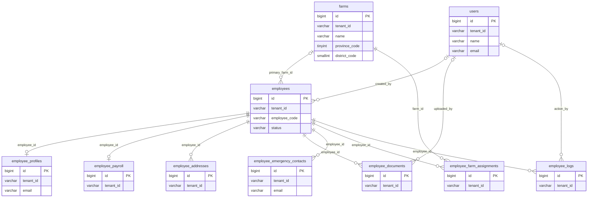

*Figure: Employees entities and foreign keys (live schema).*

## Marketplace, learning hub and platform

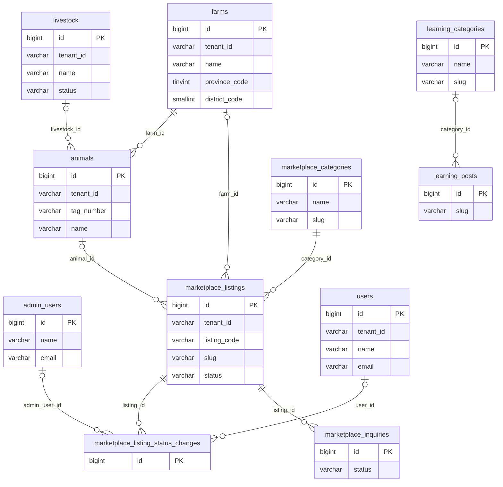

*Figure: Marketplace, learning hub and platform entities and foreign keys (live schema).*

> **Note:** The marketplace tables use the `central` connection. `marketplace_listings.tenant_id`/`farm_id`/`animal_id` link a listing to the farm that owns it.

## Eloquent relationships by model

Extracted from `return $this->hasMany(...)`-style methods in `app/Models/**`. Extra arguments are explicit foreign/local keys; where blank Laravel's naming convention applies (`<model>_id`). Scoped queries chained onto a relationship (ordering, filters) are not shown.

### AbattoirDispatch

Table: `abattoir_dispatches`

| Method | Type | Related model | Keys / args |
|---|---|---|---|
| farm() | belongsTo | Farm |  |
| creator() | belongsTo | User | `'created_by'` |
| animals() | hasMany | AbattoirDispatchAnimal |  |
| returns() | hasMany | AbattoirReturn |  |
| saleTransaction() | hasOne | SaleTransaction |  |

### AbattoirDispatchAnimal

Table: `abattoir_dispatch_animals`

| Method | Type | Related model | Keys / args |
|---|---|---|---|
| dispatch() | belongsTo | AbattoirDispatch | `'abattoir_dispatch_id'` |
| animal() | belongsTo | Animal |  |

### AbattoirReturn

Table: `abattoir_returns`

| Method | Type | Related model | Keys / args |
|---|---|---|---|
| dispatch() | belongsTo | AbattoirDispatch | `'abattoir_dispatch_id'` |
| animal() | belongsTo | Animal |  |
| saleItems() | hasMany | SaleItem |  |

### Animal

Table: `animals`

| Method | Type | Related model | Keys / args |
|---|---|---|---|
| farm() | belongsTo | Farm |  |
| livestock() | belongsTo | Livestock |  |
| feedings() | hasMany | Feeding |  |
| milkRecords() | hasMany | MilkRecord |  |
| certificates() | hasMany | Certificate |  |
| movements() | hasMany | Movement |  |
| saleItems() | hasMany | SaleItem |  |
| healthRecords() | hasMany | HealthRecord |  |
| vaccinations() | hasMany | Vaccination |  |
| treatments() | hasMany | Treatment |  |

### BelongsToFlock

Table: `?`

| Method | Type | Related model | Keys / args |
|---|---|---|---|
| flock() | belongsTo | Flock |  |

### BirthRecord

Table: `birth_records`

| Method | Type | Related model | Keys / args |
|---|---|---|---|
| breedingRecord() | belongsTo | BreedingRecord |  |
| motherAnimal() | belongsTo | Animal | `'mother_animal_id'` |
| offspring() | hasMany | Offspring |  |
| expense() | morphOne | Expense | `'source'` |

### BreedingLog

Table: `breeding_logs`

| Method | Type | Related model | Keys / args |
|---|---|---|---|
| breedingRecord() | belongsTo | BreedingRecord |  |
| actor() | belongsTo | User | `'action_by'` |

### BreedingRecord

Table: `breeding_records`

| Method | Type | Related model | Keys / args |
|---|---|---|---|
| farm() | belongsTo | Farm |  |
| femaleAnimal() | belongsTo | Animal | `'female_animal_id'` |
| maleAnimal() | belongsTo | Animal | `'male_animal_id'` |
| creator() | belongsTo | User | `'created_by'` |
| pregnancyChecks() | hasMany | PregnancyCheck |  |
| birthRecord() | hasOne | BirthRecord |  |
| logs() | hasMany | BreedingLog | `->orderByDesc('action_date'` |
| expense() | morphOne | Expense | `'source'` |

### Certificate

Table: `certificates`

| Method | Type | Related model | Keys / args |
|---|---|---|---|
| farm() | belongsTo | Farm |  |
| animal() | belongsTo | Animal |  |

### Customer

Table: `customers`

| Method | Type | Related model | Keys / args |
|---|---|---|---|
| creator() | belongsTo | User | `'created_by'` |
| profile() | hasOne | CustomerProfile |  |
| contacts() | hasMany | CustomerContact |  |
| addresses() | hasMany | CustomerAddress |  |
| credit() | hasOne | CustomerCredit |  |
| documents() | hasMany | CustomerDocument |  |
| communications() | hasMany | CustomerCommunication | `->orderByDesc('communication_date'` |
| logs() | hasMany | CustomerLog | `->orderByDesc('action_at'` |
| saleTransactions() | hasMany | SaleTransaction |  |

### CustomerAddress

Table: `customer_addresses`

| Method | Type | Related model | Keys / args |
|---|---|---|---|
| customer() | belongsTo | Customer |  |

### CustomerCommunication

Table: `customer_communications`

| Method | Type | Related model | Keys / args |
|---|---|---|---|
| customer() | belongsTo | Customer |  |
| logger() | belongsTo | User | `'logged_by'` |

### CustomerContact

Table: `customer_contacts`

| Method | Type | Related model | Keys / args |
|---|---|---|---|
| customer() | belongsTo | Customer |  |

### CustomerCredit

Table: `customer_credit`

| Method | Type | Related model | Keys / args |
|---|---|---|---|
| customer() | belongsTo | Customer |  |

### CustomerDocument

Table: `customer_documents`

| Method | Type | Related model | Keys / args |
|---|---|---|---|
| customer() | belongsTo | Customer |  |
| uploader() | belongsTo | User | `'uploaded_by'` |

### CustomerLog

Table: `customer_logs`

| Method | Type | Related model | Keys / args |
|---|---|---|---|
| customer() | belongsTo | Customer |  |
| actor() | belongsTo | User | `'action_by'` |

### CustomerProfile

Table: `customer_profiles`

| Method | Type | Related model | Keys / args |
|---|---|---|---|
| customer() | belongsTo | Customer |  |

### Deworming

Table: `dewormings`

| Method | Type | Related model | Keys / args |
|---|---|---|---|
| farm() | belongsTo | Farm |  |
| livestock() | belongsTo | Livestock |  |
| animal() | belongsTo | Animal |  |
| medicine() | belongsTo | Medicine |  |
| healthRecord() | belongsTo | HealthRecord |  |
| expense() | morphOne | Expense | `'source'` |

### DiseaseRecord

Table: `disease_records`

| Method | Type | Related model | Keys / args |
|---|---|---|---|
| farm() | belongsTo | Farm |  |
| livestock() | belongsTo | Livestock |  |
| animal() | belongsTo | Animal |  |
| healthRecord() | belongsTo | HealthRecord |  |
| creator() | belongsTo | User | `'created_by'` |
| expense() | morphOne | Expense | `'source'` |

### EggCollection

Table: `egg_collections`

| Method | Type | Related model | Keys / args |
|---|---|---|---|
| farm() | belongsTo | Farm |  |
| flock() | belongsTo | Flock |  |

### Employee

Table: `employees`

| Method | Type | Related model | Keys / args |
|---|---|---|---|
| creator() | belongsTo | User | `'created_by'` |
| primaryFarm() | belongsTo | Farm | `'primary_farm_id'` |
| profile() | hasOne | EmployeeProfile |  |
| emergencyContacts() | hasMany | EmployeeEmergencyContact |  |
| addresses() | hasMany | EmployeeAddress |  |
| farmAssignments() | hasMany | EmployeeFarmAssignment |  |
| payroll() | hasOne | EmployeePayroll |  |
| documents() | hasMany | EmployeeDocument |  |
| logs() | hasMany | EmployeeLog | `->orderByDesc('action_at'` |

### EmployeeAddress

Table: `employee_addresses`

| Method | Type | Related model | Keys / args |
|---|---|---|---|
| employee() | belongsTo | Employee |  |

### EmployeeDocument

Table: `employee_documents`

| Method | Type | Related model | Keys / args |
|---|---|---|---|
| employee() | belongsTo | Employee |  |
| uploader() | belongsTo | User | `'uploaded_by'` |

### EmployeeEmergencyContact

Table: `employee_emergency_contacts`

| Method | Type | Related model | Keys / args |
|---|---|---|---|
| employee() | belongsTo | Employee |  |

### EmployeeFarmAssignment

Table: `employee_farm_assignments`

| Method | Type | Related model | Keys / args |
|---|---|---|---|
| employee() | belongsTo | Employee |  |
| farm() | belongsTo | Farm |  |

### EmployeeLog

Table: `employee_logs`

| Method | Type | Related model | Keys / args |
|---|---|---|---|
| employee() | belongsTo | Employee |  |
| actor() | belongsTo | User | `'action_by'` |

### EmployeePayroll

Table: `employee_payroll`

| Method | Type | Related model | Keys / args |
|---|---|---|---|
| employee() | belongsTo | Employee |  |

### EmployeeProfile

Table: `employee_profiles`

| Method | Type | Related model | Keys / args |
|---|---|---|---|
| employee() | belongsTo | Employee |  |

### Expense

Table: `expenses`

| Method | Type | Related model | Keys / args |
|---|---|---|---|
| farm() | belongsTo | Farm |  |
| animal() | belongsTo | Animal |  |
| livestock() | belongsTo | Livestock |  |
| category() | belongsTo | ExpenseCategory | `'expense_category_id'` |
| vendor() | belongsTo | ExpenseVendor | `'expense_vendor_id'` |
| source() | morphTo |  |  |

### ExpenseCategory

Table: `expense_categories`

| Method | Type | Related model | Keys / args |
|---|---|---|---|
| expenses() | hasMany | Expense |  |

### ExpenseVendor

Table: `expense_vendors`

| Method | Type | Related model | Keys / args |
|---|---|---|---|
| expenses() | hasMany | Expense |  |

### Farm

Table: `farms`

| Method | Type | Related model | Keys / args |
|---|---|---|---|
| members() | hasMany | FarmMember |  |
| livestock() | hasMany | Livestock |  |
| animals() | hasMany | Animal |  |
| flocks() | hasMany | Flock |  |
| feedings() | hasMany | Feeding |  |
| certificates() | hasMany | Certificate |  |
| saleTransactions() | hasMany | SaleTransaction |  |

### FarmMember

Table: `farm_members`

| Method | Type | Related model | Keys / args |
|---|---|---|---|
| farm() | belongsTo | Farm |  |

### FeedInventory

Table: `feed_inventories`

| Method | Type | Related model | Keys / args |
|---|---|---|---|
| farm() | belongsTo | Farm |  |
| feedType() | belongsTo | FeedType |  |
| movements() | hasMany | FeedInventoryMovement | `->orderByDesc('moved_at'` |
| latestPurchase() | hasOne | FeedInventoryMovement | `->ofMany(['moved_at' => 'max', 'id' => 'max'], function ($query) { $query->where('movement_type', 'purchase'` |

### FeedInventoryMovement

Table: `feed_inventory_movements`

| Method | Type | Related model | Keys / args |
|---|---|---|---|
| inventory() | belongsTo | FeedInventory | `'feed_inventory_id'` |
| reference() | morphTo |  |  |
| expense() | morphOne | Expense | `'source'` |

### FeedSupplier

Table: `feed_suppliers`

| Method | Type | Related model | Keys / args |
|---|---|---|---|
| feedTypes() | hasMany | FeedType |  |

### FeedType

Table: `feed_types`

| Method | Type | Related model | Keys / args |
|---|---|---|---|
| supplier() | belongsTo | FeedSupplier | `'feed_supplier_id'` |
| inventories() | hasMany | FeedInventory |  |
| feedings() | hasMany | Feeding |  |
| schedules() | hasMany | FeedingSchedule |  |

### Feeding

Table: `feedings`

| Method | Type | Related model | Keys / args |
|---|---|---|---|
| farm() | belongsTo | Farm |  |
| livestock() | belongsTo | Livestock |  |
| animal() | belongsTo | Animal |  |
| feedType() | belongsTo | FeedType |  |
| feedInventory() | belongsTo | FeedInventory |  |
| feedingSchedule() | belongsTo | FeedingSchedule |  |

### FeedingSchedule

Table: `feeding_schedules`

| Method | Type | Related model | Keys / args |
|---|---|---|---|
| farm() | belongsTo | Farm |  |
| feedType() | belongsTo | FeedType |  |
| feedInventory() | belongsTo | FeedInventory |  |
| livestock() | belongsTo | Livestock |  |
| animal() | belongsTo | Animal |  |
| feedings() | hasMany | Feeding |  |

### FinanceAccount

Table: `finance_accounts`

| Method | Type | Related model | Keys / args |
|---|---|---|---|
| parent() | belongsTo | self | `'parent_account_id'` |
| children() | hasMany | self | `'parent_account_id'` |
| lines() | hasMany | FinanceTransactionLine |  |

### FinancePeriod

Table: `finance_periods`

| Method | Type | Related model | Keys / args |
|---|---|---|---|
| transactions() | hasMany | FinanceTransaction |  |

### FinanceTransaction

Table: `finance_transactions`

| Method | Type | Related model | Keys / args |
|---|---|---|---|
| farm() | belongsTo | Farm |  |
| livestock() | belongsTo | Livestock |  |
| period() | belongsTo | FinancePeriod | `'finance_period_id'` |
| lines() | hasMany | FinanceTransactionLine |  |
| logs() | hasMany | FinanceTransactionLog |  |
| reversedTransaction() | belongsTo | self | `'reversed_transaction_id'` |

### FinanceTransactionLine

Table: `finance_transaction_lines`

| Method | Type | Related model | Keys / args |
|---|---|---|---|
| transaction() | belongsTo | FinanceTransaction | `'finance_transaction_id'` |
| account() | belongsTo | FinanceAccount | `'finance_account_id'` |

### FinanceTransactionLog

Table: `finance_transaction_logs`

| Method | Type | Related model | Keys / args |
|---|---|---|---|
| transaction() | belongsTo | FinanceTransaction | `'finance_transaction_id'` |

### Flock

Table: `flocks`

| Method | Type | Related model | Keys / args |
|---|---|---|---|
| farm() | belongsTo | Farm |  |
| livestock() | belongsTo | Livestock |  |
| events() | hasMany | FlockEvent | `->orderByDesc('occurred_on'` |
| eggCollections() | hasMany | EggCollection |  |

### FlockEvent

Table: `flock_events`

| Method | Type | Related model | Keys / args |
|---|---|---|---|
| flock() | belongsTo | Flock |  |
| reference() | morphTo |  |  |

### HealthRecord

Table: `health_records`

| Method | Type | Related model | Keys / args |
|---|---|---|---|
| farm() | belongsTo | Farm |  |
| animal() | belongsTo | Animal |  |

### LearningCategory

Table: `learning_categories`

| Method | Type | Related model | Keys / args |
|---|---|---|---|
| posts() | hasMany | LearningPost | `'category_id'` |

### LearningPost

Table: `learning_posts`

| Method | Type | Related model | Keys / args |
|---|---|---|---|
| category() | belongsTo | LearningCategory | `'category_id'` |

### Livestock

Table: `livestock`

| Method | Type | Related model | Keys / args |
|---|---|---|---|
| farm() | belongsTo | Farm |  |
| animals() | hasMany | Animal |  |
| flocks() | hasMany | Flock |  |

### MarketplaceCategory

Table: `marketplace_categories`

| Method | Type | Related model | Keys / args |
|---|---|---|---|
| listings() | hasMany | MarketplaceListing | `'category_id'` |

### MarketplaceInquiry

Table: `marketplace_inquiries`

| Method | Type | Related model | Keys / args |
|---|---|---|---|
| listing() | belongsTo | MarketplaceListing | `'listing_id'` |

### MarketplaceListing

Table: `marketplace_listings`

| Method | Type | Related model | Keys / args |
|---|---|---|---|
| tenant() | belongsTo | Tenant |  |
| farm() | belongsTo | Farm |  |
| animal() | belongsTo | Animal |  |
| category() | belongsTo | MarketplaceCategory | `'category_id'` |
| inquiries() | hasMany | MarketplaceInquiry | `'listing_id'` |
| statusChanges() | hasMany | MarketplaceListingStatusChange | `'listing_id'` |

### MarketplaceListingStatusChange

Table: `marketplace_listing_status_changes`

| Method | Type | Related model | Keys / args |
|---|---|---|---|
| listing() | belongsTo | MarketplaceListing | `'listing_id'` |
| admin() | belongsTo | AdminUser | `'admin_user_id'` |
| user() | belongsTo | User |  |

### Medicine

Table: `medicines`

| Method | Type | Related model | Keys / args |
|---|---|---|---|
| treatments() | hasMany | Treatment |  |
| movements() | hasMany | MedicineMovement | `->orderByDesc('moved_at'` |

### MedicineMovement

Table: `medicine_movements`

| Method | Type | Related model | Keys / args |
|---|---|---|---|
| medicine() | belongsTo | Medicine |  |
| reference() | morphTo |  |  |
| recordedBy() | belongsTo | User | `'recorded_by'` |

### MilkDistribution

Table: `milk_distributions`

| Method | Type | Related model | Keys / args |
|---|---|---|---|
| farm() | belongsTo | Farm |  |
| animal() | belongsTo | Animal |  |
| storage() | belongsTo | MilkStorage | `'milk_storage_id'` |
| storageMovement() | belongsTo | MilkStorageMovement | `'storage_movement_id'` |
| saleTransaction() | belongsTo | SaleTransaction |  |
| saleItem() | belongsTo | SaleItem |  |
| recorder() | belongsTo | User | `'recorded_by'` |

### MilkRecord

Table: `milk_records`

| Method | Type | Related model | Keys / args |
|---|---|---|---|
| session() | belongsTo | MilkSession | `'milk_session_id'` |
| animal() | belongsTo | Animal |  |
| creator() | belongsTo | User | `'created_by'` |

### MilkSale

Table: `milk_sales`

| Method | Type | Related model | Keys / args |
|---|---|---|---|
| farm() | belongsTo | Farm |  |
| items() | hasMany | MilkSaleItem |  |
| payments() | hasMany | MilkSalePayment |  |
| logs() | hasMany | MilkSaleLog |  |
| creator() | belongsTo | User | `'created_by'` |

### MilkSaleItem

Table: `milk_sale_items`

| Method | Type | Related model | Keys / args |
|---|---|---|---|
| sale() | belongsTo | MilkSale | `'milk_sale_id'` |
| storage() | belongsTo | MilkStorage | `'milk_storage_id'` |

### MilkSaleLog

Table: `milk_sale_logs`

| Method | Type | Related model | Keys / args |
|---|---|---|---|
| sale() | belongsTo | MilkSale | `'milk_sale_id'` |
| user() | belongsTo | User |  |

### MilkSalePayment

Table: `milk_sale_payments`

| Method | Type | Related model | Keys / args |
|---|---|---|---|
| sale() | belongsTo | MilkSale | `'milk_sale_id'` |

### MilkSession

Table: `milk_sessions`

| Method | Type | Related model | Keys / args |
|---|---|---|---|
| farm() | belongsTo | Farm |  |
| livestock() | belongsTo | Livestock |  |
| destinationStorage() | belongsTo | MilkStorage | `'destination_storage_id'` |
| creator() | belongsTo | User | `'created_by'` |
| completer() | belongsTo | User | `'completed_by'` |
| records() | hasMany | MilkRecord |  |

### MilkStorage

Table: `milk_storage`

| Method | Type | Related model | Keys / args |
|---|---|---|---|
| farm() | belongsTo | Farm |  |
| movements() | hasMany | MilkStorageMovement | `->orderByDesc('moved_at'` |

### MilkStorageMovement

Table: `milk_storage_movements`

| Method | Type | Related model | Keys / args |
|---|---|---|---|
| storage() | belongsTo | MilkStorage | `'milk_storage_id'` |
| reference() | morphTo |  |  |

### Mortality

Table: `mortalities`

| Method | Type | Related model | Keys / args |
|---|---|---|---|
| farm() | belongsTo | Farm |  |
| animal() | belongsTo | Animal |  |
| healthRecord() | belongsTo | HealthRecord |  |

### Movement

Table: `movements`

| Method | Type | Related model | Keys / args |
|---|---|---|---|
| animal() | belongsTo | Animal |  |
| fromFarm() | belongsTo | Farm | `'from_farm_id'` |
| toFarm() | belongsTo | Farm | `'to_farm_id'` |

### Offspring

Table: `offspring`

| Method | Type | Related model | Keys / args |
|---|---|---|---|
| birthRecord() | belongsTo | BirthRecord |  |
| motherAnimal() | belongsTo | Animal | `'mother_animal_id'` |
| fatherAnimal() | belongsTo | Animal | `'father_animal_id'` |
| animal() | belongsTo | Animal |  |

### PlatformRelease

Table: `platform_releases`

| Method | Type | Related model | Keys / args |
|---|---|---|---|
| tenants() | belongsToMany | Tenant | `'platform_release_tenant', 'platform_release_id', 'tenant_id'` |
| creator() | belongsTo | AdminUser | `'created_by'` |
| publisher() | belongsTo | AdminUser | `'published_by'` |

### PregnancyCheck

Table: `pregnancy_checks`

| Method | Type | Related model | Keys / args |
|---|---|---|---|
| breedingRecord() | belongsTo | BreedingRecord |  |
| animal() | belongsTo | Animal |  |
| expense() | morphOne | Expense | `'source'` |

### Sale

Table: `sales`

| Method | Type | Related model | Keys / args |
|---|---|---|---|
| farm() | belongsTo | Farm |  |
| animal() | belongsTo | Animal |  |
| livestock() | belongsTo | Livestock |  |

### SaleDocument

Table: `sale_documents`

| Method | Type | Related model | Keys / args |
|---|---|---|---|
| transaction() | belongsTo | SaleTransaction | `'sale_transaction_id'` |

### SaleItem

Table: `sale_items`

| Method | Type | Related model | Keys / args |
|---|---|---|---|
| transaction() | belongsTo | SaleTransaction | `'sale_transaction_id'` |
| customer() | belongsTo | Customer |  |
| animal() | belongsTo | Animal |  |
| livestock() | belongsTo | Livestock |  |
| abattoirReturn() | belongsTo | AbattoirReturn |  |
| milkStorage() | belongsTo | MilkStorage | `'milk_storage_id'` |

### SaleLog

Table: `sale_logs`

| Method | Type | Related model | Keys / args |
|---|---|---|---|
| transaction() | belongsTo | SaleTransaction | `'sale_transaction_id'` |
| actor() | belongsTo | User | `'action_by'` |

### SalePayment

Table: `sale_payments`

| Method | Type | Related model | Keys / args |
|---|---|---|---|
| transaction() | belongsTo | SaleTransaction | `'sale_transaction_id'` |
| customer() | belongsTo | Customer |  |

### SaleTransaction

Table: `sale_transactions`

| Method | Type | Related model | Keys / args |
|---|---|---|---|
| farm() | belongsTo | Farm |  |
| customer() | belongsTo | Customer |  |
| creator() | belongsTo | User | `'created_by'` |
| abattoirDispatch() | belongsTo | AbattoirDispatch |  |
| items() | hasMany | SaleItem |  |
| payments() | hasMany | SalePayment |  |
| documents() | hasMany | SaleDocument |  |
| logs() | hasMany | SaleLog | `->orderByDesc('action_at'` |

### Tenant

Table: `tenants`

| Method | Type | Related model | Keys / args |
|---|---|---|---|
| domains() | hasMany | Domain |  |

### TenantAccount

Table: `tenant_accounts`

| Method | Type | Related model | Keys / args |
|---|---|---|---|
| tenant() | belongsTo | Tenant |  |

### Treatment

Table: `treatments`

| Method | Type | Related model | Keys / args |
|---|---|---|---|
| farm() | belongsTo | Farm |  |
| livestock() | belongsTo | Livestock |  |
| animal() | belongsTo | Animal |  |
| medicine() | belongsTo | Medicine |  |
| recordedBy() | belongsTo | User | `'recorded_by'` |
| healthRecord() | belongsTo | HealthRecord |  |
| expense() | morphOne | Expense | `'source'` |

### User

Table: `users`

| Method | Type | Related model | Keys / args |
|---|---|---|---|
| tenant() | belongsTo | Tenant |  |
| farms() | hasMany | Farm | `'tenant_id', 'tenant_id'` |
| modulePermissions() | hasMany | WorkspaceModulePermission |  |

### Vaccination

Table: `vaccinations`

| Method | Type | Related model | Keys / args |
|---|---|---|---|
| farm() | belongsTo | Farm |  |
| livestock() | belongsTo | Livestock |  |
| animal() | belongsTo | Animal |  |
| healthRecord() | belongsTo | HealthRecord |  |
| expense() | morphOne | Expense | `'source'` |

### VetVisit

Table: `vet_visits`

| Method | Type | Related model | Keys / args |
|---|---|---|---|
| farm() | belongsTo | Farm |  |
| livestock() | belongsTo | Livestock |  |
| animal() | belongsTo | Animal |  |
| healthRecord() | belongsTo | HealthRecord |  |
| expense() | morphOne | Expense | `'source'` |

### WorkspaceModulePermission

Table: `workspace_module_permissions`

| Method | Type | Related model | Keys / args |
|---|---|---|---|
| user() | belongsTo | User |  |
