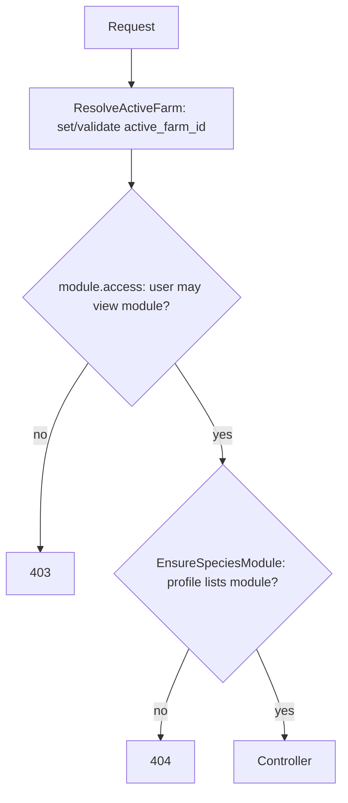
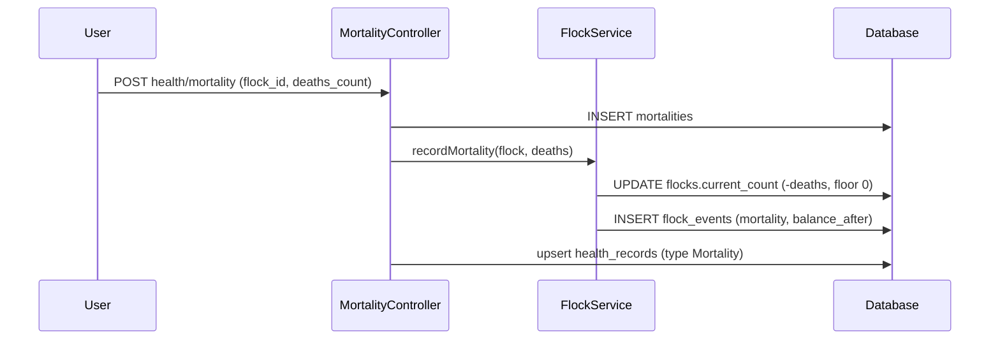
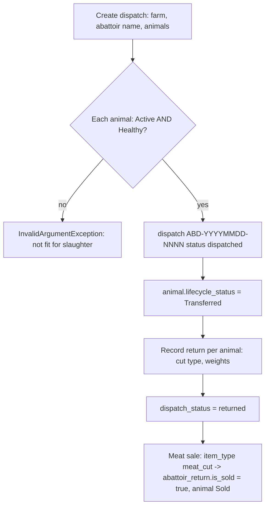

# Business Logic: Animals, Flocks and Production

This chapter describes how the livestock-side workflows are implemented: species profiles, animals (cattle) versus flocks (poultry), egg collection, mortality, movements, certificates and abattoir dispatch. Every statement is taken from the controllers, services, FormRequests and config named in each section.

## Species profiles (cattle versus poultry)

A farm has a `primary_species` (see `Farm::isPoultry()`); the default profile key is `cattle` (`config/species.php` -> `default`). Two profiles exist: `cattle` and `poultry`. `App\Services\Species\SpeciesProfile` resolves the profile for the active farm and exposes helper methods used by controllers, views and middleware.

| Aspect | `cattle` profile | `poultry` profile |
|---|---|---|
| `stock_unit` | `individual` (one row per animal) | `flock` (one row per group of birds) |
| Stock model | `Animal` | `Flock` (+ `FlockEvent` ledger) |
| Modules enabled (`modules`) | dashboard, farms, livestock, animals, employees, health, feeding, feed-calculator, milk, breeding, certificates, movement, sales, customers, expenses, finance | dashboard, farms, livestock, flocks, employees, health, feeding, feed-calculator, eggs, certificates, movement, sales, customers, expenses, finance |
| Sale types | `animal_sale`, `meat_sale`, `milk_sale` | `animal_sale`, `egg_sale`, `meat_sale` |
| Hidden sale sections | none | `abattoir` |
| Production statuses | Lactating, Dry, Growing, Breeding, Fattening, Pregnancy, Not applicable | Laying, Growing, Broiler, Breeding, Not applicable |
| UI labels | Animal / Animals / Herd group | Flock / Flocks / House / flock group |

Not available to poultry: `animals`, `milk`, `breeding` and `sales.abattoir`. Not available to cattle: `flocks`, `eggs`.

### How the profile is enforced

1. `ResolveActiveFarm` (global web middleware) calls `ActiveFarmContext::rememberFromRequest()`. A `farm_id` request parameter switches the active farm (stored in session key `active_farm_id`, validated against the tenant's farms). If no farm is active and the tenant has exactly one farm, it is selected automatically.
2. `EnsureSpeciesModule` (applied in `routes/modules.php`) maps the route name to a module through `config/species.php` -> `route_modules` (`animals`, `milk`, `breeding`, `flocks`, `eggs`, `sales.abattoir`). If the active farm's profile does not list the module it aborts with **404**. `sales.abattoir` is checked against `hidden_sale_sections`.
3. Navigation is filtered by `SpeciesProfile::navigationGroups()` and then by `WorkspaceAccessService::filterNavigationGroups()` (see chapter 11).

> **Note:** When no farm is active (a multi-farm tenant that has not selected one), `SpeciesProfile::key()` falls back to the default (`cattle`). A poultry-only tenant with several farms therefore sees cattle modules until a farm is selected.

*Request gating by permission and species profile.*

## Animals (cattle profile)

Controller `AnimalController`, validation `AnimalRequest`.

- Create/update fields include `farm_id`, `livestock_id` (must belong to the farm via `ValidatesFarmRelations::livestockBelongsToFarm()`), `tag_number` (required, max 100, **unique per livestock group** via `Rule::unique(...)->where(livestock_id)`), `name`, `gender` (`config('modules.animal_genders')`), optional `photo` (image, max 2048 KB), dates, `weight_kg`, `mother_tag` / `father_tag` (free text), and the status fields `health_status`, `production_status`, `lifecycle_status`, `current_condition`.
- `lifecycle_status` values (`config/modules.php`): Active, Sold, Deceased, Transferred, Missing, Retired.
- Photo is stored on the `public` disk at `animals/{id}/...`; replacing or deleting an animal deletes the old file.
- Index filters (all validated against config lists, otherwise ignored): search `q` (tag, name, breed, species, farm name, group name), `farm_id`, `livestock_id`, `gender`, `lifecycle_status`, `health_status`; 15 per page.
- Deleting an animal is a hard delete (`Animal` has no soft deletes).

### Status side effects driven by other modules

| Trigger | Effect on `Animal` |
|---|---|
| Mortality saved for an animal | `health_status` = `Deceased`, `lifecycle_status` = `Deceased` (`MortalityController::syncAnimalStatus`) |
| Sale transaction **completed** (animal item) | `lifecycle_status` = `Sold` (`SaleTransactionService::completeAnimalSale`) |
| Meat sale completed | animal `lifecycle_status` = `Sold` |
| Abattoir dispatch created | `lifecycle_status` = `Transferred` |
| Pregnancy check `confirmed_pregnant` | `health_status` = `Pregnant`, `production_status` = `Pregnancy` |
| Pregnancy check `not_pregnant` | if `health_status` was `Pregnant`: `Healthy`, `production_status` = null |
| Birth recorded | mother `health_status` Healthy/Sick (`weak`/`critical` -> Sick), `production_status` = `Lactating` for cattle and goat (`lactating_after_birth_types`); `died` -> Deceased |

> **Warning:** These transitions are one-directional. Editing or deleting a mortality, sale or dispatch does not restore the animal's previous `lifecycle_status` (only the flock count is reversed for flock mortality).

### Milking eligibility

`Animal::isMilkingEligible()`: `production_status` = `Lactating` is eligible; any other non-empty `production_status` is not; when `production_status` is empty, eligibility is true if the animal's livestock group `herd_groups` intersects `config('modules.milking_herd_groups')`. Used by milk sessions (chapter 9).

## Livestock groups

`LivestockController` manages `Livestock` rows (a herd/group within a farm). Groups own animals (`animals.livestock_id`), flocks, milk sessions and feed calculations. Type, purpose, farming and feeding method pick-lists come from the active species profile (`SpeciesProfile::livestockTypes()`, `productionPurposes()`, `farmingMethods()`, `feedingMethods()`, `herdGroups()`).

## Flocks (poultry profile)

Controller `FlockController`, service `FlockService`, ledger model `FlockEvent`.

- `placed_count` is required (min 1). `FlockService::create` generates `flock_code` as `FLK-YYYYMMDD-NNNN`, sets `current_count` = `placed_count` unless supplied, `lifecycle_status` = `Active`, and writes a `placement` event inside one DB transaction.
- `FlockService::adjust($flock, $eventType, $quantity, ...)` is the only supported way to change `current_count`: `next = max(0, current + quantity)`; when it reaches 0 on an active flock the status becomes `Sold`; a `FlockEvent` row records `quantity` (signed), `balance_after`, `occurred_on`, a polymorphic `reference` (the mortality or sale item) and notes.
- Event types used in code: `placement`, `mortality`, `sale`, `adjustment`.
- Numeric codes (`generateCode`) take the highest existing code for that date prefix and add 1 (not concurrency-safe; see chapter 14).

*Flock mortality updates the count and the ledger.*

## Eggs (poultry profile)

Controllers `EggModuleController` (overview) and `EggCollectionController`; service `EggCollectionService`; model `EggCollection`.

- Required: `farm_id` (must be a poultry farm), `flock_id` (must belong to the selected farm), `collected_on`, `eggs_count` (>= 0). Optional: `shift` (`config('modules.egg_collection_shifts')`), `cracked_count` (cannot exceed `eggs_count`), `weight_kg`, `collected_by`, `notes`.
- `collection_code` = `EGG-YYYYMMDD-NNNN`.
- Collections are production records only. There is **no egg inventory**: an `egg_sale` does not decrement any egg stock (see `SaleTransactionService::complete`, which handles only animal, meat and milk types).

## Mortality

Controller `MortalityController`, request `MortalityRequest` (attachment: pdf/jpg/jpeg/png/doc/docx, max 5120 KB, stored on `public` disk under `mortalities/{id}`).

A mortality targets either an animal (`animal_id`) or a flock (`flock_id`, with `deaths_count`). On create/update/delete:

1. Animal target: animal statuses are set to Deceased (see table above).
2. Flock target: `FlockService::recordMortality` reduces the count. On update the delta against the previous record is applied (`syncFlockCountOnUpdate`), including reassignment between flocks. On delete an `adjustment` event restores the deaths.
3. A mirrored `HealthRecord` (`record_type` = `Mortality`) is created or updated and linked through `mortalities.health_record_id`; it is deleted with the mortality.

Mortality creation does not run in a database transaction in the controller (the individual service calls are transactional; the record, attachment and health record writes are not wrapped together).

## Movements

`MovementController` validates inline (no FormRequest):

| Field | Rule |
|---|---|
| `animal_id` / `flock_id` | one required (`required_without`), mutually exclusive (`prohibits`), `exists` |
| `quantity` | nullable integer >= 1 |
| `from_farm_id` | required, exists |
| `to_farm_id` | nullable, exists, different from `from_farm_id` |
| `movement_type` | one of `config('modules.movement_types')`: transfer, sale, death, export, other |
| `moved_on` | required date |

> **Note:** A movement is a **record only**. Creating one does not change the animal's or flock's `farm_id`, status or count. Quantity is not checked against flock size.

## Certificates

`CertificateController` (inline validation): `farm_id` required; optional `animal_id` or `flock_id` (mutually exclusive); `certificate_type` in health, vaccination, export, ownership, transport, other; `issued_on` required; `expires_on` >= `issued_on`; `status` from `config('modules.certificate_statuses')`. The dashboard raises a "Certificates expiring" alert for certificates expiring within 30 days. There is no certificate PDF generation or file upload in this controller.

## Abattoir dispatch (cattle only)

Controller `AbattoirDispatchController`; models `AbattoirDispatch`, `AbattoirDispatchAnimal`, `AbattoirReturn`; rules in `SaleTransactionService`.

*Abattoir workflow.*

- Validation: `farm_id`, `dispatch_date`, `abattoir_name` required; `animal_ids` array min 1; optional `live_weights[animalId]` (defaults to `animals.weight_kg`).
- `assertAnimalFitForSlaughter`: lifecycle must be `Active` and `health_status` must equal `Healthy` (case-insensitive).
- Returns (`storeReturn`): `cut_type` from `config('modules.abattoir_cut_types')`, `cut_weight_kg` > 0, optional carcass weight, `dressing_percentage` 0-100, `grade`. The dispatch status becomes `returned` after the **first** return.

> **Warning:** `storeReturn` does not verify that `animal_id` is part of the dispatch, and the status flips to `returned` after one cut even if other animals have no returns. The failure inside the transaction loop rolls back the dispatch, but the validation `exists:animals,id` is not tenant-scoped (see chapter 11).

## Known limitations

- Movements, certificates and egg collections do not drive stock or status.
- Animal status changes are not reversed when the originating record is edited or deleted.
- Species is resolved per active farm; there is no per-user species lock.
- Code generators (`FLK-`, `EGG-`, `ABD-`) use "max existing + 1" and rely on unique indexes for safety.
