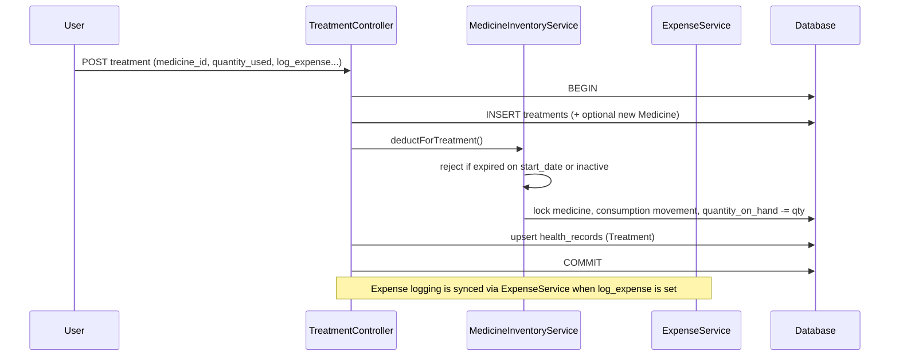
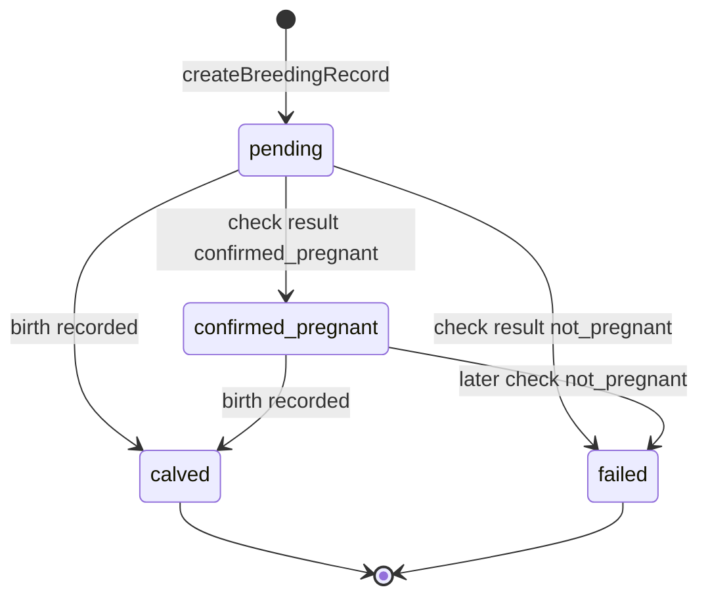

# Business Logic: Health, Feeding and Breeding

## Health module overview

Health records are split across several tables, each with its own controller and FormRequest. Treatments and mortalities additionally mirror a summary row into `health_records` so the animal timeline is unified.

| Record | Controller | Model / table | Notable validation |
|---|---|---|---|
| General health record | `HealthRecordController` | `HealthRecord` / `health_records` | `HealthRecordRequest` |
| Vaccination | `VaccinationController` | `Vaccination` | `status` in Scheduled, Completed, Overdue, Cancelled; `next_due_date` >= `vaccination_date`; attachment pdf/jpg/png/doc/docx <= 5120 KB |
| Treatment | `TreatmentController` | `Treatment` | `status` in Ongoing, Completed, Discontinued, Cancelled; attachment <= 5120 KB; medicine rules below |
| Deworming | `DewormingController` | `Deworming` / `dewormings` | status uses `vaccination_statuses`; medicine fields added by migration `2026_10_14_010000` |
| Vet visit | `VetVisitController` | `VetVisit` | attachment <= 5120 KB |
| Disease record | `DiseaseRecordController` + `DiseaseRecordService` | `DiseaseRecord` | attachment pdf/jpg/png <= 4096 KB |
| Mortality | `MortalityController` | `Mortality` | see chapter 7 |
| Medicine catalogue and stock | `MedicineController` | `Medicine`, `MedicineMovement` | `MedicineRequest`, `MedicineMovementRequest` |

Each of vaccination, treatment, deworming, vet visit and disease record can target an animal, a flock (`flock_id`) or a livestock group (`livestock_id`; columns added by migrations `2026_10_13_11*`). `HealthSectionViews` and `ProvidesStockOptions` build the shared form options.

`HealthOverviewAnalyticsService` produces the Health overview figures and charts (see chapter 9 for dashboard computations).

## Medicine inventory

Service: `App\Services\MedicineInventoryService`. Model: `Medicine` (`quantity_on_hand`, `unit`, `reorder_level`, `expiry_date`, `is_active`).

### Movement algorithm (`recordMovement`)

1. `quantity` must be > 0 and `movement_type` in `config('modules.medicine_movement_types')`: `purchase`, `adjustment_in`, `adjustment_out`, `consumption`.
2. Outbound types are `adjustment_out` and `consumption` (delta = -quantity); the others add stock.
3. Inside `DB::transaction`, the medicine row is locked (`lockForUpdate`), `balance = quantity_on_hand + delta`. If `balance < 0` an `InvalidArgumentException("Insufficient medicine stock...")` is thrown and nothing is written.
4. `quantity_on_hand` is updated and a `MedicineMovement` row is written with `balance_after`, polymorphic reference (`reference_type` = class name, `reference_id`), `moved_at` and `recorded_by` = current user.

### Treatment and deworming consumption

*Treatment save with medicine deduction.*

- `deductForTreatment` / `deductForDeworming` do nothing when `medicine_id` or `quantity_used` is missing/<= 0. They refuse expired medicine (`Medicine::isExpired($treatment->start_date)`) and inactive medicine.
- On update: `syncForTreatment($new, $previous)` restores the previous consumption (`restoreForTreatment`: deletes linked `consumption` movements and adds their quantity back; if no movement rows exist it adds `quantity_used` back directly) and then deducts the new values, all in one transaction.
- On delete: `restoreForTreatment` then the related expense (`ExpenseService::deleteForSource`), the mirrored health record and the treatment itself are removed in a transaction.
- Controllers catch `InvalidArgumentException` and return the message as a validation error on `quantity_used`.
- Vaccinations do **not** consume medicine stock (no inventory call in `VaccinationController`).
- `Medicine::isLowStock()` is true when `quantity_on_hand <= reorder_level` (reorder level set). Low medicine stock is shown in lists; the dashboard alert for low stock counts **feed** only.

> **Note:** Medicine and feed movements store `reference_type` as `Class::class` (medicine) or `getMorphClass()` (feed); no morph map is configured, so both produce the FQCN. Keep consistent when querying.

## Expenses logged from health records

Vaccination, deworming, treatment, vet visit, disease record and breeding records can create a linked `Expense` through `ExpenseService::syncFromRequest()` when the form posts `log_expense` and `expense_amount`:

- category is looked up by code (`health.vaccination`, `health.deworming`, `health.vet_visit`, `health.treatment`, ...); `firstOrFail` - a missing seeded category raises 404/500.
- the expense is created with `status = paid`, `source_type`/`source_id` pointing at the record; an existing expense is updated; if the box is unticked the linked expense is deleted.
- vendor: `expense_vendor_id`, otherwise `firstOrCreate` by `expense_vendor_name`.
- the `ExpenseObserver` then posts the ledger entry (chapter 9).

Context builders (`vaccinationContext`, `dewormingContext`, `treatmentContext`, `diseaseRecordContext`, `vetVisitContext`, `breedingRecordContext`, `pregnancyCheckContext`, `birthRecordContext`) are static helpers on `ExpenseService`.

## Reminders and alerts for health

There are **no push reminders**. "Due" states are computed when the dashboard or overview pages render (`DashboardAnalyticsService::alerts()`):

| Alert | Condition |
|---|---|
| Vaccinations due | `vaccinations.next_due_date` not null and <= today + 30 days (includes already-overdue and long-past dates; does not check whether a later vaccination exists) |
| Deworming scheduled soon | `status = Scheduled` and date between today and today + 7 days |
| Animals need attention | `animalsNeedingAttention()` count |
| Certificates expiring | `expires_on` between today and + 30 days |

## Feeding

### Data model

`FeedType`, `FeedSupplier` (legacy; copied into expense vendors by migration `2026_10_23_130000`), `FeedInventory` (one row per farm + feed type: `quantity_on_hand`, `unit`, `reorder_level`), `FeedInventoryMovement`, `Feeding` (a recorded feeding), `FeedingSchedule`.

### Inventory service

`FeedInventoryService::recordMovement` mirrors the medicine algorithm: positive quantity, type in `feed_movement_types` (`purchase`, `adjustment_in`, `adjustment_out`, `consumption`), row lock, reject negative balance ("Insufficient stock for this movement."), write `FeedInventoryMovement` with `balance_after`.

- `deductForFeeding(Feeding)` resolves the inventory (`feeding.feed_inventory_id`, else farm + feed type), rejects inactive feed types and records a `consumption` movement dated `fed_on`.
- `restoreForFeeding` re-credits and deletes all consumption movements linked to the feeding; `syncForFeeding` = restore then deduct, in a transaction (used on update).
- `ensureInventory(farmId, feedTypeId, unit)` is `firstOrCreate` with zero stock.
- Feed purchases (`FeedInventoryController::storeMovement`) can create a linked expense (`feed.purchase`) through `ExpenseService::createForMovement` (purchase movements only).
- `FeedInventory::isLowStock()`: `reorder_level` not null and `quantity_on_hand <= reorder_level`; feeds the "Feed inventory low" dashboard alert.

### Feeding schedules

`FeedingScheduleService`:

- `recordFed($schedule, $fedOn)`: when a `Feeding` is saved with a `feeding_schedule_id`, `next_due_date` advances from the current due date (or `start_date`, or the fed date) in steps until it is after `fed_on`: `weekly` +1 week, `biweekly` +2 weeks, `monthly` +1 month (no overflow), anything else +1 day. A hard cap of 5000 iterations guards against bad data. If the new date is after `end_date`, `status` becomes `completed`.
- `dueState($schedule)`: for `status = active` with a `next_due_date`, returns `overdue`, `today` or `upcoming` plus the day gap.
- Overdue active schedules raise the "Scheduled feedings overdue" dashboard alert.
- Nothing creates feedings automatically; a user must record each feeding.

### Feed calculator

`FeedCalculatorController` -> `FeedCalculatorService` (read-only recommendations; nothing is saved). Rules live in `config/feed_calculator.php`:

- Types: `cattle`, `goat` (method `weight_based`), `pig`, `poultry` (method `fixed`).
- Weight-based: `total_kg/day = weight_kg x dm_percent / 100 x head_count`. Fixed: `fixed_kg x count` (poultry rules use `fixed_grams`). Breakdown: roughage, concentrate, supplement = `total x pct / 100` each.
- Cattle lactating tiers (`lactating_cattle_tiers`): yield < 10 L/day DM 3.5% (50/45/5), 10-20 L DM 4.0% (45/50/5), > 20 L DM 4.5% (40/55/5). Yield is the average of the last 5 milk records; medium tier is the default without milk data.
- Inputs: species or first livestock type, `weight_kg`, `production_status` (normalised via `status_normalization`), age in months from `date_of_birth` (defaults to 12 months when missing), milk yield.
- Entry points: `calculateForAnimal`, `calculateForHerd` (livestock group; sums animals and, for poultry, flocks via `calculateForFlock`).
- Missing weight on a weight-based rule yields a warning rather than an error; no matching rule returns an empty result with a reason.

## Breeding (cattle profile)

Controllers: `BreedingModuleController` (overview), `BreedingRecordController`, `PregnancyCheckController`, `BirthRecordController`. Service: `BreedingService`; reminders: `BreedingReminderService`. Models: `BreedingRecord`, `PregnancyCheck`, `BirthRecord`, `Offspring`, `BreedingLog`.

*Breeding record status transitions (`breeding_status`).*

### Breeding record

- The female must be `gender = female`; an internal sire must be `male` and on the same farm; otherwise `external_sire_name` is required. The female must belong to the selected farm. Violations throw `InvalidArgumentException`.
- `breeding_code` = `BR-YYYYMMDD-NNNN`.
- `expected_calving_date = breeding_date + gestation_period_days`; default gestation per `config('modules.breeding_gestation_days')`: cattle 283, goat 150, pig 114, poultry 21 (fallback 283).
- `pregnancy_check_due_on = breeding_date + 35 days` (`modules.breeding_pregnancy_check_due_days`).
- A `BreedingLog` entry is written for every action (`created`, `pregnancy_checked`, `confirmed_pregnant`, `failed`, `calved`, `offspring_registered`).
- Editing is blocked once a birth record exists. Updating recomputes expected calving and check-due dates.

### Pregnancy check

- Blocked if a birth exists; `check_date` >= `breeding_date`; `animal_id` must equal the bred female.
- Code `PC-YYYYMMDD-NNNN`; optional attachment stored on `public` disk under `breeding/checks` (stored **before** the transaction starts).
- Result handling (`applyPregnancyCheckResult`): `confirmed_pregnant` updates the record (and expected calving date if supplied) and the female (`Pregnant` / `Pregnancy`); `not_pregnant` sets status `failed` and resets the female if she was `Pregnant`. Other results change nothing.

### Birth and offspring

- Birth requires a breeding in `pending` or `confirmed_pregnant`, mother = breeding female, `alive_offspring <= total_offspring`. Code `BIR-YYYYMMDD-NNNN`.
- In one transaction: create birth, set breeding `calved`, update mother (see chapter 7), and seed `alive_offspring` placeholder `Offspring` rows (`OFF-...`, gender `unknown`, health `healthy`, not registered).
- `registerOffspring` creates a real `Animal` (farm, livestock and breed from the mother, `acquisition_type` = "Born on farm", `lifecycle_status` Active, `mother_tag`, `father_tag`) and marks the offspring registered. Stillborn offspring and already-registered offspring are refused; registered offspring cannot be edited.

### Reminders

`BreedingReminderService` has no scheduler. `pregnancyCheckDueQuery()` returns breeding records with `breeding_status = pending`, no pregnancy checks, and `pregnancy_check_due_on <= today` (or, when null, `breeding_date <= today - 35 days`). It feeds the overview KPI, the "Pregnancy checks due" dashboard alert, and per-record helpers `isPregnancyCheckDue` / `daysUntilPregnancyCheck`. The dashboard also alerts "Calvings approaching" for `confirmed_pregnant` records expected within 14 days.

## Known limitations

- No scheduled reminder delivery; everything is computed at page view.
- Vaccination "due" alert has no upper bound on how old a due date is.
- `ExpenseService::syncFromRequest` fails hard when the expense category code is not seeded.
- Pregnancy-check and birth attachments are stored before the DB transaction and are not removed if the transaction fails.
- Breeding is cattle-profile only; `config/modules.php` lists gestation values for goat, pig and poultry but the module is not available to the poultry profile.
