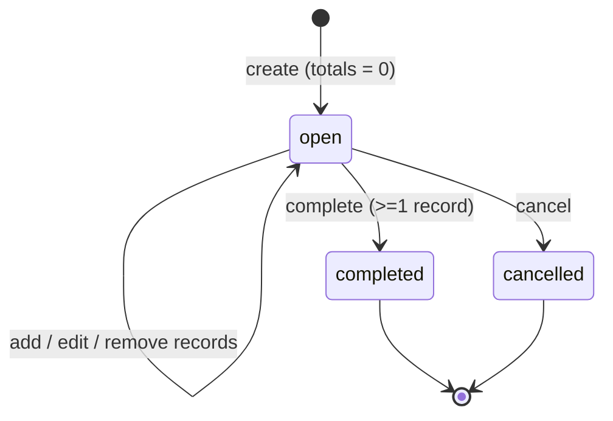
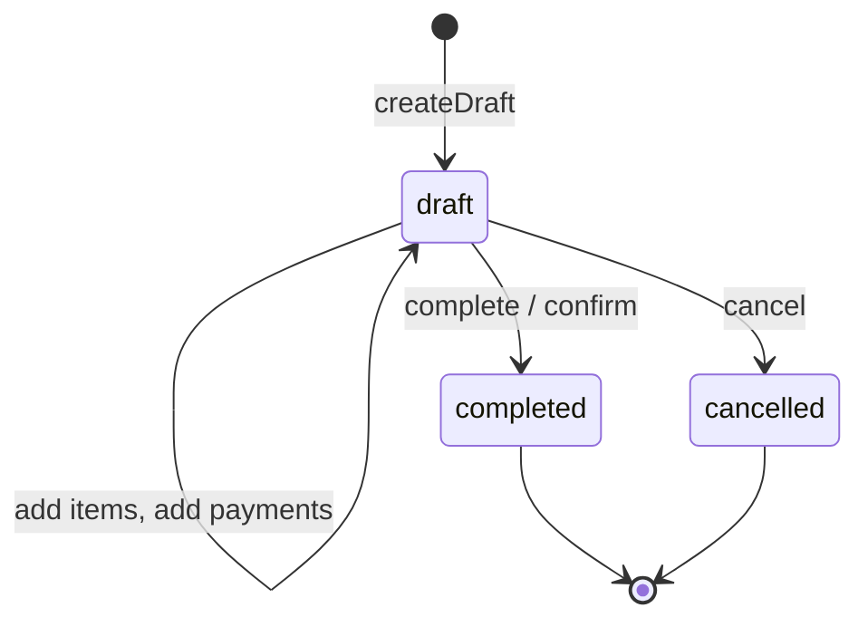
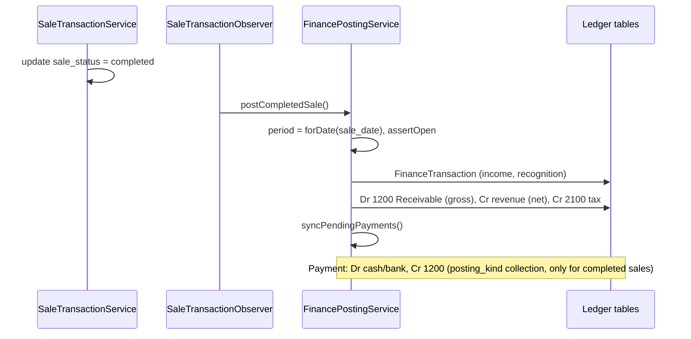

# Business Logic: Milk, Sales and Finance

## Milk module (cattle profile)

Controllers: `MilkModuleController` (overview), `MilkSessionController`, `MilkRecordController`, `MilkStorageController`, `MilkDistributionController`. Services: `MilkSessionService`, `MilkStorageService`, `Milk\MilkDistributionService`, `Milk\MilkCostPerLitreService`, `MilkOverviewAnalyticsService`. Observer: `MilkRecordObserver` (registered in `MilkServiceProvider`).

### Milk session lifecycle

A session is one milking of one herd (`livestock_id`) on one farm, on a date and shift. A unique index prevents a second session for the same herd, date and shift (the service translates SQLSTATE 23000 into "A milk session already exists for this herd, date, and shift.").


*Milk session `status` values (`open`, `completed`, `cancelled`).*

- `create`: livestock must belong to the farm; `session_code` = `MS-YYYYMMDD-NNNN`; `status = open`.
- `addRecord` / `addRecordsBulk` / `updateRecord` / `removeRecord`: only on `open` sessions. The animal must be on the session's farm and herd and `isMilkingEligible()` (Lactating); one record per animal per session. Record code `MR-YYYYMMDD-NNNN`. After each change `recomputeTotals` sets `total_yield_liters`, `number_of_animals_milked` and `average_yield_per_animal` (rounded to 2 dp).
- Bulk entry accepts per-animal inputs plus free-text lines parsed by `parseBulkLines` (`tag,litres`, `tag;litres`, tab or `tag litres`; `#` comments ignored; tags matched case-insensitively among eligible animals). Failures are collected per animal and the rest still save.
- `complete(session, ?destinationStorageId)`: requires `open` and at least one record. Inside a transaction (session locked) totals are recomputed; if a storage tank is chosen (argument or `destination_storage_id`) `MilkStorageService::receiveFromSession` records an `intake` movement of `total_yield_liters` (tank must be on the same farm); then `status = completed`, `completed_at`, `completed_by`.
- `cancel`: only `open`; there is no stock effect.
- Completed or cancelled sessions cannot be edited.

### Storage tanks

`MilkStorageService::recordMovement` (same pattern as feed/medicine): litres > 0; types `intake`, `sale`, `adjustment_in`, `adjustment_out`, `spoilage`, `distribution`, `distribution_return`; outbound = `sale`, `adjustment_out`, `spoilage`, `distribution`; row lock; reject negative balance ("Insufficient milk in storage."). After each movement `refreshStatus` sets the tank status: `available` (0 L), `full` (>= `capacity_liters`), otherwise `in_use`; `maintenance` is never overwritten. Tank code `MK-YYYYMMDD-NNNN`.

> **Note:** Intake and `adjustment_in` movements are **not** capped at `capacity_liters`; the tank can go over capacity (it is only labelled `full`).

### Milk distribution (non-sale use)

`MilkDistributionService` records milk that is not sold: categories `sold`, `fed_to_calf`, `household`, `neighbor`, `relative_visitor`, `other`; manual entry is limited to `milk_distribution_manual_categories` (everything except `sold`). When a tank is chosen the litres are deducted through a `distribution` storage movement; edits reverse (`distribution_return`) and re-deduct when quantity or tank changes; deletes return the litres. `fed_to_calf` stores the calf `animal_id` and clears recipient name/phone. `MilkDistributionRequest` validates `quantity_liters` > 0 (max 100000).

Sold milk appears in the same table as a mirrored row (`category = sold`, code `MD-SALE-{sale_item_id}`, `sale_item_id` set) created by `syncFromSaleItem` when a milk sale is confirmed, with **no** additional storage movement (the sale already deducted stock). Such rows cannot be edited or deleted from the milk module.

### Cost per litre

`MilkCostPerLitreService::calculate(farmId, from, to)`:

```
allocated_expense = SUM(paid expenses on the farm in range) x (lactating animals / active animals)
cost_per_litre    = allocated_expense / SUM(yield_liters of completed sessions in range)
```

Active animals = `lifecycle_status = Active`; lactating = `production_status = Lactating`. If total litres or lactating animals is 0 an empty result is returned. With no farm, a litre-weighted average across active farms is used. Results are cached for 300 s (daily) / 600 s (monthly) on the **file** cache store with keys `milk.cost.{tenant}.{period}.{farm}.{suffix}`; `MilkRecordObserver` and `ExpenseObserver` invalidate the affected keys.

## Sales (unified transactions)

`SaleTransaction` (+ `SaleItem`, `SalePayment`, `SaleLog`) is the current sales model, driven by `SaleTransactionController` and `SaleTransactionService`. Sale types are limited per species profile: animal, meat, milk (cattle); animal, egg, meat (poultry).

> **Note:** `MilkSale`, `MilkSaleItem`, `MilkSalePayment`, `MilkSaleLog` and `MilkSaleService` are a **legacy** milk-sales implementation. No controller or route references them; `/milk/sales` redirects to the unified sales page. `MilkSaleService` is documented here only because it still exists in the codebase: it supports draft -> confirmed with storage deduction per item and `MLS-YYYYMMDD-NNNN` codes, but is not reachable from the application.


*Sale status as reachable from the UI. `confirmed` exists as a transient state for milk sales; `refunded` is defined in config but never set.*

### Lifecycle

1. **Draft** (`createDraft`): number `SL-` (animal), `MLS-` (milk), `MET-` (meat) or `EGS-` (egg) + `YYYYMMDD-NNNN`; `payment_status = unpaid`.
2. **Items** (`addItem`, draft only): `assertItemMatchesType` enforces item types per sale type (animal sale: `animal` or `flock_birds`; meat: `meat_cut`; milk: `milk`; egg: `egg`). Rules: flock birds need a flock on the same farm and `quantity <= current_count`; an animal must be `Active`, on the same farm, not already on this sale and not on another draft animal sale. Line total: explicit `total_price`, else per-kg (`weight x price_per_kg`, weight and price required) or `quantity x unit_price`. `recalculateTotals`: `total = max(0, subtotal - discount + tax)`.
3. **Payments** (`addPayment`, rejected on cancelled): stores `remaining_balance = max(0, balanceDue - amount)`, generates `PAY-YmdHis-NNN` reference if none, then `syncPaymentStatus` (`paid` when paid >= total, `partial`, `unpaid`) and customer balance sync. Overpayment is not rejected.
4. **Complete** (`complete`, also invoked by the `confirm` route): requires at least one item. In a transaction:
   - animal sale: each animal must still be sellable -> `lifecycle_status = Sold`; flock-bird items -> `FlockService::recordSale` (count reduced, event written);
   - meat sale: linked `abattoir_returns.is_sold = true`, animal -> `Sold`;
   - milk sale from draft: `confirm()` -> per item `deductForUnifiedSaleItem` (storage `sale` movement; an item without a tank throws) and `syncFromSaleItem` distribution mirror;
   - egg sale: no stock effect;
   - `sale_status = completed`, log entry, payment status and customer balance re-synced.
5. **Cancel**: allowed except for `completed` and `cancelled`; removes `sold` milk distribution mirrors. It does **not** return stock (reachable only for drafts, which have not deducted any).
6. **Delete**: only `draft` or `cancelled`.

> **Warning:** A completed sale cannot be cancelled, refunded or corrected from the UI. `FinancePostingService::reverseCompletedSale` (triggered by `SaleTransactionObserver` on completed -> cancelled) is therefore unreachable through `SaleTransactionService::cancel`.

### Customers and credit

`CustomerService` creates a customer with profile, an empty `customer_credit` row (`credit_limit` 0, `outstanding_balance` 0) and optional primary contact, and logs actions in `customer_logs`. `syncOutstandingBalance` recomputes `outstanding_balance` = sum over the customer's sale transactions with status not `draft`/`cancelled` of `max(0, total - SUM(payments.amount_paid))` and logs a `credit_changed` entry when it changes. `CustomerCreditController::update` edits `credit_limit` and payment terms.

> **Warning:** `credit_limit` is **informational only**. No code blocks a sale or payment when `outstanding_balance` exceeds the limit; it only drives the "Credit limit exceeded" dashboard alert and customer filter.

## Expenses

`ExpenseController`/`ExpenseService`/`ExpenseObserver`. Statuses `paid`, `draft`, `void`; payment methods `Cash`, `Mobile money`, `Bank transfer`, `Cheque`, `Other` (shared with sale payments via `config('modules.expense_payment_methods')`). Attachment (pdf/jpg/png/doc/docx, <= 5120 KB) is stored on the `public` disk under `expenses/{id}`.

- Expenses created from other modules have `source_type`/`source_id`; they cannot be edited or deleted from the Expenses module ("Edit it from the source record").
- Categories are seeded and addressed by `code` (`feed.purchase`, `health.vaccination`, ...). Vendors are `ExpenseVendor` rows (`firstOrCreate` by name).

## Finance (double-entry ledger)

Finance is a posting layer fed by observers; users do not enter journal entries manually. Config: `config/finance.php`.

| Mapping | Source |
|---|---|
| Expense category code -> account | `expense_category_to_account` (feed 5000, health 5100, labour 5200, transport 5300, equipment/structures 5400, other 5900); default `5900` |
| Sale type -> revenue account | milk 4000, animal 4100, meat 4200, egg 4250 |
| Cash 1000, bank 1100, receivable 1200, taxes payable 2100 | `cash_accounts`, `accounts_receivable`, `taxes_payable` |


*Posting of a completed sale and its payments.*

- Observers (`FinanceServiceProvider`): `SaleTransactionObserver::updated` (completed -> `postCompletedSale`; completed -> cancelled -> `reverseCompletedSale`), `SalePaymentObserver::created` (`postSalePayment`), `ExpenseObserver` (paid on create or status change -> `postPaidExpense` Dr expense account, Cr cash; status paid -> void/draft -> reversal; amount change on a paid expense -> reverse then re-post; delete of a paid expense -> reversal).
- Idempotency: `findSourcePosting(module, type, id, kind)` prevents double posting; reversals copy the original lines with opposite entries (`is_reversal`, `reversed_transaction_id`) dated today.
- Periods: `FinancePeriodService::forDate` finds or lazily creates a **monthly** period (`status open`); `assertOpen` throws `InvalidArgumentException` when the period is not open. There is no UI to close periods in the controllers reviewed (`FinanceModuleController` exposes overview, transactions, P&L and cash flow only).
- Account lookup: `FinanceAccountResolver::requireAccount` throws "Finance account {code} is not configured." if the chart of accounts has not been seeded for the tenant.
- Reports (`FinanceReportService`): P&L aggregates lines of `income`/`expense` accounts; cash flow uses accounts with subtype `cash`/`bank`; overview adds receivable balance and transaction count. Filters: date range, farm, livestock group.

> **Warning:** `FinanceAccountResolver::cashAccount` compares the payment method to `finance.bank_payment_methods` (`bank_transfer`, `mobile_money`, `cheque`, `card`), but the only values the forms accept are `Cash`, `Mobile money`, `Bank transfer`, `Cheque`, `Other`. No accepted value matches, so every posting is debited/credited to the **cash** account (1000) and the bank account (1100) is never used.

### `finance:backfill`

`php artisan finance:backfill [--tenant=]` iterates all completed sales, paid expenses and payments of completed sales and calls the same posting methods (idempotent through `findSourcePosting`). Output: "Posted N sales, N expenses, N payments." Limitations: the `--tenant` option is declared but **not read** by `handle()`. The command runs with no active `TenantContext`, so the tenant global scope does not filter and newly created ledger rows are not stamped with a `tenant_id` (the `creating` hook only sets it when a tenant is active). Run it only after confirming behaviour on a single-tenant database or a backup (see chapter 14).

## Dashboard and analytics

`DashboardController` resolves a period (`today`, `this_month`, `last_month`, `this_quarter`, `this_year`, `custom`, `all`) and an optional farm filter, then calls `DashboardAnalyticsService::build()`, which returns: alert strip, financial summary (from `FinanceReportService::overviewStats`), livestock summary, six charts (revenue vs expenses trend, milk or egg production, sales by type, expense breakdown, animal health, ...), module KPI strips, recent sales, top 5 milk producers (cattle), feed stock and recent activity. Poultry farms swap milk series for egg collections.

Alerts are computed live (no storage): animals needing attention (critical), low feed stock, vaccinations due within 30 days, dewormings scheduled within 7 days, overdue feeding schedules, certificates expiring within 30 days, customers over credit limit (critical), calvings within 14 days (info), pregnancy checks due, unpaid/partial completed-or-confirmed sales. Revenue and expense figures come from the **ledger**, so they depend on observers having posted entries (use `finance:backfill` for historic data).

`MilkOverviewAnalyticsService` and `HealthOverviewAnalyticsService` supply the module overview pages. Platform-wide figures for the admin dashboard come from `AdminPlatformStatsService` / `AdminDashboardFilterService` / `AdminFarmMapService` (queried with the tenant scope removed, super admin only).

## Exports and imports

| Feature | Route group | Format | Limits |
|---|---|---|---|
| Animals export/template | `animals.export`, `animals.import.template` | CSV stream, chunk 200 | filters from request |
| Animals import | `animals.import*` | CSV/TXT/XLSX/XLS (PhpSpreadsheet for Excel), request limit 5120 KB | `MAX_ROWS = 2000` |
| Customers import/export | `customers.import*`, `customers.export` | CSV/TXT, 2048 KB | `MAX_ROWS = 2000` |
| Employees import/export | `employees.import*`, `employees.export` | CSV/TXT, 2048 KB | `MAX_ROWS = 2000` |
| Trace report | `marketplace.trace.pdf` | PDF via `barryvdh/laravel-dompdf` | public, throttled |

Animal import is a multi-step flow: upload -> file stored on the `local` disk as `animal-imports/{uuid}.{ext}` and a preview computed (`AnimalCsvImporter::preview`, no writes) -> pending state kept in the session (`SESSION_KEY`) -> `confirm` choosing duplicate handling `keep` (skip existing) or `replace` (requires an extra confirm page) -> `import` -> file deleted. Duplicates are detected by the unique key `livestock_id + tag_number`. Spreadsheet wording is normalised to Orora statuses (`NormalizesAnimalStatuses`).

> **Note:** Exports write cell values as-is (no formula-injection guard such as prefixing `=`, `+`, `-`, `@`).

## Known limitations

- Completed sales cannot be reversed, cancelled or refunded from the UI.
- Bank vs cash account split is never applied (payment method string mismatch).
- Credit limits are not enforced.
- No egg or meat inventory; egg sales do not reduce any stock.
- Finance periods cannot be closed in the UI; unusual dates silently create new monthly periods.
- Legacy `MilkSale*` classes and the `Sale` model remain in the codebase with no routes or controllers using them (`Sale` is not referenced anywhere in app, config, routes or views; `SaleDocument` is only related from `SaleTransaction`).
