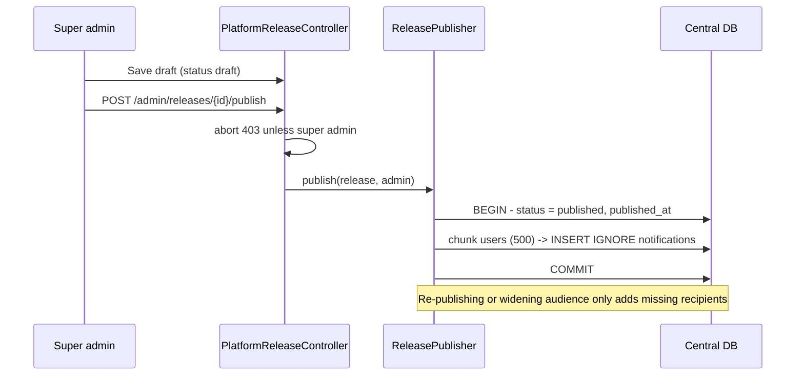

# Notifications and Automation

## Summary: what is and is not automated

| Capability | Status | Evidence |
|---|---|---|
| In-app (database) notifications | **Implemented** (two kinds) | `app/Notifications/*`, `NotificationController` |
| E-mail notifications / Mailables | **Not implemented** | no `app/Mail`, no `Mail::` calls, `via()` returns `['database']` only |
| SMS / push / WhatsApp | **Not implemented** | no code or config |
| Laravel scheduler tasks | **None defined** | `routes/console.php` contains only the default `inspire` command; no `Schedule::` call anywhere in `app/` |
| Queued jobs | **None defined** | no `app/Jobs`, no class implements `ShouldQueue`, no `dispatch()` of a job |
| Event listeners | **None** | no `app/Events`, no `app/Listeners` |
| Model observers | **Implemented** (4) | `app/Observers`, registered in `FinanceServiceProvider` and `MilkServiceProvider` |
| Reminders (vaccination, breeding, feeding) | **Computed at page view only** | see chapters 8 and 9; nothing is sent |

> **Warning:** `.env.example` sets `QUEUE_CONNECTION=database` and the `jobs` migration exists, but the application never dispatches a job. Running a queue worker is optional today. Likewise a cron entry for `schedule:run` has nothing to run. Both become relevant only if future features add them.

## In-app notifications

Laravel's `notifications` table lives on the **central** connection (`2026_10_21_100000_create_platform_releases_and_notifications.php`, with an extra `platform_release_id` column and a unique `(platform_release_id, notifiable_type, notifiable_id)` index).

| Notification | Created by | Recipients | Payload `kind` |
|---|---|---|---|
| `ReleasePublished` | `ReleasePublisher` (bulk `insertOrIgnore`, no `notify()` call) | all active tenant users, or users of selected tenants | `release` |
| `MarketplaceInquiryReceived` | `Marketplace\ShopController::inquiry` via `Notification::send` | seller tenant's workspace admins (all active users if there is no admin) | `marketplace_inquiry` |

Both notifications are synchronous (`Notification` classes do not implement `ShouldQueue`). The inquiry notification is wrapped in `try/catch` with `report()` so a failure does not break the public form.

### User-facing endpoints

| Route | Behaviour |
|---|---|
| `GET /notifications` (`notifications.index`) | list, `?filter=unread`, 20 per page |
| `POST /notifications/read-all` | marks all unread as read (JSON `{unread: 0}` when the client expects JSON) |
| `GET /notifications/{notification}/open` | scoped to the signed-in user (`$user->notifications()->whereKey()`), marks read, redirects to `data.url` only if it starts with `/` and not `//` (open-redirect guard) |
| `GET /whats-new` (`whats-new.index`) | lists releases visible to the tenant; viewing marks the listed releases' notifications as read |
| header bell | `View::composer('layouts.partials.notification-bell')` loads unread count and the latest `releases.bell_limit` (8); query errors (table missing) are swallowed |

These routes are behind `auth` only (not `module.access`), as intended for all active users.

## Platform releases ("What's New")


*Release publishing and notification fan-out.*

- Config: `config/releases.php` (categories `new_feature`, `improvement`, `bug_fix`, `important_update`, `maintenance`; audiences `all` / `selected`; statuses `draft` / `published`).
- `publish`: refuses `audience = selected` with no tenants; sets published fields once; `notifyAudience` inserts one row per active user (`users.tenant_id` not null, `is_active` null or true). The notification id is a deterministic UUID-v5-style hash of release and user, and the unique index makes repeats no-ops.
- Editing a published release whose audience widens calls `notifyAudience` again to reach new tenants without re-notifying existing ones.
- Deleting a release calls `retract` (deletes its notifications).
- Only super admins may publish (`isSuperAdmin()` check in the controller).

## Observers

| Observer | Model | Hooks | Effect |
|---|---|---|---|
| `ExpenseObserver` | `Expense` | `saved`, `deleting` | invalidate milk cost cache; post/reverse ledger entries |
| `SaleTransactionObserver` | `SaleTransaction` | `updated` | post on `completed`; reverse on `completed -> cancelled` |
| `SalePaymentObserver` | `SalePayment` | `created` | post collection entry (only if the sale is completed) |
| `MilkRecordObserver` | `MilkRecord` | `saved`, `deleted` | invalidate milk cost cache for the session's farm/date |

Observers run synchronously in the request. `saved`/`updated`/`created` fire after the row is written, so if posting throws (closed period, missing account) the originating record has already been saved unless the caller wrapped both in a transaction (`SaleTransactionService::complete` does; `ExpenseController::store` does not).

## Scheduled tasks

None. `routes/console.php`:

```php
Artisan::command('inspire', function () { ... })->purpose('Display an inspiring quote');
```

If scheduled work is introduced later, the standard cPanel cron entry is `* * * * * cd /path/to/orora && php artisan schedule:run >> /dev/null 2>&1` (see chapter 12). This is a recommendation, not an existing requirement.

## Queue usage

- Default connection `database` (`config/queue.php`), table `jobs` created by `0001_01_01_000002_create_jobs_table.php`; `composer run dev` starts `php artisan queue:listen --tries=1 --timeout=0` for local development.
- Production: no worker is required for current features. In tests `QUEUE_CONNECTION=sync` (`phpunit.xml`).

## Housekeeping commands that act like automation

These are run manually: `finance:backfill`, `orora:learning-cleanup`, `rwanda:download-locations`. See chapter 13.

## Known limitations

- No outbound channel (mail/SMS) exists; users only see alerts while logged in.
- Reminder counts are recalculated per page view, which adds query load to the dashboard (see chapter 14).
- The `jobs`/`failed_jobs` infrastructure is unused.
