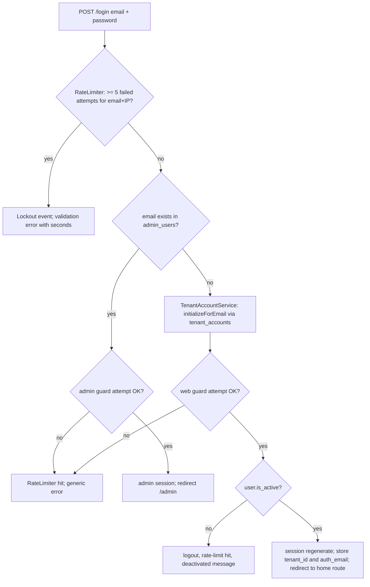
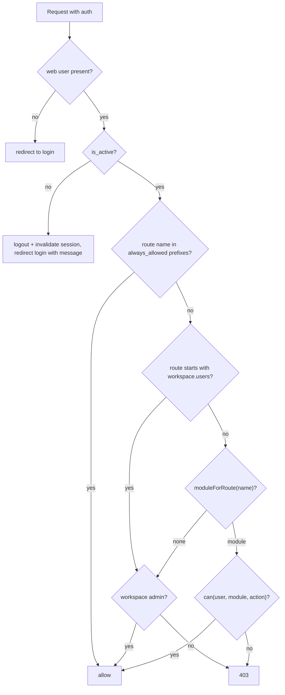

# Security and Permissions

Findings in this chapter were verified against the code (routes from `php artisan route:list --json`, middleware, FormRequests, services). Items that are gaps are marked **Gap** and repeated in chapter 14.

## Authentication

### Guards and providers (`config/auth.php`)

| Guard | Driver | Provider | Model | Purpose |
|---|---|---|---|---|
| `web` (default) | session | `users` -> `tenant_eloquent` (`App\Auth\TenantAwareUserProvider`) | `App\Models\User` | farm workspace users |
| `admin` | session | `admin_users` -> `eloquent` | `App\Models\Central\AdminUser` (connection `central`, table `admin_users`) | platform administrators under `/admin` |

`TenantAwareUserProvider::retrieveById()` / `retrieveByToken()` return `null` unless a tenant context is active (`TenantContext::isActive()` in single-database mode). A session or remember cookie therefore cannot authenticate a user before the tenant has been resolved.

### Single login form for both guards

`POST /login` -> `LoginRequest::authenticate()`:

*Login decision flow.*

- Throttle: 5 failures per `lower(email)|IP` key (`LoginRequest::throttleKey`), using the default cache store; success clears the key. Lock-out time is the Laravel default decay (60 s). `AdminLoginRequest` has its own throttle but `/admin/login` is only a redirect to `/login` (`central.login`), and `AdminLoginController` only implements `destroy`.
- Session is regenerated on login (`session()->regenerate()`), invalidated and CSRF token regenerated on logout (`POST /logout`). Logging in as one guard logs the other guard out.
- "Remember me" is honoured (`remember` checkbox -> Laravel `remember_web_*` cookie).
- `last_login_at` is updated for users and admins when the column exists.
- Registration (`POST /register`, `RegisterRequest`): `name` max 255, `email` unique in `tenant_accounts`, `password` confirmed with `Password::defaults()`. No custom `Password::defaults()` is set in any provider, so the framework default applies (minimum 8 characters, no complexity or breach checks). The created user receives role `workspace_admin`.
- Tenant resolution (`InitializeDefaultTenant`, `TenantAccountService::initializeFromRequest`) uses the session (`tenant_id`, `auth_email`) or the tenant/email cookies (1 year). Cookies are encrypted by Laravel's cookie middleware. Stale auth state redirects to `/login` with "Your session expired".

### Password hashing

`User` and `AdminUser` cast `password` as `hashed` (bcrypt by default; `BCRYPT_ROUNDS=12` in `.env.example`). The `orora:super-admin` command assigns the plain value to the cast attribute and verifies it with `Hash::check`.

### Sessions

`SESSION_DRIVER=database` (table `sessions`, created by `0001_01_01_000003_create_central_sessions_table`), lifetime `120` minutes, `SESSION_ENCRYPT=false`, `http_only=true`, `same_site=lax`. `SESSION_SECURE_COOKIE` is not set in `.env.example`.

> **Gap:** with `SESSION_SECURE_COOKIE` unset the session cookie is not marked `Secure`. **Recommendation:** set `SESSION_SECURE_COOKIE=true` in production (HTTPS).

### CSRF

All routes use the `web` middleware group, which includes Laravel's CSRF protection. `bootstrap/app.php` registers no CSRF exclusions. Every state-changing route is POST/PUT/PATCH/DELETE; GET routes with side effects: `GET /locale/{locale}` (changes locale only) and `GET /notifications/{id}/open` (marks one notification read).

### Not implemented

- **Password reset / "Forgot password?"** is not implemented: no routes or controllers; the login view renders a disabled link titled "Coming soon" (`resources/views/auth/login.blade.php`). `config/auth.php` still defines password brokers and the users migrations still create a `password_reset_tokens` table, but no code uses them. Account recovery is done by a workspace admin editing the user (`workspace.users.update`) or by a super admin through the CLI (`orora:super-admin`).
- **Email verification**: `User` does not implement `MustVerifyEmail`; no `verified` middleware is used.
- **Two-factor authentication**: absent.
- **Account lockout beyond rate limiting**, login history and audit logging of security events: absent (only `last_login_at`).

## Authorization

### Roles and permission model

- `users.role`: `workspace_admin` (also legacy `owner`, `admin` treated as admin) or `member` (`WorkspaceAccessService::ADMIN_ROLES`, `config/workspace_access.php` -> `roles`).
- `users.is_active`: inactive users cannot log in and are logged out on their next request by `EnsureModuleAccess`.
- `workspace_module_permissions`: one row per `(user_id, module_key)` with `can_view`, `can_create`, `can_edit`, `can_delete`. Modules (`config/workspace_access.php`): dashboard, farms, livestock, animals, flocks, employees, health, feeding, feed-calculator, milk, eggs, breeding, certificates, movement, sales, customers, expenses, finance. `dashboard` supports `view` only.
- Workspace admins bypass every module check. Creating/editing a user (`WorkspaceUserController`, `WorkspaceUserRequest`) saves the matrix through `WorkspaceAccessService::syncPermissions`: create/edit/delete are only stored when `view` is true; admin users have their rows deleted. The last workspace admin cannot be demoted or deactivated, and an admin cannot change their own role away from admin.

### `module.access` middleware flow

*`EnsureModuleAccess` decision logic (`canAccessRoute`).*

1. `moduleForRoute()` picks the **longest** matching prefix in `route_modules` (e.g. `feeding.calculator` beats `feeding`; a name containing "calculator" under feeding maps to `feed-calculator`).
2. `actionForRoute()` maps to an action: route suffix `create`, `store`, `import*` -> `create`; `edit`, `update` -> `edit`; `destroy`, `cancel` or HTTP DELETE -> `delete`; other POST (not `.index/.show/.overview`) -> `create`; PUT/PATCH -> `edit`; everything else -> `view`. Create/edit/delete additionally require `can_view`.
3. Always allowed for any active user: `profile`, `logout`, `locale`, `api.rwanda`, `stancl.tenancy`, `notifications`, `whats-new` (and any others listed in `always_allowed_route_prefixes`).
4. A route whose name matches no module is **admin-only** (`moduleForRoute` null -> `isWorkspaceAdmin`).
5. If the permission tables are not migrated (`schemaReady()` false) every user is treated as admin (fail-open for legacy databases).

Species gating (`EnsureSpeciesModule`, chapter 7) is evaluated after permissions and returns 404 for modules the active farm's profile does not offer.

### Where authorization is *not* applied

Verified from the route list (375 routes):

| Routes | Middleware | Comment |
|---|---|---|
| `/api/rwanda/*` (5) | `auth` | location lookup; no module check (static reference data) |
| `/notifications*`, `/whats-new`, `/logout` | `auth` | intended; scoped to the user |
| `/workspace/users*` (7) | `auth`, `workspace.admin` | admin only |
| `/shop/*` write routes (marketplace) | `auth` | any authenticated workspace user can create/edit listings; ownership is enforced inside `ShopController` / listing service, not by `module.access` |
| `/`, `/about`, `/shop`, `/shop/{listing}`, `/contact`, `/learning*` | none | public pages |
| `POST /shop/{listing}/inquiry`, `POST /contact` | none | **public form posts, no throttle or CAPTCHA** |
| `/trace*` (4) | `throttle:30,1` | public traceability lookup |
| `/register`, `/login` | `guest` | no throttle on `/register` |
| `/up` | none | health check |
| `/storage/{path}` (GET/PUT) | none | Laravel's built-in `local` disk route (`serve => true`); private files require a signed URL, nothing in the app generates one |

Controllers use FormRequests with `authorize(): true`; authorization is entirely route-middleware based (there are no Policies or Gates in `app/`).

### Platform admin (`/admin`)

All `/admin/*` routes (31) use `auth:admin` plus `ForgetTenantForCentralAdmin` (clears `TenantContext`). Only `PlatformReleaseController` publish/delete and the marketplace listing admin request check `isSuperAdmin()`. Other admin actions (delete tenant, delete platform user account with full purge, moderate listings, view messages) are available to **any** `AdminUser`.

> **Gap:** the `is_super_admin` flag does not gate tenant/user deletion. Today `SuperAdminSetup`/`orora:super-admin` only create super admins, so the gap is latent.

## Data isolation

- `BelongsToTenant` adds a global scope `tenants.tenant_id = TenantContext::id()` and fills `tenant_id` on create. Every model except `Tenant`, `TenantAccount`, `WorkspaceModulePermission`, `FinanceAccount` and `ExpenseCategory` extends `TenantModel`. `FinanceAccount` and `ExpenseCategory` use `BelongsToTenantWithSystemCatalog` instead: rows with `is_system = true` (the seeded chart of accounts and expense categories) are visible to every tenant in addition to the tenant's own rows. Route-model binding goes through the scope, so another tenant's record returns 404.
- The scope is skipped when no tenant is active (`if (! $tenantId = TenantContext::id()) return;`), i.e. it **fails open**. Code that runs without a tenant context (console commands such as `finance:backfill`, seeders) sees all tenants.
- `withoutGlobalScope('tenant')` / `withoutGlobalScopes()` appear in `Central\*` controllers, admin services, `ReleasePublisher`, `ShopController::notifySeller` and the public `AnimalTraceService`. These are the intentional cross-tenant paths.
- The scope calls `Schema::hasColumn()` on every query (extra metadata query each time; chapter 14).

> **Gap (cross-tenant references):** About 70 validation rules in `app/Http` use `exists:table,id` **without** a tenant constraint (plus `Rule::exists` variants that constrain only by farm, not by tenant), e.g. `MovementController::rules()` (`exists:animals,id`), `CertificateController`, `AbattoirDispatchController`, `AnimalRequest` (`farm_id` -> `exists:farms,id`). A user who guesses another tenant's id passes validation and the foreign id is stored; reads are then scoped, so impact is mainly an existence oracle and orphaned references. Some paths re-check with scoped `findOrFail` (services), others do not. **Recommendation:** a shared helper such as `Rule::exists(...)->where('tenant_id', TenantContext::id())`.

> **Gap (raw queries):** `FinanceReportService::transactionCount()` uses `DB::table('finance_transactions')` (no tenant filter) and so counts transactions of all tenants in the Finance overview. `MilkOverviewAnalyticsService` uses `DB::table('animals'/'livestock')` keyed by ids that were already scoped (no leak of other rows).

> **Gap (public trace):** `/trace/{animal}` and `/trace/{animal}/pdf` resolve **any** animal by sequential numeric id across all tenants (`AnimalTraceService::resolve` removes the tenant scope) and render farm name/registration, vaccinations, treatments, health records, movements and certificates (limit 20 each). The throttle is 30 requests/minute per IP, which does not prevent enumeration over time. This may be intended (public traceability) but exposes full health history for every animal. **Recommendation:** opt-in flag per animal or signed/opaque tokens.

- Cache: in single-database mode `TenancyMode::bootstrappers()` is empty, so the framework cache is not tenant-tagged. The only app code that caches (`MilkCostPerLitreService`) puts the tenant id in the key. Any future cache use must do the same.
- Files: attachments and photos are stored on the `public` disk (`storage/app/public/{type}/{record-id}/{random-name}`), reachable at `/storage/...` without authentication if the URL is known; names are random hashes but not tenant-checked. CSV/animal imports use the private `local` disk and are deleted after use.

## Input validation

- About 70 FormRequest classes (`app/Http/Requests`, including Auth, Central, Marketplace) plus inline `$request->validate()` in `MovementController`, `CertificateController`, `AbattoirDispatchController` and others. Enumerated fields validate against `config/modules.php` lists (`Rule::in`).
- Mass assignment: models use `$fillable` (User uses `#[Fillable]`); `User` fillable includes `role`, `tenant_id`, `is_active` but writes come from validated, controller-built arrays.
- Output: Blade `{{ }}` escaping everywhere; `{!! !!}` appears 7 times, with user text passed through `e()` + `nl2br` except `marketplace/learning/show.blade.php`, which prints `$post->content` raw (content authored by platform admins/seeders; the learning routes are currently redirects).
- SQL: Eloquent/query builder with bindings; `whereRaw('LOWER(tag_number) = ?')` is parameterised.

## File upload handling

| Upload | Rules | Disk / path |
|---|---|---|
| Animal photo | `image`, <= 2048 KB | `public`: `animals/{id}` |
| Health/expense attachments | `file`, `mimes:pdf,jpg,jpeg,png,doc,docx`, <= 5120 KB (disease: pdf/jpg/png <= 4096 KB; pregnancy check: pdf/jpg/png <= 5120 KB) | `public`: `treatments/{id}`, `mortalities/{id}`, `expenses/{id}`, `breeding/checks`, ... |
| Marketplace images | `image`, `mimes:jpg,jpeg,png`, <= 4096 KB each | marketplace listing service |
| Animal import | `extensions:csv,txt,xlsx,xls`, <= 5120 KB | private `local`: `animal-imports/{uuid}.{ext}` |
| Customer / employee import | `extensions:csv,txt`, <= 2048 KB | read from the upload |

The `image` rule in Laravel 13 excludes SVG by default. Files are renamed by `store()` (hash names), never by the client file name. There is no malware scanning.

## Rate limiting

| Scope | Limit |
|---|---|
| Login | 5 failures per email+IP (custom `RateLimiter`) |
| `/trace*` | `throttle:30,1` |
| Everything else (register, contact, shop inquiry, all authenticated writes) | none |

## Other configuration risks

- **APP_DEBUG**: `.env.example` ships `APP_DEBUG=true` and `APP_ENV=local`; `config/app.php` defaults to `false` only when the variable is absent. **Recommendation:** production `.env` must set `APP_ENV=production`, `APP_DEBUG=false`. `.env` itself is git-ignored.
- **Demo credentials**: `config/demo.php` defaults the demo user to `demo@ororafarm.rw` / `password` (overridable with `DEMO_USER_EMAIL`, `DEMO_USER_PASSWORD`); `orora:seed-demo` must not be run on production or the password must be overridden.
- **Super-admin bootstrap**: `SUPER_ADMIN_PASSWORD` in `.env` is read by `orora:install`; remove it after the account is created.
- **Public login enumeration**: the login flow first checks `admin_users` by email and returns the same generic message on failure; there is no user-existence disclosure in the message, but registration reveals whether an email is taken (`unique` validation on `tenant_accounts.email`).

## Summary of gaps

| # | Gap | Severity |
|---|---|---|
| 1 | No password reset, e-mail verification or 2FA | High (operational) |
| 2 | Public trace exposes any tenant's animal health history by sequential id | High (privacy) |
| 3 | `exists:` rules not tenant scoped (about 70 occurrences) | Medium |
| 4 | `FinanceReportService::transactionCount` ignores tenant | Medium |
| 5 | `/register`, `/contact`, shop inquiries unthrottled | Medium |
| 6 | Attachments on `public` disk served unauthenticated | Medium |
| 7 | Tenant scope fails open without context (console jobs) | Medium |
| 8 | Any admin can delete tenants/users (`is_super_admin` not checked) | Low (latent) |
| 9 | `SESSION_SECURE_COOKIE` unset; `APP_DEBUG=true` in `.env.example` | Medium (deployment) |
| 10 | CSV exports lack formula-injection escaping | Low |
