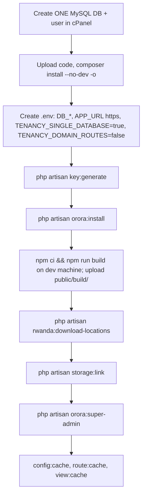

# Deployment and Maintenance

## Server requirements

| Item | Requirement | Source |
|---|---|---|
| PHP | `^8.3` (composer platform lock is 8.3; local CLI used for this review: 8.4.7) | `composer.json`, `composer.lock` |
| Framework | Laravel `^13.8` (locked v13.11.2) | `composer.json`, `composer.lock` |
| Tenancy package | `stancl/tenancy` ^3.10 (v3.10.0). Used for its tenant model, central connection and asset route; database-per-tenant bootstrappers are disabled in the default single-database mode | `composer.json`, `config/tenancy.php` |
| PDF | `barryvdh/laravel-dompdf` ^3.1 (v3.1.2) | traceability PDF |
| Excel import | `phpoffice/phpspreadsheet` ^5.0 (v5.10.0; requires ext `gd`, `zip`, `dom`, `mbstring`, `json`) | animal import |
| Database | MySQL / MariaDB (charset `utf8mb4`, collation `utf8mb4_unicode_ci`). Tests use MySQL (see chapter 13). SQLite is only a fallback default in `config/database.php` | `config/database.php` |
| PHP extensions | `pdo_mysql`, `mbstring`, `openssl`, `ctype`, `json`, `tokenizer`, `xml`, `dom`, `fileinfo`, `curl`, `gd`, `zip`, `intl`, `bcmath`, `iconv` (the standard Laravel set plus those required by PhpSpreadsheet/DomPDF) | composer.lock requirements |
| Web server | Apache/Nginx with document root = `public/` (repo ships `public/.htaccess`) | |
| Node.js | Only on the build machine: `vite ^8`, `laravel-vite-plugin ^3.1`, `tailwindcss ^4`, `chart.js ^4.4` | `package.json` |
| Outbound internet | Needed once for `rwanda:download-locations` (GitHub) and for the Bunny font loaded by the Vite fonts plugin during build | `RwandaLocationService`, `vite.config.js` |
| Writable paths | `storage/`, `bootstrap/cache/` | Laravel default |

## Environment variables

Never commit `.env` (it is git-ignored). Values below are those defined in `.env.example` or read by `config/*.php`; secrets are intentionally not shown.

| Variable | Purpose | Example / default |
|---|---|---|
| `APP_NAME`, `APP_ENV`, `APP_DEBUG`, `APP_KEY`, `APP_URL` | core app; `APP_URL` **must include `http://` or `https://`**; production: `APP_ENV=production`, `APP_DEBUG=false` | `.env.example` ships `local` / `true` |
| `APP_LOCALE`, `APP_FALLBACK_LOCALE` | language (`en`, `rw` in `lang/`) | `en` |
| `APP_MAINTENANCE_DRIVER` | maintenance mode store | `file` |
| `APP_PREVIOUS_KEYS` | key rotation | empty |
| `BCRYPT_ROUNDS` | password hashing cost | `12` |
| `DB_CONNECTION`, `DB_HOST`, `DB_PORT`, `DB_DATABASE`, `DB_USERNAME`, `DB_PASSWORD`, `DB_SOCKET` | main MySQL connection (the `central` connection reuses the same `DB_*` values) | `mysql`, `127.0.0.1`, `3306`, `orora` |
| `TENANCY_CENTRAL_CONNECTION` | name of the central connection | `central` |
| `TENANCY_SINGLE_DATABASE` | `true` = row-level tenancy in one DB (required for cPanel) | `true` |
| `TENANCY_DOMAIN_ROUTES` | `true` = host-based routes from `routes/tenant.php` | `false` |
| `DEFAULT_TENANT_ID` | legacy fallback tenant for unknown emails | `demo` |
| `CENTRAL_DOMAINS` | comma list of hosts that serve the main app (host of `APP_URL` is added automatically) | `127.0.0.1,localhost` |
| `TENANCY_DATABASE_PREFIX`, `TENANCY_CPANEL_HOST`, `TENANCY_CPANEL_USERNAME`, `TENANCY_CPANEL_API_TOKEN` | only for database-per-tenant mode (not used in single-database mode) | unset |
| `SESSION_DRIVER`, `SESSION_LIFETIME`, `SESSION_ENCRYPT`, `SESSION_PATH`, `SESSION_DOMAIN`, `SESSION_SECURE_COOKIE`, `SESSION_SAME_SITE` | sessions (database driver) | `database`, `120`, `false` |
| `CACHE_STORE`, `DB_CACHE_CONNECTION`, `CACHE_PREFIX` | cache (`database` store on the `central` connection); milk cost uses the `file` store | `database`, `central` |
| `QUEUE_CONNECTION`, `DB_QUEUE` | queue (currently unused by features) | `database` |
| `FILESYSTEM_DISK`, `AWS_*` | storage; app uses `public` and `local` disks | `local` |
| `LOG_CHANNEL`, `LOG_STACK`, `LOG_LEVEL`, `LOG_DAILY_DAYS`, `LOG_DEPRECATIONS_CHANNEL` | logging | `stack`, `single`, `debug` |
| `MAIL_MAILER`, `MAIL_HOST`, `MAIL_PORT`, `MAIL_USERNAME`, `MAIL_PASSWORD`, `MAIL_FROM_ADDRESS`, `MAIL_FROM_NAME` | mail (set to `log`; the app sends no mail) | `log` |
| `SUPER_ADMIN_NAME`, `SUPER_ADMIN_EMAIL`, `SUPER_ADMIN_PASSWORD` | bootstrap of the first platform admin by `orora:install` / `orora:super-admin`; remove the password afterwards | unset |
| `DEMO_TENANT_ID`, `DEMO_USER_EMAIL`, `DEMO_USER_PASSWORD`, `DEMO_SEED_FORCE`, `DEMO_DATE_START`, `DEMO_DATE_END`, `DEMO_MIN_RECORDS`, `DEMO_ANIMAL_COUNT`, `DEMO_FARM_COUNT` | demo seeder (`orora:seed-demo`) | see `config/demo.php` |
| `VITE_APP_NAME` | Vite build | `${APP_NAME}` |
| `BROADCAST_CONNECTION`, `REDIS_*`, `MEMCACHED_HOST` | framework defaults, not used by features | |

> **Warning:** `.env.example` ships `APP_DEBUG=true`. A production deployment that copies it without changing this leaks stack traces and environment details.

## Installation

### Local development

```bash
composer run setup        # composer install, copy .env, key:generate, migrate --force, npm install, npm run build
composer run dev          # php artisan serve + queue:listen + pail + vite (concurrently)
```

Set `DB_*` in `.env` first (MySQL), then `php artisan orora:seed-demo` for demo data (workspace "Orora Demo Farm", `demo@ororafarm.rw`).

### Production / cPanel shared hosting (from `MULTITENANCY.md`)


*Production installation sequence.*

1. Create one MySQL database and user (e.g. `sandycyi_orora`). Registration does **not** create databases (works on shared hosting).
2. Point the domain's document root at `public/`.
3. `.env` (minimum): `APP_ENV=production`, `APP_DEBUG=false`, `APP_URL=https://ororafarm.com`, `DB_*`, `TENANCY_SINGLE_DATABASE=true`, `TENANCY_DOMAIN_ROUTES=false`, `SESSION_SECURE_COOKIE=true`.
4. `php artisan orora:install` runs `migrate --force` and verifies that tables `tenants`, `tenant_accounts`, `users`, `farms`, `animals` exist and that `users.tenant_id` exists; it warns when `database/data/rwanda_locations.json` or `public/build/manifest.json` is missing, when marketplace tables or `disease_records` are missing, and creates the first super admin from `SUPER_ADMIN_EMAIL`/`SUPER_ADMIN_PASSWORD` if set. `orora:migrate` is an alias for `migrate --force`.
5. Frontend: `public/build` is git-ignored. Build with `npm ci && npm run build` on a machine with Node and upload the whole `public/build/` directory. Without it you get "Vite manifest not found" (auth pages fall back to basic styles).
6. `php artisan rwanda:download-locations` (about 6 MB JSON into `database/data/`) or upload `rwanda_locations.json` manually; farm address dropdowns depend on it.
7. `php artisan storage:link` (the repo `.gitignore` excludes `public/storage`).
8. Create the platform admin: `php artisan orora:super-admin --email=... --name=...` (prompts for the password), check with `php artisan orora:super-admin-status`. Sign-in is at `/login`; platform admins are redirected to `/admin`.
9. Optional: `php artisan db:seed --class=MarketplaceSeeder --force` for marketplace demo content.
10. After code or config changes: `php artisan config:clear && php artisan cache:clear && php artisan view:clear`, or rebuild caches with `config:cache`, `route:cache`, `view:cache`.

### Updating a deployed instance (recommended sequence)

1. Take a database backup (below).
2. `php artisan down` (optional), upload/pull code, `composer install --no-dev --optimize-autoloader`.
3. `php artisan migrate --force` (or `orora:migrate`).
4. Upload a fresh `public/build/` if frontend files changed.
5. Clear/rebuild caches, `php artisan up`.

## Queue worker and scheduler

- **Queue worker**: not required by current features (no job is dispatched; see chapter 10). If one is introduced: `php artisan queue:work --tries=3 --max-time=3600` under Supervisor or a cPanel cron / "Setup Node/PHP" background process, matching `QUEUE_CONNECTION=database`.
- **Scheduler**: no scheduled tasks are defined. If added later, a single cron entry is needed: `* * * * * cd /home/USER/orora && /usr/local/bin/php artisan schedule:run >> /dev/null 2>&1`. These are recommendations, not current requirements.

## Backups and restore

The whole platform is one MySQL database plus uploaded files, so backup scope is:

| What | Where |
|---|---|
| Database (all tenants) | MySQL schema named by `DB_DATABASE` |
| Uploads | `storage/app/public/` (photos, attachments), `storage/app/private/` (transient imports) |
| Configuration | `.env` (store securely, separately from code) |
| Reference data | `database/data/rwanda_locations.json` (re-downloadable) |

No backup automation exists in the repository. Recommended manual procedure:

```bash
# backup (run from cron nightly, keep several generations, copy off-server)
mysqldump --single-transaction --routines --triggers -h "$DB_HOST" -u "$DB_USERNAME" -p "$DB_DATABASE" | gzip > orora-$(date +%F).sql.gz
tar czf orora-storage-$(date +%F).tgz storage/app/public

# restore (into an empty or scratch database first)
gunzip < orora-2026-01-01.sql.gz | mysql -h "$DB_HOST" -u "$DB_USERNAME" -p "$DB_DATABASE"
tar xzf orora-storage-2026-01-01.tgz
php artisan config:clear && php artisan cache:clear
```

> **Tip:** Test restores regularly on a scratch database. Because all tenants share the schema, a restore replaces every tenant's data; per-tenant restore requires extracting rows by `tenant_id`.

## Logs

- Application log: `storage/logs/laravel.log` (`LOG_CHANNEL=stack`, `LOG_STACK=single`, level `debug` by default, no rotation). Recommended for production: `LOG_STACK=daily`, `LOG_LEVEL=warning`, `LOG_DAILY_DAYS=14`.
- Live tail in development: `php artisan pail` (started by `composer run dev`).
- Web server logs: see hosting panel. Health endpoint: `GET /up`.
- Smoke check of authenticated routes: `php scripts/smoke-routes.php` (expects the `demo` tenant; read-only GETs).

## Troubleshooting

| Symptom | Likely cause | Fix |
|---|---|---|
| `Vite manifest not found` | `public/build/` missing | build locally and upload `public/build/` |
| Registration: `Table 'users' doesn't exist` | migrations not run | `php artisan orora:install` |
| Redirect to `/login` with "Your session expired" | session or tenant cookie lost, tenant not resolvable | sign in again; check `SESSION_DOMAIN`, `APP_URL` host, HTTPS and cookie settings |
| Every page 403 for a member | no `workspace_module_permissions` for the module | edit the user at *Users & access* and grant View |
| Page returns 404 for a module that exists | active farm's species profile does not include it (e.g. milk on a poultry farm) | switch farm or check `config/species.php` |
| Farm province/district dropdowns empty | `database/data/rwanda_locations.json` missing | `php artisan rwanda:download-locations` |
| "Finance account 1200 is not configured." / expense category not found | chart of accounts or expense categories not seeded for the tenant | the chart of accounts and expense categories are system rows (`is_system = true`, `tenant_id` null) inserted by the finance and expense migrations and shared by all tenants; check that those rows exist in `finance_accounts` / `expense_categories` |
| "Accounting period ... is not open for posting" | period status not `open` | set the period back to `open` in `finance_periods` |
| Cannot log in as admin | no row in `admin_users` or wrong password | `php artisan orora:super-admin-status`, then `orora:super-admin` |
| Download/import fails with 413 or max upload errors | PHP `upload_max_filesize` / `post_max_size` lower than 5 MB | raise both to >= 8M |
| Class/route changes not visible | config/route/view caches | `php artisan optimize:clear` |
| `finance:backfill` created ledger rows for the wrong tenant | command is not tenant-aware | see chapter 14; restore from backup and run on a single-tenant copy |
| Emails are not sent | `MAIL_MAILER=log` and no mail features exist | expected (chapter 10) |

## Maintenance recommendations

These are recommendations, not existing features:

1. Production `.env` hardening: `APP_DEBUG=false`, `SESSION_SECURE_COOKIE=true`, strong `DB_PASSWORD`, remove `SUPER_ADMIN_PASSWORD` after first run.
2. Schedule nightly `mysqldump` and `storage/app/public` backups with off-server copies.
3. Rotate or switch to the `daily` log channel; monitor disk usage of `storage/logs` and of the `sessions`, `cache` and `jobs` tables (database-backed; expired sessions are only removed by Laravel's lottery sweep).
4. Before relying on dashboard revenue/expense figures, confirm that ledger entries exist (they come from `finance_transactions`); `finance:backfill` has no dry-run mode, so test it on a restored copy first.
5. Keep dependencies patched: `composer audit`, `npm audit`, and update Laravel minor versions regularly.
6. Add a password-reset mechanism before onboarding users who cannot reach a workspace admin (chapter 11).
